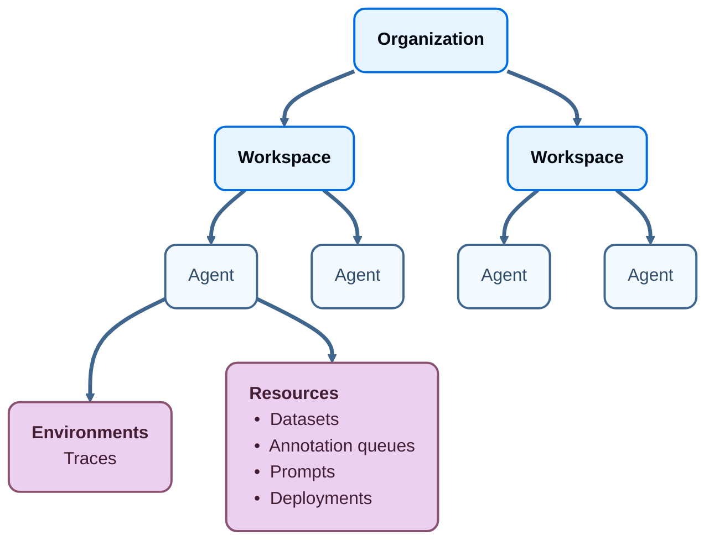

import OrgWorkspaceRole from '/snippets/python/langsmith/multi-workspace-org-roles.mdx';
import PermissionReference from '/snippets/python/langsmith/permissions-reference.mdx';

本概览页介绍在 LangSmith 中管理用户、组织、工作区和 agents 的相关主题。

## 资源层级

LangSmith 在四个层级上组织访问权限和数据。[组织](#organizations)包含工作区。每个[工作区](#workspaces)包含 agents。[Agents](#agents)按环境组织你的 traces，并对你要使用的[资源](#resources)进行分组，例如 datasets 和 prompts。

自托管 LangSmith 按应用而不是按 agent 对资源分组。详情请参阅[自托管工作区](#self-hosted-workspaces)。

下图展示了组织、工作区、agents、环境和资源之间的关系：

### Organizations

组织是 LangSmith 中用于聚合用户的逻辑单元，它定义了作用于该组织内所有工作区的共享设置。这些设置面向组织级事务，而不是某个工作区内的 agents 和资源。常见的组织级配置包括用户管理、单点登录（SSO）、OAuth provider 配置、自定义角色创建、计费和用量追踪。

通常一个公司对应一个组织。一个组织可以拥有多个工作区。关于配置细节，请参阅[设置组织](/langsmith/set-up-hierarchy#set-up-an-organization)。

当你第一次登录时，系统会自动为你创建一个个人组织。如果你想与其他人协作，可以额外创建一个独立组织，并邀请团队成员加入。个人组织和共享组织之间有几个重要区别：

| Feature             | Personal            | Shared                                                                                       |
| ------------------- | ------------------- | -------------------------------------------------------------------------------------------- |
| Maximum workspaces  | 1                   | 取决于方案，数量可变（参见[定价页面](https://www.langchain.com/pricing)） |
| Collaboration       | Cannot invite users | Can invite users                                                                             |
| Billing: paid plans | Developer plan only | All other plans available                                                                    |

### Workspaces

<Info>
Workspaces 之前曾被称为 Tenants。在过渡期间，某些代码和 API 中可能仍会引用旧名称。
</Info>

工作区是组织内部用于聚合用户、agents 和[资源](#resources)的逻辑单元。工作区通常用于隔离不同业务单元，使每个业务单元的 agents 和资源与其他业务单元保持分离。

工作区为资源和访问控制划分了信任边界。用户在工作区级别被授予权限，这些权限决定他们可以访问该工作区中的哪些资源，包括 datasets、annotation queues 和 prompts。关于如何配置工作区，请参阅[设置工作区](/langsmith/set-up-hierarchy#set-up-a-workspace)；关于权限细节，请参阅[工作区角色](#workspace-roles)。

<Tip>
为组织中的每个团队创建独立工作区。若想进一步组织资源，可以在工作区内按 [agent](#agents) 继续分组。

关于不同工作区组织模型以及如何根据团队的隔离要求进行选择，请参阅 [Workload isolation](/langsmith/workload-isolation)。
</Tip>

### Agents

[Agent](/langsmith/agent-registry#agent) 是工作区内对资源的逻辑分组，位于工作区之下一层。这种分组通过只展示当前上下文中与该 agent 相关的资源，帮助 UI 保持整洁。agent 的 traces 还会进一步划分到一组固定的四种[环境（environment）](/langsmith/agent-environments)中。

在顶栏的 agent 切换器中选择某个 agent，或选择 **All agents**。更多信息请参阅 [Navigate agents](/langsmith/navigate-agents)。

LangSmith 通过 agent 的环境把 traces 关联到该 agent，并使用保留的 `Agent` [资源标签](#resource-tags) key 把 datasets、prompts、annotation queues 和 deployments 关联到该 agent。

Tracing 页面要求你先选择一个 agent。Datasets、prompts、annotation queues 和 deployments 可以在没有 agent 的情况下存在。选择 **All agents** 会显示这些未关联的资源以及所有 agent 的资源；选择某个具体 agent 则只显示该 agent 的资源。

### Resources

资源是用于构建、运行和观察 agents 的具体实体。示例包括 [prompts](/langsmith/prompt-context-hub)、[datasets](/langsmith/manage-datasets)、[annotation queues](/langsmith/annotation-queues) 和 [deployments](/langsmith/deploy-overview)。资源可以归属于某个具体的 agent。

### 设置所在位置

下表给出了不同功能分别在哪些作用域中可用：

| Resource/Setting                                                            | Scope            |
| --------------------------------------------------------------------------- | ---------------- |
| Trace Projects                                                              | Workspace 或 agent  |
| Annotation Queues                                                           | Workspace 或 agent  |
| Deployments                                                                 | Workspace 或 agent  |
| Datasets & Experiments                                                      | Workspace 或 agent  |
| Prompts                                                                     | Workspace 或 agent  |
| [Resource Tags](#resource-tags)                                             | Workspace                       |
| API Keys                                                                    | Workspace                       |
| Settings，包括 Secrets、Feedback config、Models、Rules 和 Shared URLs      | Workspace                       |
| 用户管理：邀请用户加入工作区                                                | Workspace                       |
| RBAC：分配工作区角色                                                        | Workspace                       |
| 数据保留、用量上限                                                          | Workspace\*                     |
| 方案与计费、积分、发票                                                      | Organization                    |
| 用户管理：邀请用户加入组织                                                  | Organization\*\*                |
| 添加工作区                                                                  | Organization                    |
| 分配组织角色                                                                | Organization                    |
| RBAC：创建/编辑/删除自定义角色                                              | Organization                    |

<Info>
\* 未来数据保留设置和用量上限也会支持组织级别。

\*\* 自托管安装可以通过 feature flag 启用由工作区级别发起的组织邀请。更多信息请参阅[自托管用户管理文档](/langsmith/self-host-user-management)。
</Info>

### 资源标签

资源标签允许你在工作区内进一步分隔资源，并配合 [ABAC](/langsmith/organization-workspace-operations#access-policies) 使用。每个标签都是一个 key-value 对，可以分配给某个资源。

LangSmith 的资源标签与云服务（例如 [AWS](https://docs.aws.amazon.com/tag-editor/latest/userguide/tagging.html)）中的标签概念非常相似。

在 [LangSmith UI](https://smith.langchain.com?utm_source=docs&utm_medium=cta&utm_campaign=langsmith-signup&utm_content=langsmith-administration-overview) 中进入 **Settings**，然后在侧栏选择 **Resource tags** 页面。

### 环境隔离

环境是发布流程中的一个阶段，例如开发、暂存或生产。Agents 内置了环境，来自一组固定的四种。[Agent](/langsmith/agent-registry#agent) 会将其 traces 划分到这些环境中，因此不需要任何标签约定。更多信息请参阅 [Agent environments](/langsmith/agent-environments)。

自托管 LangSmith 则使用资源标签进行环境隔离。详情请参阅[自托管工作区](#self-hosted-workspaces)。

无论哪种情况，都请避免为环境隔离使用独立工作区，因为资源无法跨工作区共享，这会导致你无法在不同环境间推广资源（例如 prompts）。

<Note>
**用于 prompt 管理时，资源标签与 commit tags 的区别**

虽然这两类标签都可以使用 `dev`、`staging`、`prod` 之类的环境术语，但它们用途不同：

- **资源标签**（`Environment: prod`）：用于在工作区内*组织*资源。你可以把资源标签应用到 tracing projects、datasets 以及其他资源（包括 prompts），从而按环境进行归组。
- [Commit tags](/langsmith/manage-prompts#commit-tags)（`prod` 标签）：用于管理代码引用的是哪个 [prompt 版本](/langsmith/prompt-context-hub#prompts)。Commit tags 是指向 prompt 历史中某次具体 commit 的标签。当你的代码按标签名拉取 prompt（例如 `client.pull_prompt("prompt-name:prod")`）时，它会获取当前该标签所指向的那次 commit。若要把某个 prompt 从 `staging` 推进到 `prod`，只需把 commit tag 移动到目标版本即可。

资源标签用来组织**哪些资源**属于某个环境。Commit tags 则让你可以控制代码引用的是 prompt 的**哪个版本**，而无需修改代码本身。
</Note>

### 自托管工作区

自托管 LangSmith 使用基于 project 的工作区，这类工作区按应用而不是按 agent 对资源分组。一个应用可以对团队中的任意项目进行分组。你可以在侧栏顶部的 **Application** 下拉框中选择某个应用，也可以选择 **All applications** 查看工作区中的所有资源。

基于 project 的工作区使用[资源标签](#resource-tags)进行环境隔离：默认标签 key 为 `Environment`，每个环境使用不同的值（例如 `dev`、`staging`、`prod`）。

要确认你的工作区属于哪种类型，请参阅[基于 agent 的工作区有哪些差异](/langsmith/migrate-to-agent-based-workspaces#check-which-one-you-have)。

## 用户与角色

本节介绍谁可以访问 LangSmith 以及他们可以执行哪些操作：用户、三种 API key，以及授予权限的角色。

### Users

用户是指可以访问 LangSmith 的人。一个用户可以同时属于一个或多个组织，以及这些组织中的一个或多个工作区。

在 **Settings** 页面管理成员，该页面为组织和工作区分别提供了独立区域：

- **Organization** > **Members**：管理组织成员。
- **Workspace** > **Members**：管理当前工作区的成员。

### API keys

LangSmith API key 用于对发往 LangSmith 的请求进行认证。它们不同于你的应用调用模型时使用的模型提供商密钥，例如 OpenAI 或 Anthropic 密钥。

<Warning>
我们已在 2024 年 10 月 22 日停止支持以 `ls__` 开头的旧版 API keys，转而使用 personal access tokens（PATs）和 service keys。所有新的集成都必须使用 PATs 和 service keys。以 `ls__` 开头的 API keys 自 2024 年 10 月 22 日起将不再可用。
</Warning>

#### 过期时间

创建 API key 时，你可以选择设置过期时间。给 key 增加过期时间有助于提升安全性，并降低未授权访问的风险。例如，你可以为某些需要临时提升权限的任务所使用的 key 设置过期时间。

一旦过期，API key 将失效，不能重新激活，也无法修改其过期时间。

#### Personal access tokens (PATs)

Personal Access Tokens（PATs）用于对 LangSmith API 请求进行认证。它们由用户创建，作用域绑定到用户。PAT 的权限与创建它的用户权限相同。

PATs 以前缀 `lsv2_pt_` 开头。

成员可以停用、重新启用或删除自己的 PAT。[Organization Admins](/langsmith/rbac#organization-admin) 和 [Organization Operators](/langsmith/rbac#organization-operator) 还可以列出、停用、重新启用以及删除任意成员的 PAT。

停用 token 会使其停止认证，但会保留其记录，且记录、所有者和最近使用时间会带着 **Deactivated** 徽标继续可见。停用是可逆的；删除则会永久移除记录。重新启用会保留原始过期时间，一旦过期时间已过便无法再启用。由于认证结果会被缓存，这些更改会在一分钟内生效，而不是立即生效。

关于具体步骤和认证缓存时间，请参阅[停用或删除 personal access token](/langsmith/create-account-api-key#deactivate-or-delete-a-personal-access-token)。

<Tip>
避免使用 PAT 认证应用发出的请求。请改为将 PAT 用于与 LangSmith API 交互的个人脚本或工具。如果与该 PAT 关联的用户被移出组织，该 PAT 将不再有效。
</Tip>

#### Service keys

Service keys 与 PATs 类似，但它们用于代表 service account 对 LangSmith API 发起认证。Organization Admins 可以创建任意 service key。Organization Operators 和 Organization Users 可以在角色授予 `workspaces:manage-keys` 的工作区（例如 Workspace Admin）中创建作用域为工作区的 service keys。完整说明请参阅 [API keys 操作](/langsmith/organization-workspace-operations#api-keys)。建议将其用于需要与 LangSmith API 交互的应用或服务，例如 LangGraph agents 或其他集成。

Service keys 可以作用于单个工作区、多个工作区或整个组织。你可以用它们为有权访问的任意工作区认证 LangSmith API 请求。

Service keys 以前缀 `lsv2_sk_` 开头。

Service keys 只能删除，不能停用。

<Warning>
请使用 `X-Tenant-Id` header 指定目标工作区。

- **使用 PATs 时**：如果省略该 header，请求会默认落到该 key 关联的默认工作区。
- **使用组织级 service key 时**：访问工作区级资源时必须包含 `X-Tenant-Id` header。否则请求会以 `403 Forbidden` 失败。
</Warning>

<Note>
如需创建任意类型的 API key，请参阅[创建账户和 API key](/langsmith/create-account-api-key)。
</Note>

#### Tracing keys

Tracing keys 是组织所有的凭证，具有固定权限，可在选定的工作区中提交 traces 并创建项目。它们不授予访问已存储的 traces、实验、保存的视图或管理功能的权限。

Tracing keys 使用 `lsv2_tr_` 前缀。其作用域在创建时固定，并且在创建者离开组织后仍然有效。它们遵循 service key 的过期限制。有关创建权限、作用域限制和删除规则，请参阅 [Tracing keys](/langsmith/create-account-api-key#tracing-keys)。

### Roles

每个用户拥有一个组织角色，它应用于整个组织。在 Enterprise 方案中，每个用户在其所属的每个工作区中还各有一个工作区角色。两者都在 **Settings** > **Roles** 中管理。更多信息请参阅[基于角色的访问控制](/langsmith/rbac)。

#### Organization roles

你的组织角色决定了你的[组织级权限](/langsmith/organization-workspace-operations)和工作区成员资格。组织角色与[工作区角色](#workspace-roles)（Enterprise 功能）相互独立，并应用于组织中的所有工作区。

每个组织角色对工作区成员资格的影响如下：

- [Organization Admin](/langsmith/rbac#organization-admin) 角色授予用户管理所有组织配置、用户、计费和工作区的完整权限。
    - Organization Admin 自动拥有该组织中所有工作区的 `Admin` 访问权限。
- [Organization Operator](/langsmith/rbac#organization-operator) 角色授予用户面向日常运营的工作区和非管理员用户管理权限，但不包含管理员级别权限，例如管理 Organization Admins。
    - Organization Operator 只会被添加到其创建或被邀请的工作区。
- [Organization User](/langsmith/rbac#organization-user) 角色授予用户读取组织信息的权限。但用户不能在组织级别执行任何写操作。Organization User 可以创建 [Personal Access Tokens](#personal-access-tokens-pats)。
    - 如果启用了 RBAC，Organization User 可以像往常一样被添加到部分工作区，并被分配工作区角色，这些角色决定其工作区级别权限。
- [Organization Viewer](/langsmith/rbac#organization-viewer) 角色与 Organization User 等同，但拥有该角色的用户**不能**创建 Personal Access Tokens。自托管安装需要 Helm chart 0.11.25 或更高版本才能使用该角色。
- [Organization Restricted](/langsmith/rbac#organization-restricted) 角色授予用户访问其被分配的工作区，但没有组织范围的读取权限，因此该用户不能列出组织成员。作用域为工作区的 service keys 也可以持有该角色。

<Info>
<OrgWorkspaceRole/>

如需禁用整个组织的 PAT 创建，请参阅[安全设置](/langsmith/manage-organization-by-api#security-settings)。
</Info>

如需进一步了解如何设置组织和工作区，请参阅[组织设置指南](/langsmith/set-up-hierarchy#organization-roles)。

按角色划分的组织级权限：

|                                             | Organization Restricted | Organization Viewer | Organization User | Organization Operator | Organization Admin |
| ------------------------------------------- | ----------------------- | ------------------- | ----------------- | --------------------- | ------------------ |
| 查看组织配置                                | ✅                       | ✅                   | ✅                 | ✅                     | ✅                  |
| 查看组织角色                                | ✅                       | ✅                   | ✅                 | ✅                     | ✅                  |
| 查看组织成员                                | ❌                       | ✅                   | ✅                 | ✅                     | ✅                  |
| 查看数据保留设置                            | ❌                       | ✅                   | ✅                 | ✅                     | ✅                  |
| 查看用量上限                                | ❌                       | ✅                   | ✅                 | ✅                     | ✅                  |
| 创建 personal access tokens（PATs）         | ❌                       | ❌                   | ✅                 | ✅                     | ✅                  |
| 查看、停用、重新启用以及删除任意成员的 PATs | ❌                       | ❌                   | ❌                 | ✅                     | ✅                  |
| 对所有工作区拥有 Admin 访问权限             | ❌                       | ❌                   | ❌                 | ❌                     | ✅                  |
| 管理计费设置                                | ❌                       | ❌                   | ❌                 | ✅                     | ✅                  |
| 创建工作区                                  | ❌                       | ❌                   | ❌                 | ✅                     | ✅                  |
| 创建、编辑和删除组织角色                    | ❌                       | ❌                   | ❌                 | ✅                     | ✅                  |
| 邀请新用户加入组织                          | ❌                       | ❌                   | ❌                 | ✅\*                   | ✅                  |
| 删除用户邀请                                | ❌                       | ❌                   | ❌                 | ✅\*                   | ✅                  |
| 将用户移出组织                              | ❌                       | ❌                   | ❌                 | ✅\*                   | ✅                  |
| 更新数据保留设置                            | ❌                       | ❌                   | ❌                 | ✅                     | ✅                  |
| 更新用量上限                                | ❌                       | ❌                   | ❌                 | ✅                     | ✅                  |

\* Organization Operators 不能邀请 Organization Admins，也不能移除他们或删除其邀请。

<PermissionReference/>

#### Workspace roles

<Note>
RBAC（Role-Based Access Control）仅适用于 Enterprise 客户。如果你对该功能感兴趣，请[联系销售团队](https://www.langchain.com/contact-sales)。其他方案默认所有用户都使用 Admin 角色。
</Note>

在 Enterprise 方案中，工作区角色定义用户在工作区内拥有的权限。系统内置了三个不可编辑的工作区角色：

- [Workspace Admin](/langsmith/rbac#workspace-admin) 对工作区中的所有资源拥有完整访问权限。
- [Workspace Editor](/langsmith/rbac#workspace-editor) 可以创建、编辑和删除大多数资源，但不能删除 runs、更改工作区设置或管理工作区成员。
- [Workspace Viewer](/langsmith/rbac#workspace-viewer) 对工作区中的所有资源拥有只读访问权限。

[Organization Admins](/langsmith/rbac#organization-admin) 还可以创建和编辑自定义角色，为不同资源配置特定权限。

<Tip>
若要一次性为一个团队在多个工作区中分配角色，请创建[用户组](/langsmith/user-groups)。
</Tip>

## 使用量与计费

关于 trace 保留期、速率限制和使用量限制，请参阅[使用量与计费](/langsmith/usage-and-billing)。如需管理发票和支出，请参阅[管理计费](/langsmith/billing)。

## 另请参阅

* **[Release policy](/langsmith/release-versions)**：了解自托管发布通道、发布节奏以及版本编号规则。

---

<Callout icon="terminal-2">
    [Connect these docs](/use-these-docs) to your agent of choice via MCP for real-time answers.
</Callout>
<Callout icon="edit">
    [Edit this page on GitHub](https://github.com/langchain-ai/docs/edit/main/src/langsmith/administration-overview.mdx) or [file an issue](https://github.com/langchain-ai/docs/issues/new/choose).
</Callout>

