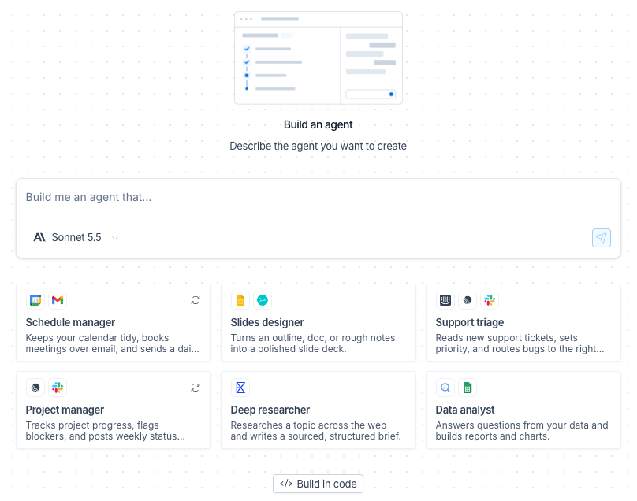
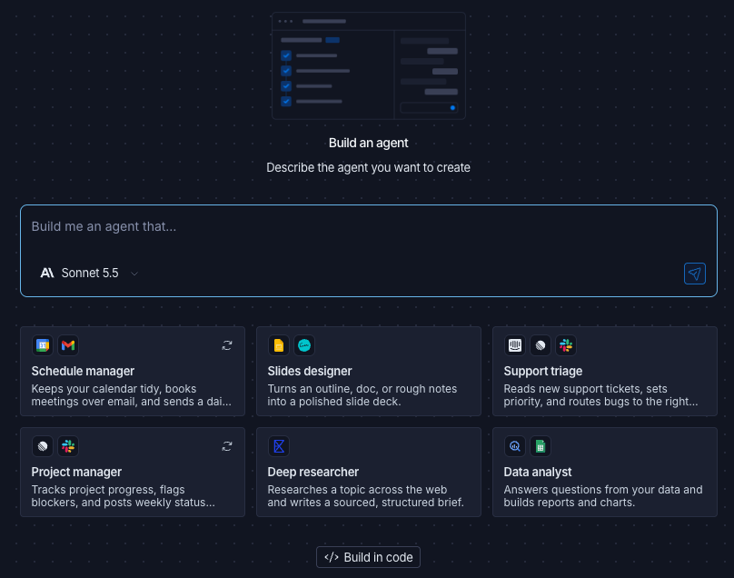

import AgentAvailabilityNote from '/snippets/python/langsmith/agent-availability-note.mdx';

LangSmith Studio 根据一段描述构建 no-code agent。你描述 agent 应该做什么，[LangSmith Chat](/langsmith/chat) 起草其配置，你在保存前逐步审阅。随后你测试该 agent 并查看其 traces，无需离开 Studio。

当你想要一个不需要本地项目或 deployment 就能使用的 agent 时，可以使用它。如果你想改为从自己机器上的文件构建 agent，请参阅 [Managed Deep Agents](/langsmith/python/managed-deep-agents-overview)。它的产物是一个普通的 [agent](/langsmith/agent-registry#agent)，因此其 traces、dashboards 和 evaluators 的行为与你自行 instrument 的 agent 相同。Studio 构建的 no-code agent 与 [Fleet](/langsmith/fleet) 属于同一类型，因此 Fleet 中关于 tools、channels、schedules 和 skills 的页面同样适用于它。

<AgentAvailabilityNote />

创建 agent 需要 `fleet-agents:create` [权限](/langsmith/fleet/access-and-oversight)，该权限涵盖所有 no-code agent，包括在 Studio 中构建的 agent。没有该权限时，Studio 会显示 "Ask a workspace admin for permission to create agents."。

## 开始新建 agent

可以从以下两处打开 **Build an agent** 屏幕：

- **Studio**：在左侧导航中选中 **All agents** 后点击 **Studio**，然后点击 **Build a new agent**。
- **New agent menu**：在[新 agent 菜单](/langsmith/create-an-agent#start-from-the-new-agent-menu)中，在 **Build** 下点击 **Without code**。

## 描述 agent

要描述 agent：

1. 在显示 "Build me an agent that…" 的输入框中，描述 agent 应该做什么，最多 8,000 个字符。要从示例开始，可以改为点击一张模板卡片：**Schedule manager**、**Slides designer**、**Support triage**、**Project manager**、**Deep researcher** 或 **Data analyst**。每张卡片都会列出其 agent 使用的应用。卡片会填充提示词，你可以在发送前编辑它。
1. （可选）从输入框左下角的模型菜单中选择 Chat 用于起草该 agent 的模型。**Auto** 在可用时使用 LangSmith 托管的模型。否则，菜单会以你的 workspace 的 Chat 默认模型为初始选项。此选择仅适用于 Chat。agent 自身的 model 在 [Basics 步骤](#configure-the-agent)中设置。
1. 点击 **Build with AI** <Icon icon="send"/> 图标。

要改为用代码构建 agent，请点击模板卡片下方的 **Build in code**。它会打开 **Build with code** 面板，其中提供由 LangSmith 托管的 [Managed Deep Agents](/langsmith/python/managed-deep-agents-overview)，或由你自行托管开源框架。更多信息，请参阅 [Create an agent](/langsmith/create-an-agent#start-from-the-new-agent-menu)。

## 生成草稿

Chat 会先起草 agent 的名称、描述和 instructions。这三项全部填写完成后，LangSmith 创建该 agent，并在 **Instructions** 步骤打开其配置。

<Note>
agent 从这一刻起就已存在，早于你点击 **Save**。它会出现在 workspace 中所有人的 agent 列表和 agent 切换器里。如果你没有点击 **Cancel** 就离开页面，该 agent 会留在 workspace 中。要移除它，请参阅[保存或取消](#save-or-cancel)。
</Note>

如果 Chat 在名称、描述和 instructions 填写完成前就停止，请点击 **Retry** 重新发送你最初的提示词。**Retry** 只在 agent 创建之前出现，因此重试不会创建第二个 agent。

随后 Chat 会逐步建议剩余的步骤：connections、channels 和 schedules。你也可以直接编辑任意步骤。

## 配置 agent

**Configure agent** 视图以步骤形式列出配置：

- **Basics**：agent 的 **Name**、描述其用途的 **Description**，以及为其响应提供动力的 **Model**。名称就是你在 agent 切换器中看到的标签。**Model** 列表显示的模型与 [Fleet](/langsmith/fleet/manage-agent-settings#change-the-model) 中启用的模型相同。
- **Instructions**：agent 应该做什么以及它应该如何工作。
- **Connections**：agent 可以使用的应用和 tools，通过 **Add connection** 添加。详细信息在列表之后。
- **Channels**：人们可以与 agent 对话的地方，通过 **Add channel** 添加。选项包括 Slack、Gmail、Outlook 和 Microsoft Teams。Microsoft Teams 带有 **Admin** 标记，且仅对使用共享连接的 agent 可用。Studio 会将 channel 设置与其余配置分开保存。更多信息，请参阅 [Channels](/langsmith/fleet/channels)。
- **Schedules**：agent 自行进行的 [scheduled runs](/langsmith/fleet/schedules)，通过 **Add schedule** 添加。

编辑已有 agent 时，该视图还会显示 **Skills** 和 **Memory**。更多信息，请参阅 [Skills](/langsmith/fleet/skills)。

在 **Connections** 中，**Connection Type** 标题显示 agent 使用的是谁的账号：

- **Shared**（固定凭证）：所有人使用同一组已连接的账号。
- **Per-user**（用户凭证）：每个人连接自己的账号。

Studio 会将新 agent 创建为 **Per-user**。该标题只显示类型，不会更改类型。更多信息，请参阅 [Agent identity](/langsmith/fleet/agent-identity)。

账号设置会立即生效，而 tool 选择会保留在草稿中直到你保存。对于每个 tool，选择一个选项：

- **Auto**：agent 直接运行该 tool，不询问。
- **Ask**：agent 在运行该 tool 前请求批准。
- **Remove**：该 tool 从 agent 中移除。

## 保存或取消

要保存，请点击 **Configure agent** 标题栏中的 **Save**，或 Chat 输入框上方卡片上的 **Save agent**。该卡片仅在有待保存内容时出现。保存会关闭 Chat 并返回 Studio，你可以在那里测试该 agent。

要在不保留 agent 的情况下离开，请点击 **Cancel**。由于 agent 已经存在，**Cancel agent creation?** 对话框会要求你确认：

- **Delete agent**：永久删除该 agent 并丢弃其配置。
- **Keep building**：返回配置。

如果你在 Chat 完成第一版草稿之前取消，对话框会提供 **Discard and leave** 而不是 **Delete agent**，且不会创建任何内容。

## 测试 agent

保存后，Studio 会打开与该 agent 的聊天。给它发送一条消息试用一下。agent 响应时，聊天旁的 traces 面板会填入本次 run 的 traces。

在 Studio 中，你通过聊天测试 no-code agent，因此 **Interact**（需要带有 graph 视图的 agent）对它不可用。

## 之后更改配置

编辑 agent 需要 `fleet-agents:update` [权限](/langsmith/fleet/access-and-oversight)以及该 agent 的编辑权限。缺少这些权限时，配置会以 **Read-only configuration** banner 打开。

要在 Studio 中打开已有 agent，请使用以下任一方式：

- 在左侧导航中选中 **All agents** 后点击 **Studio**，点击 **Select existing agent**，然后从列表中选择该 agent。
- 在 agent 切换器中选中该 agent，然后在左侧导航中点击 **Studio**。

要编辑 agent 的配置，请使用以下任一控件：

- 在 Studio 聊天中，点击 <Icon icon="pencil"/> **Edit**。
- 在该 agent 的 Overview 上，点击 **Agent settings** <Icon icon="settings"/> 图标，然后点击 **Edit configuration**。

两者都会在 **Basics** 步骤打开配置。进行更改并点击 **Save**。**Cancel** 会丢弃这些更改并返回 Studio。

如果你在 LangSmith 的其他位置要求 Chat 更改该 agent，它会提议在 Studio 中打开配置，并保留该对话。

## 查找 traces 和 environments

Studio 创建该 agent 时只带有 **Production** 这一个 [environment](/langsmith/agent-environments)，它的 runs 会落在那里。只有当有内容上报到其他 environment 时，它才会获得这些 environment。

要查找该 agent 的 traces，请选中该 agent 并打开 **Tracing**。要查看它的 environments，请阅读 [agent Overview](/langsmith/navigate-agents#read-the-agent-overview) 上的摘要。

LangSmith 会替你运行该 agent，因此它没有 deployment。它的 Overview 上没有 **Deployments** 部分，你也不能为它创建 deployment，因此 [agent environment deploy flags](/langsmith/deploy-to-agent-environment) 对它不适用。选中该 agent 时，Deployments 只显示所选 agent 的 deployments，因此它是空的。

## 继续阅读

- [Test from Studio](/langsmith/studio)
- [Create an agent](/langsmith/create-an-agent)
- [Navigate agents](/langsmith/navigate-agents)
- [Agent Registry](/langsmith/agent-registry)
- [Agent environments](/langsmith/agent-environments)
- [Fleet](/langsmith/fleet)

---

<Callout icon="terminal-2">
    [Connect these docs](/use-these-docs) to your agent of choice via MCP for real-time answers.
</Callout>
<Callout icon="edit">
    [Edit this page on GitHub](https://github.com/langchain-ai/docs/edit/main/src/langsmith/build-an-agent.mdx) or [file an issue](https://github.com/langchain-ai/docs/issues/new/choose).
</Callout>

