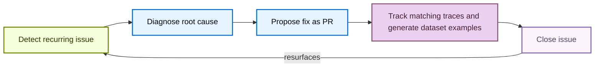

LangSmith Engine 是 LangSmith 面向 agent engineering 的 agent。它基于你的生产 trace 工作，发现反复出现的问题、诊断其根因并提出修复方案，让你无需手动翻查 trace 就能交付更可靠的 agent。首先，请为一个 tracing project [设置 Engine](/langsmith/engine-setup)。

## Engine across the lifecycle

对于每个问题，Engine 会呈现相关的 traces、提出修复方案，通过附加匹配同一失败模式的新 traces 让问题保持最新，并根据生产 trace 输入创建 ground truth dataset examples。

<CardGroup cols={3}>
  <Card title="Build: Open a pull request" icon="git-pull-request" href="/langsmith/engine-issues#open-a-pull-request">
    在你已连接的仓库中创建 pull request，以应用建议的修复方案。Engine 可以为基于 Deep Agents、LangChain 和 LangGraph 构建的 agent 提出代码修改建议。
  </Card>
  <Card title="Test: Generate datasets" icon="database" href="/langsmith/engine-issues#add-offline-examples">
    根据生产 traces 创建 ground truth dataset examples 用于离线评估，让你在修复上线前验证它。
  </Card>
  <Card title="Monitor: Track recurring issues" icon="chart-line" href="/langsmith/engine-issues#filter-and-sort-issues">
    按计划扫描你的 tracing projects，发现、排列优先级并诊断反复出现的问题，并在出现新的匹配 traces 时将它们附加到对应问题。
  </Card>
</CardGroup>

## How Engine differs from Insights

Engine 和 [Insights](/langsmith/insights) 都会分析你的 traces，但它们回答的是不同的问题：

- **Insights** 是一个分析工具。它把 traces 分组为类别（由它自动生成或由你定义），并报告每个类别的指标，让你了解使用模式及其变化。
- **Engine** 寻找需要修复的具体问题。它创建的每个问题都附带诊断、支撑该诊断的 traces，以及建议的修复方案。

用 Insights 了解用户如何使用你的 agent。用 Engine 查明哪里出了问题以及应该改什么。

## Engine 的工作方式

Engine 会按照为平衡成本和性能而调整的动态调度扫描每个已连接的 tracing project，并按严重性对其发现的问题进行聚类和优先级排序。

### The issue lifecycle

每个问题都会经历一个闭环，在这个闭环中 Engine 会：

1. 在你的 trace 中检测到重复出现的问题。
2. 对照你的 trace 和已连接的源代码诊断根因。
3. 以 pull request 形式提出修复方案。
4. 随时间持续跟踪该问题，自动添加匹配同一模式的新 traces，并生成 ground truth [dataset examples](/langsmith/manage-datasets)，以便你验证修复方案。参见[查找并修复问题](/langsmith/engine-issues)。
5. 如果问题在关闭后再次出现，则自动重新打开它。

### How Engine selects traces

Engine 在为每次扫描选择和排序 trace 时，会同时分析 trace 内容和 run feedback。它把 feedback（包括 online evaluator 分数、annotation queue 分数，以及通过 SDK 提交的用户 feedback）视为高优先级信号，而非补充数据。

为了应用这一信号，Engine 会：

- 读取你项目中存在的 feedback key，并为每个 key 专门拉取低分 trace，使样本中包含 evaluator 分数较差的 trace，而不是听凭按时间近度取舍。
- 在筛查样本时，把带有非空 feedback 分数的 trace 排在其他 trace 之前。
- 在分析 context 中的每条 trace 上都保留 feedback 分数，即使 trace payload 因需要适配 context 限制而被压缩。

任何向 run 写入 feedback 的来源都会自动参与这一优先级判断。Engine 无需在 evaluators 或 annotation queues 之外进行任何额外设置。

### How Engine learns from your feedback

Engine 会随着你处理问题而变得越来越准确。在每次计划扫描中，它会审查你自上次扫描以来在问题上执行的操作，并将每个操作转化为该 project 的 [agent overview](/langsmith/engine-setup#give-context-on-your-agent) 中 **User Preferences** 部分的一条通用规则。后续扫描会使用这些规则来决定标记什么以及如何排列优先级。

Engine 会从这些操作中学习，包括你随操作给出的原因：

- **关闭问题**或将其标记为 **Incorrectly Flagged**：Engine 会把这类问题视为更低的优先级。
- **更改问题的优先级**：Engine 会记录该类别问题对你的 agent 的严重程度。
- **打开 pull request**：Engine 会记录该类别是真实的，且值得提出修复方案。

例如，假设你的 agent 处理支付，Engine 把一条包含完整信用卡号的 trace 标记为未脱敏的个人身份信息（PII）。你的 agent 在设计上就会处理卡号，因此你将问题标记为 **Incorrectly Flagged**，并注明原因 "This agent processes card numbers as part of checkout"。Engine 会记录支付流程中的卡号属于预期行为。如果你持续忽略同一类别的问题，Engine 会一次一个级别地调低该类别的严重性。它不会降到 low 以下，因此该模式仍然可见，又不会挤占紧急问题。

来自自动化的变更（例如 pull request 合并）以及通过 [LangSmith Chat](/langsmith/chat#engine) 执行的操作不计为反馈。要审阅或修正 Engine 学到的内容，请编辑 agent overview 的 **User Preferences** 部分。

## Why connect GitHub

连接 GitHub 仓库是可选的，但当 Engine 能读取你的源代码时，它会找到更多问题，而且是更有用的问题。有了源代码访问权限，Engine 能定位失败 trace 背后的代码路径，并让诊断和修复建议扎根于你的实际实现。即使你从不合并 Engine 的 pull request，这一点也成立：你可以自己应用修复，或把修复上下文复制给你的 coding assistant。

Engine 的 GitHub 访问权限是固定的。通过 GitHub App，Engine 可以：

- **读取**你安装该 app 时选择的仓库。
- 从它创建的修复分支**打开草稿 pull request**。

Engine 永远不会合并 pull request。它提出的每一项更改都要经过你的审查和分支保护规则，你随时可以通过卸载该 app 撤销访问权限。关于 token 有效期、sandboxing 和保留策略，请参阅 [Engine security](/langsmith/engine-security#github-integration)。要连接仓库，请参阅[将 Engine 连接到你的仓库](/langsmith/engine-repositories)。

## Manage Engine costs

### Understand LSU costs

<Note>
LangSmith Cloud 使用 LangChain-managed inference。自托管部署也可以使用[自己的 model providers](/langsmith/engine-self-hosted-model-providers)，通过 API key 或云身份认证。[BYOC](/langsmith/engine-self-hosted#engine-on-byoc) 部署仅使用自己的 model providers。使用自己的 providers 时，模型调用由它们收费，而 LangChain 对 Engine 用量收取更低的 LSU 费率。
</Note>

Engine 按 **LangChain Standard Units (LSUs)** 收费。LSU 是一种标准化工作量单位，覆盖计算、存储和内存，并在 LangChain 提供模型时包含模型推理。LSU 消耗量随被分析的 trace 数量、Engine 为诊断和修复问题而发起的 LLM 调用的数量与复杂度，以及任何已连接仓库的大小而变化。每个 LSU 的价格是 **1 美元**。如需估算你预期的 LSU 用量，请参阅 [LangSmith Usage Calculator](https://www.langchain.com/pricing#pricing-calc)。

在初始化阶段，Engine 会审计历史 trace，按严重性聚类并排序问题优先级，并对你的 prompt 或代码提出修复建议，如果已连接代码仓库。后续的定期扫描按照为平衡成本和性能而调整的动态调度运行，无论是否发现新问题，都会展示此前未检测到的新问题。

### Set the analysis level

分析级别控制 Engine 分析你项目中多少比例的 trace，也就是使用多少 LSU。在[为 project 打开 Engine](/langsmith/engine-setup#turn-on-engine-for-a-tracing-project) 时选择它，之后可以在 [**Engine settings**](/langsmith/engine-setup#configure-engine) 面板的 **Analysis level** 下更改：

- **Reduced**：以更低的成本监控更少的 trace。
- **Standard**（默认）：分析更多符合条件的 trace，覆盖更全面。
- **Expanded**：面向高流量 project 的最大覆盖。仅对有足够 tracing 体量的 project 可用。

Setup 对话框会显示一个随所选级别更新的月度成本估算区间。

### Set spend limits and monitor usage

Organization Admin 可以在两个层级设置支出上限：

- **Org-wide limit**：打开 **Settings**，在 **Engine** 下选择 **Engine**。在当月至今支出卡片上，点击限额 chip，然后在弹出框中设置限额。
- **Project 或 environment limit**：打开 tracing project 或 agent environment 中的 **Engine** 标签页，点击 **Configure Engine** <Icon icon="settings"/> 图标。在 **Spend limit** 下，点击限额 chip（未设置限额时 chip 显示 **None**），然后在弹出框中设置限额。

你可以用 LSU 或 USD 输入上限，1 LSU = $1。当达到限制后，LangSmith 会暂停新的 Engine 运行，直到你提高限制，或下一个月度计费周期开始。

两个层级的默认行为不同：

- **Org-wide limit**：可以选择 **Default**、**No limit** 或自定义上限。在管理员做出选择之前，默认值会生效（每月 750 LSU，即 $750），因此即使没有人设置过限额，Engine 支出也会被限制。**Engine** 设置页面会显示当前生效的限额及其来源。
- **Project 或 environment limit**：将弹出框中的字段留空即表示不限制。使用 **Remove limit** 可以清除之前设置的上限。

要为某个 project 或整个组织停止 Engine，请参阅[暂停 Engine 或删除其问题](/langsmith/engine-setup#pause-engine-or-delete-its-issues)。

如需监控用量，你可以在 **Settings** 中的 **Engine** 页面查看整个组织的月度 LSU 支出，或在 tracing project 或 agent environment 的 [**Engine settings**](/langsmith/engine-setup#configure-engine) 面板中查看其支出。

对于离线的自托管部署，支出报告和限额执行方式有所不同。请参阅 [Air-gapped installations](/langsmith/engine-self-hosted#air-gapped-installations)。

## Get started

<CardGroup cols={2}>
  <Card title="Set up Engine" icon="settings" href="/langsmith/engine-setup">
    为组织启用 Engine，并为 tracing project 或 agent environment 打开它。
  </Card>
  <Card title="Find and fix issues" icon="bug" href="/langsmith/engine-issues">
    审阅 Engine 检测到的问题、打开 pull request 并创建 dataset examples。
  </Card>
  <Card title="Connect Engine to your repository" icon="brand-github" href="/langsmith/engine-repositories">
    让 Engine 读取你的源代码，并用建议的修复方案打开 pull request。
  </Card>
  <Card title="Engine notifications" icon="bell" href="/langsmith/engine-notifications">
    把检测到的问题发送到 Slack、Jira 或你的事件管理和呼叫工具。
  </Card>
</CardGroup>

## See also

- [自动验证修复](/langsmith/engine-fix-validation)：重放问题的 traces，确认问题可以复现，且 Engine 的修复方案能解决它（beta，仅限 LangSmith Cloud）。
- [通过 Red Teaming 主动发现问题](/langsmith/engine-red-teaming)：在失败到达生产环境之前，用合成请求探测已部署的 agent（beta，仅限 LangSmith Cloud）。
- [Engine security](/langsmith/engine-security)：Engine 如何处理你的数据，以及其 GitHub 和模型子处理器控制。
- [自托管和 BYOC 环境中的 Engine](/langsmith/engine-self-hosted)：在自托管 LangSmith 实例或 BYOC data plane 上安装并运行 Engine。

---

<Callout icon="terminal-2">
    [Connect these docs](/use-these-docs) to your agent of choice via MCP for real-time answers.
</Callout>
<Callout icon="edit">
    [Edit this page on GitHub](https://github.com/langchain-ai/docs/edit/main/src/langsmith/engine.mdx) or [file an issue](https://github.com/langchain-ai/docs/issues/new/choose).
</Callout>

