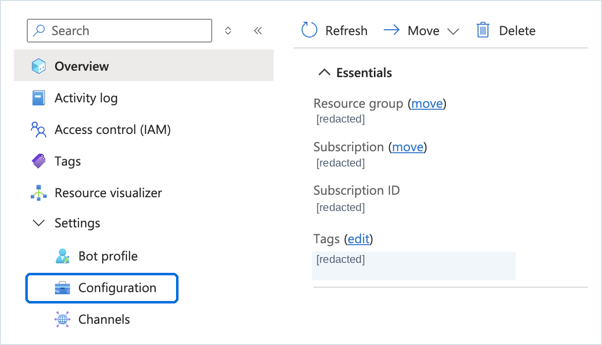
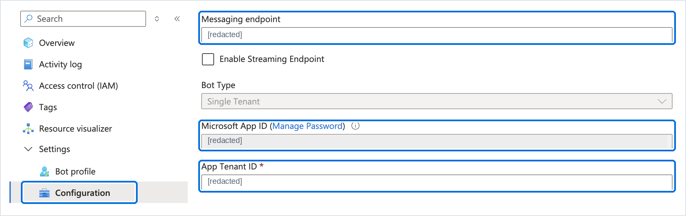
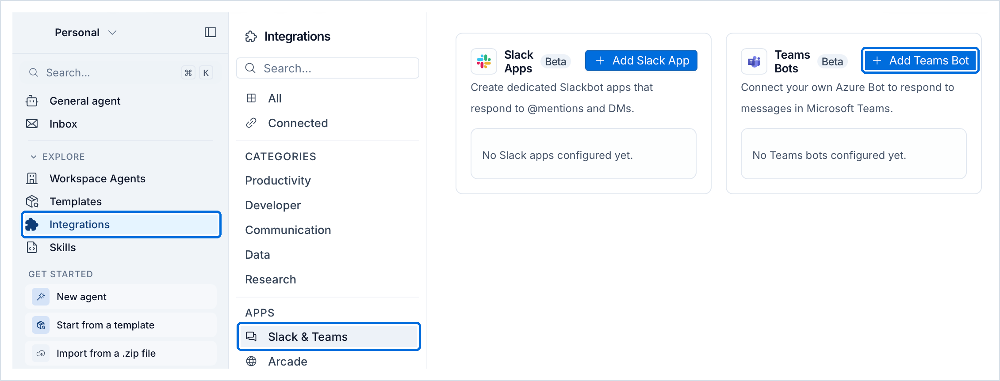
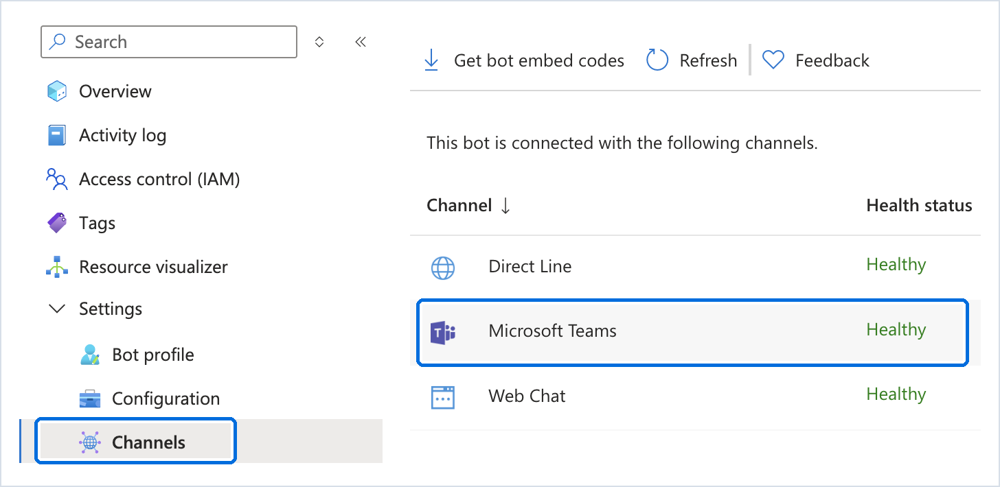
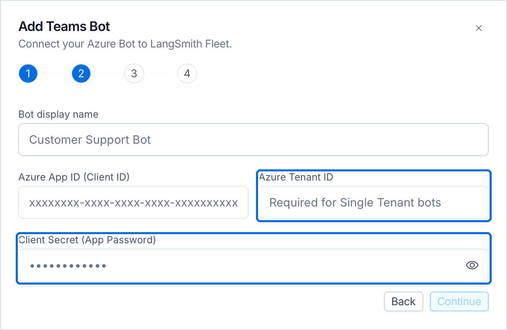
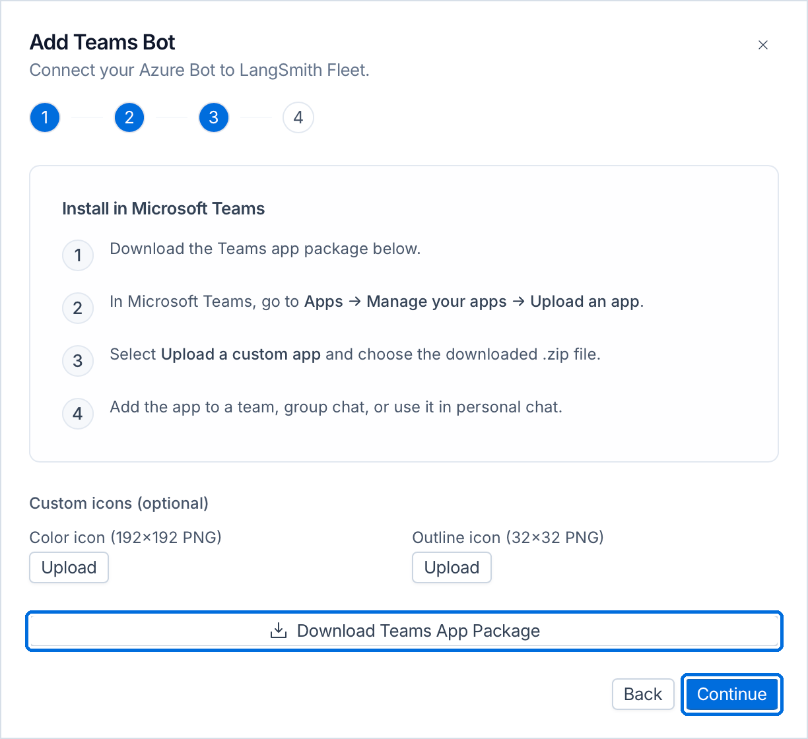
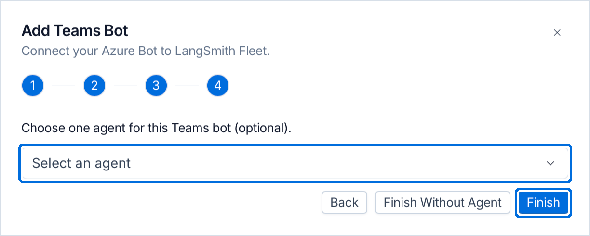
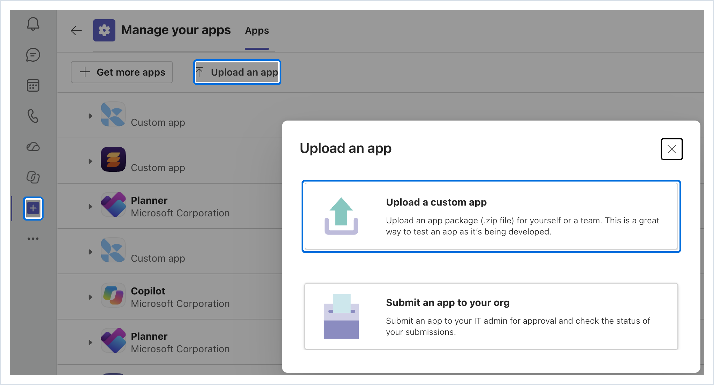

通过 LangSmith Fleet，你可以通过注册自定义 Azure Bot，将 agents 连接到 Microsoft Teams。连接完成后，agents 将可以：

- 接收来自 Teams 用户的消息，并以消息内容启动新的 run。
- 使用 Bot Framework 直接在 Teams 对话中进行响应。
- 通过 Microsoft Graph API tools 访问 Teams 频道和消息。

## 前置要求

- Fleet 中已经存在一个 agent（可参考 [Quickstart](/langsmith/fleet/quickstart) 创建）
- 一个拥有创建资源权限的 [Azure 账号](https://portal.azure.com)
- 在你的 Microsoft Teams 组织中上传并安装自定义应用的权限。你的 Teams 管理员可能需要启用[自定义应用上传](https://learn.microsoft.com/en-us/microsoftteams/platform/concepts/deploy-and-publish/apps-upload)。

## 设置 Teams bot

创建 Azure Bot，将其连接到 Fleet，并在 Teams 中完成安装：

<Steps>
  <Step title="Create an Azure Bot resource">
    1. 打开 [Azure Portal](https://portal.azure.com)。
    1. 搜索 **Azure Bot** 并点击 **Create**。
    1. 填写必填字段：
       - **Bot handle**：bot 的唯一标识符。
       - **Subscription**：选择你的 Azure 订阅。
       - **Resource group**：新建一个或选择已有的。
       - **Pricing tier** 和 **Data residency**：为你的组织选择合适的设置。参见 [Azure Bot 定价](https://azure.microsoft.com/en-us/pricing/details/bot-services/)和[区域化](https://learn.microsoft.com/en-us/azure/bot-service/bot-builder-concept-regionalization)。仅部署在某个区域的 bot 并不能保证端到端的数据驻留。
       - **Type of App**：选择 **Single Tenant**。
       - **Creation type**：选择 **Create new Microsoft App ID**。
    1. 点击 **Review + create**，然后点击 **Create**。

    <Note>
    Azure 不再允许新建 Multi Tenant bot。
    </Note>
  </Step>

  <Step title="Get your app credentials">
    资源创建完成后：

    1. 进入你的 bot 资源，在左侧边栏点击 **Configuration**。

       

    1. 复制 **Microsoft App ID** 和 **App Tenant ID**，供 Fleet 设置向导使用。

       

    1. 点击 App ID 旁边的 **Manage Password**。
    1. 点击 **New client secret**，添加描述后点击 **Add**。
    1. 复制 secret 的 **Value**，而不是 secret ID。该值只会显示一次；如果丢失，请新建一个 secret。
  </Step>

  <Step title="Configure the Azure connection">
    

    1. 在 [Fleet](https://smith.langchain.com?utm_source=docs&utm_medium=cta&utm_campaign=langsmith-signup&utm_content=langsmith-fleet-teams-app) 中打开 **Integrations** > **Slack & Teams**。在 **Teams Bots** 中点击 **Add Teams Bot**。

       

    1. 复制 Fleet 向导第一屏中显示的 webhook URL。
    1. 在你的 Azure Bot 资源中进入 **Configuration**。将该 URL 粘贴到 **Messaging endpoint**，然后点击 **Apply**。Streaming Endpoint 不是必需的。
    1. 进入 **Channels**，选择 **Microsoft Teams**，并同意服务条款。
    1. 在 **Messaging** 标签页中，为你的 Teams 组织选择云环境，然后点击 **Apply**。
    1. 确认 **Microsoft Teams** 已出现在已连接的频道列表中，并检查其状态。

       

    <Warning>
    每个新建的 Azure Bot（包括用于替换的 bot）都需要启用 Teams 频道。仅上传应用包并不会启用它。
    </Warning>

    详情请参见[将 bot 连接到 Microsoft Teams](https://learn.microsoft.com/en-us/azure/bot-service/channel-connect-teams)。
  </Step>

  <Step title="Register and link the bot">
    1. 返回 Fleet，点击 **Continue to Credentials**，然后填写：
       - **Bot display name**：该 bot 的名称。
       - **Azure App ID (Client ID)**：Azure 中的 Microsoft App ID。
       - **Azure Tenant ID**：Azure 中的 App Tenant ID，而不是你的 Fleet workspace ID。
       - **Client Secret (App Password)**：你复制的 secret 值。

       

    1. 点击 **Continue**，然后点击 **Download Teams App Package**。保留该 ZIP 文件以便安装。

       

    1. 点击 **Continue**，选择你的 agent，然后点击 **Finish**。确认 Fleet 显示 **Teams bot configured successfully**。

       

    <Warning>
    下载 ZIP 或点击 **Continue** 并不会保存 bot 注册。在 Teams 中测试或安装 bot 之前，请务必点击 **Finish**。
    </Warning>

    如果你是从某个 agent 的 **Channels** 抽屉开始操作的，请点击 **Save & Connect** 而不是 **Finish**。如果你选择了 **Finish Without Agent**，请在测试回复之前先[关联一个 agent](#link-an-existing-bot-to-an-agent)。
  </Step>

  <Step title="Install and test the bot in Teams">
    

    1. 在 Teams 中进入 **Apps** > **Manage your apps** > **Upload an app**。
    1. 选择 **Upload a custom app**，并选择从 Fleet 下载的 ZIP 文件。

       

    1. 按需遵循你组织的审批流程，然后将该应用添加到一个 team 或 chat 中。
    1. 发送一条消息并确认 agent 能够回复。在频道和群聊中，请 **@mention** 该 bot。

    如果你使用新的 App ID 重新创建了 Azure Bot，请为该 bot 重新下载一个新的应用包。不要复用已删除 bot 的应用包。
  </Step>
</Steps>

## 将已有 bot 关联到 agent

如果在设置过程中已经选择了 agent，那么 bot 已经完成关联。否则，可以使用以下任一方式：

- 在 Fleet 中打开 **Integrations** 或 **Slack & Teams**，选择该 bot，选择一个 agent，然后点击 **Attach**。
- 打开该 agent 的 **Channels** 抽屉，选择 **Teams**，然后选择该 bot。

## 添加 Teams 工具

当把 agent 关联到 Teams bot 时，Fleet 会尝试添加 `teams_reply_to_message` 工具。该工具可能显示为 **Teams Bot Reply**。使用此工具向发起对话的 Teams 会话发送回复。仅在 Fleet 中做出响应并不等同于在 Teams 中回复。bot 回复使用 bot 凭证，不需要单独的 Microsoft Graph 授权。

要读取频道或执行其他 Teams 操作，请在 agent 的 **Connections** 抽屉中添加相关的 Teams 工具。Microsoft Graph 工具可能需要授权。`teams_bot_send_proactive_message` 工具用于直接回复之外的消息，例如通知。

## 故障排查

### 解决安装错误

Teams 可能会报告 `InvalidUserId`，并给出提示“Incorrect bot configuration/registration, please check the bot settings.”，仅凭这条消息无法确定具体原因。

在重新创建 bot 或更改设置之前，请检查以下内容：

- **Azure 与 Fleet**：确认已为正确的云启用 Teams 频道。验证 bot 的 App ID、tenant ID 以及 Single Tenant 应用类型。在 Fleet 中使用相同的 ID，并在已关联 agent 的情况下完成设置。
- **应用包**：在 ZIP 的 `manifest.json` 中，检查 `bots[].botId` 是否与 Azure Bot 的 App ID 一致。顶层的 `id` 用于标识 Teams 应用，可能与 bot ID 不同。
- **Teams 组织**：安装到目标组织中，并确认其策略允许该自定义应用。

要在不安装应用包的情况下进行测试，请在 Azure Bot 资源中打开 **Channels** > **Microsoft Teams**。使用 **Open in Teams**，或选择 **Get bot embed code** 并打开 Teams HTTPS 测试链接。使用同一个 bot、账号和组织发送一条消息，并检查是否收到回复。

此可选诊断方式不用于生产环境分发。它可能需要自定义应用上传权限，并且某些云环境中无法使用 embed code。如果聊天窗口无法打开，请检查 Azure 注册、Teams 频道和策略。如果聊天窗口能打开但收不到回复，请检查 Fleet、agent 关联、messaging endpoint 和凭证。如果回复正常但应用包安装失败，请检查应用包和策略。个人聊天中的回复并不能验证 team 或群聊的安装是否正常。

如果错误仍然存在，请为支持团队收集以下信息：

- 确切的失败时间和时区、所到达的步骤，以及错误截图。
- 失败请求的 URL、HTTP 状态码、错误响应，以及请求 ID 或 correlation ID（如果有）。
- Azure Bot 的 App ID、App Tenant ID、应用类型，以及 Teams 频道的状态和云环境。
- 用于失败安装的确切应用 ZIP 文件。

<Warning>
不要分享 client secret、access token、cookie、authorization header 或未经脱敏的网络抓包。在分享截图或请求详情之前，请先对凭证进行脱敏处理。
</Warning>

### Agent 没有响应

- 检查 Fleet 中的 run，确认是否存在 `teams_reply_to_message` 调用及其结果。如果缺少该工具，请将其添加到 agent。如果 agent 没有调用它，请更新其 instructions 并再次测试。instructions 并不能保证一定发生工具调用。
- 检查 Fleet 中的 thread 是否有待审批项、**Feed** 标签页是否有错误，以及该 agent 的频道是否被[暂停](/langsmith/fleet/channels#pause-and-resume-channels)。
- 在频道和群聊中，请 **@mention** 该 bot，并确认应用已安装到对应的 team 或群聊中。
- 验证 Azure 中的 messaging endpoint 与 Fleet 的 webhook 一致，并且该 bot 已关联到预期的 agent。
- 将 Fleet 中的 App ID、tenant ID 和 client secret 值与 Azure 进行核对。确认该 secret 尚未过期。在 Fleet 中保存凭证并不会测试 Azure 身份验证。

---

<Callout icon="terminal-2">
    [Connect these docs](/use-these-docs) to your agent of choice via MCP for real-time answers.
</Callout>
<Callout icon="edit">
    [Edit this page on GitHub](https://github.com/langchain-ai/docs/edit/main/src/langsmith/fleet/teams-app.mdx) or [file an issue](https://github.com/langchain-ai/docs/issues/new/choose).
</Callout>

