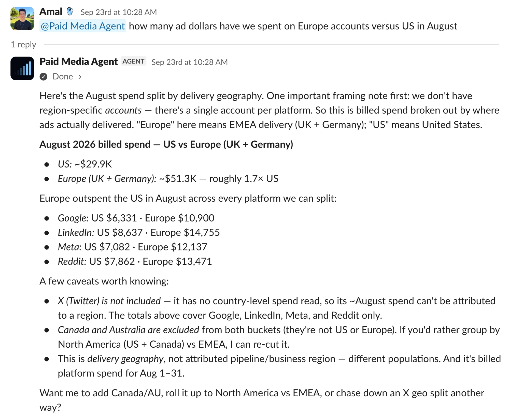
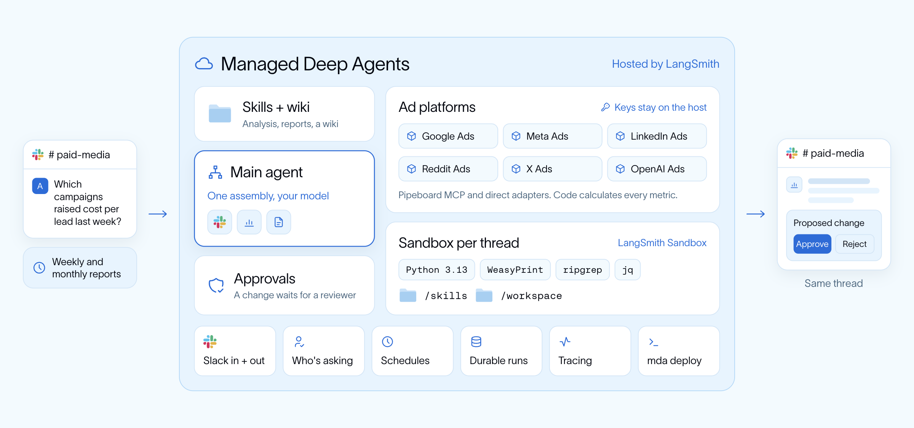
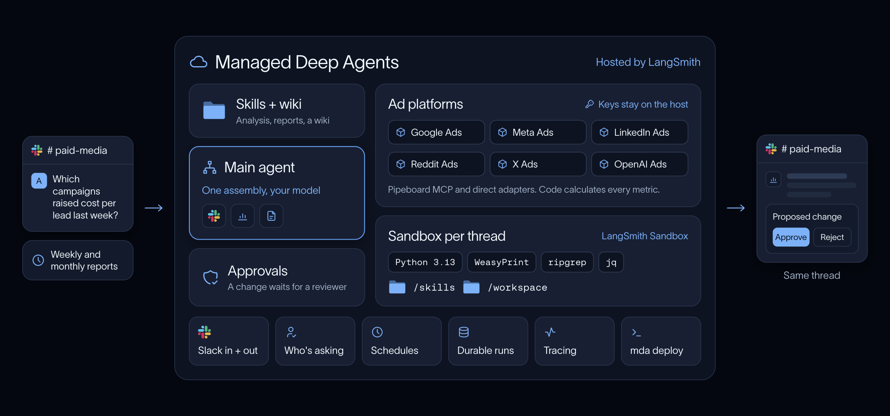
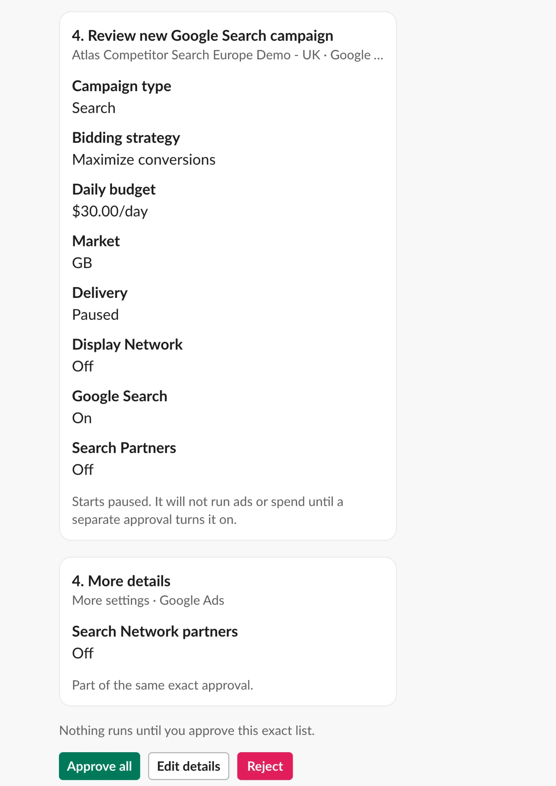

import ManagedDeepAgentsPublicBetaNote from '/snippets/javascript/langsmith/managed-deep-agents-public-beta-note.mdx';

[paid media agent](https://github.com/langchain-ai/paid-media-agent) 是一个使用 Managed Deep Agents 构建的开源 agent，用于跨渠道广告分析。你的团队在 Slack 中提问，agent 会基于已连接的 Google Ads、Meta Ads、LinkedIn Ads、Reddit Ads、X Ads 和 OpenAI Ads 账号作答。

它会比较各账号的支出和转化，用支撑数据解释效果变化，发布每周和每月报告，并准备预算或广告系列更改，这些更改会保持暂停状态，直到审核人批准。paid-media wiki 涵盖归因、平台差异和预算决策。项目中的业务上下文提供目标和转化定义。

<ManagedDeepAgentsPublicBetaNote />

## 部署 agent

开始之前，请确认已具备以下条件：

- 一个 [LangSmith Cloud](/langsmith/cloud) 账号。请使用 personal access token（以 `lsv2_pt_` 开头的 [API key](/langsmith/create-account-api-key)），或在首次部署时通过浏览器登录。service key 无法设置 Slack app。
- 你的 model provider 的 key。在 [LLM Gateway](/langsmith/llm-gateway) 上，agent 会改用你的 LangSmith key。
- 一个 [Pipeboard](https://pipeboard.co/integrations) 账号，用于 Google Ads、Meta Ads、LinkedIn Ads、TikTok Ads、Pinterest Ads、Snap Ads、Reddit Ads 和 Google Analytics。请查看 [Pipeboard pricing](https://pipeboard.co/pricing) 了解方案限制。X Ads 和 OpenAI Ads 使用单独的 key，并保持只读。
- 在你的 Slack workspace 中安装 app 的权限，或者由一位 workspace 管理员批准该 agent 的 Slack app。

要使用 Claude Code、Codex 或 Cursor 等 coding agent 部署，请粘贴以下 prompt。它会安装 agent、检查配置，并在任何产生费用或执行部署的操作之前征求你的同意。

<Prompt
    description="Deploy the paid media agent with your coding agent"
    icon="terminal"
    actions={["copy"]}
>
使用 Managed Deep Agents 将开源 paid media agent 部署到我的 Slack workspace。

1. 使用 `curl -fsSL https://raw.githubusercontent.com/langchain-ai/paid-media-agent/main/install.sh | bash` 安装，然后在它创建的 `paid-media-agent` 文件夹中工作。
2. 阅读 `AGENTS.md`，并遵循 `paid-media-onboarding` skill。
3. 运行 `uv run paid-media-agent demo --with-proposal` 检查安装。
4. 告诉我你需要哪些 key。我会在自己的终端中用 `uv run paid-media-agent config set <KEY>` 输入，或在设置控制台（`uv run paid-media-agent setup`）中输入；绝不要让我在聊天中粘贴 key。
5. 帮我连接广告账号并编写业务上下文。
6. 运行 `uv run paid-media-agent mda check`，直到没有阻塞项。然后让我在自己的终端中执行首次部署 `uv run paid-media-agent mda deploy --yes`，因为它会设置 Slack app。
7. 上线后，带我走一遍在 Slack 中向该 app 发消息并提出第一个问题的流程。
</Prompt>

自行部署：

<Steps>
  <Step title="安装项目">

安装脚本会在需要时安装 uv，然后克隆仓库并完成设置。

```bash
curl -fsSL https://raw.githubusercontent.com/langchain-ai/paid-media-agent/main/install.sh | bash
cd paid-media-agent
uv run paid-media-agent demo --with-proposal
```

该 demo 会在没有任何 key 的情况下分析合成账号，并模拟一次预算更改。

  </Step>
  <Step title="添加你的 keys">

在 Pipeboard 中连接你的广告平台，并在 **Settings** > **API Tokens** 下创建一个 token。然后保存你的 key：

```bash
uv run paid-media-agent config set LANGSMITH_API_KEY ANTHROPIC_API_KEY PIPEBOARD_API_TOKEN
```

该命令会逐个询问每个 key，并保持输入隐藏。设置控制台 `uv run paid-media-agent setup` 会在浏览器中完成同样的工作。在 [LLM Gateway](/langsmith/llm-gateway) 上，请跳过 provider key，改为运行 `uv run paid-media-agent config set PAID_MEDIA_MODEL=langsmith:anthropic/claude-opus-5-5`。如果要用浏览器登录而不是 LangSmith key，请省略 `LANGSMITH_API_KEY`。

  </Step>
  <Step title="连接你的广告账号">

```bash
uv run paid-media-agent accounts discover --add
```

该命令会找出你的 Pipeboard token 能访问的每个广告账号，并为每个账号分配一个别名。X Ads 和 OpenAI Ads 使用自己的 key，并保持只读。设置写入 `.env`，账号映射写入 `config/accounts.toml`。Git 会忽略这两个文件。

  </Step>
  <Step title="添加业务上下文">

agent 会从 `workspace/skills/company-context/` 读取你的目标、转化定义和广告系列简报。请从[模板](https://github.com/langchain-ai/paid-media-agent/blob/main/docs/customization.md#business-context)开始，或让 coding agent 遵循 `.agents/skills/paid-media-org-onboarding/SKILL.md`。请在首次真实分析之前添加这些上下文。

  </Step>
  <Step title="部署">

```bash
uv run paid-media-agent mda deploy --yes
```

该命令会先检查项目：缺少 key 时会停止，当 agent 可能使用 demo 数据作答时则会发出警告。然后它会部署项目的一个副本，其中不包含你的本地工作文件。它还会将 `sandbox/setup.sh`（用于安装 Python tools 和 PDF 库）构建为快照。该 sandbox 较小，因此不需要单独的发布步骤。

请在你自己的终端中运行首次部署，因为它会设置 Slack app。选择由 LangSmith 管理的 app。如果命令打印了链接，请打开它并为你的 workspace 批准该 app。部署会等待 Slack 报告批准完成。可能需要 workspace 管理员先批准该 app。

  </Step>
  <Step title="提出第一个问题">

在 Slack 中从 **Apps** 找到该 app 并向它发送消息，或将其邀请到某个 channel 并 mention 它。可以问类似这样的问题：上个月在欧洲和美国的支出分别是多少。agent 会读取已连接的账号，在代码中计算指标，并在 thread 中给出答案，同时说明会影响结论的注意事项。

<Frame caption="Slack thread 示例：支出对比及注意事项。">
  
</Frame>

  </Step>
</Steps>

## 自定义 paid media agent

大多数更改都是编辑仓库中的文件。常见的更改包括：

- **Business context**：目标、转化定义和广告系列简报位于 `workspace/skills/company-context/`。
- **Reports**：每周和每月报告从 `schedules/` 运行，时间分别为每周一和每月 1 日的 13:00 UTC。在 schedule 中设置 `deliver_to`，即可将结果发布到 Slack channel。
- **Report design**：颜色、排版和布局位于 `workspace/skills/report-design/DESIGN.md`。可以让 coding agent 遵循 `.agents/skills/paid-media-design/SKILL.md`，以保持渲染器同步。
- **Slack app**：在 `channels/slack.py` 中设置名称、描述和触发器。
- **Memory**：memory 默认关闭。当所有调用方都可以共享 agent 学到的内容时，添加 `memory.py` 以开启 [memory](/langsmith/javascript/managed-deep-agents-memory)。
- **Live changes**：写入广告账号需要来自 `config/write-policy.example.toml` 的 write policy、[release checks](https://github.com/langchain-ai/paid-media-agent/blob/main/docs/operations/live-write-runbook.md) 以及一位获授权的审核人。待处理的 proposal 存在于部署进程中，而默认的 serverless deployment 可能在审批前缩容并丢失 proposal，因此在开启 live changes 之前，请使用 `--deployment-type dedicated` 部署。

要试用一项更改并将其发布，请使用以下 [`mda` 命令](/langsmith/javascript/managed-deep-agents-cli)：

| 命令 | 用途 |
| --- | --- |
| `uv run mda dev` | 在本地运行 agent，并在 [LangSmith Studio](/langsmith/studio) 中打开 |
| `uv run paid-media-agent mda deploy --yes --name paid-media-agent-test` | 部署一个单独的副本以测试更改，不影响团队正在使用的部署 |
| `uv run paid-media-agent mda deploy --yes` | 先检查项目，然后将你的更改发布到团队正在使用的 deployment |
| `uv run mda logs` | 持续查看已部署 agent 的日志 |
| `uv run mda build` | 将将要发布的内容编译到 `.mda/build/`，但不执行部署 |

更多信息请参见仓库中的 [deploy guide](https://github.com/langchain-ai/paid-media-agent/blob/main/docs/deploy-mda.md)、[Customization](https://github.com/langchain-ai/paid-media-agent/blob/main/docs/customization.md) 和 [Operations](https://github.com/langchain-ai/paid-media-agent/blob/main/OPERATIONS.md)。

## 了解项目

每项托管能力都对应仓库根目录下的一个文件或文件夹：

| 路径 | 在此 agent 中的作用 | 了解更多 |
| --- | --- | --- |
| `agent.py` | 使用 `define_deep_agent` 构建 agent，模型、tools、middleware 和审批策略来自同一份共享组装定义 | [Agent definition](/langsmith/javascript/managed-deep-agents-agent-definition) |
| `instructions.md` | 常驻 prompt | [Instructions](/langsmith/javascript/managed-deep-agents-instructions) |
| `skills/` | 用于分析、报告、报告设计和更改提案的 skills，以及一个 paid-media wiki，在 `workspace/skills/` 中编辑 | [Skills](/langsmith/javascript/managed-deep-agents-skills) |
| `sandbox/` | Python 3.13，包含 ripgrep、jq 和 PDF 库，由 `mda deploy` 构建 | [Sandboxes](/langsmith/javascript/managed-deep-agents-sandboxes) |
| `channels/slack.py` | 托管 Slack app，处理 mentions、私信、thread 和审批按钮 | [Slack channel](/langsmith/javascript/managed-deep-agents-channels-slack) |
| `schedules/` | 每周和每月报告，以及每日的日常维护 | [Schedules](/langsmith/javascript/managed-deep-agents-schedules) |
| `identity.py` | 使用 LangSmith API key 对调用方进行身份验证 | [Identity](/langsmith/javascript/managed-deep-agents-identity) |
| `src/paid_media_agent/` | agent 入口导入的应用代码，例如广告平台 tools、指标和报告渲染 | [Tools](/langsmith/javascript/managed-deep-agents-tools) |

## 架构

Managed Deep Agents 提供 Slack app、身份验证、schedules，以及每个 thread 一个 sandbox。仓库则添加广告平台 tools、分析 skills 和审批策略。

<Frame caption="请求路径：从 Slack 或 schedule 经过 agent，再回到 thread。">
  
  
</Frame>

由模型决定调查什么。代码负责计算指标，并对照源数据核对报告中的数字。大型 tool 结果保留在文件中。模型读取带有来源、日期范围和数据质量标记的摘要。

广告系列更改从 proposal 开始：更改前后的值、原因，以及检查和撤销的计划。run 会暂停，approver 列表中的审核人在 Slack 中批准或拒绝该确切 proposal。编辑会生成一个需要单独批准的新 proposal。

<Frame caption="针对建议的广告系列更改的 Slack 审批卡片。">
  
</Frame>

批准后，host 会在改动账号之前逐项检查所有 gate，执行一次更改，然后回读并记录回执。live changes 默认关闭。要开启，请遵循 [live-write runbook](https://github.com/langchain-ai/paid-media-agent/blob/main/docs/operations/live-write-runbook.md)。

<Frame caption="在操作员开启写入后，live write 的审批路径。">
  
  
</Frame>

## 另请参阅

- [Paid media agent repository](https://github.com/langchain-ai/paid-media-agent)
- [Design agent template](/langsmith/javascript/managed-deep-agents-design-agent)
- [Managed Deep Agents project structure](/langsmith/javascript/managed-deep-agents-project-structure)
- [Deploy a Managed Deep Agents project](/langsmith/javascript/managed-deep-agents-deploy)

---

<div className="source-links">
<Callout icon="terminal-2">
    [Connect these docs](/use-these-docs) to your agent of choice via MCP for real-time answers.
</Callout>
<Callout icon="edit">
    [Edit this page on GitHub](https://github.com/langchain-ai/docs/edit/main/src/langsmith/managed-deep-agents-paid-media-agent.mdx) or [file an issue](https://github.com/langchain-ai/docs/issues/new/choose).
</Callout>
</div>
