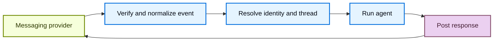
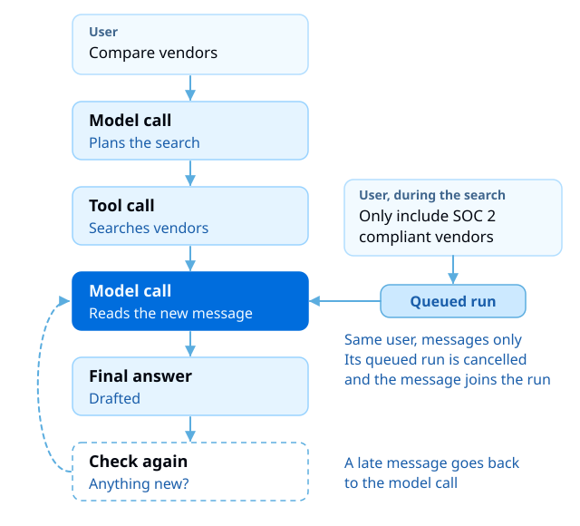
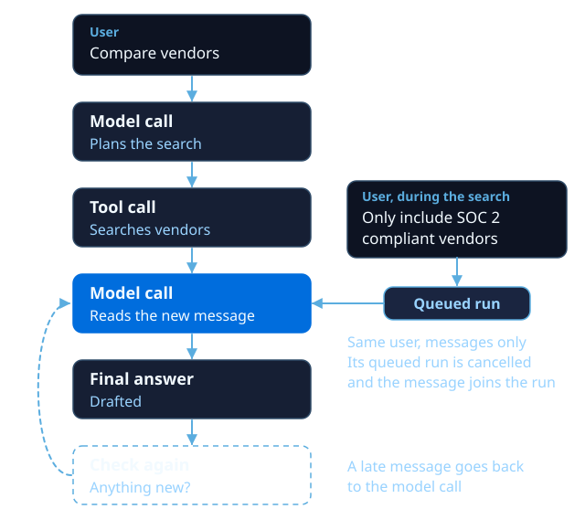

import ManagedDeepAgentsPublicBetaNote from '/snippets/python/langsmith/managed-deep-agents-public-beta-note.mdx';

Channel 让 managed deep agent 在外部消息服务中可用。来自该服务的消息可以启动 agent runs，agent 的最终响应也通过同一个服务返回。

<ManagedDeepAgentsPublicBetaNote />

## 项目结构

Channel 声明位于项目级的 `channels/` 目录中：

```text
my-agent/
  agent.py
  channels/
    slack.py
```


## 理解 channels

一个 channel 组合了外部消息集成的三个部分：

- **入站事件**：验证并归一化 provider 事件，然后启动 agent run。
- **出站消息**：将 agent 的响应发送回发起请求的会话。
- **预置**：创建并配置将服务连接到 deployed agent 的 provider 资源。

在 Managed Deep Agents 中，channel 将 deployed agent 连接到消息 provider。

托管运行时处理 channel 生命周期：



Provider adapter 决定接受哪些事件、provider 会话如何映射到 Managed Deep Agents threads，以及响应如何投递。Channel 声明暴露该 provider 支持的配置。

### 向运行中的 agent 发送消息

Steering 让用户可以为已经进行中的 run 追加内容。当 agent 在该 thread 上运行期间，同一用户发送消息时，该消息会在下一次模型调用时加入当前活动的 run。它不会启动新的 run。

<Note>
Steering 处于 beta 阶段，需要 `managed-deepagents` 0.10.2 或更高版本。
</Note>

例如，用户要求 agent 比较多个供应商，然后在 agent 搜索期间发送“只包含符合 SOC 2 要求的供应商”。搜索结束后，模型会结合目前的结果读取这条新消息。同一个 run 会带着更精确的请求继续执行。





#### 消息如何加入 run

在 run 期间发送的消息会先作为 queued run 在该 thread 上等待。每次模型调用前，agent 会检查该 thread 中是否有可以接收的 queued runs。对于每一条，按照消息发送的顺序，agent 会：

1. 以 `taken` 为原因取消该 queued run，这样该消息之后就不会再单独启动自己的 run。
2. 将该 run 的消息添加到活动 run 的对话中。

Steering 在步骤之间生效。已经在进行中的 tool 调用或模型调用会先完成。

模型写出最终答案后，agent 会再次检查该 thread。如果在这最后一次模型调用期间有消息到达，run 会带着该消息返回模型，而不是结束。

#### 自行运行的消息

只有当 queued run 仅包含同一用户发送的用户消息时，它才会加入活动 run。以下 queued runs 会等待，并在活动 run 结束后启动：

- 对中断（例如审批）的响应。
- 来自其他用户的消息。
- 设置了 webhook、从较早的 checkpoint 分叉，或设置了 messages 以外输入的 run。

只有主 agent 会接收消息。在 subagent 运行期间，新消息会等到主 agent 的下一次模型调用。

如果 agent 无法读取或取消 queued runs，消息会按顺序继续排队。Agent 会在下一次模型调用时重试，而它未接收的任何消息会在活动 run 结束后自行运行。

## 在项目中声明 channels

把每个 channel 放在 `channels/` 下的单独模块中。

从每个文件导出一个模块级的 `channel`。


文件名会成为配置的 channel 名称，并在 deployment 中标识该 channel。

不要将声明命名为 `channels/channel.py`。


Channel 名称在项目内必须唯一。

声明由 provider factory 创建。

例如，`channels.slack()` 创建一个 Slack channel。


各 provider 的声明、app 配置和部署步骤请参见其 provider 指南。

## 区分 channels 与 connectors

Channel 接收启动 agent runs 的消息并投递响应。[MCP connector](/langsmith/python/managed-deep-agents-mcp-connectors) 为 agent 提供来自远程 MCP 服务器的 tools。项目可以只用其一，也可以两者都用。

## 支持的 channels

<CardGroup cols={2}>
  <Card title="Slack" icon="brand-slack" href="/langsmith/python/managed-deep-agents-channels-slack">
    从 Slack mention、私信（DM）和 thread 回复启动 runs。
  </Card>
  <Card title="Custom (HTTP)" icon="webhook" href="/langsmith/python/managed-deep-agents-channels-http">
    从任何能发送 JSON webhook 的服务启动 runs。
  </Card>
</CardGroup>

HTTP adapter 也可以放在由社区维护的 package 中。请参阅[以 package 形式共享 channel adapter](/langsmith/python/managed-deep-agents-channels-http#share-a-channel-adapter-as-a-package)，了解如何发布可复用的 provider 代码，供用户导入到自己的 channel 声明中。

## 另请参阅

- [Identity](/langsmith/python/managed-deep-agents-identity)：对调用方进行认证，并将 channel runs 限定到解析出的用户。
- [Schedules](/langsmith/python/managed-deep-agents-schedules)：通过配置的 channel 投递定时结果。
- [Deploy an agent](/langsmith/python/managed-deep-agents-deploy)：部署项目更改并配置 secrets。
- [CLI reference](/langsmith/python/managed-deep-agents-cli)：查看 channel 项目文件约定。

---

<div className="source-links">
<Callout icon="terminal-2">
    [Connect these docs](/use-these-docs) to your agent of choice via MCP for real-time answers.
</Callout>
<Callout icon="edit">
    [Edit this page on GitHub](https://github.com/langchain-ai/docs/edit/main/src/langsmith/managed-deep-agents-channels.mdx) or [file an issue](https://github.com/langchain-ai/docs/issues/new/choose).
</Callout>
</div>
