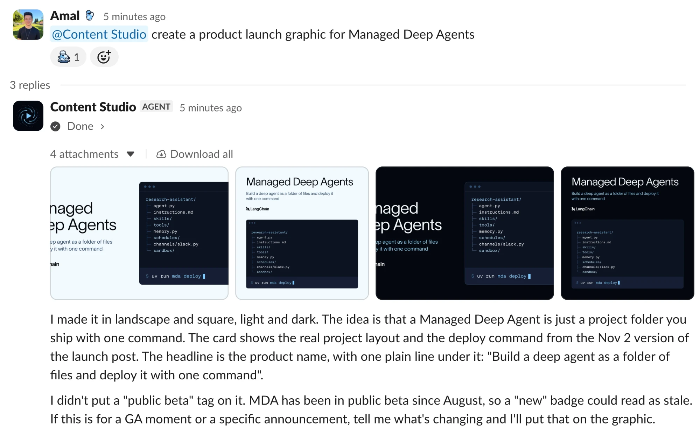
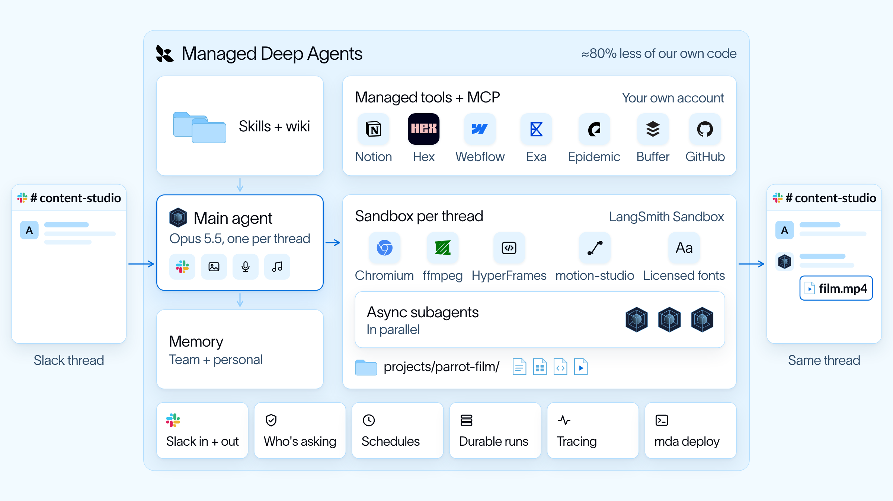
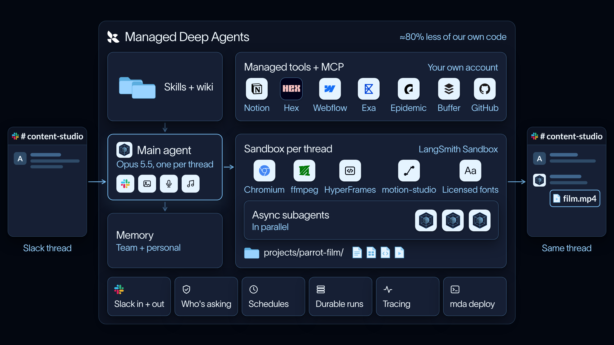

import ManagedDeepAgentsPublicBetaNote from '/snippets/python/langsmith/managed-deep-agents-public-beta-note.mdx';

[Content Studio](https://github.com/langchain-ai/design-agent) 是一个基于 Managed Deep Agents 构建的开源 design agent。你的团队在 Slack 中提出需求，agent 会在同一 thread 中返回完成的文件。

<ManagedDeepAgentsPublicBetaNote />

## 部署 agent

开始之前，请确认已具备以下条件：

- 一个 [LangSmith Cloud](/langsmith/cloud) 账号，以及一个可用于部署的 [API key](/langsmith/create-account-api-key)。
- 你的 model provider 的 key。在 [LLM Gateway](/langsmith/llm-gateway) 上，agent 会改用你的 LangSmith key。
- 在你的 Slack workspace 中安装 app 的权限，或者由一位 workspace 管理员批准该 agent 的 Slack app。

要使用 Claude Code、Codex 或 Cursor 等 coding agent 部署，请粘贴以下 prompt。它会安装 agent、检查配置，并在任何产生费用或执行部署的操作之前征求你的同意。

<Prompt
    description="Deploy the design agent with your coding agent"
    icon="terminal"
    actions={["copy"]}
>
使用 Managed Deep Agents 将开源 design agent 部署到我的 Slack workspace。

1. 使用 `curl -fsSL https://raw.githubusercontent.com/langchain-ai/design-agent/main/install.sh | bash` 安装，然后在它创建的 `design-agent` 文件夹中工作。
2. 阅读 `AGENTS.md`，并遵循 `design-agent-deploy` skill。
3. 告诉我你需要哪些 key。我会在自己的终端中用 `uv run design-agent config set <KEY>` 自行输入；绝不要让我在聊天中粘贴 key。
4. 运行 `uv run design-agent doctor`，并修复它标记的问题。它的 `mda-deploy` 行列出了部署仍需要的内容。
5. 在执行会产生费用的 `uv run design-agent sandbox publish` 之前先问我。然后让我在自己的终端中执行首次部署 `uv run mda deploy`，因为它会设置 Slack app。
6. 上线后，带我走一遍在 Slack 中向 agent 发消息并发送第一个请求的流程。
</Prompt>

自行部署：

<Steps>
  <Step title="安装项目">

安装脚本会在需要时安装 uv，然后克隆仓库并完成设置。

```bash
curl -fsSL https://raw.githubusercontent.com/langchain-ai/design-agent/main/install.sh | bash
cd design-agent
```

  </Step>
  <Step title="添加你的 keys">

```bash
uv run design-agent config set LANGSMITH_API_KEY ANTHROPIC_API_KEY
```

该命令会逐个询问每个 key，并保持输入隐藏。在 [LLM Gateway](/langsmith/llm-gateway) 上，请跳过 provider key，改为运行 `uv run design-agent config set DESIGN_AGENT_MODEL=langsmith:anthropic/claude-opus-5-5`。

`mda deploy` 会将 `.env` 中的每个 key 作为 deployment secret 转发，但 `LANGSMITH_API_KEY` 除外，它用于签名部署。

  </Step>
  <Step title="发布 sandbox">

```bash
uv run design-agent sandbox publish
```

`mda deploy` 会自行将 `sandbox/setup.sh` 构建为快照。该构建以 Docker 镜像为基础，会得到一个 1 GiB 的文件系统。而 design agent 的机器包含 Chrome、FFmpeg 和 HyperFrames，约为 1.3 GiB。此命令改为在你的 [workspace](/langsmith/administration-overview#workspaces) 中构建一个更大的快照，并让 `sandbox/__init__.py` 指向它。

该过程需要 10 到 15 分钟，每个 workspace 只需运行一次。仅在 `sandbox/setup.sh` 发生变化时才需要重新发布。

  </Step>
  <Step title="部署">

```bash
uv run mda deploy
```

首次部署会预置 agent 的 Slack app。如果命令打印了 Slack 链接，请打开它，为你的 workspace 批准该 app，然后按 Enter。可能需要 workspace 管理员先批准该 app。

  </Step>
  <Step title="发送第一个请求">

首次部署后，agent 会向你发送一条私信。直接回复该消息，或将其邀请到某个 channel 并 mention 它来提出需求，例如为某个产品制作发布图。进度更新和完成的文件会出现在同一 thread 中。

<Frame caption="Slack thread 示例：先显示进度更新，然后是完成的文件。">
  
</Frame>

  </Step>
</Steps>

## 自定义 design agent

大多数更改都是编辑仓库中的文件。常见的更改包括：

- **Brand pack**：你的颜色、字体、logo 和语气位于 `workspace/brand/`。可以让 coding agent 根据你的网站和品牌指南构建该 pack。
- **Skills**：每个工作流都是 `skills/` 中的一个文件夹。可以为团队经常提出的需求新增一个，例如每周 newsletter 的页眉。
- **Instructions**：常驻 prompt 是 `instructions.md`。保持简短，把工作流放在 skills 中。
- **MCP servers**：将 `config/mcp.example.toml` 复制为 `config/mcp.toml`，并启用 Notion 或 GitHub 等服务器。每个人都会通过 [workspace connection](/langsmith/python/managed-deep-agents-connections) 以自己的身份登录。
- **Model**：使用 `uv run design-agent config set` 设置 `DESIGN_AGENT_MODEL`。任何支持 tool calling 和 vision 的 chat model 都可以。

要试用一项更改并将其发布，请使用以下 [`mda` 命令](/langsmith/python/managed-deep-agents-cli)：

| 命令 | 用途 |
| --- | --- |
| `uv run mda dev` | 在本地运行 agent，并在 [LangSmith Studio](/langsmith/studio) 中打开 |
| `uv run mda deploy --name design-agent-test` | 部署一个单独的副本以测试更改，不影响团队正在使用的部署 |
| `uv run mda deploy` | 将你的更改发布到团队正在使用的 deployment |
| `uv run mda logs` | 持续查看已部署 agent 的日志 |
| `uv run mda build` | 将将要发布的内容编译到 `.mda/build/`，但不执行部署 |

更多信息请参见仓库中的 [Customization](https://github.com/langchain-ai/design-agent/blob/main/docs/customization.md)。

## 了解项目

每项托管能力都对应仓库根目录下的一个文件或文件夹：

| 路径 | 在此 agent 中的作用 | 了解更多 |
| --- | --- | --- |
| `agent.py` | 使用 `define_deep_agent` 构建 agent，模型、tools、middleware 和 subagents 来自同一份共享组装定义 | [Agent definition](/langsmith/python/managed-deep-agents-agent-definition) |
| `instructions.md` | 简短的常驻 prompt，工作流放在 skills 中 | [Instructions](/langsmith/python/managed-deep-agents-instructions) |
| `skills/` | 35 个 skills 和一个 design wiki，同步到 Context Hub，仅在任务需要时加载 | [Skills](/langsmith/python/managed-deep-agents-skills) |
| `sandbox/` | 每个 thread 克隆的 Linux 机器的固定 recipe，包含 Chrome、FFmpeg、HyperFrames、D2 和你的字体 | [Sandboxes](/langsmith/python/managed-deep-agents-sandboxes) |
| `channels/slack.py` | 托管 Slack app，处理 mentions、私信、thread 回复、文件和审批卡片 | [Slack channel](/langsmith/python/managed-deep-agents-channels-slack) |
| `memory.py` | 团队共享的 team memory，以及每个人的 personal memory | [Memory](/langsmith/python/managed-deep-agents-memory) |
| `tools/mcp.py` | 来自 `config/mcp.toml` 的 MCP servers，每个人以自己的身份登录 | [MCP connectors](/langsmith/python/managed-deep-agents-mcp-connectors) |
| `schedules/housekeeping.py` | 每 15 分钟运行一次，清理因重启而中断的工作，不调用模型 | [Schedules](/langsmith/python/managed-deep-agents-schedules) |
| `identity.py` | 使用 LangSmith API key 对 API 调用方进行身份验证 | [Identity](/langsmith/python/managed-deep-agents-identity) |
| `src/design_agent/` | agent 入口导入的应用代码，例如 host tools 和 middleware | [Tools](/langsmith/python/managed-deep-agents-tools) |

## 架构

Managed Deep Agents 提供 Slack app、身份验证、schedules，以及每个 thread 一个 sandbox。仓库则添加 design 工作流、brand pack 和渲染工具。

<Frame caption="请求路径：从 Slack 经过 agent 和 sandbox，再回到 thread。">
  
  
</Frame>

视频生成等长耗时任务在后台运行。主 agent 将各部分交给同一 sandbox 上的 [subagents](/langsmith/python/managed-deep-agents-subagents)，并保持随时可以对话。一次性的 [schedule](/langsmith/python/managed-deep-agents-schedules) 会在后台任务完成或停滞时唤醒主 agent。

`workspace/brand/` 中的 brand pack 是颜色、字体、logo 和语气的来源。agent 在发布前会依据该 pack 检查每次渲染结果。

## 另请参阅

- [Design agent repository](https://github.com/langchain-ai/design-agent)
- [Run the demo locally, with no API keys](https://github.com/langchain-ai/design-agent#try-it-locally)
- [Paid media agent template](/langsmith/python/managed-deep-agents-paid-media-agent)
- [Deploy with Managed Deep Agents, in the repository](https://github.com/langchain-ai/design-agent/blob/main/docs/deploy-mda.md)
- [Managed Deep Agents project structure](/langsmith/python/managed-deep-agents-project-structure)
- [Deploy a Managed Deep Agents project](/langsmith/python/managed-deep-agents-deploy)

---

<div className="source-links">
<Callout icon="terminal-2">
    [Connect these docs](/use-these-docs) to your agent of choice via MCP for real-time answers.
</Callout>
<Callout icon="edit">
    [Edit this page on GitHub](https://github.com/langchain-ai/docs/edit/main/src/langsmith/managed-deep-agents-design-agent.mdx) or [file an issue](https://github.com/langchain-ai/docs/issues/new/choose).
</Callout>
</div>
