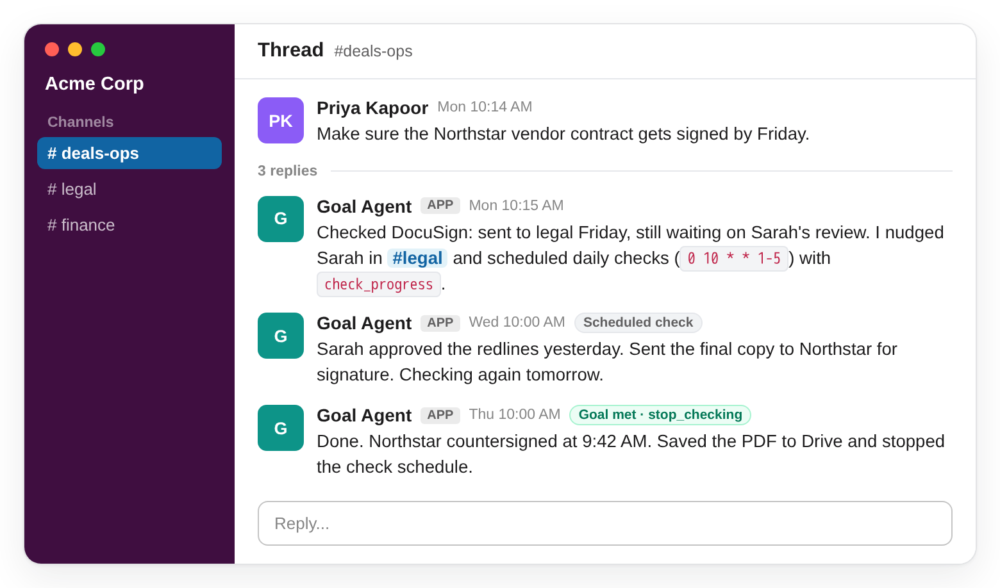
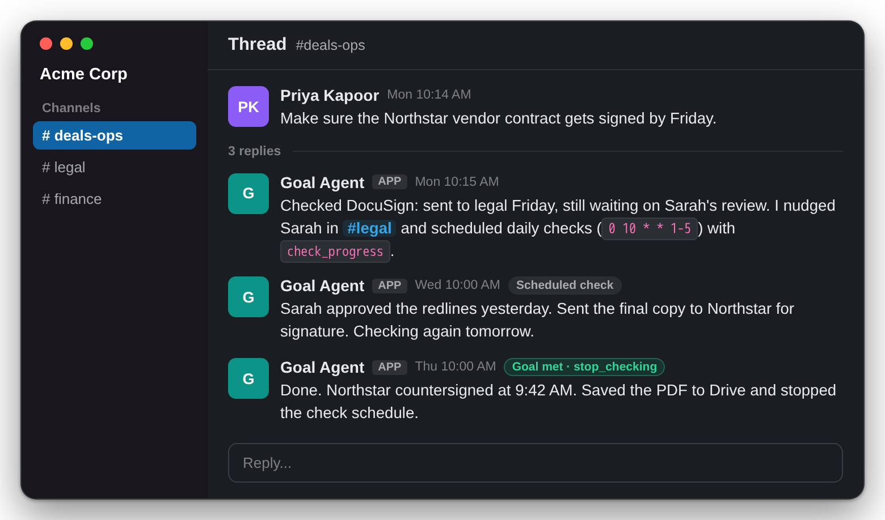

import ManagedDeepAgentsPublicBetaNote from '/snippets/python/langsmith/managed-deep-agents-public-beta-note.mdx';

有些工作无法在一轮内完成：合同等待签署，pull request 等待审核，或者公告尚未发布。目标导向的 agent 会立即完成力所能及的部分，然后在进展依赖外部事件时自行安排跟进检查。每次检查时，它都会推进工作，并在目标达成后停止 schedule。

<ManagedDeepAgentsPublicBetaNote />

<Note>
本 Python 示例需要 `managed-deepagents>=0.10.4` 以及匹配的 `mda` CLI。
</Note>






## 添加 schedule tools

为 agent 提供两个 [tools](/langsmith/python/managed-deep-agents-tools)，用于封装 [runtime schedules](/langsmith/python/managed-deep-agents-schedules#create-schedules-at-runtime)。`check_progress` 会在当前 channel thread 中启动由 agent 拥有的定期检查，`stop_checking` 则会删除该检查：


```python tools/goals.py
from langchain.tools import tool
from managed_deepagents import ManagedDeepAgentRuntime

OWNER = {"type": "agent"}


@tool
async def check_progress(goal: str, cron: str, runtime: ManagedDeepAgentRuntime) -> str:
    """Check back on unfinished work in this thread on a cron schedule, until you stop it."""
    item = await runtime.schedules.create(
        owner=OWNER,
        cron=cron,
        new_thread=False,
        prompt=f"Check progress on this goal: {goal}",
    )
    return f"Checking progress with schedule {item['id']}."


@tool
async def stop_checking(schedule_id: str, runtime: ManagedDeepAgentRuntime) -> str:
    """Stop checking progress on a goal that is met or abandoned."""
    await runtime.schedules.delete(schedule_id, owner=OWNER)
    return f"Stopped schedule {schedule_id}."
```


将这两个 tools 与 quickstart 的 model 和 web search tool 一起注册：

```python agent.py
from managed_deepagents import define_deep_agent

from tools.goals import check_progress, stop_checking

agent = define_deep_agent(
    name="goal-agent",
    model="openai:gpt-6.1-sol",
    tools=[{"type": "web_search"}, check_progress, stop_checking],
)
```


## 编写 instructions

使用 `instructions.md` 告诉 agent 何时自行安排跟进，并根据你的工作流调整示例和检查频率：

```markdown instructions.md
## Follow through

Finish every request in the current turn when possible. If the work depends on
something outside your control, such as an approval, review, or publication,
define what "done" looks like and pick a check interval. Call check_progress
and end your turn instead of waiting.

On each check, inspect the current state with your tools rather than assuming.
Move the work forward if you can; otherwise, note who needs to act. When the
goal is met or blocked permanently, report the outcome and call stop_checking.
```

每次检查都在同一个 thread 中运行，并保留原始请求、之前的更新，以及 `stop_checking` 所需的 schedule ID。对于 Slack 会话，每次检查都会在同一个 Slack thread 中回复。

## 试用

从 [quickstart](/langsmith/python/managed-deep-agents-quickstart) agent 开始，你会得到可用于跟踪公开事件的 web search。添加一个 [Slack channel](/langsmith/python/managed-deep-agents-channels-slack)（使用同一 thread 的 agent-owned schedules 需要 channel），[部署该 agent](/langsmith/python/managed-deep-agents-deploy)，然后在 Slack 中提问：“告诉我 LangChain 何时发布下一个版本。”agent 会先搜索；如果版本尚未发布，就安排定期检查，并在版本出现后停止。能够立即回答的请求不会创建 schedule。

## 扩展该模式

- 为你的 tools 连接 [MCP servers](/langsmith/python/managed-deep-agents-mcp-connectors)（例如 GitHub、Linear 或 CRM），让 agent 可以跟踪“合并 pull request”或“签署合同”等目标，并在过程中提醒相关负责人。
- 将每个目标保存到 [memory](/langsmith/python/managed-deep-agents-memory)，以便 agent 列出并报告所有未完成的目标。
- 在 `check_progress` 中设置最小间隔，让成本可预测：每次检查都是一次 model run。
- 清理已完成或已放弃的目标：agent-owned schedules 在所有会话中共享每个 agent 默认 20 个的限制（请参见 [Schedule 限制](/langsmith/python/managed-deep-agents-schedules#schedule-limits)）。

## 另请参阅

- [Schedules](/langsmith/python/managed-deep-agents-schedules)：创建和管理 runtime schedules。
- [Tools](/langsmith/python/managed-deep-agents-tools)：编写自定义 tools。
- [监视模式](/langsmith/python/managed-deep-agents-watch-mode)：从 Slack 安排一次性检查。

---

<div className="source-links">
<Callout icon="terminal-2">
    [Connect these docs](/use-these-docs) to your agent of choice via MCP for real-time answers.
</Callout>
<Callout icon="edit">
    [Edit this page on GitHub](https://github.com/langchain-ai/docs/edit/main/src/langsmith/managed-deep-agents-goal-oriented.mdx) or [file an issue](https://github.com/langchain-ai/docs/issues/new/choose).
</Callout>
</div>
