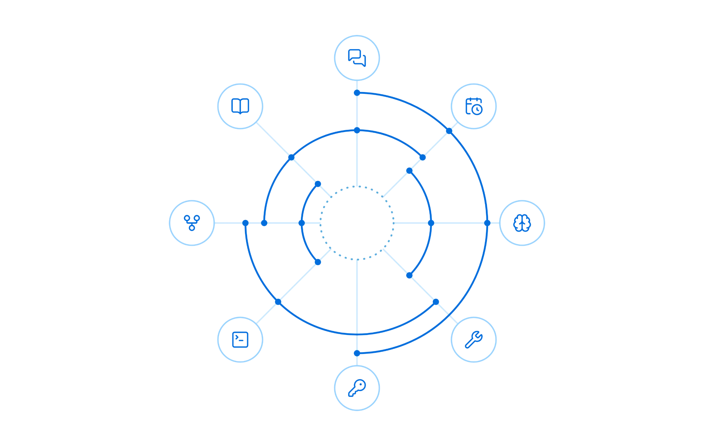
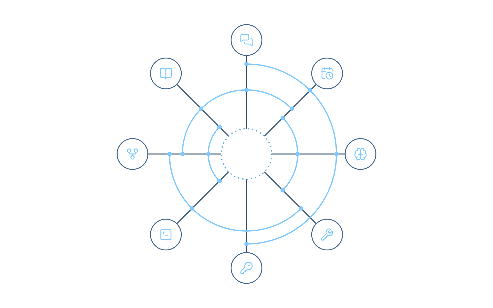

import ManagedDeepAgentsPublicBetaNote from '/snippets/python/langsmith/managed-deep-agents-public-beta-note.mdx';

模式将 memory、schedules、channels、browsers 和 subagents 等 Managed Deep Agents 原语组合成可用的 agents。请将每份指南作为起点，并根据你的工作流调整其中的 instructions 和 tools。

<ManagedDeepAgentsPublicBetaNote />

## 模式

- [每日摘要](/langsmith/python/managed-deep-agents-tutorial)：在 durable memory 中记住主题，并发送工作日新闻摘要。
- [监视模式](/langsmith/python/managed-deep-agents-watch-mode)：监控 Slack channel，默认保持安静，并安排后续检查。
- [目标](/langsmith/python/managed-deep-agents-goal-oriented)：安排周期性进度检查，直到多轮工作完成。
- [Dreaming](/langsmith/python/managed-deep-agents-dreaming)：每晚回顾某个人的 traces，以更新其 memory 并提出改进建议。
- [Swarm](/langsmith/python/managed-deep-agents-swarm)：将一次事件调查分发到多个并行异步 subagents。

---

<Callout icon="terminal-2">
    [Connect these docs](/use-these-docs) to your agent of choice via MCP for real-time answers.
</Callout>
<Callout icon="edit">
    [Edit this page on GitHub](https://github.com/langchain-ai/docs/edit/main/src/langsmith/managed-deep-agents-patterns.mdx) or [file an issue](https://github.com/langchain-ai/docs/issues/new/choose).
</Callout>

