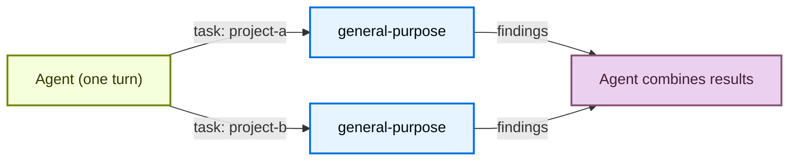

import ManagedDeepAgentsPublicBetaNote from '/snippets/python/langsmith/managed-deep-agents-public-beta-note.mdx';

为 managed deep agent 配置 subagents，用于委派专业化或上下文繁重的工作，例如调研某个主题、审查一项变更，或使用 async subagent 在后台运行长时间任务，同时 agent 继续与用户对话。每个 subagent 都有自己的 prompt 和上下文窗口，也可以使用自己的 model 和 tools。

<ManagedDeepAgentsPublicBetaNote />

Subagent 分为两种类型：

| 类型 | Agent 如何使用 | 适用场景 |
| --- | --- | --- |
| Subagent | 使用 `task` 调用并等待其回答 | Agent 需要先取得结果才能继续的专注型工作 |
| Async subagent | 使用 `start_async_task` 启动后继续工作；subagent 完成时会回报结果 | Agent 无需等待的长时间运行或并行工作 |

Subagent 运行在 agent 的 graph 内。Managed Deep Agents 会在同一 deployment 中将每个 async subagent 构建为独立的 graph。两种 subagent 都在 agent 的 [sandbox](/langsmith/python/managed-deep-agents-sandboxes) 中工作。关于 subagents 在开源 Deep Agents SDK 中的工作方式，请参见 [Subagents](/oss/python/deepagents/subagents) 和 [Async subagents](/oss/python/deepagents/async-subagents)。

<Note>
Async subagents 需要 `managed-deepagents>=0.10.0`。
</Note>

<a id="the-general-purpose-subagent"></a>

## 通用 subagent

即使在 [agent definition](/langsmith/python/managed-deep-agents-agent-definition) 中省略 `subagents`，每个 agent 也有一个内置的 `general-purpose` subagent。Agent 可在运行时将独立任务委派给它，包括[并行分派任务](#fan-out-tasks-in-parallel)，无需预先声明专用 subagent。

`general-purpose` 会自动继承 agent 的 skills、model 和 tools。它与其他 subagent 一样，在自己的 prompt 和上下文窗口中运行，无法访问 agent 的对话或 [instructions](/langsmith/python/managed-deep-agents-instructions)。在每项任务的 `description` 中提供所需的上下文、约束和预期输出。

当任务需要不同的 model、受限的工具集或可复用的系统提示时，请声明自定义 subagent。有关自定义选项，请参见[通用子代理](/oss/python/deepagents/subagents#the-general-purpose-subagent)。

<a id="declare-a-custom-subagent"></a>

## 声明自定义 subagent

在 agent definition 的 `subagents` 中添加 subagent 定义。每个 subagent 都需要 `name` 和 `description`；agent 使用 description 决定何时委派。要让 subagent 变为异步，请在其定义中添加 `async`：

<Tabs>
  <Tab title="Subagent">
```python agent.py
from managed_deepagents import define_deep_agent

agent = define_deep_agent(
    name="research-assistant",
    model="openai:gpt-6.1-sol",
    subagents=[
        {
            "name": "reviewer",
            "description": "Reviews a draft for accuracy and clarity.",
            "system_prompt": "Review the draft and list concrete fixes.",
        },
    ],
)
```
  </Tab>
  <Tab title="Async subagent">
```python agent.py
from managed_deepagents import define_deep_agent

agent = define_deep_agent(
    name="research-assistant",
    model="openai:gpt-6.1-sol",
    subagents=[
        {
            "name": "researcher",
            "description": "Researches a topic in the background.",
            "system_prompt": "Research the topic and report your findings.",
            "async": True,
        },
    ],
)
```
  </Tab>
</Tabs>


## 同步 subagents

Agent 使用 `task` tool 运行 subagent，并等待其回答。Subagent 运行在 agent 的 graph 内，并在 agent 的 [sandbox](/langsmith/python/managed-deep-agents-sandboxes) 中工作。

### Subagent 继承的内容

Subagent 以 agent 的配置为起点，并替换其定义所设置的内容：

| 设置 | 行为 |
| --- | --- |
| `model`, `tools`, `permissions`, `interrupt_on` | 使用 agent 的设置，除非 subagent 设置了自己的值 |
| `system_prompt` | 仅使用 subagent 自己的 prompt，不使用 agent 的 [instructions](/langsmith/python/managed-deep-agents-instructions) |
| `skills` | 仅加载 subagent 列出的 skills；列出 `"/skills/"` 可加载 agent 的 skills |
| `middleware`, `response_format` | 仅使用 subagent 自己的设置 |
| Memory | 不加载 |


处于 fork 模式的 subagent 会以 agent 对话的副本开始，并且还会使用 agent 的 instructions、middleware、skills 和 memory。请参见 [Choose a launch mode](/oss/python/deepagents/async-subagents#choose-a-launch-mode)。

<a id="fan-out-tasks-in-parallel"></a>

### 并行分派任务

要并行分派任务，agent 会在同一轮中发出多个 `task` 调用。内置的 `general-purpose` subagent 和任何已声明的自定义 subagent 都支持这种方式。每次调用都设置 `subagent_type` 和独立的 `description`，并在各自的上下文窗口中运行。Agent 在下一轮开始前收到所有结果，并将它们汇总为一条回答。要在任务后台运行时继续工作，agent 可以发起多个 `start_async_task` 调用。参见[异步 subagents](#async-subagents)。



例如，要并行调查多个项目的日志，请在 `instructions.md` 中添加以下指引：

```markdown instructions.md
When investigating multiple independent projects, delegate one task per project
to the general-purpose subagent in the same turn. Include the project, time
range, symptoms to look for, and expected output in each task description.
Wait for all results, then compare the findings and cite sources.
```

### 选择 MCP servers

在 subagent 上设置 `mcp`，可选择哪些 [MCP server](/langsmith/python/managed-deep-agents-mcp-connectors) 定义为其提供 tools。`mcp` 不会影响 subagent 的其他 tools。

<Note>
Subagent 的 MCP 选择需要 `managed-deepagents>=0.10.2`。


</Note>

| `mcp` 取值 | Subagent | Async subagent |
| --- | --- | --- |
| 省略 | 继承 agent 的 tools | 继承 agent 的 MCP servers |
| 定义列表 | 仅保留来自这些定义的 MCP tools。Agent 也必须加载它们。 | 仅加载这些定义 |
| `[]` 或 `None` | 无 MCP tools | 无 MCP tools |


Async subagent 只会连接到它选择的 servers，并且只请求这些 servers 的 credentials。

只有 [graph factory](/langsmith/python/managed-deep-agents-agent-definition#select-configuration-per-run) 才能在 agent 上设置 `mcp`。

```python agent.py expandable
from managed_deepagents import ManagedServerRuntime, connections, define_deep_agent, define_mcp

knowledge = define_mcp(
    servers={
        "langchainDocs": {"transport": "http", "url": "https://docs.langchain.com/mcp"},
        "notion": {
            "transport": "http",
            "url": "https://mcp.notion.com/mcp",
            "connection": connections.get("engineering-notion", {"type": "user"}),
        },
    },
)

planning = define_mcp(
    servers={
        "linear": {
            "transport": "http",
            "url": "https://mcp.linear.app/mcp",
            "connection": connections.get("engineering-linear", {"type": "user"}),
        },
    },
)

def agent(runtime: ManagedServerRuntime):
    return define_deep_agent(
        name="research-assistant",
        model="openai:gpt-5.5",
        mcp=[knowledge, planning],
        subagents=[
            {
                "name": "researcher",
                "description": "Answers questions from the docs and the team wiki.",
                "system_prompt": "Search the docs and Notion, and cite the pages you use.",
                "mcp": [knowledge],
            },
            {
                "name": "planner",
                "description": "Turns findings into Linear issues.",
                "system_prompt": "Create one Linear issue for each follow-up.",
                "mcp": [planning],
            },
        ],
    )
```


<a id="async-subagents"></a>

## 异步 subagents

Async subagent 会在自己的 thread 上运行，同时父 agent 继续工作，并在 subagent 完成或暂停时自动回报结果。关于完整生命周期、[tools](/oss/python/deepagents/async-subagents#use-the-async-subagent-tools) 和 [options](/oss/python/deepagents/async-subagents#configure-async-subagents)，请参见 [Async subagents](/oss/python/deepagents/async-subagents)。

Managed Deep Agents 会在同一个 deployment 中把每个 async subagent 构建为独立 graph（例如 `research-assistant--researcher`）。请直接在 `subagents` 中声明每个 async subagent（或在直接返回定义的 [graph factory](/langsmith/python/managed-deep-agents-agent-definition#select-configuration-per-run) 中声明），并为 `name` 和 `async` 提供静态值，因为 CLI 会在构建时发现它们，而不会执行你的代码。由 `mda dev` 或 deployment 提供服务的 agents 还会自动获得一个异步 `general-purpose` subagent 和异步 task tools。

不要在 `async` subagent 上设置 `graph_id`、`url`、`headers` 或 `runnable`；Managed Deep Agents 会自行连接 graph。`update_strategy`、`notify_parent`、`webhook` 和 `mode` 会透传给 Deep Agents。要通过 [remote subagent](/oss/python/deepagents/async-subagents#http-transport-remote) 调用另一个 deployment 上的 agent，请省略 `async`，并传入其 `graph_id`（对于 Managed Deep Agent，即其 `name`）和 `url`。


- **继承**：遵循与同步 subagents 相同的[继承规则](#what-a-subagent-inherits)。在 `fork` 模式下，它会复制对话，但保留自己的 prompt、tools 和 middleware。
- **Sandbox 和 traces**：以同一用户身份在独立 thread 上运行，共享 agent 的 sandbox，并在 LangSmith 中嵌套在 agent 的 trace 下。启用 [private threads](/langsmith/python/managed-deep-agents-identity) 时，不同用户会获得不同的 sandboxes。
- **Channels 和审批**：结果返回给父 agent，由它决定在 [channel](/langsmith/python/managed-deep-agents-channels) thread 中回复什么。在 Slack 中，[审批中断](/langsmith/python/managed-deep-agents-tools#human-in-the-loop)会显示在 thread 内；在其他 channels 中，请在 Studio 中或通过 API 恢复 subagent 的 thread（参见[响应中断](/langsmith/python/managed-deep-agents-tools#respond-to-an-interrupt)）。
- **评估**：`mda eval` 会为声明了 async subagents 的 agents 启动本地 Agent Server（需要 `managed-deepagents>=0.10.2` 以及匹配的 `mda` CLI）。未声明 async subagents 的被评估 agents 不会获得异步 `general-purpose` subagent 或异步 task tools。

## 另请参阅

- [Subagents](/oss/python/deepagents/subagents)
- [Async subagents](/oss/python/deepagents/async-subagents)
- [Agent definition](/langsmith/python/managed-deep-agents-agent-definition)
- [Sandboxes](/langsmith/python/managed-deep-agents-sandboxes)
- [Channels](/langsmith/python/managed-deep-agents-channels)

---

<div className="source-links">
<Callout icon="terminal-2">
    [Connect these docs](/use-these-docs) to your agent of choice via MCP for real-time answers.
</Callout>
<Callout icon="edit">
    [Edit this page on GitHub](https://github.com/langchain-ai/docs/edit/main/src/langsmith/managed-deep-agents-subagents.mdx) or [file an issue](https://github.com/langchain-ai/docs/issues/new/choose).
</Callout>
</div>
