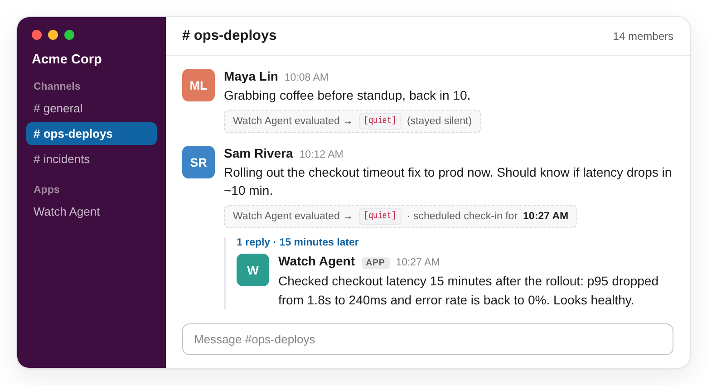
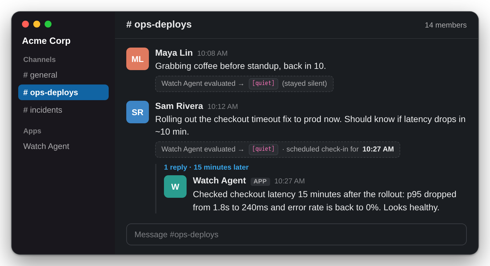

import ManagedDeepAgentsPublicBetaNote from '/snippets/python/langsmith/managed-deep-agents-public-beta-note.mdx';

监视模式让 [连接到 Slack 的 agent](/langsmith/python/managed-deep-agents-channels-slack) 无需等待 mention 即可读取 channel 消息。agent 会根据上下文决定回复还是保持静默。

<ManagedDeepAgentsPublicBetaNote />

<Note>
本 Python 示例需要 `managed-deepagents>=0.10.4` 以及匹配的 `mda` CLI。
</Note>






## 配置 Slack channel

从一个已有 [Slack channel](/langsmith/python/managed-deep-agents-channels-slack#add-a-slack-channel) 的项目开始，并更新其声明：

```python channels/slack.py
from managed_deepagents import channels

channel = channels.slack(
    trigger_mode="all",
    reactions=False,
    status=False,
)
```


bot 所在 channel 中的每条消息都会启动一次 run，每次 run 都会产生用量。关闭 reactions 和工作状态后，agent 选择不回复时就不会在 channel 中留下任何动静。

## 编写 instructions

在 `instructions.md` 中添加：

```markdown instructions.md
# Slack watch agent

Answer direct questions and mentions. For other messages, reply only when you
can add something useful. Otherwise, respond with exactly [quiet].
```

如果回复内容恰好是 `[quiet]`，则不会发布任何内容。

[部署该 agent](/langsmith/python/managed-deep-agents-deploy) 并将其邀请到某个 channel。发送一条无需回复的消息和一条 mention 该 agent 的消息，然后确认只有 mention 得到回复。

## 添加跟进检查

要让 agent 稍后跟进，请添加一个 [自定义 tool](/langsmith/python/managed-deep-agents-tools)，用于在当前 thread 中安排一次性 [检查](/langsmith/python/managed-deep-agents-schedules#create-schedules-at-runtime)。


```python tools/watch.py
from datetime import datetime, timedelta, timezone

from langchain.tools import tool
from managed_deepagents import ManagedDeepAgentRuntime


@tool
async def schedule_check_in(
    prompt: str, minutes: int, runtime: ManagedDeepAgentRuntime
) -> str:
    """Schedule one check-in in the current conversation, 2 to 1440 minutes from now."""
    origin = runtime.thread.origin
    if origin is None or origin.channel.provider != "slack":
        return "A Slack conversation is required to schedule a check-in."
    if not 2 <= minutes <= 1440:
        return "Choose a delay between 2 and 1440 minutes."
    item = await runtime.schedules.create(
        owner={"type": "agent"},
        at=datetime.now(timezone.utc) + timedelta(minutes=minutes),
        new_thread=False,
        prompt=prompt,
    )
    return f"Scheduled check-in {item['id']}."
```


注册该 tool：

```python agent.py
from managed_deepagents import define_deep_agent

from tools.watch import schedule_check_in

agent = define_deep_agent(
    name="watch-agent",
    model="openai:gpt-6.1-sol",
    tools=[schedule_check_in],
)
```


在 `instructions.md` 中添加：

```markdown instructions.md
When work is ongoing and a later check could help, call schedule_check_in.
When a check-in runs, reply only if there is something new; otherwise respond
with exactly [quiet].
```

例如，如果有人说一项修复正在逐步上线，agent 可以安排 15 分钟后的检查。检查以 agent 身份运行，并且只能看到已投递到其 thread 的消息。

## 扩展该模式

- 在 run 开始前筛选消息：在 `channels.slack(...)` 的 `on_event` `"message"` handler 中返回 `None`，以减少繁忙 channel 中的用量。


- 添加一个 Slack history [tool](/langsmith/python/managed-deep-agents-tools)，让检查可以读取 thread 中的最新回复。
- 要让 thread 跨多次检查保持跟踪，可让每次检查安排下一次检查，并在完成时提供用于[列出和删除](/langsmith/python/managed-deep-agents-schedules#manage-schedules)待处理检查的 tools。

## 另请参阅

- [Slack](/langsmith/python/managed-deep-agents-channels-slack)：设置 Slack app 并配置 channel 触发条件。
- [Schedules](/langsmith/python/managed-deep-agents-schedules)：创建和管理 runtime schedules。
- [Instructions](/langsmith/python/managed-deep-agents-instructions)：配置 agent 的行为。

---

<div className="source-links">
<Callout icon="terminal-2">
    [Connect these docs](/use-these-docs) to your agent of choice via MCP for real-time answers.
</Callout>
<Callout icon="edit">
    [Edit this page on GitHub](https://github.com/langchain-ai/docs/edit/main/src/langsmith/managed-deep-agents-watch-mode.mdx) or [file an issue](https://github.com/langchain-ai/docs/issues/new/choose).
</Callout>
</div>
