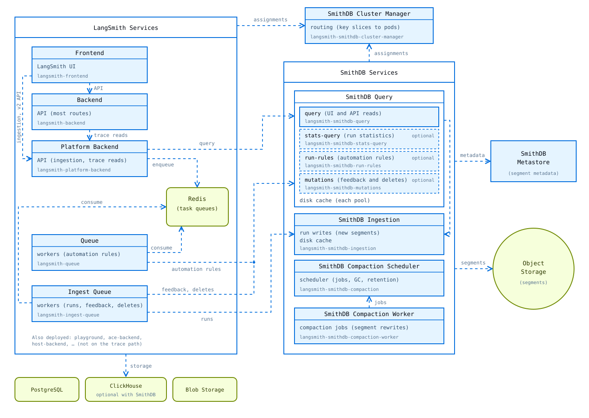
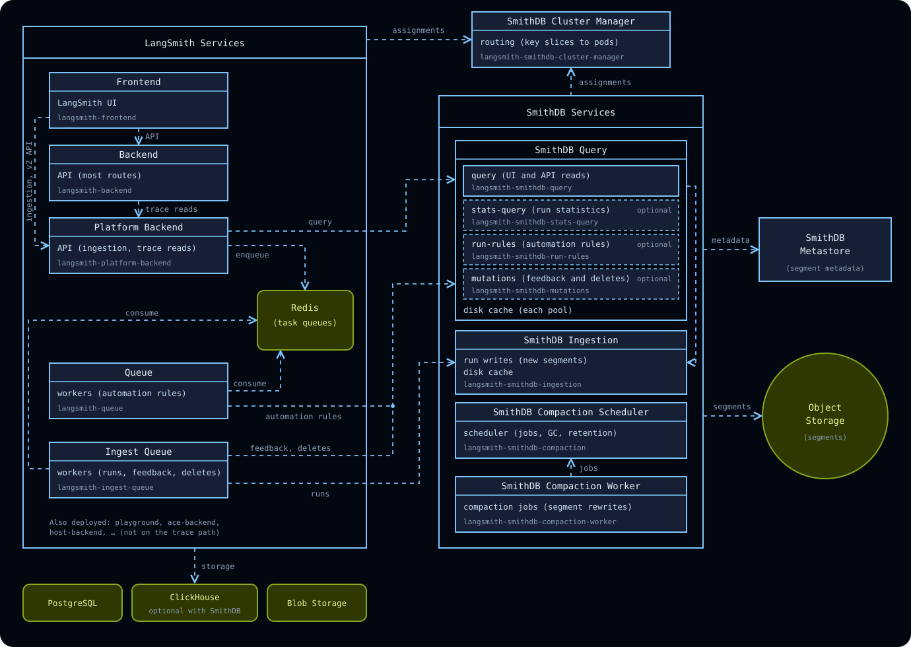

SmithDB 是 LangSmith 的 trace datastore。LangSmith 服务接收 run 和 feedback，并提供 UI 和 API。它们不会直接写入 SmithDB。它们把新数据放入 Redis 中的队列，再由 ingest queue worker 写入 SmithDB。读取则直接发往 SmithDB。SmithDB 将所有数据保存在 object storage 和它自己的 PostgreSQL 数据库（即 metastore）中。它的 pod 只保存数据的副本和进行中的工作。在后台，compaction 会把小数据文件合并成更大的文件、把 feedback 写入文件，并移除过期和已删除的数据，从而让查询保持快速。

关于 SmithDB 如何写入、读取、更改和压缩数据，请参见 [SmithDB 如何处理数据](/langsmith/self-host-smithdb-data-paths)。

## 组件

| 组件 | 说明 |
|---|---|
| Frontend | 提供 LangSmith UI。 |
| Backend | 提供大部分 LangSmith API。 |
| Platform backend | 接收来自客户端的 run 和 feedback，并将它们排队等待写入。把 trace 查询发送给 SmithDB。 |
| Queue | 运行 automation 规则，包括在线评估。 |
| Ingest queue | 把排队中的 run、feedback 和删除操作写入 SmithDB。 |
| SmithDB cluster manager | 决定哪个 SmithDB pod 处理哪些请求，使相关请求发往同一个 pod。 |
| SmithDB query | 响应查询，并应用 feedback 和删除。可选的[查询池](#query-pools)会把繁重工作从主 query pod 上移走，使 UI 和 API 读取保持快速。 |
| SmithDB ingestion | 存储新的 run 和 run 更新。 |
| SmithDB compaction scheduler | 规划 compaction 工作，包括移除过期数据。 |
| SmithDB compaction worker | 运行 compaction job：合并并重写 object storage 中的数据。 |
| SmithDB metastore migration | 在安装和升级期间准备 metastore。 |
| SmithDB migration | 从 ClickHouse 复制历史数据。（可选） |
| SmithDB metastore | 记录每个 SmithDB 数据文件，并存储新的 feedback。 |
| Object storage | 保存所有 SmithDB 数据文件。 |
| Redis, PostgreSQL | LangSmith 的 datastore。 |

## 查询池

默认情况下，一个 SmithDB 查询池 `query` 承担所有查询工作。对于更大的 deployment，可以启用[专用查询服务](/langsmith/self-host-smithdb-scale#dedicated-query-services)。每个服务都会从 `query` 池移走一类工作，使繁重负载不会拖慢 UI 和 API 读取。

| 池 | 工作 | 请求来源 |
|---|---|---|
| `query` | UI 和 API 的 trace 读取，例如 run 列表和 trace 视图。未启用的可选池的所有工作。 | Platform backend |
| `stats-query` | run 统计，例如项目和实验视图中的 run 数量、延迟和错误率。（可选） | Platform backend |
| `run-rules` | 找出 automation 规则和在线评估所适用的 run。queue 组件本身运行这些规则和评估。（可选） | Queue |
| `mutations` | 应用 feedback 和删除。（可选） | Ingest queue |

## 术语

| 术语 | 含义 |
|---|---|
| Run | trace 中的一步，例如一次 LLM 调用或一次工具调用。 |
| Feedback | 用户、评估器或 automation 规则对 run 给出的分数或评论。 |
| Task | Redis 队列中的一个工作单元，例如一批 run 或一批 feedback。每个 ingest queue worker pod 会同时处理多个 task。 |
| Ingestion queue, feedback queue | 由 ingest queue worker 处理的 Redis 队列。ingestion queue 保存 run，feedback queue 保存 feedback。 |
| Segment | object storage 中的一个数据文件，以及它在 metastore 中的行。SmithDB 写入 segment 后永不更改它。 |
| Metastore | SmithDB 的 PostgreSQL 数据库。它记录每个 segment，并存储新的 feedback。 |
| Disk cache | SmithDB pod 的缓存卷，位于本地 SSD 或网络磁盘上。它只保存数据副本，从不保存唯一副本。 |
| Query pool | 针对一类请求的一组 SmithDB query pod。请参见[查询池](#query-pools)。 |
| Compaction | 后台工作：把小 segment 合并成更大的 segment、把 feedback 写入文件，并移除过期和已删除的数据。 |
| Slice | cluster manager 分配给某个 SmithDB pod 的一段键空间。对于 ingestion，键是 tenant 和 project。对于查询，键是 tenant。 |

## 另请参阅

- [SmithDB 如何处理数据](/langsmith/self-host-smithdb-data-paths)
- [在自托管 LangSmith 上启用 SmithDB](/langsmith/self-host-smithdb)
- [SmithDB 指标参考](/langsmith/self-host-smithdb-metrics)
- [按规模配置 SmithDB](/langsmith/self-host-smithdb-scale)
- [故障排查 SmithDB](/langsmith/self-host-smithdb-troubleshooting)

---

<Callout icon="terminal-2">
    [Connect these docs](/use-these-docs) to your agent of choice via MCP for real-time answers.
</Callout>
<Callout icon="edit">
    [Edit this page on GitHub](https://github.com/langchain-ai/docs/edit/main/src/langsmith/self-host-smithdb-architecture.mdx) or [file an issue](https://github.com/langchain-ai/docs/issues/new/choose).
</Callout>

