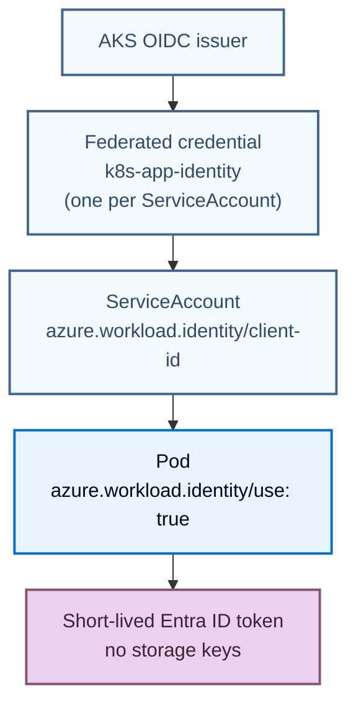
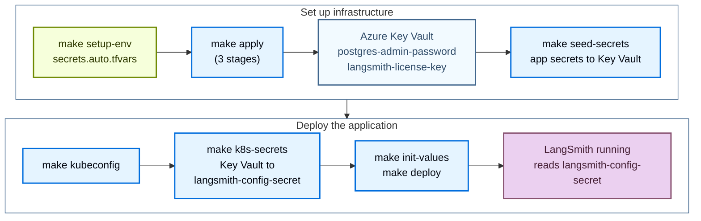

了解 [Azure Terraform modules](https://github.com/langchain-ai/terraform/tree/main/modules/azure) 会预配哪些内容，以及各部分如何协同工作，这样你就可以在运行 `make apply` 之前规划容量、加固安全并自定义 LangSmith 部署。

如果已准备好安装，请从[部署流程指南](/langsmith/self-host-terraform-azure-deploy)开始。

## 平台分层

LangSmith 在 Azure 上分阶段部署。每个阶段都在前一阶段之上增加一层能力。所有层共享同一个 AKS 集群和 `langsmith` namespace。


| 阶段 | 分层 | 新增内容 |
|---|---|---|
| Infrastructure | Azure infrastructure | VNet、AKS、Postgres、Redis、Blob、Key Vault、cert-manager、KEDA、ingress controller、可选的 SmithDB metastore |
| Application | LangSmith base | frontend、backend、platform-backend、queue、ingest-queue、ace-backend、clickhouse、playground |
| LangSmith Deployment add-on | LangSmith Deployment | host-backend、listener、operator + 每个 deployment 的 pods |
| Fleet add-on | Fleet | fleet-tool-server、fleet-trigger-server、in-cluster Fleet Redis |
| Insights + Polly add-on | Insights + Polly | Insights 分析（基于 ClickHouse）、Polly eval agent（静态 `standalone-polly` pods） |
| LLM Gateway add-on | LLM Gateway（beta） | agent-gateway，加上带 PII 脱敏的 presidio-analyzer |

Terraform 通过 `make apply` 预配基础设施层。应用层和 add-on 层通过 Helm 部署，使用 `make init-values` 和 `make deploy`。

## 部署层级

每个层级都从 `infra/` 中的一个模板开始，每个模板设置对应的 `sizing_profile`：

| 模板 | 层级 | `sizing_profile` |
|---|---|---|
| `terraform.tfvars.minimum` | 轻量部署，全部 in-cluster | `minimum` |
| `terraform.tfvars.dev` | 外部 Postgres 和 Redis，更小的节点池 | `dev` |
| `terraform.tfvars.production` | 生产环境，外部托管服务 | `production` |

### Light 部署（全部 in-cluster）

```txt
AKS Cluster
├── langsmith namespace
│   ├── frontend, backend, platform-backend, playground, queue, ace-backend
│   ├── clickhouse (in-cluster pod)
│   ├── postgres   (in-cluster pod)
│   └── redis      (in-cluster pod)
├── Envoy Gateway (Azure Load Balancer → Envoy)
└── cert-manager  (Let's Encrypt TLS)

Azure
├── Azure Blob Storage  (trace payloads, always external)
└── Azure Key Vault     (secrets)
```

`terraform.tfvars.minimum` 设置：

```hcl
postgres_source   = "in-cluster"
redis_source      = "in-cluster"
clickhouse_source = "in-cluster"
```

### Production（外部托管服务）

```txt
AKS Cluster
├── langsmith namespace
│   ├── frontend, backend, platform-backend, playground, queue, ingest-queue, ace-backend
│   └── clickhouse (in-cluster; use LangChain Managed for production scale)
└── Envoy Gateway + cert-manager

Azure Managed Services
├── Azure DB for PostgreSQL Flexible Server (private VNet)
├── Azure Managed Redis (private VNet)
├── Azure Blob Storage (Workload Identity, no static keys)
└── Azure Key Vault
```

## 网络

### Light 部署

当 `unique_resource_names = true`（每个模板都会设置）时，VNet 名为 `ls-vnet-<name_prefix>`。每个子网名称都以 VNet 名称开头。

```txt
ls-vnet-<name_prefix>
└── subnet-0    (AKS nodes only)
    No Postgres/Redis subnets; chart-managed pods handle both
```

### Production

```txt
ls-vnet-<name_prefix>
├── subnet-0              (AKS nodes)
├── subnet-postgres       (Azure DB for PostgreSQL Flexible Server, SmithDB metastore)
└── subnet-redis          (Azure Managed Redis)
```

当 `enable_smithdb = true` 时，Terraform 还会创建 `subnet-postgres`；当 `create_bastion = true` 时创建 `subnet-bastion`；当 `ingress_controller = "agic"` 时创建 `subnet-agic`。bastion 和 AGIC 子网只在 Terraform 自行创建的 VNet 中创建；设为 `create_vnet = false` 时，需要提供 `bastion_subnet_id` 和 `agic_subnet_id`。仅当 `enable_subnet_nsgs = true` 时，网络安全组才会挂载到这些子网。

AKS 节点没有公网 IP。默认情况下，它们通过 AKS 托管负载均衡器上的出站公网 IP 进行出站访问。要让出站流量经过自己的防火墙或 NAT 网关，请提供 AKS 子网并设置 `aks_outbound_type`（参见[网络变量](/langsmith/self-host-terraform-azure-variables#networking)）。module README 的 "Egress through your network" 一节列出了出站路径必须放行的目标。除非用 `aks_authorized_ip_ranges` 加以限制，或用 `aks_private_cluster_enabled` 设为私有，AKS API server 是公网可达的。Postgres 和 Redis 没有公网 endpoint；两者都只能通过私有 DNS 解析从 VNet 内访问。Terraform 会在部署资源组中创建私有 DNS zone 并将其链接到 VNet。在 hub-and-spoke 网络中，用 `postgres_private_dns_zone_id`、`storage_private_dns_zone_id` 和 `keyvault_private_dns_zone_id` 提供中心 DNS zone，由 zone 的所有者完成链接。

## 应用核心服务

| 服务 | 用途 | 端口 | HPA | Workload Identity |
|---|---|---|---|---|
| `langsmith-frontend` | React UI | 3000 | 2 到 10 | 否 |
| `langsmith-backend` | 主 API（traces、runs、projects、API keys、feedback） | 1984 | 3 到 10 | 是（Blob） |
| `langsmith-platform-backend` | 组织与用户管理、认证、计费、设置 | 1986 | 2 到 10 | 是（Blob） |
| `langsmith-playground` | LLM prompt playground UI | 3001 | 1 到 5 | 否 |
| `langsmith-queue` | Trace ingestion worker（Redis 到 ClickHouse + Blob） | None | 3 到 10 + KEDA | 是 |
| `langsmith-ingest-queue` | 专用的高吞吐量 ingestion worker | None | 3 到 10 + KEDA | 是 |
| `langsmith-ace-backend` | 异步计算（dataset runs、evaluations、后台任务） | None | 1 到 5 | 否 |
| `langsmith-clickhouse` | 列式存储（trace spans、run metadata、eval 结果） | 8123, 9000 | StatefulSet，单副本，500Gi PVC | 否 |

<Warning>
In-cluster ClickHouse 仅适用于 dev/POC（单 pod、无副本、无备份）。生产环境请使用 [LangChain Managed ClickHouse](/langsmith/langsmith-managed-clickhouse) 或自行管理的外部集群。
</Warning>

<Note>
[SmithDB](https://www.langchain.com/blog/introducing-smithdb?utm_source=docs) 是 LangSmith 专用的 observability 后端，从版本 0.16.0 起可用于 self-hosted LangSmith（参见 [self-hosted support](/langsmith/smithdb-sdk-migration#about-self-hosted)）。这些 Terraform module 默认预配 ClickHouse，因此前几节中的指引适用于大多数部署。设置 `enable_smithdb = true` 可添加 SmithDB 基础设施：专属的 PostgreSQL 18 metastore、一个 storage account 和 Blob container、Workload Identity，以及 Premium SSD v2 缓存卷。在 Azure 上，SmithDB 要求 LangSmith Helm chart 0.17 线上的稳定版本，`v0.17.*` module tag 部署的正是该线。在 `v0.16.*` 线上，SmithDB 需要 v0.16.56 或更高版本的 module tag，并设置 `langsmith_helm_chart_version = "~0.17.0"`。
</Note>

### 一次性任务

| Job | 用途 |
|---|---|
| `langsmith-backend-migrations` | PostgreSQL schema 迁移 |
| `langsmith-backend-ch-migrations` | ClickHouse schema 迁移 |
| `langsmith-backend-auth-bootstrap` | 使用 `langsmith-config-secret` 中的 `initial_org_admin_password` 创建初始组织和 admin 账号 |

## LangSmith Deployment add-on

| 服务 | 用途 | Workload Identity |
|---|---|---|
| `langsmith-host-backend` | LangSmith Deployment control plane API。管理 deployment 生命周期，提供 deployment metadata。 | 是 |
| `langsmith-listener` | 监听 host-backend 的状态变化，创建和更新 `LangGraphPlatform` CRD。 | 是 |
| `langsmith-operator` | Kubernetes operator。Azure 专属：注入 `azure.workload.identity/use: "true"` + `langsmith-ksa`，让每个 agent pod 通过 Workload Identity 访问 Blob Storage。 | 否 |

## Fleet add-on

Fleet 取代旧版 Agent Builder add-on。设置 `enable_fleet = true`，它要求 `enable_deployments = true` 和 `postgres_source = "external"`。`enable_fleet` 与 `enable_agent_builder` 互斥。

| Pod | 类型 | 角色 | Workload Identity |
|---|---|---|---|
| `langsmith-fleet-tool-server` | 静态 | MCP tool 执行服务器 | 是 |
| `langsmith-fleet-trigger-server` | 静态 | Webhook 接收器与定时触发引擎（单副本） | 是 |
| `langsmith-standalone-fleet-redis` | StatefulSet | Fleet 的 in-cluster Redis，由 chart 捆绑 | 否 |

Fleet 将其数据存储在 Azure PostgreSQL 服务器上一个专属的 `langsmith_fleet` 数据库中。Terraform 会创建该数据库和 `langsmith-fleet-postgres` Kubernetes secret。

## Insights 与 Polly add-on

**Insights**：以静态 `standalone-insights` api-server 和 queue pods 运行。从 `langsmith-config-secret` 读取 `insights_encryption_key`。切勿轮换该 key：它会永久损坏现有的 Insights 数据。

**Polly**：以静态 `standalone-polly` api-server 和 queue pods 运行，并需要 `enable_deployments = true`。从 `langsmith-config-secret` 读取 `polly_encryption_key`。轮换警告与 Insights 相同。

## Azure 托管服务

当 `postgres_source = "external"` 且 `redis_source = "external"`（推荐的生产设置）时，Terraform 会预配：

### Azure DB for PostgreSQL Flexible Server

- 存储组织、用户、projects、API keys、设置。
- 要求 PostgreSQL ≥ 14。`postgres` module 默认将 `postgres_version` 设为 `14`。
- 由 `postgres` module 自动启用的扩展：`btree_gin`、`btree_gist`、`pgcrypto`、`citext`、`pg_trgm`。
- 仅限私有 VNet（`subnet-postgres`），SSL 端口 5432。
- 密钥：`langsmith-postgres-secret`，由 `k8s-bootstrap` Terraform module 创建。

### Azure Managed Redis

- Trace ingestion queue、pub/sub、短期缓存。
- Azure Managed Redis 托管引擎版本；没有可设置的版本变量。
- 每个 LangSmith 安装必须使用自己专属的 Redis。共享实例会导致 deployment 任务路由错误。
- 仅限私有 VNet（`subnet-redis`），TLS 端口 10000。
- 密钥：`langsmith-redis-secret`，由 `k8s-bootstrap` Terraform module 创建。

### Azure Blob Storage

- Trace payload：大型输入与输出、附件。
- 通过 `k8s-app-identity` Managed Identity 使用 Workload Identity（无静态密钥）。
- 始终必需。禁用 blob storage 会在大 payload 时导致集群故障。
- 前缀：`ttl_s/`（14 天 TTL）、`ttl_l/`（400 天 TTL）。

### Azure Key Vault

- 所有 LangSmith 机密的集中式 secret store。
- 默认为 vault 防火墙后面的公网 endpoint。`keyvault_private_endpoint_enabled = true` 会将 vault 迁移到 Private Endpoint 并关闭公网访问，因此 Terraform 和密钥脚本必须在网络内部运行。
- 密钥流转：`make seed-secrets` 将应用机密写入 Key Vault，然后 `make k8s-secrets` 用它们构建 `langsmith-config-secret`。参见[密钥流转](#secret-flow)。

## Workload Identity

Microsoft Entra ID token 交换通过 AKS OIDC issuer 完成。Pods 无需静态密钥即可访问 Blob Storage。



Workload Identity 集中在 `infra/modules/k8s-cluster/` 中，与 managed identity 和 OIDC issuer 放在一起，这避免了循环依赖，也简化了新增 ServiceAccount 的过程。

### 哪些 pods 需要 Workload Identity

每个读取 blob storage 环境变量的 pod 必须具备：

1. 在 Terraform 中注册的 federated credential（`infra/modules/k8s-cluster/main.tf`）。
2. Deployment 上的 `azure.workload.identity/use: "true"` 标签。
3. ServiceAccount 上的 `azure.workload.identity/client-id` 标注。

| Pod | 阶段 | 需要 WI |
|---|---|---|
| `langsmith-backend` | Application | 是 |
| `langsmith-platform-backend` | Application | 是 |
| `langsmith-queue` | Application | 是 |
| `langsmith-ingest-queue` | Application | 是 |
| `langsmith-host-backend` | LangSmith Deployment add-on | 是 |
| `langsmith-listener` | LangSmith Deployment add-on | 是 |
| `langsmith-fleet-tool-server` | Fleet add-on | 是 |
| `langsmith-fleet-trigger-server` | Fleet add-on | 是 |
| `langsmith-agent-gateway` | LLM Gateway add-on | 是 |
| `langsmith-presidio-analyzer` | LLM Gateway PII 脱敏 | 是 |
| `langsmith-frontend` | Application | 否 |
| `langsmith-playground` | Application | 否 |
| `langsmith-ace-backend` | Application | 否 |
| `langsmith-clickhouse` | Application | 否 |
| `langsmith-operator` | LangSmith Deployment add-on | 否 |

所有 federated credential 都注册在 `infra/modules/k8s-cluster/main.tf` 的 `service_accounts_for_workload_identity` 中。每个名称都是 `<release>-<component>`，其中 `<release>` 是 chart fullname（默认为 `langsmith`）。无论是否设置 `enable_llm_gateway`，Terraform 都会注册两个 LLM Gateway credential。`v0.16.*` module tag 注册除两个 LLM Gateway credential 之外的所有 credential。SmithDB 使用自己的 ServiceAccount 和 identity。新增访问 blob storage 的 pod，需要把它的 ServiceAccount 名称加入该列表，然后运行 `make apply`。

如果 pod 的 ServiceAccount 没有注册 federated credential，Microsoft Entra ID 会拒绝 token 交换，pod 在启动时 panic：

```txt
panic: blob-storage health-check failed: get container properties failed:
DefaultAzureCredential: failed to acquire a token.
WorkloadIdentityCredential authentication failed.
  AADSTS700213: No matching federated identity record found for presented assertion subject
```

## 密钥流转



密钥流转按以下顺序进行。`make deploy-all` 会运行步骤 2 到 5；当 `secrets.auto.tfvars` 不存在时，`make apply` 会先运行 `make setup-env`：

1. `make setup-env` 写入 `secrets.auto.tfvars`，该文件被 gitignore，Terraform 会自动读取。它会提示输入 PostgreSQL admin 密码、license key 和初始 org admin 邮箱。设置 `LANGSMITH_PG_PASSWORD`、`LANGSMITH_LICENSE_KEY` 和 `LANGSMITH_ADMIN_EMAIL` 可跳过提示。它不会写入 Key Vault。
1. `make apply` 创建 Key Vault。Terraform 只会向其写入 `postgres-admin-password` 和 `langsmith-license-key`，且仅在 `keyvault_manage_secrets = true`（默认值）时写入。`k8s-bootstrap` module 会创建 `langsmith-license`，在外部 Postgres 和 Redis 时还会创建 `langsmith-postgres-secret` 和 `langsmith-redis-secret`。
1. `make seed-secrets` 将应用机密直接写入 Key Vault：admin 密码（提示输入，或 `LANGSMITH_ADMIN_PASSWORD`）、API key salt、JWT secret 和四个 Fernet 加密 key。设为 `keyvault_manage_secrets = false` 时，它还会写入 Terraform 跳过的两个机密。
1. `make kubeconfig` 获取 AKS 凭证。随后 `make k8s-secrets` 读取 Key Vault，创建包含全部八个 key 的 `langsmith-config-secret`；当 Key Vault 中存在 `langsmith-oauth-*` 机密时，还会加上 `oauth_client_id`、`oauth_client_secret` 和 `oauth_issuer_url`。
1. `make init-values` 和 `make deploy` 使用 `config.existingSecretName = "langsmith-config-secret"` 安装 chart。任何 values 文件中都不会内联机密。

**关键规则：** `secrets.auto.tfvars` 永远不会提交。在任何机器上重新运行 `make setup-env` 即可恢复它。应用机密永远不会经过 Terraform state。`make seed-secrets` 不会覆盖已存在的机密，因为新的 API key salt、JWT secret 或 Fernet key 会破坏正在运行的部署。需要轮换机密时，用 `make keyvault` 刻意执行。

## Ingress 选项

| Controller | 变量 | DNS label 支持 | 说明 |
|---|---|---|---|
| `nginx` | `ingress_controller = "nginx"` | 是 | 通过 Helm 安装的 NGINX，标准 Kubernetes Ingress。 |
| `istio-addon` | `ingress_controller = "istio-addon"` | 是 | AKS 托管的 Istio service mesh。使用 `istio_addon_revision` 锁定版本。 |
| `istio` | `ingress_controller = "istio"` | 是 | 通过 Helm 自托管的 Istio。完全控制版本与配置。 |
| `agic` | `ingress_controller = "agic"` | 是 | Azure Application Gateway v2 + AKS 托管的 `ingress_application_gateway` add-on。网关运行 `Standard_v2`；`create_waf = true` 会将其切换到 `WAF_v2` 并挂载 WAF 策略。仅 HTTP、使用自定义域名的 `dns01`，或使用自有证书的 `existing`。 |
| `envoy-gateway` _（默认）_ | `ingress_controller = "envoy-gateway"` | 是 | 原生 Gateway API。使用 `envoyproxy/gateway-helm`。 |
| `none` | `ingress_controller = "none"` | 否 | 自带 ingress。 |

Azure 公网 IP DNS label（`dns_label`）适用于除 `none` 之外的所有 controller。对于 `nginx`、`istio` 和 `istio-addon`，`deploy.sh` 会将 `service.beta.kubernetes.io/azure-dns-label-name` 标注应用到 controller 的 LoadBalancer service。对于 `envoy-gateway`，标签由 EnvoyProxy 资源携带。对于 `agic`，Terraform 将标签设置在 Application Gateway 公网 IP 上。

完整的 TLS 兼容性矩阵和各 controller 的设置，请参见 [Azure module 仓库](https://github.com/langchain-ai/terraform/blob/main/modules/azure/INGRESS_CONTROLLERS.md)中的 `INGRESS_CONTROLLERS.md`。

## 资源规格

提供四种 sizing profile。

| Profile | 使用场景 | 设置方式 |
|---|---|---|
| `minimum` | 成本占位、CI 冒烟测试、单人演示 | 在 `terraform.tfvars` 中设置 `sizing_profile = "minimum"` |
| `dev` | 开发者使用、集成测试、POC | `sizing_profile = "dev"` |
| `production` | 真实流量，多副本 + HPA | `sizing_profile = "production"` _（推荐）_ |
| `production-large` | 约 50 个用户、约 1000 traces/sec | `sizing_profile = "production-large"` |

### AKS 节点池

| 节点池 | VM 规格 | vCPU | 内存 | 最少 | 最多 | 用途 |
|---|---|---|---|---|---|---|
| default | `Standard_D8s_v5` | 8 | 32 GB | 1 | 10 | LangSmith 核心与系统 pods（生产环境设为 3） |
| large | `Standard_D16s_v5` | 16 | 64 GB | 0 | 2 | ClickHouse（in-cluster）、LangSmith Deployment agent pods |

<Note>
ClickHouse（in-cluster 时）根据 profile 请求 1 到 4 CPU 和 2 到 16 GB 内存。使用 [LangChain Managed ClickHouse](/langsmith/langsmith-managed-clickhouse) 时，`large` 节点池只用于 LangSmith Deployment operator 派生的 agent pods。
</Note>

## 可选 module

每个 module 都由 count 控制（`0` 禁用，`1` 启用）。可任意组合启用；核心部署不依赖它们。

| module | 变量 | 使用场景 |
|---|---|---|
| `waf` | `create_waf = true` | Azure WAF 策略（OWASP 3.2 + bot 防护），默认为 `Detection` 模式（`waf_mode`）。`ingress_controller = "agic"` 时，Terraform 会将其挂载到 Application Gateway。使用其他 controller 时，策略保持未挂载状态，直到你自己的 Application Gateway 引用它。Azure Front Door 无法使用此策略类型。 |
| `diagnostics` | `create_diagnostics = true` | Log Analytics 工作区 + AKS、Key Vault、PostgreSQL 的诊断设置（`ingress_controller = "agic"` 时还包括 Application Gateway）。生产 observability 推荐。 |
| `bastion` | `create_bastion = true` | 带静态公网 IP 的跳板 VM，通过 `az ssh vm` 和 Entra ID SSH 访问私有 AKS。 |
| `dns` | `create_dns_zone = true` | Azure DNS zone + A 记录。使用自定义域名的 DNS-01 证书签发必需。 |
| `smithdb` | `enable_smithdb = true` | SmithDB 基础设施：PostgreSQL 18 metastore、storage account 和 Blob container，以及 Workload Identity。需要 chart 0.17 线。 |

---

<div className="source-links">
<Callout icon="terminal-2">
    [Connect these docs](/use-these-docs) to your agent of choice via MCP for real-time answers.
</Callout>
<Callout icon="edit">
    [Edit this page on GitHub](https://github.com/langchain-ai/docs/edit/main/src/langsmith/self-host-terraform-azure-architecture.mdx) or [file an issue](https://github.com/langchain-ai/docs/issues/new/choose).
</Callout>
</div>
