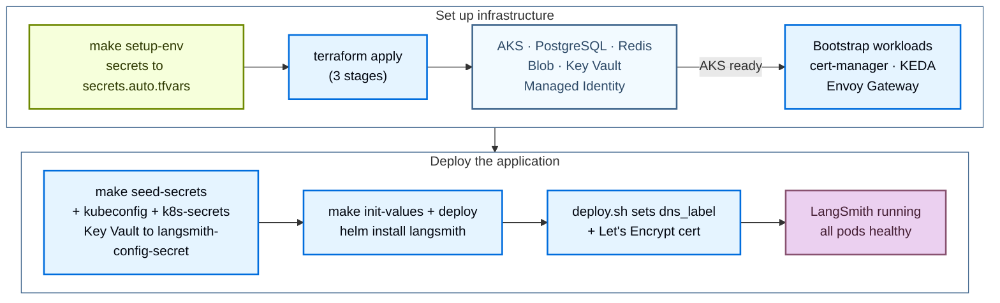

使用公开的 [Terraform modules](https://github.com/langchain-ai/terraform/tree/main/modules/azure) 将 LangSmith 部署到 Azure。以代码方式管理部署，你可以在多个订阅之间对 LangSmith 环境进行版本化、审查和复现，而不必在 Azure Portal 中逐一点击。

安装分为两个阶段：

1. **Infrastructure**：Terraform 预配 AKS、Postgres、Redis、Blob Storage、Key Vault、cert-manager、KEDA 和 ingress。
2. **Application**：Helm 在集群上安装 LangSmith chart。

完成基础安装后，通过设置开关并重新部署来启用可选 add-on（LangSmith Deployment、Fleet、Insights、Polly、SmithDB 和 LLM Gateway）以及 SSO。

<Note>
这些页面遵循 module 的 `v0.17.*` release tag，它们部署 LangSmith Helm chart 0.17 线。在 module tag 中，前两个数字表示 chart 线，最后一个数字是 module 修订号，因此 `v0.17.4` 部署的仍是 0.17 chart 的最新补丁。`v0.16.*` tag 部署 chart 0.16。它们没有 LLM Gateway 或 SSO 开关，联合的是 8 个 Workload Identity ServiceAccount 而不是 10 个。从 v0.16.56 起，只有在设置 `langsmith_helm_chart_version = "~0.17.0"` 时才部署 SmithDB。已运行 chart 0.17 的部署无法回退到 0.16。
</Note>



## 前置条件

### 所需工具

| 工具 | 版本 | 用途 |
|---|---|---|
| Azure CLI（`az`） | 2.50 或更高 | 认证、查询 Azure 资源、管理 AKS 凭证 |
| Terraform | 1.11.0 或更高 | 运行基础设施 module |
| `kubectl` | 1.34 或更高 | 检查 AKS 集群 |
| Helm | 3.12 或更高 | 安装和管理 LangSmith chart |
| `kubelogin` | latest | 登录启用了 Microsoft Entra ID 集成的集群（`aks_entra_only`，或附带 Entra ID 集成的集群）。其他情况不需要 |

```bash
brew install azure-cli kubectl helm
brew tap hashicorp/tap && brew install hashicorp/tap/terraform

az --version
terraform version
kubectl version --client
helm version

# Only for a cluster with Entra ID integration
brew install Azure/kubelogin/kubelogin
kubelogin --version
```

设为 `aks_private_cluster_enabled = true` 时，请从能访问 API server 私有 endpoint 的主机（例如集群 VNet 内的跳板机或对等网络中的机器，且 DNS 能解析私有 zone）运行 Terraform 和各 `make` 目标。设为 `keyvault_private_endpoint_enabled = true` 时，`make apply`、`make seed-secrets` 和 `make k8s-secrets` 需要能解析 vault 私有 endpoint 的主机。参见 [Key Vault 变量](/langsmith/self-host-terraform-azure-variables#key-vault)。

### 所需的 Azure RBAC

运行 Terraform 的身份需要在订阅上拥有以下角色：

| 角色 | 用途 |
|---|---|
| `Contributor` | 创建和管理所有 Azure 资源 |
| `User Access Administrator` 或 `Role Based Access Control Administrator` | 为 Key Vault、Blob、cert-manager managed identity 创建角色分配 |

`Owner` 包含两者。仅 `Contributor` 不够，因为它无法创建角色分配。

用户分配的 control plane identity（`aks_control_plane_identity = "user"`）和你提供的私有 DNS zone 需要更多授权，参见 [PERMISSIONS.md](https://github.com/langchain-ai/terraform/blob/main/modules/azure/PERMISSIONS.md)。

### 认证

```bash
az login
az account set --subscription <your-subscription-id>
az account show
```

你还需要一个 LangSmith license key（可[联系 LangChain 销售团队](https://www.langchain.com/contact-sales)），以及一个 `dns_label`（Azure 子域名，无需 DNS 设置）或自定义的 `langsmith_domain`。

## 快速开始

要从零最快启动一个运行中的 LangSmith 实例：

```bash
# 1. Clone the public modules and check out the newest v0.17 release
git clone https://github.com/langchain-ai/terraform.git
cd terraform/modules/azure
git checkout "$(git tag -l 'v0.17.*' --sort=-v:refname | head -1)"

# 2. Generate terraform.tfvars interactively
make quickstart

# 3. Bootstrap secrets (writes infra/secrets.auto.tfvars, chmod 600, gitignored)
make setup-env

# 4. Validate environment
make preflight

# 5. Provision infrastructure (~15 to 20 min; each of the three stages prompts)
make init
make apply

# 6. Seed app secrets into Key Vault, get cluster credentials, push secrets into the cluster
make seed-secrets
make kubeconfig
make k8s-secrets

# 7. Deploy LangSmith via Helm (~10 min)
make init-values
make deploy
```

或在 `make init` 之后，一次性运行第 5 到第 7 步的剩余部分：

```bash
make deploy-all   # apply → seed-secrets → kubeconfig → k8s-secrets → init-values → deploy
```

`make deploy-all` 会在每个 `make apply` 阶段提示处停下。要跳过提示，运行 `make deploy-all ARGS="-auto-approve"`。`make seed-secrets` 这一步还会提示输入初始 admin 密码，因此无人值守运行时请导出 `LANGSMITH_ADMIN_PASSWORD`。

## 预配基础设施

Terraform 会预配以下 Azure 资源：

| 资源 | 类型 | 用途 |
|---|---|---|
| Resource Group | `azurerm_resource_group` | 所有资源的容器 |
| Virtual Network | `azurerm_virtual_network` | 隔离网络（默认 10.0.0.0/17） |
| AKS Cluster | `azurerm_kubernetes_cluster` | Kubernetes，所有工作负载运行于此 |
| Ingress Controller | Helm | 外部负载均衡器 + TLS 终止（默认 Envoy Gateway） |
| PostgreSQL Flexible Server | `azurerm_postgresql_flexible_server` | 组织配置、run metadata（external 层级） |
| Azure Managed Redis | `azapi_resource`（Microsoft.Cache/redisEnterprise） | Trace ingestion queue、pub/sub（external 层级） |
| Blob Storage | `azurerm_storage_account` | 原始 trace 对象，始终必需 |
| Managed Identity | `azurerm_user_assigned_identity` | 用于 pod 到 Blob 认证的 Workload Identity |
| Azure Key Vault | `azurerm_key_vault` | 存储所有 LangSmith 机密 |
| cert-manager | Helm | 自动化 TLS 证书管理 |
| KEDA | Helm | worker 的事件驱动自动扩缩容 |

### 克隆并配置

克隆 module 并检出最新的 `v0.17.*` release tag：

```bash
git clone https://github.com/langchain-ai/terraform.git
cd terraform/modules/azure
git checkout "$(git tag -l 'v0.17.*' --sort=-v:refname | head -1)"
```

要部署 chart 0.16，请将 `v0.17.*` 替换为 `v0.16.*`。

后续所有命令都在 `modules/azure/` 中运行。完整目标列表请运行 `make help`。

使用交互式向导生成 `terraform.tfvars`：

```bash
make quickstart
```

向导运行一份包含 10 个部分的问题清单，涵盖 profile、订阅与命名、网络、AKS 规格、ingress controller、DNS/TLS、后端服务、Key Vault、sizing profile 和安全 add-on。重复运行是安全的：每个提示处会预选现有值，按 Enter 即可保留。

更喜欢手动编辑：

```bash
cp infra/terraform.tfvars.example infra/terraform.tfvars
vi infra/terraform.tfvars
```

最少必需的变量：

```hcl
# Identity
subscription_id = "<your-azure-subscription-id>"

# Location
location = "eastus"

# Naming
name_prefix           = "prod"   # appended to resource names, for example ls-rg-prod
unique_resource_names = true     # new deployments only; see the following warning

# Deployment tier, production recommended
postgres_source   = "external"   # Azure DB for PostgreSQL
redis_source      = "external"   # Azure Managed Redis
clickhouse_source = "in-cluster" # use "external" + LangChain Managed for production

# DNS + TLS (HTTPS via Let's Encrypt on a free Azure subdomain)
dns_label              = "langsmith-prod"   # → langsmith-prod.eastus.cloudapp.azure.com
tls_certificate_source = "letsencrypt"
letsencrypt_email      = "ops@example.com"

# Sizing
sizing_profile = "production"   # minimum | dev | production | production-large
```

`environment` 默认为 `name_prefix`。仅当需要用不同的值标记资源时才设置它。

<Warning>
`name_prefix` 取代了 `identifier`。如果现有的 `terraform.tfvars` 设置了 `identifier = "-prod"`，请改为 `name_prefix = "prod"`。资源名称不会改变。

在现有部署上不要设置 `unique_resource_names`。开启它会重命名每个资源，Terraform 会以销毁并重建的方式执行。你会丢失 PostgreSQL 和 Blob Storage 数据。
</Warning>

<Warning>
In-cluster ClickHouse 以单 pod 运行，无副本也无备份，仅限 dev/POC。生产环境请使用 [LangChain Managed ClickHouse](/langsmith/langsmith-managed-clickhouse)。
</Warning>

所有变量请参见 [Azure 变量参考](/langsmith/self-host-terraform-azure-variables)。

### 引导机密

```bash
make setup-env
```

`setup-env.sh` 会写入 `infra/secrets.auto.tfvars`（被 gitignore，`chmod 600`）。Terraform 会自动拾取该文件；无需 shell 导出。

- **首次运行**：提示输入 PostgreSQL admin 密码（按 Enter 生成一个）、LangSmith license key 和 admin 邮箱。
- **后续运行**：每个提示都会把上一次的值作为默认值。要跳过提示，在环境中设置 `LANGSMITH_PG_PASSWORD`、`LANGSMITH_LICENSE_KEY` 或 `LANGSMITH_ADMIN_EMAIL`。

admin 密码和生成的应用机密不在这个文件中。`make seed-secrets` 会在 `make apply` 之后把它们写入 Key Vault。

### Preflight

```bash
make preflight
```

校验 Azure CLI 认证、当前订阅、必需的资源 provider，以及创建角色分配的权限。它还会检查订阅的 offer 类型、区域 vCPU 配额，以及该区域是否提供你的 PostgreSQL 版本和 SKU。它会确认全局唯一名称未被占用、`terraform.tfvars` 和 `secrets.auto.tfvars` 存在，以及 `terraform`、`kubectl`、`helm` 在 PATH 上。

订阅必须注册 11 个资源 provider：`Microsoft.ContainerService`、`Microsoft.DBforPostgreSQL`、`Microsoft.Cache`、`Microsoft.KeyVault`、`Microsoft.Storage`、`Microsoft.Network`、`Microsoft.Compute`、`Microsoft.Authorization`、`Microsoft.ManagedIdentity`、`Microsoft.OperationalInsights` 和 `Microsoft.Insights`。

### 执行 apply

```bash
make init
make apply   # ~15 to 20 min on first run; do not interrupt it
```

`make init` 会在 `infra/` 中运行 `terraform init`，下载包括 AzureRM 在内的 provider 并初始化 backend。每个 clone 运行一次。检出新的 module tag 之后，运行 `make init ARGS=-upgrade`。

<Note>
`make apply` 分三个阶段运行：Azure 基础设施（含 AKS）→ Kubernetes 引导（namespace、机密、cert-manager、KEDA）→ 其余资源（如 DNS zone 和 WAF）。每个阶段都会提示确认。要跳过全部三个提示，运行 `make apply ARGS="-auto-approve"`。
</Note>

### 集群凭证与 Kubernetes Secrets

`make apply` 完成后，将应用机密播种到 Key Vault，获取集群凭证，并把机密推入集群：

```bash
make seed-secrets  # admin password + generated secrets → Key Vault (never overwrites)
make kubeconfig    # fetches AKS credentials, merges into ~/.kube/config
make k8s-secrets   # Key Vault → langsmith-config-secret in the langsmith namespace
```

`make seed-secrets` 会提示输入 LangSmith admin 密码，或读取 `LANGSMITH_ADMIN_PASSWORD`。它会生成 API key salt、JWT secret 和四个 Fernet 加密 key。它只写入缺失的机密，因此可以安全地重复运行。

`make k8s-secrets` 从 Key Vault 读取 8 个机密（存在 `langsmith-oauth-*` 机密时还会加上那三个），并创建或更新 `langsmith-config-secret`。可安全重复运行。

在启用了 Microsoft Entra ID 集成的集群上，`make kubeconfig` 会转换 context，改用 `kubelogin` 以你的 `az` 身份登录。

### 验证基础设施

```bash
# All nodes Ready
kubectl get nodes

# Bootstrap components, all Running
kubectl get pods -n cert-manager           # 3 pods
kubectl get pods -n keda                   # 3 pods
kubectl get pods -n envoy-gateway-system   # Envoy Gateway controller (default ingress_controller)

# Workload Identity ServiceAccount, should have client-id annotation
kubectl get sa langsmith-ksa -n langsmith \
  -o jsonpath='{.metadata.annotations}'

# Terraform outputs that the Helm scripts read
terraform -chdir=infra output
```

## 部署 LangSmith

`make init-values` 生成 Helm values，`make deploy` 安装 LangSmith Helm chart。首次部署和 Day-2 重新部署都使用这两条命令。

### 使用 Helm 部署

#### 生成 Helm values

```bash
make init-values
```

`make init-values` 读取 `terraform output` 和 `terraform.tfvars`，生成所有字段都已填充的 `helm/values/values-overrides.yaml`：

- `config.hostname`，你的 FQDN（来自 `dns_label` 或 `langsmith_domain`）。
- `config.initialOrgAdminEmail`，第一个组织 admin 账号。
- `config.existingSecretName: langsmith-config-secret`，机密引用。
- `config.blobStorage`，storage account 名称 + container + Workload Identity client ID。
- 8 个 ServiceAccount 的 Workload Identity 标注（backend、platform-backend、queue、ingest-queue、host-backend、listener、fleet-tool-server、fleet-trigger-server）。
- Ingress + TLS 区块：`letsencrypt`、`dns01` 和 `existing` 使用 `langsmith-tls` secret 名称，`letsencrypt` 和 `dns01` 另有 cert-manager 标注。使用 `envoy-gateway` 时，chart 会创建 Gateway API 路由而不是 Ingress。
- Postgres 和 Redis 的外部 secret 引用（当 `postgres_source = "external"` / `redis_source = "external"` 时）。
- `insights.enabled` 和 `polly.enabled`，取自 `enable_insights` 和 `enable_polly`。

设为 `clickhouse_source = "external"` 时，`make init-values` 还会提示输入 ClickHouse 连接详情，并创建 `langsmith-clickhouse` secret。

`make init-values` 还会把 sizing overlay 和已启用的 add-on overlay 写入 `helm/values/`。其中大部分从 `helm/values/examples/` 复制，Insights、LLM Gateway 和 PII overlay 则是生成的。

#### 部署

```bash
make deploy   # ~10 min
```

`make deploy` 会执行以下操作：

1. 校验 `values-overrides.yaml` 存在，且是由当前的 `terraform.tfvars` 生成的。
1. 为 `nginx`、`istio` 和 `istio-addon` 的公网 IP 应用 `dns_label`，方式是为 LoadBalancer service 添加 `service.beta.kubernetes.io/azure-dns-label-name` 标注。
1. 当 `tls_certificate_source` 为 `letsencrypt` 或 `dns01` 时，创建 `letsencrypt-prod` cert-manager `ClusterIssuer`（幂等）。为 `existing` 时，检查名为 `langsmith-tls`、类型为 `kubernetes.io/tls` 的 Secret 是否存在。
1. 校验 `langsmith-config-secret` 存在；缺失时自动从 Key Vault 创建。使用外部 ClickHouse 时，检查 `langsmith-clickhouse` secret。
1. 校验 add-on 开关。Agent Builder 和 Fleet 需要 `enable_deployments = true`，Fleet 需要外部 PostgreSQL，且两者不能同时运行。
1. 构建并记录 values 链，并拒绝仍处于 chart 0.15 schema 的 values 文件。
1. 在继续之前自动恢复卡在 `pending-upgrade` 的 Helm release。
1. 对于 `envoy-gateway`，创建 `EnvoyProxy`（它携带 `dns_label`）、`GatewayClass` 和 `langsmith-gateway` Gateway。
1. 运行 `helm upgrade --install langsmith langchain/langsmith --timeout 20m`。足够长的 timeout 覆盖了 post-install 迁移 Job，首次安装时它最多需要 5 分钟。chart 版本为 `~0.17.0`（最新的 0.17 补丁），除非 `langsmith_helm_chart_version` 或 `CHART_VERSION` 环境变量指定了 0.17 补丁。脚本会拒绝其他 chart 线。
1. 为 `langsmith-ksa` ServiceAccount 标注 Workload Identity client ID。
1. 当 `enable_llm_gateway = true` 且 `ingress_controller` 为 `nginx` 或 `agic` 时，为 `/gateway/` 应用 `<release>-llm-gateway` Ingress，其中 `<release>` 是 chart fullname（默认为 `langsmith`），超时为 900 秒。网关关闭时，它会移除残留的 Ingress。

要在第二个终端观察 pods 的启动过程，运行 `kubectl get pods -n langsmith -w`。

### 验证部署

```bash
# All pods Running or Completed (~17 pods)
kubectl get pods -n langsmith

# Routes: HTTPRoutes for envoy-gateway, an Ingress for nginx, istio, and agic
kubectl get httproute -n langsmith
kubectl get ingress -n langsmith

# TLS certificate issued
kubectl get certificate -n langsmith   # READY: True

# Helm release status
helm list -n langsmith
```

预期的 pod 状态（约 5 分钟后全部 Running）：

```txt
langsmith-ace-backend-xxxxx              1/1   Running     0   5m
langsmith-backend-xxxxx                  1/1   Running     0   5m
langsmith-backend-auth-bootstrap-xxxxx   0/1   Completed   0   5m
langsmith-backend-ch-migrations-xxxxx    0/1   Completed   0   5m
langsmith-backend-migrations-xxxxx       0/1   Completed   0   5m
langsmith-clickhouse-0                   1/1   Running     0   5m
langsmith-frontend-xxxxx                 1/1   Running     0   5m
langsmith-ingest-queue-xxxxx             1/1   Running     0   5m
langsmith-platform-backend-xxxxx         1/1   Running     0   5m
langsmith-playground-xxxxx               1/1   Running     0   5m
langsmith-queue-xxxxx                    1/1   Running     0   5m
```

打开 `https://<HOSTNAME>`，使用 Key Vault 中的管理员邮箱和密码登录：

```bash
az keyvault secret show \
  --vault-name $(terraform -chdir=infra output -raw keyvault_name) \
  --name langsmith-admin-password \
  --query value -o tsv
```

### values 链

`make deploy` 按以下顺序应用 Helm values 文件（冲突时以最后一个文件为准）：

```txt
1. helm/values/values.yaml                              ← Azure base values (committed)
2. helm/values/values-overrides.yaml                    ← hostname, WI client-id, auth, postgres/redis
3. (add-on files when enable_* flags are set)           ← agent-deploys, agent-builder, fleet, insights, polly, llm-gateway, gateway-pii
4. helm/values/langsmith-values-sizing-<profile>.yaml   ← resource requests + HPA settings
5. helm/values/langsmith-values-smithdb*.yaml           ← when enable_smithdb = true
```

`helm/values/` 中生成的文件，即 `values-overrides.yaml` 和 `langsmith-values-*.yaml` overlay，因包含实时机密而被 gitignore。`make init-values` 会写入它们，其中大部分 overlay 从 `helm/values/examples/` 复制。`make clean` 还会删除已提交的 `values.yaml`，运行 `git checkout -- helm/values/values.yaml` 可恢复它。

### Day-2 运维

```bash
make status         # 9-section health check
make status-quick   # skip the Key Vault, kubeconfig, Kubernetes, and Helm checks (faster)
make deploy         # re-deploy after any Helm value changes
make init-values    # re-generate values after Terraform changes
make kubeconfig     # refresh cluster credentials
make k8s-secrets    # re-create langsmith-config-secret from Key Vault
```

### 从 chart 0.16 升级

<Warning>
升级前请备份数据库。LangSmith 数据库迁移只向前推进，部署运行 chart 0.17 后无法回退到 0.16。更多信息参见 [Upgrade an installation](/langsmith/self-host-upgrades)。
</Warning>

将部署从 chart 0.16 迁移到 0.17：

1. 检出最新的 `v0.17.*` module tag：

   ```bash
   git fetch --tags
   git checkout "$(git tag -l 'v0.17.*' --sort=-v:refname | head -1)"
   ```

1. 运行 `make init ARGS=-upgrade`，更新新 tag 所需的 provider 和 module。
1. 检查新 tag 上的 `infra/variables.tf` 是否声明了 `terraform.tfvars` 设置的每个变量。

   <Warning>
   在 `v0.16.*` 线上添加的变量会在之后的 tag 中进入 `v0.17.*` 线。v0.17.0 未声明 `ingress_load_balancer`、`ingress_load_balancer_subnet_id`、`ingress_load_balancer_ip`、`ingress_load_balancer_manage_subnet_assignment`、`envoy_gateway_image_registry` 和 `envoy_gateway_image_pull_secret_name`，这些由 v0.17.1 添加。`aks_network_owner_checks` 会在之后的 tag 中进入 `v0.17.*` 线。Terraform 对 `terraform.tfvars` 中未声明的变量只发出警告，因此在缺少该变量的 tag 上设置的部署会静默丢失该设置，不会报错。
   </Warning>

1. 如果 `terraform.tfvars` 将 `langsmith_helm_chart_version` 设为 0.16 版本，请清除它或设为 0.17 版本；如果 shell 设置了 `CHART_VERSION`，运行 `unset CHART_VERSION`。设为 0.16 值时，`deploy.sh` 会以 `does not resolve to the chart 0.17 line` 退出。
1. 运行 `make apply`。它会添加两个 LLM Gateway federated credential。
1. 运行 `make init-values`，按 chart 0.17 的结构重新生成 values 文件。
1. 运行 `make deploy`。

如果你在自己的 values 中启用了 Engine，chart 0.17 还要求 `engine.usageSigningSecret`（至少 32 个字符），或在 `config.existingSecretName` 命名的 Secret 中提供 `engine_usage_signing_secret` key。

除了两个 federated credential 之外，Azure 上的升级只移动 chart pin。仍停留在 chart 0.15 的安装必须先按照 [`MIGRATION-0.15-to-0.16.md`](https://github.com/langchain-ai/terraform/blob/main/MIGRATION-0.15-to-0.16.md) 操作。chart 变更的完整列表参见 [`MIGRATION-0.16-to-0.17.md`](https://github.com/langchain-ai/terraform/blob/main/MIGRATION-0.16-to-0.17.md)。

## 启用 add-on

每个 add-on 都由 `infra/terraform.tfvars` 中的一个开关控制。设置开关后，重新运行 `make init-values` 重新生成 values，然后重新运行 `make deploy`。

### LangSmith Deployment

启用 [LangSmith Deployment](/langsmith/enable-self-hosted-deployment)，让你可以直接从 [LangSmith UI](https://smith.langchain.com?utm_source=docs&utm_medium=cta&utm_campaign=langsmith-signup&utm_content=langsmith-self-host-terraform-azure-deploy) 以 API server 的形式部署和管理 agent。这会新增三个 pods。

| Pod | 角色 | Workload Identity |
|---|---|---|
| `langsmith-host-backend` | LangSmith Deployment control plane API。管理 deployment 生命周期，状态存储在共享 PostgreSQL 中。 | 是 |
| `langsmith-listener` | 监听 host-backend，在 Kubernetes 中创建和更新 `LangGraphPlatform` CRD。 | 是 |
| `langsmith-operator` | 调谐 CRD。为每个 deployment 创建 Deployment、StatefulSet 和 Service。 | 否 |

#### 先扩容节点池

启用之前，先将 `default_node_pool_min_count` 提高到至少 5。operator 按需派生 agent deployment pods，需要节点余量：

```hcl
# infra/terraform.tfvars
default_node_pool_min_count = 5      # operator pods need headroom
enable_deployments          = true
```

没有这些余量，operator 派生的 agent pods 会无限期停留在 `Pending` 状态。

#### Apply、重新生成 values、部署

```bash
make apply          # scale up node pool (~5 min)
make init-values    # picks up enable_deployments = true → generates add-on overlay
make deploy         # rolls out host-backend + listener + operator
```

`make init-values` 会把 LangSmith Deployment add-on overlay（`langsmith-values-agent-deploys.yaml`）追加到 values 链。它会自动注入：

```yaml
config:
  deployment:
    enabled: true                          # REQUIRED, without this listener and operator are skipped silently
    url: "https://<your-hostname>"         # must match config.hostname (with protocol)
    tlsEnabled: true                       # set based on tls_certificate_source
```

`url` 中没有 `https://` 协议时，operator 部署的 agent 会一直卡在 `DEPLOYING` 状态。`make init-values` 会在每次运行时覆盖这些值，因此不要在 overlay 文件中编辑它们。

#### 验证

```bash
# All three pods Running
kubectl get pods -n langsmith | grep -E "host-backend|listener|operator"

# LangSmith Deployment CRDs registered
kubectl get crd | grep langchain

# List LangSmith Deployments (empty on first deploy, populated when you create a deployment)
kubectl get lgp -n langsmith
```

预期结果：`langsmith-host-backend`、`langsmith-listener` 和 `langsmith-operator` 全部 Running。pod 总数：约 20 个 Running + 3 个 Completed job。

KEDA 已随基础设施一同安装。设置 `enable_deployments = true` 后，operator 会为每个 agent deployment 的 worker queue 创建 KEDA `ScaledObject` 资源。worker pods 空闲时缩容到零，并按 Redis queue 深度扩容。

### Fleet

[Fleet](/langsmith/fleet) 是 Agent Builder 的受支持后继者。与其他 add-on 开关不同，`enable_fleet` 还会驱动 Terraform。`make apply` 会在外部 PostgreSQL 服务器上创建专属的 `langsmith_fleet` 数据库和 `langsmith-fleet-postgres` Kubernetes secret。

`make init-values` 和 `make deploy` 会强制执行三项要求：

- `enable_deployments = true`
- `postgres_source = "external"`
- `enable_agent_builder = false`

```hcl
# infra/terraform.tfvars
enable_deployments = true    # required prerequisite
enable_fleet       = true
```

```bash
make apply          # creates the langsmith_fleet database and secret
make init-values    # appends langsmith-values-fleet.yaml to the values chain
make deploy
```

Fleet 复用 `langsmith-config-secret` 中的 Agent Builder 加密 key。它的 Redis 以 chart 托管 pod 的形式运行在集群内，因为 Azure Managed Redis 无法在 Fleet 专属的逻辑数据库中隔离它。

`langsmith-fleet-tool-server` 和 `langsmith-fleet-trigger-server` ServiceAccount 需要 Workload Identity 才能访问 Azure Blob Storage。它们的 federated credential 已预先注册在 `infra/modules/k8s-cluster/main.tf` 中；无需额外设置。

验证：

```bash
kubectl get pods -n langsmith | grep fleet
```

### Agent Builder

`enable_agent_builder` 是旧版路径。在 chart 0.16 及更高版本上，它会添加 Agent Builder UI 导航项以及 Fleet tool 和 trigger server，但没有 agent 运行时。请改用 [Fleet](#fleet)。两个开关互斥，同时设置时 `make deploy` 会报错停止，`enable_deployments` 关闭时也是如此。

```hcl
# infra/terraform.tfvars
enable_deployments   = true    # required prerequisite
enable_agent_builder = true
```

```bash
make init-values    # appends langsmith-values-agent-builder.yaml to values chain
make deploy
```

<Warning>
不要在 `values-overrides.yaml` 中内联设置 `config.agentBuilder.encryptionKey`。内联值会覆盖 `langsmith-config-secret` 中的 key 并造成不一致。
</Warning>

### Insights 与 Polly

两个功能，彼此独立；可以单独启用其中任何一个。Polly 运行在 LangSmith Deployment 上，因此设置它时要同时设置 `enable_deployments = true`。部署脚本不会检查这一点。

- **Insights**：AI 驱动的 trace 分析。发现 LangSmith traces 中的模式和异常。以静态 `standalone-insights` api-server 和 queue pods 运行。overlay 设置顶层 `insights.enabled: true`。
- **Polly**：AI 驱动的评估与监控 agent。以静态 `standalone-polly` api-server 和 queue pods 运行。overlay 设置顶层 `polly.enabled: true`。

无需 `terraform apply`；运行 `make init-values && make deploy`。

```hcl
# infra/terraform.tfvars
enable_deployments = true    # Polly runs on LangSmith Deployment
enable_insights    = true    # Insights analytics
enable_polly       = true    # Polly AI evaluation agent
```

```bash
make init-values    # appends insights + polly add-on overlays to the values chain
make deploy         # rolling update, ~5 min
```

Insights overlay 只负责开启该功能。ClickHouse 连接位于 `values-overrides.yaml` 中，由 `terraform.tfvars` 中的 `clickhouse_source` 驱动。

验证：

```bash
# Static Insights and Polly pods
kubectl get pods -n langsmith | grep -E "clickhouse|standalone-insights|standalone-polly"

# Confirm Insights is enabled in Helm values
helm get values langsmith -n langsmith | grep -A3 insights
# Expected: enabled: true
```

<Warning>
**加密密钥在首次启用后绝不能更改。** 更改 `insights_encryption_key` 或 `polly_encryption_key` 会永久损坏所有已加密数据。没有恢复途径。这些 key 存放在 Key Vault 中，从不自动轮换。
</Warning>

首次启用后，如果 Polly UI 显示 "Unable to connect to LangGraph server"，说明 frontend 在 `langsmith-polly-config` ConfigMap 存在之前就已启动。运行 `kubectl rollout restart deployment langsmith-frontend -n langsmith`。

### SmithDB

<Warning>
Azure 上的 SmithDB 要求 LangSmith Helm chart 0.17 线上的稳定版本，`v0.17.*` module tag 默认部署的就是该线。0.17 release candidate 不是受支持的配置。在 `v0.16.*` tag 上，SmithDB 需要 v0.16.56 或更高版本，并设置 `langsmith_helm_chart_version = "~0.17.0"`。
</Warning>

`enable_smithdb = true` 会预配 Azure 上 SmithDB 所需的基础设施：专属的 PostgreSQL 18 metastore、一个 Blob container、一个 Workload Identity，以及 Premium SSD v2 缓存卷。它还要求非空的 `availability_zones`，因为 Premium SSD v2 在大多数区域只能挂载到 zonal VM。AKS 只在集群创建时应用 zone，因此如果计划使用 SmithDB，请在第一次 `make apply` 时设置 `availability_zones`。在未设置 zone 的集群上，之后添加 zone 可以通过 plan，但 module 会忽略现有节点池上的 zone 变更：节点保持非 zonal，且每次 plan 都会输出 zone 漂移警告。

```hcl
# infra/terraform.tfvars
enable_smithdb     = true
availability_zones = ["1", "2", "3"]
```

```bash
make apply          # creates the SmithDB infrastructure
make init-values    # generates langsmith-values-smithdb.yaml and langsmith-values-smithdb-overrides.yaml
make deploy
```

版本要求以及 ingestion、migration 和 query 开关，请参见 [Azure module 仓库](https://github.com/langchain-ai/terraform/blob/main/modules/azure/SMITHDB.md)中的 `SMITHDB.md`。

### LLM Gateway

`enable_llm_gateway = true` 部署 [LLM Gateway](/langsmith/llm-gateway)，它让一个 LangSmith API key 调用你组织配置的各 provider 的模型。LLM Gateway 处于 beta 阶段，要求 chart 0.17。

```hcl
# infra/terraform.tfvars
enable_llm_gateway           = true
enable_gateway_pii_redaction = false   # true adds the Presidio analyzer for PII redaction
```

```bash
make init-values    # generates langsmith-values-llm-gateway.yaml
make deploy
```

客户端通过 LangSmith hostname 访问网关：

| 客户端格式 | Base URL |
|---|---|
| OpenAI Chat Completions and Responses | `https://<hostname>/gateway/v1` |
| Anthropic Messages | `https://<hostname>/gateway` |

部署完成后，由组织 admin 为工作区开启网关、添加 provider 密钥并授予访问权限。更多信息参见 [LLM Gateway admin setup](/langsmith/llm-gateway-admin-setup)。

- **Workload Identity**：无论是否设置该开关，Terraform 都会联合 `<release>-agent-gateway` 和 `<release>-presidio-analyzer` ServiceAccount，因此从 `v0.17.*` tag apply 的集群不需要 `make apply`。集群上次 apply 使用较旧 tag 时，先运行一次 `make apply`。
- **Timeouts**：模型调用最多可运行 900 秒。`ingress_controller` 为 `nginx` 或 `agic` 时，`make deploy` 会为 `/gateway/` 提供单独的 Ingress，超时为 900 秒，`make uninstall` 会将其移除。Istio 默认不设置请求超时。使用 `envoy-gateway` 或 `none` 时，`make init-values` 会输出警告，需要你自己在该 controller 上调高超时。
- **PII redaction**：`enable_gateway_pii_redaction = true` 会添加 Presidio analyzer，并为新组织开启脱敏。它要求 `enable_llm_gateway = true`。analyzer 镜像 `mcr.microsoft.com/presidio-analyzer` 来自 Microsoft 的 registry，因此私有 registry 镜像必须在该路径下包含它。

### SSO with OIDC

`enable_sso_oidc = true` 会将 LangSmith 登录从基本认证切换为通过标准 OIDC provider（如 Microsoft Entra ID、Okta、Auth0 或 Google Workspace）的 [SSO](/langsmith/self-host-sso)。

<Warning>
仅在初始安装之后、以 org admin 身份用基本认证登录过之后再启用 SSO。该开关会禁用基本认证，在 admin 账号存在之前启用会把你自己锁在 UI 之外。如果使用 SCIM，请在 SSO 之后配置。
</Warning>

启用 SSO：

1. 将 OIDC 客户端凭证存入 Key Vault：

   ```bash
   ./infra/scripts/manage-keyvault.sh set langsmith-oauth-client-id '<client-id>'
   ./infra/scripts/manage-keyvault.sh set langsmith-oauth-issuer-url '<issuer-url>'
   make keyvault   # set langsmith-oauth-client-secret; the prompt hides the value
   ```

   客户端 secret 通过 `make keyvault` 设置，它读取值时不会回显。在命令行上传入时，secret 会显示在进程列表和 shell 历史中。

   对于 Entra ID，issuer URL 为 `https://login.microsoftonline.com/<tenant-id>/v2.0`。必须包含 `/v2.0` 后缀。
1. 在 `infra/terraform.tfvars` 中设置 `enable_sso_oidc = true`。
1. 重新创建 Kubernetes secret，重新生成 values，并部署：

   ```bash
   make k8s-secrets
   make init-values
   make deploy
   ```

任一 Key Vault 机密缺失时，`make init-values` 都会报错停止。

### add-on 汇总

| 阶段 | 新增 pods | 运行总数（约） |
|---|---|---|
| 基础安装 | LangSmith 核心（backend、frontend、queue、ingest-queue、clickhouse 等） | 约 17 |
| LangSmith Deployment | `host-backend`、`listener`、`operator` | 约 20 |
| Fleet | `fleet-tool-server`、`fleet-trigger-server`，以及 Fleet 的 in-cluster Redis | 不定 |
| Insights 与 Polly | `standalone-insights` 和 `standalone-polly` api-server 和 queue pods | 不定 |
| LLM Gateway | `agent-gateway`，加上带 PII 脱敏的 `presidio-analyzer` | 不定 |

## Ingress controller

在 `make apply` 之前在 `terraform.tfvars` 中设置 `ingress_controller`。完整的 TLS 兼容性矩阵请参见 [Azure module 仓库](https://github.com/langchain-ai/terraform/blob/main/modules/azure/INGRESS_CONTROLLERS.md)中的 `INGRESS_CONTROLLERS.md`。

| 取值 | Terraform 安装的内容 | 最适合 |
|---|---|---|
| `envoy-gateway` _（默认）_ | `gateway-helm` OCI chart、Kubernetes Gateway API | 标准部署。原生 Gateway API。 |
| `nginx` | 带 Azure LB 的 `ingress-nginx` Helm chart | 兼容旧版 Ingress。 |
| `istio-addon` | AKS Service Mesh add-on（Azure 托管的 Istio） | Azure 托管 Istio mesh、多 dataplane、mTLS。 |
| `istio` | `istio-base` + `istiod` + `istio-ingressgateway` | 自托管 Istio。完整 mesh 和 sidecar 注入。 |
| `agic` | Azure Application Gateway v2 + AKS 托管的 `ingress_application_gateway` add-on | 企业级 Azure、原生 L7 WAF、仅 HTTP、使用自定义域名的 `dns01`，或使用自有证书的 `existing`。 |
| `none` | 无 ingress controller | 已运行自己 controller 的集群。 |

<Warning>
在现有部署上更改 `ingress_controller` 会移除旧 controller 及其负载均衡器，公网 IP 会改变。如果部署运行的是 ingress-nginx 且 `ingress_controller` 未设置，`make plan` 和 `make apply` 会报错停止。设为 `ingress_controller = "nginx"` 保留 NGINX，或设为 `ingress_controller = "envoy-gateway"` 进行迁移。迁移时，连续运行 `make apply`、`make init-values` 和 `make deploy`，然后更新所有指向旧 IP 的 DNS A 记录。
</Warning>

<Warning>
`letsencrypt`（HTTP-01）仅适用于 `nginx`、`istio`（自托管）和 `envoy-gateway`。`istio-addon` 不创建 IngressClass，因此 ACME solver 无法接收流量。使用 `agic` 时，Application Gateway 会改写 ACME challenge 路径，HTTP-01 solver 会失败。对于这两者，请使用自定义域名的 `dns01`、使用自有证书的 `existing`，或仅 HTTP 的 `none`。
</Warning>

## DNS 与 TLS

`dns_label` 为你提供一个免费的 Azure 子域名 `<label>.<region>.cloudapp.azure.com`，无需域名注册或 DNS zone。`deploy.sh` 会自动标注正确的 LoadBalancer service。使用 `envoy-gateway` 时，它改为在 EnvoyProxy 资源上设置标签。

默认的 `tls_certificate_source` 为 `letsencrypt`。

**仅 HTTP（demo 或 dev）：**

```hcl
dns_label              = "langsmith-prod"
tls_certificate_source = "none"
```

**通过 Let's Encrypt 添加 HTTPS（nginx、自托管 istio 或 envoy-gateway）：**

```hcl
dns_label              = "langsmith-prod"
tls_certificate_source = "letsencrypt"
letsencrypt_email      = "you@example.com"
```

**自定义域名 + DNS-01（所有 controller，可在防火墙后使用）：**

```hcl
langsmith_domain       = "langsmith.mycompany.com"
tls_certificate_source = "dns01"
letsencrypt_email      = "you@example.com"
create_dns_zone        = true
install_cert_manager   = true # default; dns01 requires it
# After deploy: add ingress_ip = "<lb-ip>" and re-run make apply (creates A record)
```

**你自己的证书：**

```hcl
langsmith_domain       = "langsmith.mycompany.com"
tls_certificate_source = "existing"
```

在 `make deploy` 之前，在 `langsmith` namespace 中创建名为 `langsmith-tls` 的 `kubernetes.io/tls` Secret。叶子证书放在最前，然后是中间证书。Secret 缺失或类型错误时，`deploy.sh` 会停止。续期由你负责。

```bash
kubectl -n langsmith create secret tls langsmith-tls --cert=fullchain.pem --key=privkey.pem
```

如果有私有 CA 为 LangSmith 调用的 endpoint 签名，请将 `langsmith_custom_ca_secret_name` 设置为 `langsmith` namespace 中保存 CA bundle 的 Secret。bundle key 默认为 `ca.crt`，可用 `langsmith_custom_ca_secret_key` 覆盖。

```bash
kubectl -n langsmith create secret generic <secret-name> --from-file=ca.crt=ca-bundle.pem
```

**dns01 流程：**

1. `make apply` 创建 Azure DNS zone，并输出 4 个 nameserver。
2. 在你的注册商处，为该子域名添加 NS 记录，指向这 4 个 nameserver。使用 NS 委派而不是 CNAME：cert-manager 会把 DNS-01 TXT 记录写入 zone，因此 Azure DNS 必须对该子域名具有权威性。
3. 验证：`dig NS langsmith.mycompany.com @8.8.8.8`。
4. `make deploy` 通过 DNS-01 自动签发证书（Workload Identity 将 TXT 记录写入 Azure DNS）。
5. 获取 LB IP，在 `terraform.tfvars` 中添加 `ingress_ip = "<ip>"`，然后 `make apply`（创建 A 记录）。使用 `envoy-gateway` 时，运行 `kubectl get svc -n envoy-gateway-system -l gateway.envoyproxy.io/owning-gateway-name=langsmith-gateway`。使用 `nginx` 时，运行 `kubectl get svc -n ingress-nginx`。
6. `make status` 会准确显示每个阶段应添加哪些 NS 和 A 记录。

## 后续步骤

- 查阅 [Azure 变量](/langsmith/self-host-terraform-azure-variables)和[速查参考](/langsmith/self-host-terraform-azure-quick-reference)。
- 查看 [Azure 架构](/langsmith/self-host-terraform-azure-architecture)，了解 module 结构、流量路径和 Workload Identity。
- 出现问题时，请查阅 [Azure 故障排查指南](/langsmith/self-host-terraform-azure-troubleshooting)。
- 使用 [LangSmith Deployment](/langsmith/enable-self-hosted-deployment) 在 UI 中启用 agent 部署。

---

<div className="source-links">
<Callout icon="terminal-2">
    [Connect these docs](/use-these-docs) to your agent of choice via MCP for real-time answers.
</Callout>
<Callout icon="edit">
    [Edit this page on GitHub](https://github.com/langchain-ai/docs/edit/main/src/langsmith/self-host-terraform-azure-deploy.mdx) or [file an issue](https://github.com/langchain-ai/docs/issues/new/choose).
</Callout>
</div>
