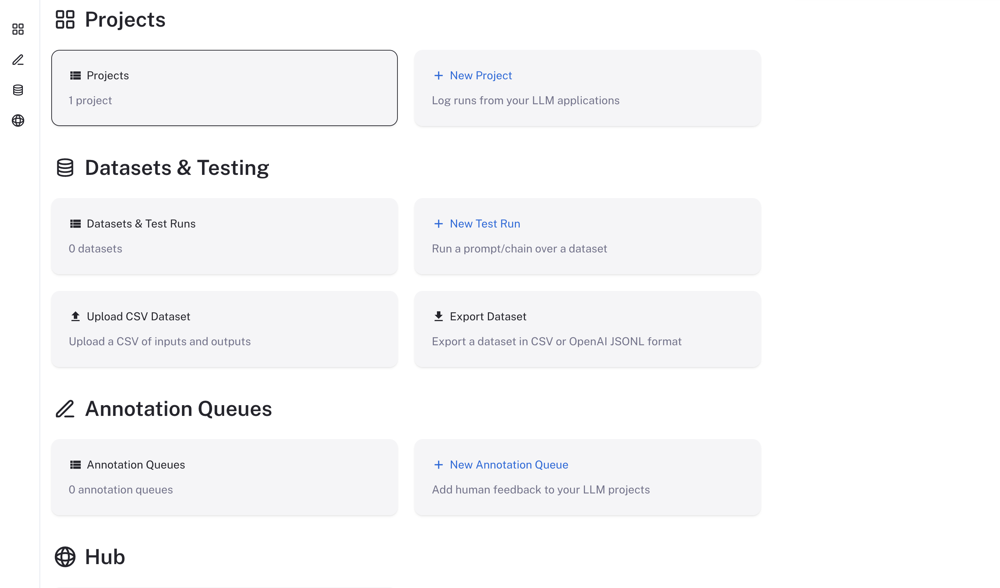

<Warning>
官方不支持降级。LangSmith 升级可能包含数据库迁移以及其他向后不兼容的变更。如果你需要回滚到旧版本，请通过 [Support Portal](https://support.langchain.com) 联系技术支持获取指导。
</Warning>

如果你还没有添加对应 repo，请先运行以下命令：

```bash
helm repo add langchain https://langchain-ai.github.io/helm/
```

更新本地 helm repo：

```bash
helm repo update
```

根据新版本的要求更新 helm chart 配置文件。所需改动会在新版本的 release notes 中说明。

运行以下命令来升级 chart（把 `version` 替换成你希望升级到的版本）：

<Note>
如果你使用的不是默认 namespace，那么在 `helm` 和 `kubectl` 命令中需要通过 `-n <namespace` 参数显式指定 namespace。
</Note>

找到 chart 的最新版本。你可以在 [LangSmith Helm Chart GitHub repository](https://github.com/langchain-ai/helm/releases) 中查看，或者运行以下命令：

```bash
helm search repo langchain/langsmith --versions
```

你应该会看到类似下面的输出：

```bash
NAME                             	CHART VERSION	APP VERSION	DESCRIPTION
langchain/langsmith              	0.17.2       	0.17.30    	Helm chart to deploy the langsmith application ...
langchain/langsmith              	0.17.1       	0.17.30    	Helm chart to deploy the langsmith application ...
langchain/langsmith              	0.17.0       	0.17.29    	Helm chart to deploy the langsmith application ...
langchain/langsmith              	0.16.41      	0.16.70    	Helm chart to deploy the langsmith application ...
langchain/langsmith              	0.16.40      	0.16.70    	Helm chart to deploy the langsmith application ...
```

选择你想升级到的版本（通常推荐最新版本），并记下版本号：

<Note>
如果你的安装版本比最新 chart 落后超过一个 major version，请一次只升级一个 major version。不要跳过 major versions。需要针对中间每一个 major version 重复本升级流程，最后再升级到当前受支持的最新版本。

例如，要从 0.15 升级到 0.17，请先升级到最新的 0.16 chart，再升级到最新的 0.17 chart。
</Note>

```bash
helm upgrade <release-name> langchain/langsmith --version <version> --values <path-to-values-file> --wait --debug
```

验证升级是否成功：

```bash
helm status <release-name>
```

所有 pods 都应该处于 `Running` 状态。还要确认 ClickHouse 正常运行，并且两个 `migrations` jobs 都已经完成。

```bash
kubectl get pods
NAME                                     READY   STATUS      RESTARTS   AGE
langsmith-backend-95b6d54f5-gz48b        1/1     Running     0          15h
langsmith-pg-migrations-d2z6k            0/1     Completed   0          5h48m
langsmith-ch-migrations-gasvk            0/1     Completed   0          5h48m
langsmith-clickhouse-0                   1/1     Running     0          26h
langsmith-frontend-84687d9d45-6cg4r      1/1     Running     0          15h
langsmith-hub-backend-66ffb75fb4-qg6kl   1/1     Running     0          15h
langsmith-playground-85b444d8f7-pl589    1/1     Running     0          15h
langsmith-queue-d58cb64f7-87d68          1/1     Running     0          15h
```

## 验证部署

1. 运行 `kubectl get services`

   输出会类似于：

    ```bash
    NAME                         TYPE           CLUSTER-IP       EXTERNAL-IP     PORT(S)                      AGE
    kubernetes                   ClusterIP      172.20.0.1       <none>          443/TCP                      27d
    langsmith-backend            ClusterIP      172.20.22.34     <none>          1984/TCP                     21d
    langsmith-clickhouse         ClusterIP      172.20.117.62    <none>          8123/TCP,9000/TCP            21d
    langsmith-frontend           LoadBalancer   172.20.218.30    <external ip>   80:30093/TCP,443:31130/TCP   21d
    langsmith-platform-backend   ClusterIP      172.20.232.183   <none>          1986/TCP                     21d
    langsmith-playground         ClusterIP      172.20.167.132   <none>          3001/TCP                     21d
    langsmith-postgres           ClusterIP      172.20.59.63     <none>          5432/TCP                     21d
    langsmith-redis              ClusterIP      172.20.229.98    <none>          6379/TCP                     20d
    ```

1. 对 `langsmith-frontend` service 的 external ip 发起 curl：

   ```bash
   curl <external ip>/api/info
   {"version":"0.5.7","license_expiration_time":"2033-05-20T20:08:06","batch_ingest_config":{"scale_up_qsize_trigger":1000,"scale_up_nthreads_limit":16,"scale_down_nempty_trigger":4,"size_limit":100,"size_limit_bytes":20971520}}
   ```

    检查这里的版本是否与你升级到的版本一致。

1. 在浏览器中访问 `langsmith-frontend` service 的 external IP。LangSmith UI 应该可以正常访问和操作。

   

## 升级独立的 sandbox 集群

当 Sandboxes 运行在[独立集群](/langsmith/self-host-sandbox-separate-cluster)中时，每次升级涉及两个 Helm release：LangSmith 集群中的 `langsmith` 和 sandbox 集群中的 `langsmith-sandbox`。两者必须保持在同一个 LangSmith release 上：

- **顺序**：先升级 `langsmith`，然后在几天内升级 `langsmith-sandbox`。除 runtime 升级滚动发布期间外，不要让 sandbox hosts 运行比 control plane 更新的 release。如果某个版本的 release notes 给出了不同的顺序，请按 release notes 执行。当 runtime 落后超过 72 小时或超前超过 30 分钟时，LangSmith 会[在 UI 中发出警告](/langsmith/self-host-sandbox-separate-cluster#watch-for-a-release-mismatch)。
- **版本**：使用 appVersion 与你的 `langsmith` chart 的 appVersion 相同的最新 `langsmith-sandbox` chart。这两个 chart 按 appVersion 配对，绝不按 chart version 配对。请参见 [Release policy](/langsmith/release-versions#pair-the-sandbox-runtime-chart)。
- **固定版本**：将两个 release 都固定到确切的 chart 版本。绝不使用版本范围。

要找到与你的 `langsmith` release 匹配的 runtime chart 版本：

```bash
helm repo update
APP=$(helm get metadata langsmith --kube-context <langsmith-context> -n <langsmith-namespace> -o json | jq -r .appVersion)
helm search repo langchain/langsmith-sandbox --versions --devel -o json \
  | jq -r --arg a "$APP" '[.[] | select(.name == "langchain/langsmith-sandbox" and .app_version == $a)][0].version // error("no langsmith-sandbox chart for appVersion \($a)")'
```

每次升级 host 都会逐个重启 hosts，每次重启都会挂起该 host 上运行的 Sandboxes。请参见 [Understand a rolling upgrade](/langsmith/self-host-sandbox-operations#understand-a-rolling-upgrade)。

### 使用 Helm CLI 升级

运行两个命令，每个命令针对自己的集群，先运行 `langsmith`：

```bash
helm upgrade langsmith langchain/langsmith \
  --kube-context <langsmith-context> \
  --namespace <langsmith-namespace> \
  --version <langsmith-chart-version> \
  --values langsmith_config.yaml \
  --wait

helm upgrade langsmith-sandbox langchain/langsmith-sandbox \
  --kube-context <sandbox-context> \
  --namespace langsmith-sandbox \
  --version <matching-sandbox-chart-version> \
  --values langsmith_sandbox_config.yaml \
  --wait \
  --timeout <timeout>
```

- **runtime 不自动回滚**：不要向 `langsmith-sandbox` 升级传入 `--atomic` 或 `--rollback-on-failure`。Hosts 会逐个 drain，因此缓慢的 rollout 可能超过 `--wait` 超时，但实际上并未失败，而回滚会让每个 host 再次重启。
- **超时**：将 `--timeout` 设置为大约 hosts 数量乘以 `sandboxHost.deployment.terminationGracePeriodSeconds`（默认 300 秒），再加上 host 启动所需的时间。要跟踪 rollout，请使用类似的超时运行 `kubectl rollout status`。
- **复用 values**：如果你复用上一个 release 的 values，优先使用 `--reset-then-reuse-values` 而不是 `--reuse-values`。`--reuse-values` 会保留上一个 chart 的默认值，包括其 image tags。

### 使用 Argo CD 或 Flux 升级

- **分两次变更**：在一次 Git 变更中升级 `langsmith`。等到同步成功且应用状态为 Healthy（Flux：HelmRelease 为 `Ready`）后，再在第二次变更中将 `langsmith-sandbox` 升级到完全匹配的版本。
- **不要合并变更**：一次变更同时升级两个 chart 会让它们同时同步。如果 `langsmith` 升级随后被阻塞，例如 pre-upgrade hook 失败，hosts 会在 control plane 通过之前超前运行。
- **不要使用浮动版本**：绝不要让 runtime chart 使用浮动版本。不要使用范围、`*` 或 `*-0`，也不要省略 Flux HelmRelease 中的 `version`。

### 使用你自己的基础设施即代码升级

将两个 chart 建模为具有显式依赖关系的两个 Helm release，例如 Terraform 中的 `depends_on`，以确保 `langsmith` 先于 `langsmith-sandbox` 应用。将两者都固定到确切的 chart 版本。

### 检查升级

两次升级完成后：

1. 检查两个 release 报告的 `APP VERSION` 是否相同。Argo CD 不更新 Helm release 记录，因此在 Argo CD 中跳过此步骤；步骤 3 检查的是同一件事：

   ```bash
   helm list --kube-context <langsmith-context> -n <langsmith-namespace> --filter '^langsmith$'
   helm list --kube-context <sandbox-context> -n langsmith-sandbox --filter '^langsmith-sandbox$'
   ```

1. 检查 `platform-backend` 和 `sandbox-host` 的 rollout 是否已完成：

   ```bash
   kubectl --context <langsmith-context> -n <langsmith-namespace> rollout status deployment/langsmith-platform-backend
   kubectl --context <sandbox-context> -n langsmith-sandbox rollout status deployment/langsmith-sandbox-sandbox-host --timeout=<timeout>
   ```

1. 检查每个集群运行的 image tags 是否与该 `APP VERSION` 一致：

   ```bash
   kubectl --context <langsmith-context> -n <langsmith-namespace> get deployment langsmith-platform-backend \
     -o jsonpath='{.spec.template.spec.containers[?(@.name=="platform-backend")].image}{"\n"}'
   kubectl --context <sandbox-context> -n langsmith-sandbox get deployment langsmith-sandbox-sandbox-host \
     -o jsonpath='{.spec.template.spec.containers[?(@.name=="sandbox-host")].image}{"\n"}'
   ```

这些命令假定 release 名称为 `langsmith` 和 `langsmith-sandbox`。

### 回滚 runtime

只回滚 `langsmith-sandbox` release，可以使用 `helm rollback` 或还原其 Git 变更。不要回滚 `langsmith` release：它的数据库迁移只能向前推进，因此请改为向前修复。回滚 host 会像升级一样重启每个 host。这并不总是安全的：如果较新的 hosts 已经以旧 hosts 无法读取的格式写入 sandbox 数据，请改为前滚。如果不确定，请在回滚 hosts 之前联系支持。

### 更改拓扑或卸载

- **从内嵌 runtime 迁移**：先在 `langsmith` release 上设置 `sandboxes.external.enabled: true`，然后针对相同的 JuiceFS metadata store 和 bucket 安装 `langsmith-sandbox`。请参见 [Move an existing installation to a separate cluster](/langsmith/self-host-sandbox-separate-cluster#move-an-existing-installation-to-a-separate-cluster)。
- **卸载**：先卸载 `langsmith-sandbox`，然后卸载或重新配置 `langsmith`。请参见 [Uninstall](/langsmith/self-host-sandbox-separate-cluster#uninstall)。

## 从 v16 升级到 v17

Chart v17 更改了 SmithDB、sandboxes 和 Engine 的 values。请在运行 `helm upgrade` 之前更新你的 values 文件。在你修改之前，Chart v17 无法渲染下方的 SmithDB、sandbox 和 Engine values。如果你使用 Terraform modules 部署，请按照 [AWS](/langsmith/self-host-terraform-aws-deploy#upgrade-from-chart-v16-to-v17)、[GCP](/langsmith/self-host-terraform-gcp-deploy) 或 [Azure](/langsmith/self-host-terraform-azure-deploy) 部署指南中的升级步骤操作，这些步骤会将这些更改应用到 module 的 values 文件。

<Warning>
不支持从 chart v17 降级到 v16。升级前请备份数据库。
</Warning>

- **SmithDB**：将 `smithdb.migration.deployment` 移到 `smithdb.migration.job`。在 `smithdb.enabled: true` 时，将 `query`、`ingestion`、`mutations`、`runRules`、`statsQuery` 和 `compactionWorker` 上的扁平 autoscaling keys（`enabled`、`minReplicas`、`maxReplicas` 等）移到 `autoscaling.hpa.*` 下。对于 `compactionWorker`，也可以改用 `autoscaling.keda.*`，但只能启用一个 scaler。缓存卷的更改请参见 [Cache storage](/langsmith/self-host-smithdb-infrastructure#cache-storage)。
- **Sandboxes**：Chart v17 移除了捆绑的 JuiceFS CSI driver，由 `sandbox-host` 自行挂载 JuiceFS。Chart v17 会忽略遗留的 `sandboxes.juicefs.csi` 块，并且其校验随后会失败，报 `sandboxes.juicefs.redis.metaURL is required when sandboxes.enabled is true and sandboxes.juicefs.existingSecretName is not set.` 请移动以下设置：
  - `sandboxes.juicefs.csi.existingSecretName` 变为 `sandboxes.juicefs.existingSecretName`。Secret 保留其键。
  - `sandboxes.juicefs.csi.mountPodPatch` 中的缓存选项移到 `sandboxes.juicefs.hostMount`。`cacheDirs` 设置 JuiceFS 缓存的主机路径，默认为 `/var/cache/juicefs`。如果覆盖它，请至少列出一个绝对路径。其他 JuiceFS 选项请以 `--flag=value` 形式设置在 `mountOptions` 中，并且不要在那里设置 `--cache-dir`。默认缓存大小从 300 GiB（`cache-size=307200`）降至 50 GiB（`--cache-size=51200`）。
  - 将 IRSA 或 Workload Identity 注解从 `sandboxes.juicefs.csi.node.serviceAccount.annotations` 移到 `sandboxes.sandboxHost.serviceAccount.annotations`。在 GKE 上，`sandbox-host` 运行在 host 网络中，而 GKE 不会向 host 网络 pod 授予 Workload Identity，因此该注解只服务于 `juicefs-format` Job。此外，请授予 sandbox node pool 的 service account 对 bucket 的 `roles/storage.objectAdmin` 权限，并通过 IAM condition 限制在 JuiceFS 前缀内。没有该授权时，挂载会从 Cloud Storage 收到 403。

  在升级之前，趁 CSI driver 仍在运行时 drain JuiceFS 卷。否则旧的 `sandbox-host` pod 会停留在 `Terminating` 状态。使用默认 release name 时：

  ```bash
  kubectl delete -n langsmith deployment.apps/langsmith-sandbox-host
  kubectl delete -n langsmith persistentvolumeclaim/smithbox-juicefs-csi
  kubectl delete -n langsmith persistentvolumeclaim/smithbox-juicefs-csi-host
  kubectl get pods -n langsmith | grep juicefs   # wait until only juicefs-csi-* pods remain
  ```

  运行中的 Sandboxes 会停止。它们的数据保留在 object storage 和 Redis 中，因为 chart v16 的两个 PersistentVolume 都使用 `Retain` 回收策略。
- **Engine**：启用 Engine 时，将 `engine.usageSigningSecret` 设置为至少 32 个字符的值（使用 `openssl rand -hex 32` 生成一个），或者在使用 `config.existingSecretName` 时，改为向该 Secret 添加 `engine_usage_signing_secret` 键。默认的 `engine.intelligenceBaseUrl` 更改为 `https://beacon.langchain.com/intelligence`，它只记录使用情况。要在 LangSmith Intelligence models 上继续运行 Engine（如 chart v16 那样），请保留 `https://beacon.aws.langchain.com/intelligence`，并在 **Settings** > **Engine** > **Model providers** 下选择 LangSmith Intelligence。详情请参见 [LangSmith Engine on Self-hosted](/langsmith/engine-self-hosted)。

---

<div className="source-links">
<Callout icon="terminal-2">
    [Connect these docs](/use-these-docs) to your agent of choice via MCP for real-time answers.
</Callout>
<Callout icon="edit">
    [Edit this page on GitHub](https://github.com/langchain-ai/docs/edit/main/src/langsmith/self-host-upgrades.mdx) or [file an issue](https://github.com/langchain-ai/docs/issues/new/choose).
</Callout>
</div>
