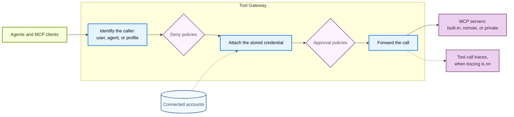

import ToolGatewayBetaNote from '/snippets/python/langsmith/tool-gateway-beta-note.mdx';

<ToolGatewayBetaNote />

Tool Gateway 是 LangSmith 中的受管层，位于你的 agents 与其调用的 MCP 服务器之间。它为 agents 发起的工具调用处理访问、身份和策略，就像 [LLM Gateway](/langsmith/llm-gateway) 为模型调用所做的那样。

如果没有 gateway，每个团队都要把工具认证内置到每个 agent 中。令牌最终硬编码在 agent 代码里。每个 agent 都能访问某个服务器上的所有工具。没有任何记录显示哪个工具代表谁运行。Tool Gateway 用一套共享设置取代这种逐 agent 的工作：

- **访问**：每个 MCP 服务器只需注册一次，每个用户或 agent 的账户只需连接一次。每个 agent 通过一个 MCP URL 调用选定的一组工具。
- **控制**：设置策略，阻止工具调用，或要求其在运行前获得批准。
- **可见性**：为每次工具调用记录一条 trace，显示运行了哪个工具以及以谁的身份运行。

<Info>
Tool Gateway 在 LangSmith [Plus 和 Enterprise 计划](https://www.langchain.com/pricing)中提供。

它支持以下运行环境：

- **[Cloud](/langsmith/cloud)**：GCP US、GCP EU、GCP APAC 和 AWS US 区域。它不在 Azure US 区域提供。
- **[BYOC](/langsmith/byoc)**：在 AWS、GCP 和 Azure 上运行 LangSmith v0.18 或更高版本的 data planes。
- **[自托管](/langsmith/self-hosted)**：LangSmith v0.18 或更高版本。请参见[启用 Tool Gateway](/langsmith/tool-gateway-self-hosted)。
</Info>

## 工具调用的处理流程

对于每次工具调用，Tool Gateway 会：

1. 识别调用方：一个用户、一个 agent 或一个 profile。
1. 如果匹配某条拒绝策略，则阻止该调用。
1. 附加调用方为该服务器存储的凭证，或要求调用方连接。
1. 如果匹配某条批准策略，则要求调用方批准该调用。
1. 将调用转发到 MCP 服务器，并在启用 [tracing](/langsmith/tool-gateway-traces) 时记录一条 trace。

每个设置都由四个概念构成：

- **MCP 服务器**：由管理员或用户注册一次的远程 MCP 服务器，注册时一并声明它需要的凭证类型。LangSmith 还为常见服务提供内置服务器。要访问你自己网络内的服务器，请使用 [tunnel](/langsmith/tunnels)。
- **已连接的账户**：Tool Gateway 调用服务器时使用的凭证。凭证可以属于你、属于某个 agent、属于某个 profile，或属于整个工作区。profile 持有共享凭证，供无人登录时运行的 agents 使用。
- **工具包**：来自任意数量服务器的一组精选工具，通过一个 MCP URL 提供。工具包决定 agent 能看到哪些工具。要控制调用方可以调用哪些工具，请使用权限和策略。
- **策略**：一条规则，用于阻止匹配的工具调用，或要求其在运行前获得批准。

关于这些部分如何协同工作，请参见 [Tool Gateway 工作原理](/langsmith/tool-gateway-how-it-works)。

## 选择你的设置

Tool Gateway 支持几种常见设置。请从最接近你情况的一种开始：

- **代表每个用户执行操作的 agents**：每个最终用户连接自己的账户，agent 以该用户的身份调用工具。请参见[以用户和 agent 的身份调用](/langsmith/tool-gateway-identity)。
- **无人登录时运行的 agents**：管理员通过 profile 或 agent 自己的凭证一次性连接共享凭证，agent 使用这些凭证调用工具。请参见[连接账户](/langsmith/tool-gateway-connect-accounts)。
- **面向平台或安全团队的集中式工具治理**：为整个工作区注册服务器，为每个 agent 提供一个工具包，并为每次工具调用设置[策略](/langsmith/tool-gateway-policies)和 [traces](/langsmith/tool-gateway-traces)。
- **为你自己的编码 agent 提供工具**：用一个 URL 将工具包添加到 Claude Code、Cursor 或其他 MCP 客户端。请参见[连接 MCP 客户端](/langsmith/tool-gateway-clients)。

## 下一步

<CardGroup cols={2}>
  <Card
    title="运行快速入门"
    icon="rocket"
    href="/langsmith/tool-gateway-quickstart"
    arrow="true"
  >
    添加两个 MCP 服务器，连接你的账户，创建一个工具包，并从 MCP 客户端调用其中的工具。
  </Card>

  <Card
    title="了解工作原理"
    icon="sitemap"
    href="/langsmith/tool-gateway-how-it-works"
    arrow="true"
  >
    了解 Tool Gateway 如何验证调用方身份、选择凭证并应用策略，以及适用的限制。
  </Card>
</CardGroup>

---

<Callout icon="terminal-2">
    [Connect these docs](/use-these-docs) to your agent of choice via MCP for real-time answers.
</Callout>
<Callout icon="edit">
    [Edit this page on GitHub](https://github.com/langchain-ai/docs/edit/main/src/langsmith/tool-gateway.mdx) or [file an issue](https://github.com/langchain-ai/docs/issues/new/choose).
</Callout>

