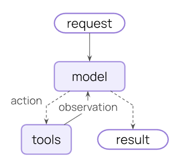
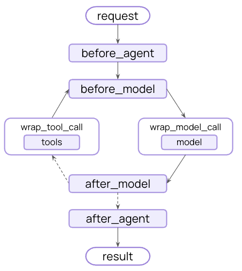

## 概览

构建 agent 的难点在于让它们足够可靠。它们可能在原型阶段表现不错，但在真实场景里经常失效。

### 为什么 agent 会失败？

agent 失败时，通常是因为 agent 里的 LLM 调用做错了动作，或者没有按预期完成任务。LLM 失败通常有两个原因：

1. 底层 LLM 能力不够强
2. 没有把“正确”的上下文传给 LLM

很多时候，真正导致 agent 不可靠的是第二个原因。

**上下文工程（context engineering）** 是把正确的信息和工具，以正确的格式提供给 LLM，让它完成任务。这是 AI 工程师最重要的工作之一。缺少“正确”上下文，是让 agent 更可靠的头号阻碍，而 LangChain 的 agent 抽象就是专门为支持上下文工程而设计的。

<Tip>
如果你刚接触上下文工程，先看 [概念总览](/oss/javascript/concepts/context)，了解不同类型的上下文，以及它们各自的使用时机。
</Tip>

### agent 循环

一个典型的 agent 循环由两个主要步骤组成：

1. **模型调用** - 用 prompt 和可用工具调用 LLM，返回响应或执行工具的请求
2. **工具执行** - 执行 LLM 请求的工具，返回工具结果

<div style={{ display: "flex", justifyContent: "center" }}>
  
</div>

这个循环会一直持续，直到 LLM 决定结束。

### 你可以控制什么

要构建可靠的 agent，你需要控制 agent 循环每一步发生什么，以及各步骤之间发生什么。

| 上下文类型 | 你控制什么 | 短期还是持久化 |
|--------------|------------------|-------------------------|
| **[模型上下文](#model-context)** | 进入模型调用的内容（指令、消息历史、工具、响应格式） | 短期 |
| **[工具上下文](#tool-context)** | 工具能访问和产出什么（对 state、store、runtime context 的读写） | 持久化 |
| **[生命周期上下文](#life-cycle-context)** | 模型调用和工具调用之间发生什么（摘要、guardrail、日志等） | 持久化 |

<CardGroup>
  <Card title="Transient context" icon="bolt" iconType="duotone">
    LLM 在一次调用中看到的内容。你可以修改 messages、tools 或 prompt，而不改变 state 里保存的内容。
  </Card>
  <Card title="Persistent context" icon="database" iconType="duotone">
    在轮次之间保存到 state 的内容。生命周期 hooks 和工具写入会把它永久修改。
  </Card>
</CardGroup>

### 数据来源

在这个过程中，agent 会访问（读 / 写）不同的数据来源：

| 数据来源 | 也称为 | 范围 | 示例 |
|-------------|---------------|-------|----------|
| **Runtime Context** | 静态配置 | 对话范围 | 用户 ID、API keys、数据库连接、权限、环境设置 |
| **State** | 短期记忆 | 对话范围 | 当前消息、上传文件、认证状态、工具结果 |
| **Store** | 长期记忆 | 跨对话 | 用户偏好、提取的洞见、记忆、历史数据 |

### 它是如何工作的

LangChain [middleware](/oss/javascript/langchain/middleware) 是底层机制，让上下文工程对使用 LangChain 的开发者真正可用。

middleware 允许你在 agent 生命周期的任一步骤中进行钩入，并：

* 更新上下文
* 跳转到 agent 生命周期中的另一步骤

在本指南里，你会频繁使用 middleware API，把它作为实现上下文工程目标的手段。

## 模型上下文

控制每次模型调用里包含什么内容，例如指令、可用工具、要用哪个模型，以及输出格式。这些决策会直接影响可靠性和成本。

<CardGroup cols={2}>
    <Card title="System Prompt" icon="message-2" href="#system-prompt">
        开发者给 LLM 的基础指令。
    </Card>
    <Card title="Messages" icon="messages" href="#messages">
        发送给 LLM 的完整消息列表（对话历史）。
    </Card>
    <Card title="Tools" icon="tool" href="#tools">
        agent 可用来采取行动的工具。
    </Card>
    <Card title="Model" icon="cpu" href="#model">
        实际要调用的模型（包括配置）。
    </Card>
    <Card title="Response Format" icon="braces" href="#response-format">
        模型最终回复的 schema 规范。
    </Card>
</CardGroup>

所有这些模型上下文类型，都可以从 **state**（短期记忆）、**store**（长期记忆）或 **runtime context**（静态配置）中获取内容。

### System Prompt

system prompt 决定 LLM 的行为和能力。不同用户、不同上下文或不同对话阶段都需要不同的指令。成功的 agent 会结合记忆、偏好和配置，为当前对话状态提供正确的指令。

<Tabs>
  <Tab title="State">
    从 state 读取消息数量或对话上下文：


    ```typescript
    import { createAgent } from "langchain";

    const agent = createAgent({
      model: "gpt-6.1-sol",
      tools: [...],
      middleware: [
        dynamicSystemPromptMiddleware((state) => {
          // Read from State: check conversation length
          const messageCount = state.messages.length;

          let base = "You are a helpful assistant.";

          if (messageCount > 10) {
            base += "\nThis is a long conversation - be extra concise.";
          }

          return base;
        }),
      ],
    });
    ```

  </Tab>

  <Tab title="Store">
    从长期记忆里读取用户偏好：


    ```typescript
    import * as z from "zod";
    import { createAgent, dynamicSystemPromptMiddleware } from "langchain";

    const contextSchema = z.object({
      userId: z.string(),
    });

    type Context = z.infer<typeof contextSchema>;

    const agent = createAgent({
      model: "gpt-6.1-sol",
      tools: [...],
      contextSchema,
      middleware: [
        dynamicSystemPromptMiddleware<Context>(async (state, runtime) => {
          const userId = runtime.context.userId;

          // Read from Store: get user preferences
          const store = runtime.store;
          const userPrefs = await store.get(["preferences"], userId);

          let base = "You are a helpful assistant.";

          if (userPrefs) {
            const style = userPrefs.value?.communicationStyle || "balanced";
            base += `\nUser prefers ${style} responses.`;
          }

          return base;
        }),
      ],
    });
    ```

  </Tab>

  <Tab title="Runtime Context">
    从 Runtime Context 读取用户 ID 或配置：


    ```typescript
    import * as z from "zod";
    import { createAgent, dynamicSystemPromptMiddleware } from "langchain";

    const contextSchema = z.object({
      userRole: z.string(),
      deploymentEnv: z.string(),
    });

    type Context = z.infer<typeof contextSchema>;

    const agent = createAgent({
      model: "gpt-6.1-sol",
      tools: [...],
      contextSchema,
      middleware: [
        dynamicSystemPromptMiddleware<Context>((state, runtime) => {
          // Read from Runtime Context: user role and environment
          const userRole = runtime.context.userRole;
          const env = runtime.context.deploymentEnv;

          let base = "You are a helpful assistant.";

          if (userRole === "admin") {
            base += "\nYou have admin access. You can perform all operations.";
          } else if (userRole === "viewer") {
            base += "\nYou have read-only access. Guide users to read operations only.";
          }

          if (env === "production") {
            base += "\nBe extra careful with any data modifications.";
          }

          return base;
        }),
      ],
    });
    ```

  </Tab>

</Tabs>

### Messages

Messages 构成了发送给 LLM 的 prompt。
管理 messages 的内容非常关键，因为这能确保 LLM 拿到足够的信息，给出更好的回复。

<Tabs>
  <Tab title="State">
    当当前查询相关时，从 State 注入上传文件的上下文：


    ```typescript
    import { createMiddleware, HumanMessage } from "langchain";

    const injectFileContext = createMiddleware({
      name: "InjectFileContext",
      wrapModelCall: (request, handler) => {
        // request.state is a shortcut for request.state.messages
        const uploadedFiles = request.state.uploadedFiles || [];  // [!code highlight]

        if (uploadedFiles.length > 0) {
          // Build context about available files
          const fileDescriptions = uploadedFiles.map(file =>
            `- ${file.name} (${file.type}): ${file.summary}`
          );

          const fileContext = `Files you have access to in this conversation:
${fileDescriptions.join("\n")}

Reference these files when answering questions.`;

          // Inject file context before recent messages
          const messages = [  // [!code highlight]
            ...request.messages,  // Rest of conversation
            new HumanMessage(fileContext)
          ];
          request = { ...request, messages };  // [!code highlight]
        }

        return handler(request);
      },
    });

    const agent = createAgent({
      model: "gpt-6.1-sol",
      tools: [...],
      middleware: [injectFileContext],
    });
    ```

  </Tab>

  <Tab title="Store">
    从 Store 注入用户的邮件写作风格，用来辅助草拟：


    ```typescript
    import * as z from "zod";
    import { createMiddleware, HumanMessage } from "langchain";

    const contextSchema = z.object({
      userId: z.string(),
    });

    const injectWritingStyle = createMiddleware({
      name: "InjectWritingStyle",
      contextSchema,
      wrapModelCall: async (request, handler) => {
        const userId = request.runtime.context.userId;  // [!code highlight]

        // Read from Store: get user's writing style examples
        const store = request.runtime.store;  // [!code highlight]
        const writingStyle = await store.get(["writing_style"], userId);  // [!code highlight]

        if (writingStyle) {
          const style = writingStyle.value;
          // Build style guide from stored examples
          const styleContext = `Your writing style:
- Tone: ${style.tone || 'professional'}
- Typical greeting: "${style.greeting || 'Hi'}"
- Typical sign-off: "${style.signOff || 'Best'}"
- Example email you've written:
${style.exampleEmail || ''}`;

          // Append at end - models pay more attention to final messages
          const messages = [
            ...request.messages,
            new HumanMessage(styleContext)
          ];
          request = { ...request, messages };  // [!code highlight]
        }

        return handler(request);
      },
    });
    ```

  </Tab>

  <Tab title="Runtime Context">
    从 Runtime Context 注入合规规则，依据用户所在辖区进行调整：


    ```typescript
    import * as z from "zod";
    import { createMiddleware, HumanMessage } from "langchain";

    const contextSchema = z.object({
      userJurisdiction: z.string(),
      industry: z.string(),
      complianceFrameworks: z.array(z.string()),
    });

    type Context = z.infer<typeof contextSchema>;

    const injectComplianceRules = createMiddleware<Context>({
      name: "InjectComplianceRules",
      contextSchema,
      wrapModelCall: (request, handler) => {
        // Read from Runtime Context: get compliance requirements
        const { userJurisdiction, industry, complianceFrameworks } = request.runtime.context;  // [!code highlight]

        // Build compliance constraints
        const rules = [];
        if (complianceFrameworks.includes("GDPR")) {
          rules.push("- Must obtain explicit consent before processing personal data");
          rules.push("- Users have right to data deletion");
        }
        if (complianceFrameworks.includes("HIPAA")) {
          rules.push("- Cannot share patient health information without authorization");
          rules.push("- Must use secure, encrypted communication");
        }
        if (industry === "finance") {
          rules.push("- Cannot provide financial advice without proper disclaimers");
        }

        if (rules.length > 0) {
          const complianceContext = `Compliance requirements for ${userJurisdiction}:
${rules.join("\n")}`;

          // Append at end - models pay more attention to final messages
          const messages = [
            ...request.messages,
            new HumanMessage(complianceContext)
          ];
          request = { ...request, messages };  // [!code highlight]
        }

        return handler(request);
      },
    });
    ```

  </Tab>

</Tabs>

<Note>
**瞬时更新 vs 持久化更新：**

上面的示例使用 `wrap_model_call` 来做 **瞬时** 更新，也就是只修改单次模型调用实际看到的 messages，而不改写 state 里保存的内容。

如果你需要 **持久化** 更新，可以：


- 在 `wrapModelCall` 中直接返回 [`Command`](https://reference.langchain.com/javascript/langchain-langgraph/index/Command)，从模型调用层写入 state 更新。
- 使用生命周期 hooks，例如 `beforeModel`、`afterModel` 或 `wrapToolCall`（处理 tool 返回）来更新对话历史。更多细节请参见 [middleware 文档](/oss/javascript/langchain/middleware)。


更多内容请参见 [State updates](/oss/javascript/langchain/middleware/custom#state-updates)。
</Note>

### Tools

工具让模型可以和数据库、API 以及外部系统交互。你如何定义和选择工具，会直接影响模型能否高效完成任务。

#### 定义工具

每个工具都需要清晰的名称、描述、参数名和参数描述。这些不只是元数据，它们会影响模型对何时、如何使用工具的判断。


```typescript
import { tool } from "@langchain/core/tools";
import { z } from "zod";

const searchOrders = tool(
  async ({ userId, status, limit }) => {
    // Implementation here
  },
  {
    name: "search_orders",
    description: `Search for user orders by status.

    Use this when the user asks about order history or wants to check
    order status. Always filter by the provided status.`,
    schema: z.object({
      userId: z.string().describe("Unique identifier for the user"),
      status: z.enum(["pending", "shipped", "delivered"]).describe("Order status to filter by"),
      limit: z.number().default(10).describe("Maximum number of results to return"),
    }),
  }
);
```


#### 选择工具

并非每个工具都适用于每种场景。工具太多会让模型负担过重、增加错误；工具太少又会限制能力。动态工具选择会根据认证状态、用户权限、功能开关或对话阶段来调整可用工具集。

<Tabs>
  <Tab title="State">
    只在达到某些对话里程碑后才启用高级工具：


    ```typescript
    import { createMiddleware } from "langchain";

    const stateBasedTools = createMiddleware({
      name: "StateBasedTools",
      wrapModelCall: (request, handler) => {
        // Read from State: check authentication and conversation length
        const state = request.state;  // [!code highlight]
        const isAuthenticated = state.authenticated || false;  // [!code highlight]
        const messageCount = state.messages.length;

        let filteredTools = request.tools;

        // Only enable sensitive tools after authentication
        if (!isAuthenticated) {
          filteredTools = request.tools.filter(t => t.name.startsWith("public_"));  // [!code highlight]
        } else if (messageCount < 5) {
          filteredTools = request.tools.filter(t => t.name !== "advanced_search");  // [!code highlight]
        }

        return handler({ ...request, tools: filteredTools });  // [!code highlight]
      },
    });
    ```

  </Tab>

  <Tab title="Store">
    根据 Store 中的用户偏好或功能开关来过滤工具：


    ```typescript
    import * as z from "zod";
    import { createMiddleware } from "langchain";

    const contextSchema = z.object({
      userId: z.string(),
    });

    const storeBasedTools = createMiddleware({
      name: "StoreBasedTools",
      contextSchema,
      wrapModelCall: async (request, handler) => {
        const userId = request.runtime.context.userId;  // [!code highlight]

        // Read from Store: get user's enabled features
        const store = request.runtime.store;  // [!code highlight]
        const featureFlags = await store.get(["features"], userId);  // [!code highlight]

        let filteredTools = request.tools;

        if (featureFlags) {
          const enabledFeatures = featureFlags.value?.enabledTools || [];
          filteredTools = request.tools.filter(t => enabledFeatures.includes(t.name));  // [!code highlight]
        }

        return handler({ ...request, tools: filteredTools });  // [!code highlight]
      },
    });
    ```

  </Tab>

  <Tab title="Runtime Context">
    根据 Runtime Context 中的用户权限来过滤工具：


    ```typescript
    import * as z from "zod";
    import { createMiddleware } from "langchain";

    const contextSchema = z.object({
      userRole: z.string(),
    });

    const contextBasedTools = createMiddleware({
      name: "ContextBasedTools",
      contextSchema,
      wrapModelCall: (request, handler) => {
        // Read from Runtime Context: get user role
        const userRole = request.runtime.context.userRole;  // [!code highlight]

        let filteredTools = request.tools;

        if (userRole === "admin") {
          // Admins get all tools
        } else if (userRole === "editor") {
          filteredTools = request.tools.filter(t => t.name !== "delete_data");  // [!code highlight]
        } else {
          filteredTools = request.tools.filter(t => t.name.startsWith("read_"));  // [!code highlight]
        }

        return handler({ ...request, tools: filteredTools });  // [!code highlight]
      },
    });
    ```

  </Tab>
</Tabs>

更多动态工具筛选与运行时注册工具的示例，请参见 [Dynamic tools](/oss/javascript/langchain/tools#dynamic-tool-selection)。

### Model

不同模型有不同的能力、成本和上下文窗口。应当为当前任务选择合适的模型，而且这个选择在 agent 运行过程中也可能变化。

<Tabs>
  <Tab title="State">
    根据 State 中的对话长度选择不同模型：


    ```typescript
    import { createMiddleware, initChatModel } from "langchain";

    // Initialize models once outside the middleware
    const largeModel = initChatModel("claude-sonnet-4-6");
    const standardModel = initChatModel("gpt-6.1-sol");
    const efficientModel = initChatModel("gpt-5.4-mini");

    const stateBasedModel = createMiddleware({
      name: "StateBasedModel",
      wrapModelCall: (request, handler) => {
        // request.messages is a shortcut for request.state.messages
        const messageCount = request.messages.length;  // [!code highlight]
        let model;

        if (messageCount > 20) {
          model = largeModel;
        } else if (messageCount > 10) {
          model = standardModel;
        } else {
          model = efficientModel;
        }

        return handler({ ...request, model });  // [!code highlight]
      },
    });
    ```

  </Tab>

  <Tab title="Store">
    从 Store 中读取用户偏好的模型：


    ```typescript
    import * as z from "zod";
    import { createMiddleware, initChatModel } from "langchain";

    const contextSchema = z.object({
      userId: z.string(),
    });

    // Initialize available models once
    const MODEL_MAP = {
      "gpt-6.1-sol": initChatModel("gpt-6.1-sol"),
      "gpt-5.4-mini": initChatModel("gpt-5.4-mini"),
      "claude-sonnet": initChatModel("claude-sonnet-4-6"),
    };

    const storeBasedModel = createMiddleware({
      name: "StoreBasedModel",
      contextSchema,
      wrapModelCall: async (request, handler) => {
        const userId = request.runtime.context.userId;  // [!code highlight]

        // Read from Store: get user's preferred model
        const store = request.runtime.store;  // [!code highlight]
        const userPrefs = await store.get(["preferences"], userId);  // [!code highlight]

        let model = request.model;

        if (userPrefs) {
          const preferredModel = userPrefs.value?.preferredModel;
          if (preferredModel && MODEL_MAP[preferredModel]) {
            model = MODEL_MAP[preferredModel];  // [!code highlight]
          }
        }

        return handler({ ...request, model });  // [!code highlight]
      },
    });
    ```

  </Tab>

  <Tab title="Runtime Context">
    根据 Runtime Context 里的成本等级或环境来选择模型：


    ```typescript
    import * as z from "zod";
    import { createMiddleware, initChatModel } from "langchain";

    const contextSchema = z.object({
      costTier: z.string(),
      environment: z.string(),
    });

    // Initialize models once outside the middleware
    const premiumModel = initChatModel("claude-sonnet-4-6");
    const standardModel = initChatModel("gpt-6.1-sol");
    const budgetModel = initChatModel("gpt-5.4-mini");

    const contextBasedModel = createMiddleware({
      name: "ContextBasedModel",
      contextSchema,
      wrapModelCall: (request, handler) => {
        // Read from Runtime Context: cost tier and environment
        const costTier = request.runtime.context.costTier;  // [!code highlight]
        const environment = request.runtime.context.environment;  // [!code highlight]

        let model;

        if (environment === "production" && costTier === "premium") {
          model = premiumModel;
        } else if (costTier === "budget") {
          model = budgetModel;
        } else {
          model = standardModel;
        }

        return handler({ ...request, model });  // [!code highlight]
      },
    });
    ```

  </Tab>
</Tabs>

更多示例请参见 [Dynamic model](/oss/javascript/langchain/models#dynamic-model-selection)。

### Response format

结构化输出可以把非结构化文本转换为经过校验的结构化数据。当你需要提取特定字段，或为下游系统返回数据时，自由文本是不够的。

**工作原理：** 当你把 schema 作为响应格式传入时，可以保证模型的最终响应符合该 schema。agent 会运行模型 / 工具调用循环，直到模型完成工具调用，然后把最终响应强制转换为传入的格式。

#### Defining formats

schema 定义会引导模型。字段名、类型和描述精确规定了输出应遵循的格式。


```typescript
import { z } from "zod";

const customerSupportTicket = z.object({
  category: z.enum(["billing", "technical", "account", "product"]).describe(
    "Issue category"
  ),
  priority: z.enum(["low", "medium", "high", "critical"]).describe(
    "Urgency level"
  ),
  summary: z.string().describe(
    "One-sentence summary of the customer's issue"
  ),
  customerSentiment: z.enum(["frustrated", "neutral", "satisfied"]).describe(
    "Customer's emotional tone"
  ),
}).describe("Structured ticket information extracted from customer message");
```


#### 选择格式

动态响应格式选择会根据用户偏好、对话阶段或角色来调整 schema，在早期返回简单格式，复杂度提升后再返回更详细的格式。

<Tabs>
  <Tab title="State">
    根据 State 配置结构化输出：


    ```typescript
    import { createMiddleware } from "langchain";
    import { z } from "zod";

    const simpleResponse = z.object({
      answer: z.string().describe("A brief answer"),
    });

    const detailedResponse = z.object({
      answer: z.string().describe("A detailed answer"),
      reasoning: z.string().describe("Explanation of reasoning"),
      confidence: z.number().describe("Confidence score 0-1"),
    });

    const stateBasedOutput = createMiddleware({
      name: "StateBasedOutput",
      wrapModelCall: (request, handler) => {
        // request.state is a shortcut for request.state.messages
        const messageCount = request.messages.length;  // [!code highlight]

        let responseFormat;
        if (messageCount < 3) {
          // Early conversation - use simple format
          responseFormat = simpleResponse; // [!code highlight]
        } else {
          // Established conversation - use detailed format
          responseFormat = detailedResponse; // [!code highlight]
        }

        return handler({ ...request, responseFormat });
      },
    });
    ```

  </Tab>

  <Tab title="Store">
    根据 Store 中的用户偏好配置输出格式：


    ```typescript
    import * as z from "zod";
    import { createMiddleware } from "langchain";

    const contextSchema = z.object({
      userId: z.string(),
    });

    const verboseResponse = z.object({
      answer: z.string().describe("Detailed answer"),
      sources: z.array(z.string()).describe("Sources used"),
    });

    const conciseResponse = z.object({
      answer: z.string().describe("Brief answer"),
    });

    const storeBasedOutput = createMiddleware({
      name: "StoreBasedOutput",
      wrapModelCall: async (request, handler) => {
        const userId = request.runtime.context.userId;  // [!code highlight]

        // Read from Store: get user's preferred response style
        const store = request.runtime.store;  // [!code highlight]
        const userPrefs = await store.get(["preferences"], userId);  // [!code highlight]

        const style = userPrefs?.value?.responseStyle || "concise";
        const responseFormat =
          style === "verbose" ? verboseResponse : conciseResponse;  // [!code highlight]

        return handler({
          ...request,
          responseFormat,
        });
      },
    });
    ```

  </Tab>

  <Tab title="Runtime Context">
    根据 Runtime Context 里的用户角色或环境来配置输出格式：


    ```typescript
    import * as z from "zod";
    import { createMiddleware } from "langchain";

    const contextSchema = z.object({
      userRole: z.string(),
      environment: z.string(),
    });

    const adminResponse = z.object({
      answer: z.string().describe("Answer"),
      debugInfo: z.record(z.any()).describe("Debug information"),
      systemStatus: z.string().describe("System status"),
    });

    const userResponse = z.object({
      answer: z.string().describe("Answer"),
    });

    const contextBasedOutput = createMiddleware({
      name: "ContextBasedOutput",
      wrapModelCall: (request, handler) => {
        // Read from Runtime Context: user role and environment
        const userRole = request.runtime.context.userRole;  // [!code highlight]
        const environment = request.runtime.context.environment;  // [!code highlight]

        let responseFormat;
        if (userRole === "admin" && environment === "production") {
          responseFormat = adminResponse;  // [!code highlight]
        } else {
          responseFormat = userResponse;  // [!code highlight]
        }

        return handler({ ...request, responseFormat });
      },
    });
    ```

  </Tab>
</Tabs>

## 工具上下文

工具的特殊之处在于，它们既读取上下文，也写入上下文。

在最基础的情况下，工具执行时会接收 LLM 的请求参数，并返回一条 tool message。工具完成自己的工作并产出结果。

工具还可以为模型获取重要信息，使其能够执行并完成任务。

### 读取

大多数真实场景中的工具需要的不仅是 LLM 的参数。它们需要用户 ID 来查询数据库、需要 API key 来访问外部服务，或者需要当前会话状态来做出决策。工具会从 state、store 和 runtime context 中读取这些信息。

<Tabs>
  <Tab title="State">
    从 State 读取，以检查当前会话信息：


    ```typescript
    import * as z from "zod";
    import { createAgent, tool, type ToolRuntime } from "langchain";

    const checkAuthentication = tool(
      async (_, runtime: ToolRuntime) => {
        // Read from State: check current auth status
        const currentState = runtime.state;
        const isAuthenticated = currentState.authenticated || false;

        if (isAuthenticated) {
          return "User is authenticated";
        } else {
          return "User is not authenticated";
        }
      },
      {
        name: "check_authentication",
        description: "Check if user is authenticated",
        schema: z.object({}),
      }
    );
    ```

  </Tab>

  <Tab title="Store">
    从 Store 读取，以访问持久化的用户偏好：


    ```typescript
    import * as z from "zod";
    import { createAgent, tool, type ToolRuntime } from "langchain";

    const contextSchema = z.object({
      userId: z.string(),
    });

    const getPreference = tool(
      async ({ preferenceKey }, runtime: ToolRuntime) => {
        const userId = runtime.context.userId;

        // Read from Store: get existing preferences
        const store = runtime.store;
        const existingPrefs = await store.get(["preferences"], userId);

        if (existingPrefs) {
          const value = existingPrefs.value?.[preferenceKey];
          return value ? `${preferenceKey}: ${value}` : `No preference set for ${preferenceKey}`;
        } else {
          return "No preferences found";
        }
      },
      {
        name: "get_preference",
        description: "Get user preference from Store",
        schema: z.object({
          preferenceKey: z.string(),
        }),
      }
    );
    ```

  </Tab>

  <Tab title="Runtime Context">
    从 Runtime Context 读取配置，例如 API key 和用户 ID：


    ```typescript
    import * as z from "zod";
    import { tool } from "@langchain/core/tools";
    import { createAgent } from "langchain";

    const contextSchema = z.object({
      userId: z.string(),
      apiKey: z.string(),
      dbConnection: z.string(),
    });

    const fetchUserData = tool(
      async ({ query }, runtime: ToolRuntime<any, typeof contextSchema>) => {
        // Read from Runtime Context: get API key and DB connection
        const { userId, apiKey, dbConnection } = runtime.context;

        // Use configuration to fetch data
        const results = await performDatabaseQuery(dbConnection, query, apiKey);

        return `Found ${results.length} results for user ${userId}`;
      },
      {
        name: "fetch_user_data",
        description: "Fetch data using Runtime Context configuration",
        schema: z.object({
          query: z.string(),
        }),
      }
    );

    const agent = createAgent({
      model: "gpt-6.1-sol",
      tools: [fetchUserData],
      contextSchema,
    });
    ```

  </Tab>
</Tabs>

### 写入

工具结果可用于帮助 agent 完成给定任务。工具既可以直接把结果返回给模型，也可以更新 agent 的记忆，让重要的上下文可供后续步骤使用。

<Tabs>
  <Tab title="State">
    使用 Command 写入 State，以跟踪会话特定信息：


    ```typescript
    import * as z from "zod";
    import { tool } from "@langchain/core/tools";
    import { createAgent } from "langchain";
    import { Command } from "@langchain/langgraph";

    const authenticateUser = tool(
      async ({ password }) => {
        // Perform authentication
        if (password === "correct") {
          // Write to State: mark as authenticated using Command
          return new Command({
            update: { authenticated: true },
          });
        } else {
          return new Command({ update: { authenticated: false } });
        }
      },
      {
        name: "authenticate_user",
        description: "Authenticate user and update State",
        schema: z.object({
          password: z.string(),
        }),
      }
    );
    ```

  </Tab>

  <Tab title="Store">
    写入 Store，以跨会话持久化数据：


    ```typescript
    import * as z from "zod";
    import { createAgent, tool, type ToolRuntime } from "langchain";

    const savePreference = tool(
      async ({ preferenceKey, preferenceValue }, runtime: ToolRuntime<any, typeof contextSchema>) => {
        const userId = runtime.context.userId;

        // Read existing preferences
        const store = runtime.store;
        const existingPrefs = await store.get(["preferences"], userId);

        // Merge with new preference
        const prefs = existingPrefs?.value || {};
        prefs[preferenceKey] = preferenceValue;

        // Write to Store: save updated preferences
        await store.put(["preferences"], userId, prefs);

        return `Saved preference: ${preferenceKey} = ${preferenceValue}`;
      },
      {
        name: "save_preference",
        description: "Save user preference to Store",
        schema: z.object({
          preferenceKey: z.string(),
          preferenceValue: z.string(),
        }),
      }
    );
    ```

  </Tab>
</Tabs>

请参见 [Tools](/oss/javascript/langchain/tools) 了解在工具中访问 state、store 和 runtime context 的完整示例。

## 生命周期上下文

控制核心 agent 步骤**之间**发生的事情，拦截数据流，以实现摘要、guardrail 和日志等横切关注点。

正如你在[模型上下文](#model-context)和[工具上下文](#tool-context)中所看到的，[middleware](/oss/javascript/langchain/middleware) 是让上下文工程真正可落地的机制。middleware 允许你钩入 agent 生命周期的任一步骤，并：

1. **更新上下文**，修改 state 和 store 以持久化变更、更新对话历史或保存洞见
2. **在生命周期中跳转**，根据上下文移动到 agent 循环中的不同步骤（例如满足条件时跳过工具执行，或用修改后的上下文重复模型调用）

<div style={{ display: "flex", justifyContent: "center" }}>
  
</div>

### 示例：摘要

最常见的生命周期模式之一，是在对话历史变得过长时自动压缩它。与[模型上下文](#messages)中展示的瞬时消息裁剪不同，摘要会**持久化更新 state**，用一条摘要永久替换旧消息，并在之后所有轮次中沿用。

LangChain 为此提供了内置 middleware：


```typescript
import { createAgent, summarizationMiddleware } from "langchain";

const agent = createAgent({
  model: "gpt-6.1-sol",
  tools: [...],
  middleware: [
    summarizationMiddleware({
      model: "gpt-5.4-mini",
      trigger: { tokens: 4000 },
      keep: { messages: 20 },
    }),
  ],
});
```


当对话超过 token 限制时，`SummarizationMiddleware` 会自动：
1. 通过单独的 LLM 调用对较早的消息生成摘要
2. 在 State 中用一条摘要消息替换这些消息（永久生效）
3. 保留最近的消息不变，以维持上下文

摘要后的对话历史会被永久更新，之后轮次将看到摘要，而不是原始消息。

<Note>
有关内置 middleware 的完整列表、可用 hooks 以及如何创建自定义 middleware，请参见 [Middleware 文档](/oss/javascript/langchain/middleware)。
</Note>

## 最佳实践

1. **从简单开始**，先用静态 prompt 和工具，只有确实需要时才增加动态能力
2. **增量测试**，一次只添加一个上下文工程特性
3. **监控性能**，跟踪模型调用、token 使用量和延迟
4. **使用内置 middleware**，优先复用 [`SummarizationMiddleware`](/oss/javascript/langchain/middleware#summarization)、[`LLMToolSelectorMiddleware`](/oss/javascript/langchain/middleware#llm-tool-selector) 等
5. **记录你的上下文策略**，清楚说明传入了哪些上下文以及原因
6. **理解瞬时与持久化**：模型上下文变更属于瞬时（每次调用），而生命周期上下文变更会持久化到 state

## 相关资源

- [上下文概念总览](/oss/javascript/concepts/context)，了解上下文类型及适用场景
- [Middleware](/oss/javascript/langchain/middleware)，完整的 middleware 指南
- [Tools](/oss/javascript/langchain/tools)，工具创建与上下文访问
- [Memory](/oss/javascript/concepts/memory)，短期与长期记忆模式
- [Agents](/oss/javascript/langchain/agents)，agent 核心概念

---

<div className="source-links">
<Callout icon="terminal-2">
    [Connect these docs](/use-these-docs) to your agent of choice via MCP for real-time answers.
</Callout>
<Callout icon="edit">
    [Edit this page on GitHub](https://github.com/langchain-ai/docs/edit/main/src/oss/langchain/context-engineering.mdx) or [file an issue](https://github.com/langchain-ai/docs/issues/new/choose).
</Callout>
</div>
