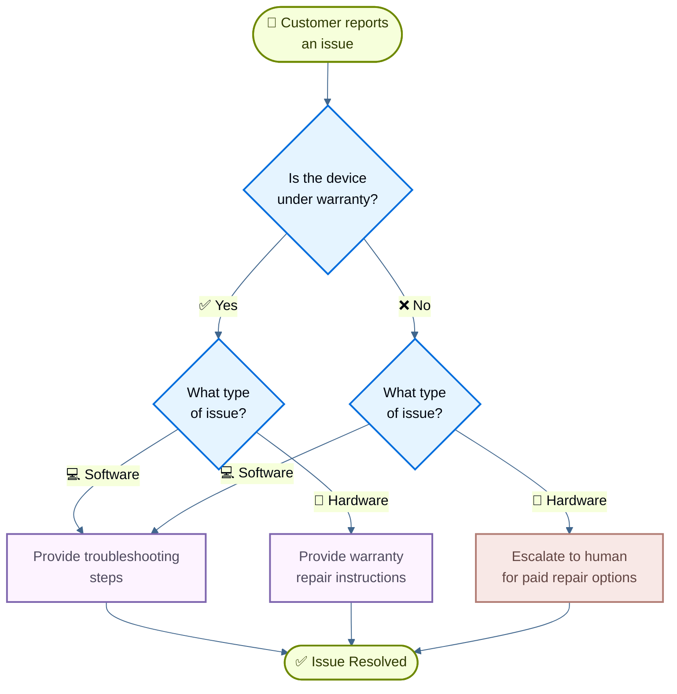

import ChatModelTabsPy from '/snippets/javascript/chat-model-tabs.mdx';
import ChatModelTabsJs from '/snippets/javascript/chat-model-tabs-js.mdx';

[state machine pattern](/oss/javascript/langchain/multi-agent/handoffs) 描述的是这样一类工作流：agent 的行为会随着任务进入不同状态而变化。本教程展示了如何通过 tool call 动态改变单个 agent 的配置，也就是根据当前 state 更新它可用的工具和指令，从而实现一个 state machine。这个 state 可以来自多个来源：agent 过去的动作（tool call）、外部 state（例如 API 调用结果），甚至初始用户输入（例如通过分类器判断用户意图）。

在本教程里，你会构建一个客户支持 agent，它会：

- 在继续之前先收集保修信息。
- 把问题分类为硬件问题或软件问题。
- 提供解决方案，或者升级给人工支持。
- 在多轮对话中维护 conversation state。

与 [subagents pattern](/oss/javascript/langchain/multi-agent/subagents-personal-assistant) 不同，后者是把 sub-agent 当作工具来调用，**state machine pattern** 使用的是一个单独的 agent，只是它的配置会随着 workflow 的进展而变化。每个“step”其实都只是同一个底层 agent 的一种不同配置（system prompt + tools），并根据 state 动态选择。

下面是我们要构建的 workflow：



## 设置

### 安装

本教程需要 `langchain` 包：


<CodeGroup>
```bash npm
npm install langchain
```
```bash yarn
yarn add langchain
```
```bash pnpm
pnpm add langchain
```
</CodeGroup>


更多细节请参见 [Installation guide](/oss/javascript/langchain/install)。

### LangSmith

先配置 [LangSmith](https://smith.langchain.com?utm_source=docs&utm_medium=cta&utm_campaign=langsmith-signup&utm_content=oss-langchain-multi-agent-handoffs-customer-support)，以便查看 agent 内部发生了什么。然后设置以下环境变量：


<CodeGroup>
```bash Shell
export LANGSMITH_TRACING="true"
export LANGSMITH_API_KEY="..."
```
```typescript TypeScript
process.env.LANGSMITH_TRACING = "true";
process.env.LANGSMITH_API_KEY = "...";
```
</CodeGroup>


### 选择 LLM

从 LangChain 的集成套件里选择一个 chat model：


<ChatModelTabsJs />


## 1. 定义自定义 state

先定义一个自定义 state schema，用来跟踪当前处于哪个 step：


```typescript
import { StateSchema } from "@langchain/langgraph";
import { z } from "zod";

// Define the possible workflow steps
const SupportStepSchema = z.enum(["warranty_collector", "issue_classifier", "resolution_specialist"]);  // [!code highlight]
const WarrantyStatusSchema = z.enum(["in_warranty", "out_of_warranty"]);
const IssueTypeSchema = z.enum(["hardware", "software"]);

// State for customer support workflow
const SupportState = new StateSchema({  // [!code highlight]
  currentStep: SupportStepSchema.optional(),  // [!code highlight]
  warrantyStatus: WarrantyStatusSchema.optional(),
  issueType: IssueTypeSchema.optional(),
});
```


`current_step` 字段是 state machine pattern 的核心—它决定了每一轮加载哪种配置（prompt + tools）。

## 2. 创建管理 workflow state 的工具

创建会更新 workflow state 的工具。这些工具让 agent 可以记录信息，并切换到下一步。

关键在于使用 `Command` 来更新 state，包括 `current_step` 字段：


```typescript
import { z } from "zod";
import { tool, ToolMessage, type ToolRuntime } from "langchain";
import { Command } from "@langchain/langgraph";

const recordWarrantyStatus = tool(
  async (input, config: ToolRuntime<typeof SupportState.State>) => {
    return new Command({ // [!code highlight]
      update: { // [!code highlight]
        messages: [
          new ToolMessage({
            content: `Warranty status recorded as: ${input.status}`,
            tool_call_id: config.toolCallId,
          }),
        ],
        warrantyStatus: input.status,
        currentStep: "issue_classifier", // [!code highlight]
      },
    });
  },
  {
    name: "record_warranty_status",
    description:
      "Record the customer's warranty status and transition to issue classification.",
    schema: z.object({
      status: WarrantyStatusSchema,
    }),
  }
);

const recordIssueType = tool(
  async (input, config: ToolRuntime<typeof SupportState.State>) => {
    return new Command({ // [!code highlight]
      update: { // [!code highlight]
        messages: [
          new ToolMessage({
            content: `Issue type recorded as: ${input.issueType}`,
            tool_call_id: config.toolCallId,
          }),
        ],
        issueType: input.issueType,
        currentStep: "resolution_specialist", // [!code highlight]
      },
    });
  },
  {
    name: "record_issue_type",
    description:
      "Record the type of issue and transition to resolution specialist.",
    schema: z.object({
      issueType: IssueTypeSchema,
    }),
  }
);

const escalateToHuman = tool(
  async (input) => {
    // In a real system, this would create a ticket, notify staff, etc.
    return `Escalating to human support. Reason: ${input.reason}`;
  },
  {
    name: "escalate_to_human",
    description: "Escalate the case to a human support specialist.",
    schema: z.object({
      reason: z.string(),
    }),
  }
);

const provideSolution = tool(
  async (input) => {
    return `Solution provided: ${input.solution}`;
  },
  {
    name: "provide_solution",
    description: "Provide a solution to the customer's issue.",
    schema: z.object({
      solution: z.string(),
    }),
  }
);
```


请注意，`record_warranty_status` 和 `record_issue_type` 返回的 `Command` 对象会同时更新数据（`warranty_status`、`issue_type`）和 `current_step`。这正是 state machine 的工作方式—工具控制 workflow 的推进。

## 3. 定义 step 配置

为每个 step 定义 prompt 和 tools。先定义每个 step 的 prompt：

<Accordion title="查看完整 prompt 定义">


```typescript
// Define prompts as constants for easy reference
const WARRANTY_COLLECTOR_PROMPT = `You are a customer support agent helping with device issues.

CURRENT STAGE: Warranty verification

At this step, you need to:
1. Greet the customer warmly
2. Ask if their device is under warranty
3. Use record_warranty_status to record their response and move to the next step

Be conversational and friendly. Don't ask multiple questions at once.`;

const ISSUE_CLASSIFIER_PROMPT = `You are a customer support agent helping with device issues.

CURRENT STAGE: Issue classification
CUSTOMER INFO: Warranty status is {warranty_status}

At this step, you need to:
1. Ask the customer to describe their issue
2. Determine if it's a hardware issue (physical damage, broken parts) or software issue (app crashes, performance)
3. Use record_issue_type to record the classification and move to the next step

If unclear, ask clarifying questions before classifying.`;

const RESOLUTION_SPECIALIST_PROMPT = `You are a customer support agent helping with device issues.

CURRENT STAGE: Resolution
CUSTOMER INFO: Warranty status is {warranty_status}, issue type is {issue_type}

At this step, you need to:
1. For SOFTWARE issues: provide troubleshooting steps using provide_solution
2. For HARDWARE issues:
   - If IN WARRANTY: explain warranty repair process using provide_solution
   - If OUT OF WARRANTY: escalate_to_human for paid repair options

Be specific and helpful in your solutions.`;
```


</Accordion>

然后用字典把 step 名称映射到各自的配置：


```typescript
// Step configuration: maps step name to (prompt, tools, required_state)
const STEP_CONFIG = {
  warranty_collector: {
    prompt: WARRANTY_COLLECTOR_PROMPT,
    tools: [recordWarrantyStatus],
    requires: [],
  },
  issue_classifier: {
    prompt: ISSUE_CLASSIFIER_PROMPT,
    tools: [recordIssueType],
    requires: ["warrantyStatus"],
  },
  resolution_specialist: {
    prompt: RESOLUTION_SPECIALIST_PROMPT,
    tools: [provideSolution, escalateToHuman],
    requires: ["warrantyStatus", "issueType"],
  },
} as const;
```


这个基于字典的配置方式很适合：
- 一眼看清所有 step
- 添加新 step（只需再加一条 entry）
- 理解 workflow 的依赖关系（`requires` 字段）
- 使用带 state 变量的 prompt 模板（例如 `{warranty_status}`）

## 4. 创建基于 step 的 middleware

创建一个 middleware，从 state 里读取 `current_step`，并应用对应配置。这里用 `@wrap_model_call` 装饰器来写一个更简洁的实现：


```typescript
import { createMiddleware } from "langchain";

const applyStepMiddleware = createMiddleware({
  name: "applyStep",
  stateSchema: SupportState,
  wrapModelCall: async (request, handler) => {
    // Get current step (defaults to warranty_collector for first interaction)
    const currentStep = request.state.currentStep ?? "warranty_collector"; // [!code highlight]

    // Look up step configuration
    const stepConfig = STEP_CONFIG[currentStep]; // [!code highlight]

    // Validate required state exists
    for (const key of stepConfig.requires) {
      if (request.state[key] === undefined) {
        throw new Error(`${key} must be set before reaching ${currentStep}`);
      }
    }

    // Format prompt with state values (supports {warrantyStatus}, {issueType}, etc.)
    let systemPrompt: string = stepConfig.prompt;
    for (const [key, value] of Object.entries(request.state)) {
      systemPrompt = systemPrompt.replace(`{${key}}`, String(value ?? ""));
    }

    // Inject system prompt and step-specific tools
    return handler({
      ...request, // [!code highlight]
      systemPrompt, // [!code highlight]
      tools: [...stepConfig.tools], // [!code highlight]
    });
  },
});
```


这个 middleware 会：

1. **读取当前 step**：从 state 获取 `current_step`（默认是 "warranty_collector"）。
2. **查找配置**：找到 `STEP_CONFIG` 中匹配的 entry。
3. **校验依赖**：确保必需的 state 字段存在。
4. **格式化 prompt**：把 state 值注入 prompt 模板。
5. **应用配置**：覆盖 system prompt 和可用的 tools。

`request.override()` 方法是关键—它让我们可以基于 state 动态改变 agent 的行为，而无需创建独立的 agent 实例。

## 5. 创建 agent

现在创建带 step-based middleware 的 agent，并配上用于 state 持久化的 checkpointer：


```typescript
import { createAgent } from "langchain";
import { MemorySaver } from "@langchain/langgraph";
import { ChatOpenAI } from "@langchain/openai";

// Collect all tools from all step configurations
const allTools = [
  recordWarrantyStatus,
  recordIssueType,
  provideSolution,
  escalateToHuman,
];

// Initialize the model
const model = new ChatOpenAI({
  model: "gpt-5.4-mini",
  temperature: 0.7,
});

// Create the agent with step-based configuration
const agent = createAgent({
  model,
  tools: allTools,
  stateSchema: SupportState,  // [!code highlight]
  middleware: [applyStepMiddleware],  // [!code highlight]
  checkpointer: new MemorySaver(),  // [!code highlight]
});
```


<Note>
**为什么需要 checkpointer？** checkpointer 会在对话轮次之间保存 state。没有它，`current_step` 在用户发送下一条消息时就会丢失，workflow 也会断掉。
</Note>

## 6. 测试 workflow

测试完整的 workflow：


```typescript
import { HumanMessage } from "@langchain/core/messages";
import { v7 as uuid7 } from "uuid";

// Configuration for this conversation thread
const threadId = uuid7();
const config = { configurable: { thread_id: threadId } };

// Turn 1: Initial message - starts with warranty_collector step
console.log("=== Turn 1: Warranty Collection ===");
let result = await agent.invoke(
  { messages: [new HumanMessage("Hi, my phone screen is cracked")] },
  config
);
for (const msg of result.messages) {
  console.log(msg.content);
}

// Turn 2: User responds about warranty
console.log("\n=== Turn 2: Warranty Response ===");
result = await agent.invoke(
  { messages: [new HumanMessage("Yes, it's still under warranty")] },
  config
);
for (const msg of result.messages) {
  console.log(msg.content);
}
console.log(`Current step: ${result.currentStep}`);

// Turn 3: User describes the issue
console.log("\n=== Turn 3: Issue Description ===");
result = await agent.invoke(
  { messages: [new HumanMessage("The screen is physically cracked from dropping it")] },
  config
);
for (const msg of result.messages) {
  console.log(msg.content);
}
console.log(`Current step: ${result.currentStep}`);

// Turn 4: Resolution
console.log("\n=== Turn 4: Resolution ===");
result = await agent.invoke(
  { messages: [new HumanMessage("What should I do?")] },
  config
);
for (const msg of result.messages) {
  console.log(msg.content);
}
```


预期流程：
1. **保修核验步骤**：询问保修状态。
2. **问题分类步骤**：询问问题，并判定为硬件问题。
3. **解决步骤**：提供保修维修说明。

## 7. 理解 state 转换

我们来追踪每一轮会发生什么：

### 第 1 轮：初始消息


```typescript
{
  messages: [new HumanMessage("Hi, my phone screen is cracked")],
  currentStep: "warranty_collector"  // Default value
}
```


middleware 会应用：
- System prompt：`WARRANTY_COLLECTOR_PROMPT`
- Tools：`[record_warranty_status]`

### 第 2 轮：记录保修状态之后


工具调用：`recordWarrantyStatus("in_warranty")` 返回：
```typescript
new Command({
  update: {
    warrantyStatus: "in_warranty",
    currentStep: "issue_classifier"  // State transition!
  }
})
```


下一轮，middleware 会应用：
- System prompt：`ISSUE_CLASSIFIER_PROMPT`（使用 `warranty_status="in_warranty"` 格式化）
- Tools：`[record_issue_type]`

### 第 3 轮：问题分类之后


工具调用：`recordIssueType("hardware")` 返回：
```typescript
new Command({
  update: {
    issueType: "hardware",
    currentStep: "resolution_specialist"  // State transition!
  }
})
```


下一轮，middleware 会应用：
- System prompt：`RESOLUTION_SPECIALIST_PROMPT`（使用 `warranty_status` 和 `issue_type` 格式化）
- Tools：`[provide_solution, escalate_to_human]`

关键点在于：**Tools drive the workflow**，它们通过更新 `current_step` 推进流程；**middleware responds**，在下一轮应用对应配置。

## 8. 管理消息历史

随着 agent 逐步推进，message history 会增长。可以使用 [summarization middleware](/oss/javascript/langchain/short-term-memory#summarize-messages) 压缩早期消息，同时保留对话上下文：


```typescript
import { createAgent, SummarizationMiddleware } from "langchain";  // [!code highlight]
import { MemorySaver } from "@langchain/langgraph";

const agent = createAgent({
  model,
  tools: allTools,
  stateSchema: SupportState,
  middleware: [
    applyStepMiddleware,
    new SummarizationMiddleware({  // [!code highlight]
      model: "gpt-5.4-mini",
      trigger: { tokens: 4000 },
      keep: { messages: 10 },
    }),
  ],
  checkpointer: new MemorySaver(),
});
```


更多记忆管理技巧请参见 [short-term memory guide](/oss/javascript/langchain/short-term-memory)。

## 9. 增加灵活性：回退

有些 workflow 需要允许用户返回上一步来更正信息，例如修改保修状态或问题分类。不过，并不是所有跳转都合理，例如退款完成后通常不能回退。对于这个支持流程，我们会添加工具，让用户能回到保修核验和问题分类步骤。

<Tip>
如果你的 workflow 需要在大多数步骤之间任意跳转，可以先想想是否真的需要结构化 workflow。这个模式最适合“清晰顺序推进、偶尔允许回退更正”的场景。
</Tip>

给 resolution 步骤添加“回退”工具：


```typescript
import { tool } from "langchain";
import { Command } from "@langchain/langgraph";
import { z } from "zod";

const goBackToWarranty = tool(  // [!code highlight]
  async () => {
    return new Command({ update: { currentStep: "warranty_collector" } });  // [!code highlight]
  },
  {
    name: "go_back_to_warranty",
    description: "Go back to warranty verification step.",
    schema: z.object({}),
  }
);

const goBackToClassification = tool(  // [!code highlight]
  async () => {
    return new Command({ update: { currentStep: "issue_classifier" } });  // [!code highlight]
  },
  {
    name: "go_back_to_classification",
    description: "Go back to issue classification step.",
    schema: z.object({}),
  }
);

// Update the resolution_specialist configuration to include these tools
STEP_CONFIG.resolution_specialist.tools.push(
  goBackToWarranty,
  goBackToClassification
);
```


更新 resolution specialist 的 prompt，把这些工具说明加进去：


```typescript
const RESOLUTION_SPECIALIST_PROMPT = `You are a customer support agent helping with device issues.

CURRENT STAGE: Resolution
CUSTOMER INFO: Warranty status is {warrantyStatus}, issue type is {issueType}

At this step, you need to:
1. For SOFTWARE issues: provide troubleshooting steps using provide_solution
2. For HARDWARE issues:
   - If IN WARRANTY: explain warranty repair process using provide_solution
   - If OUT OF WARRANTY: escalate_to_human for paid repair options

If the customer indicates any information was wrong, use:
- go_back_to_warranty to correct warranty status
- go_back_to_classification to correct issue type

Be specific and helpful in your solutions.`;
```


现在 agent 就能处理更正了：


```typescript
const result = await agent.invoke(
  { messages: [new HumanMessage("Actually, I made a mistake - my device is out of warranty")] },
  config
);
// Agent will call go_back_to_warranty and restart the warranty verification step
```


## 完整示例

下面把所有内容整合到一个可运行脚本中：

<Expandable title="Complete code" defaultOpen={false}>


```typescript
import { createMiddleware, createAgent } from "langchain";

import { z } from "zod";
import { tool, ToolMessage, type ToolRuntime, HumanMessage } from "langchain";
import { Command, MemorySaver, StateSchema } from "@langchain/langgraph";
import { ChatOpenAI } from "@langchain/openai";
import { uuid7 } from "langsmith";

// Define the possible workflow steps
const SupportStepSchema = z.enum([
  "warranty_collector",
  "issue_classifier",
  "resolution_specialist",
]);
const WarrantyStatusSchema = z.enum(["in_warranty", "out_of_warranty"]);
const IssueTypeSchema = z.enum(["hardware", "software"]);

// State for customer support workflow
const SupportState = new StateSchema({
  currentStep: SupportStepSchema.optional(),
  warrantyStatus: WarrantyStatusSchema.optional(),
  issueType: IssueTypeSchema.optional(),
});

const recordWarrantyStatus = tool(
  async (input, config: ToolRuntime<typeof SupportState.State>) => {
    return new Command({

      update: {

        messages: [
          new ToolMessage({
            content: `Warranty status recorded as: ${input.status}`,
            tool_call_id: config.toolCallId,
          }),
        ],
        warrantyStatus: input.status,
        currentStep: "issue_classifier",
      },
    });
  },
  {
    name: "record_warranty_status",
    description:
      "Record the customer's warranty status and transition to issue classification.",
    schema: z.object({
      status: WarrantyStatusSchema,
    }),
  }
);

const recordIssueType = tool(
  async (input, config: ToolRuntime<typeof SupportState.State>) => {
    return new Command({

      update: {

        messages: [
          new ToolMessage({
            content: `Issue type recorded as: ${input.issueType}`,
            tool_call_id: config.toolCallId,
          }),
        ],
        issueType: input.issueType,
        currentStep: "resolution_specialist",
      },
    });
  },
  {
    name: "record_issue_type",
    description:
      "Record the type of issue and transition to resolution specialist.",
    schema: z.object({
      issueType: IssueTypeSchema,
    }),
  }
);

const escalateToHuman = tool(
  async (input) => {
    // In a real system, this would create a ticket, notify staff, etc.
    return `Escalating to human support. Reason: ${input.reason}`;
  },
  {
    name: "escalate_to_human",
    description: "Escalate the case to a human support specialist.",
    schema: z.object({
      reason: z.string(),
    }),
  }
);

const provideSolution = tool(
  async (input) => {
    return `Solution provided: ${input.solution}`;
  },
  {
    name: "provide_solution",
    description: "Provide a solution to the customer's issue.",
    schema: z.object({
      solution: z.string(),
    }),
  }
);

// Define prompts as constants for easy reference
const WARRANTY_COLLECTOR_PROMPT = `You are a customer support agent helping with device issues.

CURRENT STAGE: Warranty verification

At this step, you need to:
1. Greet the customer warmly
2. Ask if their device is under warranty
3. Use record_warranty_status to record their response and move to the next step

Be conversational and friendly. Don't ask multiple questions at once.`;

const ISSUE_CLASSIFIER_PROMPT = `You are a customer support agent helping with device issues.

CURRENT STAGE: Issue classification
CUSTOMER INFO: Warranty status is {warranty_status}

At this step, you need to:
1. Ask the customer to describe their issue
2. Determine if it's a hardware issue (physical damage, broken parts) or software issue (app crashes, performance)
3. Use record_issue_type to record the classification and move to the next step

If unclear, ask clarifying questions before classifying.`;

const RESOLUTION_SPECIALIST_PROMPT = `You are a customer support agent helping with device issues.

CURRENT STAGE: Resolution
CUSTOMER INFO: Warranty status is {warranty_status}, issue type is {issue_type}

At this step, you need to:
1. For SOFTWARE issues: provide troubleshooting steps using provide_solution
2. For HARDWARE issues:
   - If IN WARRANTY: explain warranty repair process using provide_solution
   - If OUT OF WARRANTY: escalate_to_human for paid repair options

Be specific and helpful in your solutions.`;

// Step configuration: maps step name to (prompt, tools, required_state)
const STEP_CONFIG = {
  warranty_collector: {
    prompt: WARRANTY_COLLECTOR_PROMPT,
    tools: [recordWarrantyStatus],
    requires: [],
  },
  issue_classifier: {
    prompt: ISSUE_CLASSIFIER_PROMPT,
    tools: [recordIssueType],
    requires: ["warrantyStatus"],
  },
  resolution_specialist: {
    prompt: RESOLUTION_SPECIALIST_PROMPT,
    tools: [provideSolution, escalateToHuman],
    requires: ["warrantyStatus", "issueType"],
  },
} as const;

const applyStepMiddleware = createMiddleware({
  name: "applyStep",
  stateSchema: SupportState,
  wrapModelCall: async (request, handler) => {
    // Get current step (defaults to warranty_collector for first interaction)
    const currentStep = request.state.currentStep ?? "warranty_collector";

    // Look up step configuration
    const stepConfig = STEP_CONFIG[currentStep];

    // Validate required state exists
    for (const key of stepConfig.requires) {
      if (request.state[key] === undefined) {
        throw new Error(`${key} must be set before reaching ${currentStep}`);
      }
    }

    // Format prompt with state values (supports {warrantyStatus}, {issueType}, etc.)
    let systemPrompt: string = stepConfig.prompt;
    for (const [key, value] of Object.entries(request.state)) {
      systemPrompt = systemPrompt.replace(`{${key}}`, String(value ?? ""));
    }

    // Inject system prompt and step-specific tools
    return handler({
      ...request,
      systemPrompt,
      tools: [...stepConfig.tools],
    });
  },
});

// Collect all tools from all step configurations
const allTools = [
  recordWarrantyStatus,
  recordIssueType,
  provideSolution,
  escalateToHuman,
];

const model = new ChatOpenAI({
  model: "gpt-5.4-mini",
});

// Create the agent with step-based configuration
const agent = createAgent({
  model,
  tools: allTools,
  middleware: [applyStepMiddleware],
  checkpointer: new MemorySaver(),
});

// Configuration for this conversation thread
const threadId = uuid7();
const config = { configurable: { thread_id: threadId } };

// Turn 1: Initial message - starts with warranty_collector step
console.log("=== Turn 1: Warranty Collection ===");
let result = await agent.invoke(
  { messages: [new HumanMessage("Hi, my phone screen is cracked")] },
  config
);
for (const msg of result.messages) {
  console.log(msg.content);
}

// Turn 2: User responds about warranty
console.log("\n=== Turn 2: Warranty Response ===");
result = await agent.invoke(
  { messages: [new HumanMessage("Yes, it's still under warranty")] },
  config
);
for (const msg of result.messages) {
  console.log(msg.content);
}
console.log(`Current step: ${result.currentStep}`);

// Turn 3: User describes the issue
console.log("\n=== Turn 3: Issue Description ===");
result = await agent.invoke(
  {
    messages: [
      new HumanMessage("The screen is physically cracked from dropping it"),
    ],
  },
  config
);
for (const msg of result.messages) {
  console.log(msg.content);
}
console.log(`Current step: ${result.currentStep}`);

// Turn 4: Resolution
console.log("\n=== Turn 4: Resolution ===");
result = await agent.invoke(
  { messages: [new HumanMessage("What should I do?")] },
  config
);
for (const msg of result.messages) {
  console.log(msg.content);
}
```

</Expandable>

## 下一步

- 了解 [subagents pattern](/oss/javascript/langchain/multi-agent/subagents-personal-assistant)，用于集中编排。
- 浏览 [middleware](/oss/javascript/langchain/middleware)，看看还能实现哪些动态行为。
- 阅读 [multi-agent overview](/oss/javascript/langchain/multi-agent)，对比不同模式。
- 使用 [LangSmith](https://smith.langchain.com?utm_source=docs&utm_medium=cta&utm_campaign=langsmith-signup&utm_content=oss-langchain-multi-agent-handoffs-customer-support) 调试并监控你的 multi-agent 系统。

---

<div className="source-links">
<Callout icon="terminal-2">
    [Connect these docs](/use-these-docs) to your agent of choice via MCP for real-time answers.
</Callout>
<Callout icon="edit">
    [Edit this page on GitHub](https://github.com/langchain-ai/docs/edit/main/src/oss/langchain/multi-agent/handoffs-customer-support.mdx) or [file an issue](https://github.com/langchain-ai/docs/issues/new/choose).
</Callout>
</div>
