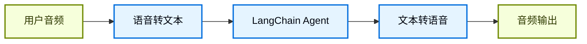
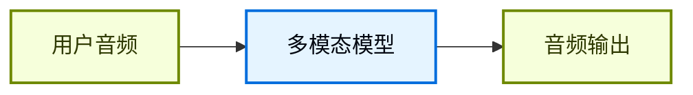

## 概览

聊天界面一直主导着我们和 AI 的交互方式，但多模态 AI 的最新突破正在打开一些令人兴奋的新可能。高质量的生成模型和表现力更强的 text-to-speech（TTS）系统，现在让构建起来像对话伙伴而不是工具的 agent 成为可能。

语音智能体就是其中一个例子。你不再需要键盘和鼠标把输入打进 agent，而是可以用口语和它交互。这通常是一种更自然、更有参与感的交互方式，在某些场景下尤其有用。

### 什么是语音智能体？

语音智能体是可以与用户进行自然口语对话的 [agents](/oss/javascript/langchain/agents)。这类 agent 结合了语音识别、自然语言处理、生成式 AI 和 text-to-speech 技术，从而实现流畅自然的对话。

它们适合很多场景，包括：

- 客户支持
- 个人助理
- 免手操作界面
- 辅导和培训

### 语音智能体如何工作？

从高层看，每个语音智能体都需要处理三件事：

1. **Listen** - 捕获音频并转写
2. **Think** - 解释意图、推理、规划
3. **Speak** - 生成音频并把它流回用户

差别在于这些步骤如何编排、如何耦合。实践中，生产级 agent 通常遵循两种主要架构之一：

#### 1. STT > Agent > TTS 架构（“三明治”）

三明治架构由三个独立组件组成：speech-to-text（STT）、基于文本的 LangChain agent，以及 text-to-speech（TTS）。



**优点：**
- 对每个组件都有完全控制权，可以按需替换 STT/TTS provider
- 能直接使用现代文本模态模型的最新能力
- 边界清晰，行为透明

**缺点：**
- 需要编排多个服务
- 管线管理更复杂
- 从语音到文本的转换会丢失部分信息，例如语气和情绪

#### 2. Speech-to-Speech 架构（S2S）

Speech-to-speech 使用一个原生处理音频输入并生成音频输出的多模态模型。



**优点：**
- 架构更简单，移动部件更少
- 对于简单交互，通常延迟更低
- 直接处理音频，可以捕捉语气和其他语音细节

**缺点：**
- 可选模型较少，provider lock-in 风险更高
- 功能可能落后于文本模态模型
- 音频处理的透明度较低
- 可控性和定制能力更弱

本指南演示的是 **三明治架构**，因为它在性能、可控性和对现代模型能力的访问之间取得了平衡。某些 STT 和 TTS provider 下，三明治架构可以把延迟压到 700ms 以下，同时保留模块化组件的控制权。

### Demo 应用概览

我们会按照三明治架构来构建一个基于语音的 agent。这个 agent 会管理一家三明治店的订单。应用会展示三明治架构的全部三个组件，使用 [AssemblyAI](https://www.assemblyai.com/) 做 STT，使用 [Cartesia](https://cartesia.ai/) 做 TTS（当然也可以为大多数 provider 编写适配器）。

完整的参考应用可以在 [voice-sandwich-demo](https://github.com/langchain-ai/voice-sandwich-demo) 仓库中找到。这里我们会逐步讲解这个应用。

这个 demo 使用 WebSockets 实现浏览器和服务器之间的实时双向通信。同样的架构也可以适配电话系统（Twilio、Vonage）或 WebRTC 连接等其他传输方式。

### 架构

这个 demo 实现了一个流式管线，其中每个阶段都会异步处理数据：

**客户端（浏览器）**
- 捕获麦克风音频并将其编码为 PCM
- 与后端服务器建立 WebSocket 连接
- 实时向服务器流式发送音频 chunk
- 接收并播放合成的语音音频


**服务端（Node.js）**


- 接收来自客户端的 WebSocket 连接
- 编排三步管线：
  - [Speech-to-text (STT)](#1-speech-to-text)：把音频转发给 STT provider（例如 AssemblyAI），接收 transcript events
  - [Agent](#2-langchain-agent)：用 LangChain agent 处理 transcripts，流式输出 response tokens
  - [Text-to-speech (TTS)](#3-text-to-speech)：把 agent responses 发送给 TTS provider（例如 Cartesia），接收音频 chunk

- 把合成音频返回给客户端播放


这个管线使用 async iterators，让每个阶段都可以流式处理。这样下游组件可以在上游阶段完成前就开始处理，从而尽量降低端到端延迟。


## 设置

有关详细安装说明和设置，请参见 [repository README](https://github.com/langchain-ai/voice-sandwich-demo#readme)。

## 1. 语音转文本

STT 阶段会把传入的音频流转换成文本 transcripts。这个实现使用生产者-消费者模式并发处理音频流式传输和 transcript 接收。

### 关键概念

**生产者-消费者模式**：音频 chunk 会在向 STT 服务发送的同时，持续接收 transcript events。这样在所有音频到齐之前，转写就可以开始。

**事件类型**：
- `stt_chunk`：STT 服务处理音频时给出的部分 transcript
- `stt_output`：最终、格式化后的 transcript，会触发 agent 处理

**WebSocket 连接**：维持到 AssemblyAI 实时 STT API 的持久连接，配置为 16kHz PCM 音频并自动 turn formatting。

### 实现


```typescript
import { AssemblyAISTT } from "./assemblyai";
import type { VoiceAgentEvent } from "./types";

async function* sttStream(
  audioStream: AsyncIterable<Uint8Array>
): AsyncGenerator<VoiceAgentEvent> {
  const stt = new AssemblyAISTT({ sampleRate: 16000 });
  const passthrough = writableIterator<VoiceAgentEvent>();

  // Producer: pump audio chunks to AssemblyAI
  const producer = (async () => {
    try {
      for await (const audioChunk of audioStream) {
        await stt.sendAudio(audioChunk);
      }
    } finally {
      await stt.close();
    }
  })();

  // Consumer: receive transcription events
  const consumer = (async () => {
    for await (const event of stt.receiveEvents()) {
      passthrough.push(event);
    }
  })();

  try {
    // Yield events as they arrive
    yield* passthrough;
  } finally {
    // Wait for producer and consumer to complete
    await Promise.all([producer, consumer]);
  }
}
```


这个应用实现了一个 AssemblyAI client，用来管理 WebSocket 连接和消息解析。具体实现见下文；其他 STT provider 也可以构建类似的适配器。

<Accordion title="AssemblyAI Client">


```typescript
export class AssemblyAISTT {
  protected _bufferIterator = writableIterator<VoiceAgentEvent.STTEvent>();
  protected _connectionPromise: Promise<WebSocket> | null = null;

  async sendAudio(buffer: Uint8Array): Promise<void> {
    const conn = await this._connection;
    conn.send(buffer);
  }

  async *receiveEvents(): AsyncGenerator<VoiceAgentEvent.STTEvent> {
    yield* this._bufferIterator;
  }

  protected get _connection(): Promise<WebSocket> {
    if (this._connectionPromise) return this._connectionPromise;

    this._connectionPromise = new Promise((resolve, reject) => {
      const params = new URLSearchParams({
        sample_rate: this.sampleRate.toString(),
        format_turns: "true",
      });
      const url = `wss://streaming.assemblyai.com/v3/ws?${params}`;
      const ws = new WebSocket(url, {
        headers: { Authorization: this.apiKey },
      });

      ws.on("open", () => resolve(ws));

      ws.on("message", (data) => {
        const message = JSON.parse(data.toString());
        if (message.type === "Turn") {
          if (message.turn_is_formatted) {
            this._bufferIterator.push({
              type: "stt_output",
              transcript: message.transcript,
              ts: Date.now()
            });
          } else {
            this._bufferIterator.push({
              type: "stt_chunk",
              transcript: message.transcript,
              ts: Date.now()
            });
          }
        }
      });
    });

    return this._connectionPromise;
  }
}
```


</Accordion>

## 2. LangChain agent

Agent 阶段会通过一个 LangChain [agent](/oss/javascript/langchain/agents) 处理文本 transcripts，并流式输出 response tokens。在这个例子里，我们会流式传输 agent 生成的所有 [text content blocks](/oss/javascript/langchain/messages#content-block-reference)。

### 关键概念

**流式响应**：agent 使用 [`stream_events(version="v3")`](/oss/javascript/langchain/streaming) 和 `stream.messages`，在生成过程中就发出 response tokens，而不是等完整回复生成完毕。这使得 TTS 阶段可以立刻开始合成。

**对话记忆**：通过唯一的 thread ID，[checkpointer](/oss/javascript/langchain/short-term-memory) 可以在多个轮次之间保留对话状态。这样 agent 就能引用对话中的前面交换内容。

### 实现


```typescript
import { createAgent } from "langchain";
import { HumanMessage } from "@langchain/core/messages";
import { MemorySaver } from "@langchain/langgraph";
import { tool } from "@langchain/core/tools";
import { z } from "zod";
import { uuid7 } from "langsmith";

// Define agent tools
const addToOrder = tool(
  async ({ item, quantity }) => {
    return `Added ${quantity} x ${item} to the order.`;
  },
  {
    name: "add_to_order",
    description: "Add an item to the customer's sandwich order.",
    schema: z.object({
      item: z.string(),
      quantity: z.number(),
    }),
  }
);

const confirmOrder = tool(
  async ({ orderSummary }) => {
    return `Order confirmed: ${orderSummary}. Sending to kitchen.`;
  },
  {
    name: "confirm_order",
    description: "Confirm the final order with the customer.",
    schema: z.object({
      orderSummary: z.string().describe("Summary of the order"),
    }),
  }
);

// Create agent with tools and memory
const agent = createAgent({
  model: "claude-haiku-4-5",
  tools: [addToOrder, confirmOrder],
  checkpointer: new MemorySaver(),
  systemPrompt: `You are a helpful sandwich shop assistant.
Your goal is to take the user's order. Be concise and friendly.
Do NOT use emojis, special characters, or markdown.
Your responses will be read by a text-to-speech engine.`,
});

async function* agentStream(
  eventStream: AsyncIterable<VoiceAgentEvent>
): AsyncGenerator<VoiceAgentEvent> {
  // Generate unique thread ID for conversation memory
  const threadId = uuid7();

  for await (const event of eventStream) {
    // Pass through all upstream events
    yield event;

    // Process final transcripts through the agent
    if (event.type === "stt_output") {
      const stream = await agent.streamEvents(
        { messages: [new HumanMessage(event.transcript)] },
        {
          configurable: { thread_id: threadId },
          version: "v3",
        }
      );

      // Yield agent response chunks as they arrive
      for await (const message of stream.messages) {
        for await (const token of message.text) {
          yield { type: "agent_chunk", text: token, ts: Date.now() };
        }
      }
    }
  }
}
```


## 3. 文本转语音

TTS 阶段会把 agent 的回复文本合成为音频，并流式返回给客户端。和 STT 阶段一样，它也使用生产者-消费者模式并发处理文本发送和音频接收。

### 关键概念

**并发处理**：这个实现会合并两条异步流：
- **上游处理**：透传所有事件，并把 agent 的文本 chunk 发送给 TTS provider
- **音频接收**：接收来自 TTS provider 的合成音频 chunk

**流式 TTS**：某些 provider（例如 [Cartesia](https://cartesia.ai/)）一收到文本就开始合成音频，这样音频播放可以在 agent 生成完整回复之前就开始。

**事件透传**：所有上游事件都原样流过，客户端或其他观察者因此可以跟踪完整的管线状态。

### 实现


```typescript
import { CartesiaTTS } from "./cartesia";

async function* ttsStream(
  eventStream: AsyncIterable<VoiceAgentEvent>
): AsyncGenerator<VoiceAgentEvent> {
  const tts = new CartesiaTTS();
  const passthrough = writableIterator<VoiceAgentEvent>();

  // Producer: read upstream events and send text to Cartesia
  const producer = (async () => {
    try {
      for await (const event of eventStream) {
        passthrough.push(event);
        if (event.type === "agent_chunk") {
          await tts.sendText(event.text);
        }
      }
    } finally {
      await tts.close();
    }
  })();

  // Consumer: receive audio from Cartesia
  const consumer = (async () => {
    for await (const event of tts.receiveEvents()) {
      passthrough.push(event);
    }
  })();

  try {
    // Yield events from both producer and consumer
    yield* passthrough;
  } finally {
    await Promise.all([producer, consumer]);
  }
}
```


这个应用实现了一个 Cartesia client，用来管理 WebSocket 连接和音频流式传输。具体实现见下文；其他 TTS provider 也可以构建类似的适配器。

<Accordion title="Cartesia Client">


```typescript
export class CartesiaTTS {
  protected _bufferIterator = writableIterator<VoiceAgentEvent.TTSEvent>();
  protected _connectionPromise: Promise<WebSocket> | null = null;

  async sendText(text: string | null): Promise<void> {
    if (!text || !text.trim()) return;

    const conn = await this._connection;
    const payload = { text, try_trigger_generation: false };
    conn.send(JSON.stringify(payload));
  }

  async *receiveEvents(): AsyncGenerator<VoiceAgentEvent.TTSEvent> {
    yield* this._bufferIterator;
  }

  protected _generateContextId(): string {
    const timestamp = Date.now();
    const counter = this._contextCounter++;
    return `ctx_${timestamp}_${counter}`;
  }

  protected get _connection(): Promise<WebSocket> {
    if (this._connectionPromise) return this._connectionPromise;

    this._connectionPromise = new Promise((resolve, reject) => {
      const params = new URLSearchParams({
        api_key: this.apiKey,
        cartesia_version: this.cartesiaVersion,
      });
      const url = `wss://api.cartesia.ai/tts/websocket?${params.toString()}`;
      const ws = new WebSocket(url);

      ws.on("open", () => {
        resolve(ws);
      });

      ws.on("message", (data: WebSocket.RawData) => {
        const message: CartesiaTTSResponse = JSON.parse(data.toString());
        if (message.data) {
          this._bufferIterator.push({
            type: "tts_chunk",
            audio: message.data,
            ts: Date.now(),
          });
        } else if (message.error) {
          throw new Error(`Cartesia error: ${message.error}`);
        }
      });
    });

    return this._connectionPromise;
  }
}
```

</Accordion>

### LangSmith

你用 LangChain 构建的很多应用都会包含多个步骤和多次 LLM 调用。随着应用越来越复杂，能够检查 chain 或 agent 内部到底发生了什么就变得至关重要。最好的方式是使用 [LangSmith](https://smith.langchain.com?utm_source=docs&utm_medium=cta&utm_campaign=langsmith-signup&utm_content=oss-langchain-voice-agent)。

在上面的链接注册后，记得设置环境变量以开始记录 traces：

```shell
export LANGSMITH_TRACING="true"
export LANGSMITH_API_KEY="..."
```


## 把所有内容整合起来

完整的管线会把这三个阶段串联在一起：


```typescript
// using https://hono.dev/
app.get("/ws", upgradeWebSocket(async () => {
  const inputStream = writableIterator<Uint8Array>();

  // Chain the three stages
  const transcriptEventStream = sttStream(inputStream);
  const agentEventStream = agentStream(transcriptEventStream);
  const outputEventStream = ttsStream(agentEventStream);

  // Process pipeline and send TTS audio to client
  const flushPromise = (async () => {
    for await (const event of outputEventStream) {
      if (event.type === "tts_chunk") {
        currentSocket?.send(event.audio);
      }
    }
  })();

  return {
    onMessage(event) {
      // Push incoming audio into pipeline
      const data = event.data;
      if (Buffer.isBuffer(data)) {
        inputStream.push(new Uint8Array(data));
      }
    },
    async onClose() {
      inputStream.cancel();
      await flushPromise;
    },
  };
}));
```


每个阶段都独立且并发地处理事件：音频一到达就开始转写，transcript 一可用 agent 就开始推理，agent 文本一生成就开始语音合成。这种架构可以把延迟做到 700ms 以下，支撑自然的对话。

要了解更多用 LangChain 构建 agent 的内容，请参见 [Agents 指南](/oss/javascript/langchain/agents)。

---

<div className="source-links">
<Callout icon="terminal-2">
    [Connect these docs](/use-these-docs) to your agent of choice via MCP for real-time answers.
</Callout>
<Callout icon="edit">
    [Edit this page on GitHub](https://github.com/langchain-ai/docs/edit/main/src/oss/langchain/voice-agent.mdx) or [file an issue](https://github.com/langchain-ai/docs/issues/new/choose).
</Callout>
</div>
