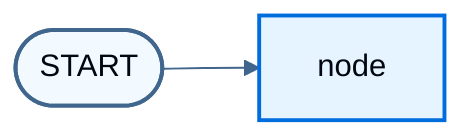

import LanggraphGraphApiMultipleSchemasJs from '/snippets/javascript/code-samples/langgraph-graph-api-multiple-schemas-js.mdx';
import LanggraphGraphApiMultipleSchemasPy from '/snippets/javascript/code-samples/langgraph-graph-api-multiple-schemas-py.mdx';
import LanggraphGraphApiReducersMergeDoesNotClearJs from '/snippets/javascript/code-samples/langgraph-graph-api-reducers-merge-does-not-clear-js.mdx';
import LanggraphGraphApiReducersMergeDoesNotClearPy from '/snippets/javascript/code-samples/langgraph-graph-api-reducers-merge-does-not-clear-py.mdx';
import LanggraphGraphApiReducersOverwriteClearJs from '/snippets/javascript/code-samples/langgraph-graph-api-reducers-overwrite-clear-js.mdx';
import LanggraphGraphApiReducersOverwriteClearPy from '/snippets/javascript/code-samples/langgraph-graph-api-reducers-overwrite-clear-py.mdx';
import LanggraphGraphApiReducersReplaceJs from '/snippets/javascript/code-samples/langgraph-graph-api-reducers-replace-js.mdx';
import LanggraphGraphApiStreamPrivateChannelPy from '/snippets/javascript/code-samples/langgraph-graph-api-stream-private-channel-py.mdx';
import LanggraphGraphApiStreamPrivateChannelJs from '/snippets/javascript/code-samples/langgraph-graph-api-stream-private-channel-js.mdx';
import LanggraphGraphApiStateAddMessagesInvokePy from '/snippets/javascript/code-samples/langgraph-graph-api-state-add-messages-invoke-py.mdx';
import LanggraphGraphApiStateAddMessagesPy from '/snippets/javascript/code-samples/langgraph-graph-api-state-add-messages-py.mdx';
import LanggraphGraphApiStateAltAnnotationRootJs from '/snippets/javascript/code-samples/langgraph-graph-api-state-alt-annotation-root-js.mdx';
import LanggraphGraphApiStateAltChannelsClassesJs from '/snippets/javascript/code-samples/langgraph-graph-api-state-alt-channels-classes-js.mdx';
import LanggraphGraphApiStateAltChannelsShorthandJs from '/snippets/javascript/code-samples/langgraph-graph-api-state-alt-channels-shorthand-js.mdx';
import LanggraphGraphApiStateAltZodV3Js from '/snippets/javascript/code-samples/langgraph-graph-api-state-alt-zod-v3-js.mdx';
import LanggraphGraphApiStateAltZodV4Js from '/snippets/javascript/code-samples/langgraph-graph-api-state-alt-zod-v4-js.mdx';
import LanggraphGraphApiStateBuildGraphJs from '/snippets/javascript/code-samples/langgraph-graph-api-state-build-graph-js.mdx';
import LanggraphGraphApiStateBuildGraphPy from '/snippets/javascript/code-samples/langgraph-graph-api-state-build-graph-py.mdx';
import LanggraphGraphApiStateDefineJs from '/snippets/javascript/code-samples/langgraph-graph-api-state-define-js.mdx';
import LanggraphGraphApiStateDefinePy from '/snippets/javascript/code-samples/langgraph-graph-api-state-define-py.mdx';
import LanggraphGraphApiStateInputOutputJs from '/snippets/javascript/code-samples/langgraph-graph-api-state-input-output-js.mdx';
import LanggraphGraphApiStateInputOutputPy from '/snippets/javascript/code-samples/langgraph-graph-api-state-input-output-py.mdx';
import LanggraphGraphApiStateInspectJs from '/snippets/javascript/code-samples/langgraph-graph-api-state-inspect-js.mdx';
import LanggraphGraphApiStateInvokeJs from '/snippets/javascript/code-samples/langgraph-graph-api-state-invoke-js.mdx';
import LanggraphGraphApiStateInvokePy from '/snippets/javascript/code-samples/langgraph-graph-api-state-invoke-py.mdx';
import LanggraphGraphApiStateMessagesStatePy from '/snippets/javascript/code-samples/langgraph-graph-api-state-messages-state-py.mdx';
import LanggraphGraphApiStateMessagesValueInvokeJs from '/snippets/javascript/code-samples/langgraph-graph-api-state-messages-value-invoke-js.mdx';
import LanggraphGraphApiStateMessagesValueJs from '/snippets/javascript/code-samples/langgraph-graph-api-state-messages-value-js.mdx';
import LanggraphGraphApiStateOverwriteJs from '/snippets/javascript/code-samples/langgraph-graph-api-state-overwrite-js.mdx';
import LanggraphGraphApiStateOverwriteJsonJs from '/snippets/javascript/code-samples/langgraph-graph-api-state-overwrite-json-js.mdx';
import LanggraphGraphApiStateOverwriteJsonPy from '/snippets/javascript/code-samples/langgraph-graph-api-state-overwrite-json-py.mdx';
import LanggraphGraphApiStateOverwritePy from '/snippets/javascript/code-samples/langgraph-graph-api-state-overwrite-py.mdx';
import LanggraphGraphApiStatePrettyPrintPy from '/snippets/javascript/code-samples/langgraph-graph-api-state-pretty-print-py.mdx';
import LanggraphGraphApiStatePrivateStateJs from '/snippets/javascript/code-samples/langgraph-graph-api-state-private-state-js.mdx';
import LanggraphGraphApiStatePrivateStatePy from '/snippets/javascript/code-samples/langgraph-graph-api-state-private-state-py.mdx';
import LanggraphGraphApiStatePydanticCoercionPy from '/snippets/javascript/code-samples/langgraph-graph-api-state-pydantic-coercion-py.mdx';
import LanggraphGraphApiStatePydanticInvalidPy from '/snippets/javascript/code-samples/langgraph-graph-api-state-pydantic-invalid-py.mdx';
import LanggraphGraphApiStatePydanticMessagesPy from '/snippets/javascript/code-samples/langgraph-graph-api-state-pydantic-messages-py.mdx';
import LanggraphGraphApiStatePydanticPy from '/snippets/javascript/code-samples/langgraph-graph-api-state-pydantic-py.mdx';
import LanggraphGraphApiStatePydanticSerializationPy from '/snippets/javascript/code-samples/langgraph-graph-api-state-pydantic-serialization-py.mdx';
import LanggraphGraphApiStateReducerDefineJs from '/snippets/javascript/code-samples/langgraph-graph-api-state-reducer-define-js.mdx';
import LanggraphGraphApiStateReducerDefinePy from '/snippets/javascript/code-samples/langgraph-graph-api-state-reducer-define-py.mdx';
import LanggraphGraphApiStateReducerInvokeJs from '/snippets/javascript/code-samples/langgraph-graph-api-state-reducer-invoke-js.mdx';
import LanggraphGraphApiStateReducerInvokePy from '/snippets/javascript/code-samples/langgraph-graph-api-state-reducer-invoke-py.mdx';
import LanggraphGraphApiStateReducerNodeJs from '/snippets/javascript/code-samples/langgraph-graph-api-state-reducer-node-js.mdx';
import LanggraphGraphApiStateReducerNodePy from '/snippets/javascript/code-samples/langgraph-graph-api-state-reducer-node-py.mdx';
import LanggraphGraphApiStateStreamOutputKeysJs from '/snippets/javascript/code-samples/langgraph-graph-api-state-stream-output-keys-js.mdx';
import LanggraphGraphApiStateStreamOutputKeysPy from '/snippets/javascript/code-samples/langgraph-graph-api-state-stream-output-keys-py.mdx';
import LanggraphGraphApiStateUpdateNodeJs from '/snippets/javascript/code-samples/langgraph-graph-api-state-update-node-js.mdx';
import LanggraphGraphApiStateUpdateNodePy from '/snippets/javascript/code-samples/langgraph-graph-api-state-update-node-py.mdx';

[State](/oss/javascript/langgraph/graph-api#state) 是节点读取和写入的共享 schema。[Reducers](/oss/javascript/langgraph/graph-api#reducers) 控制每次更新如何合并进当前值。本页涵盖：

1. 如何使用 state 定义图的 [schema](/oss/javascript/langgraph/graph-api#schema)
2. 如何使用 reducer 控制状态更新的处理方式

## Define state


LangGraph 中的 [State](/oss/javascript/langgraph/graph-api#state) 使用 `StateSchema` 类定义。它接受各个字段的 [standard schemas](https://standardschema.dev/)（如 [Zod](https://zod.dev/)），以及 `ReducedValue`、`MessagesValue` 和 `UntrackedValue` 这类值类型。请优先使用 `StateSchema`，而不是[旧版替代方案](#alternative-state-definitions)。


默认情况下，图的输入和输出使用同一个 schema，并由 state 决定该 schema。需要不同的输入和输出 schema 时，请参阅 [Define input and output schemas](#define-input-and-output-schemas)。

先从 [messages](/oss/javascript/langgraph/graph-api#working-with-messages-in-graph-state) 字段开始。这种结构适合许多 LLM 应用。更多细节请参阅 [Working with messages in graph state](/oss/javascript/langgraph/graph-api#working-with-messages-in-graph-state)。


<LanggraphGraphApiStateDefineJs />

此 state 跟踪 [message](/oss/javascript/langchain/messages) 对象列表，以及一个额外的整数字段。`MessagesValue` 带有内置 reducer，因此节点只需返回要追加的新消息。


## Update state


构建一个只包含单个[节点](/oss/javascript/langgraph/graph-api#nodes)的图。该节点是一个 TypeScript 函数，读取图状态并返回更新。第一个参数始终是 state：

<LanggraphGraphApiStateUpdateNodeJs />

该节点只返回新消息。`MessagesValue` 的 reducer 把它追加到现有列表，并设置 `extraField`。


<Warning>
节点应直接返回对状态的更新，而不是修改状态。
</Warning>


用这个节点定义一个简单的图。使用 [`StateGraph`](/oss/javascript/langgraph/graph-api#stategraph) 定义在该 state 上运行的图，再用 [`addNode`](/oss/javascript/langgraph/graph-api#nodes) 填充图：

<LanggraphGraphApiStateBuildGraphJs />


LangGraph 提供了可视化图的内置工具。详情请参阅 [Visualize your graph](/oss/javascript/langgraph/graph-api-visualize)。


```typescript
import * as fs from "node:fs/promises";

const drawableGraph = await graph.getGraphAsync();
const image = await drawableGraph.drawMermaidPng();
const imageBuffer = new Uint8Array(await image.arrayBuffer());

await fs.writeFile("graph.png", imageBuffer);
```




这个图只执行一个节点。调用它：


<LanggraphGraphApiStateInvokeJs />

```
{ messages: [HumanMessage { content: 'Hi' }, AIMessage { content: 'Hello!' }], extraField: 10 }
```


注意：

* 调用从更新 state 的单个键开始。
* 调用结果包含整个 state。


通过日志检查 [message](/oss/javascript/langchain/messages) 内容：

<LanggraphGraphApiStateInspectJs />

```
human: Hi
ai: Hello!
```


## Process state updates with reducers

状态中的每个键都可以有自己独立的 [reducer](/oss/javascript/langgraph/graph-api#reducers) 函数，用于控制如何应用节点返回的更新。如果没有指定 reducer，对该键的更新会替换之前的值。


前面的示例已经使用了 `MessagesValue`，它带有内置 reducer。对于自定义字段，使用 `ReducedValue` 定义更新的应用方式。

<LanggraphGraphApiStateReducerDefineJs />

节点只返回新消息，由 reducer 负责追加：

<LanggraphGraphApiStateReducerNodeJs />


<LanggraphGraphApiStateReducerInvokeJs />

```
human: Hi
ai: Hello!
```


### MessagesValue

在实践中，消息列表需要的不仅仅是简单拼接：

* 按 ID 更新 state 中已有的消息。
* 接受简写形式的 [message formats](/oss/javascript/langgraph/graph-api#serialization)，例如 `{ role: "user", content: "..." }`。

`MessagesValue` 是一个字段辅助类型，带有能识别消息的 reducer，可处理这些情况：

<LanggraphGraphApiStateMessagesValueJs />

<LanggraphGraphApiStateMessagesValueInvokeJs />

```
human: Hi
ai: Hello!
```

这种结构适合使用 [chat models](/oss/javascript/langchain/models) 的应用。与 Python 的 `MessagesState` 类不同，TypeScript 没有单独的预构建 state 类型：把 `MessagesValue` 放在 `StateSchema` 的 `messages` 字段上，如上面的示例所示。


## Resetting a reducer field

使用合并型 reducer 时有一个常见困惑点：返回空值并**不会**清空该字段。因为 reducer 会把右参数合并进左参数，一个空更新会被合并进去，之前累积的值依然保留。

对于错误缓冲区或重试计数器这类需要在重试之间清空的字段，这个模式非常关键：


<LanggraphGraphApiReducersMergeDoesNotClearJs />

要让节点重置（清空）该字段，可以定义一个用替换而非合并方式处理累积值的自定义 reducer：

<LanggraphGraphApiReducersReplaceJs />

或者，使用 `Overwrite` 包裹这次更新，以便在单次更新中绕过 reducer，同时该字段的其他更新仍保持正常的合并行为：

<LanggraphGraphApiReducersOverwriteClearJs />

更多信息请参见 [Bypass reducers with Overwrite](#bypass-reducers-with-overwrite)。


## Bypass reducers with `Overwrite`

在某些情况下，可能需要绕过 reducer 直接覆盖 state 值。当节点返回用 `Overwrite` 包裹的值时，reducer 会被绕过，channel 直接设置为该值。

当需要重置或替换累积状态，而不是把它与现有值合并时，这很有用。


LangGraph 为此提供了 `Overwrite` 类型。

<LanggraphGraphApiStateOverwriteJs />

```
["replacement message"]
```

也可以使用带特殊键 `"__overwrite__"` 的 JSON 格式：

<LanggraphGraphApiStateOverwriteJsonJs />

<Warning>
当节点并行执行时，在同一个 super-step 中只有一个节点能对同一个 state 键使用 `Overwrite`。如果多个节点在同一 super-step 中尝试覆盖同一个键，会抛出 `InvalidUpdateError`。`Overwrite` 还会丢弃其他节点在同一 super-step 中写入同一键的常规更新。该键最终只保留 `Overwrite` 的值。
</Warning>


## Define input and output schemas

默认情况下，`StateGraph` 使用单个 schema 运行，所有节点都通过该 schema 通信。也可以定义不同的输入和输出 schema。

指定不同的 schema 时，节点之间仍然使用内部 schema 通信。输入 schema 校验传入的输入。输出 schema 过滤内部数据，使 `invoke` 只返回输出 schema 中的字段。

定义不同的输入和输出 schema：


<LanggraphGraphApiStateInputOutputJs />

```
{ answer: 'bye' }
```


注意，invoke 的输出只包含输出 schema。

## Pass private state between nodes

节点有时需要一些中间数据，这些数据不应出现在图的主输入或输出 schema 中。把这部分数据保持为私有，只让需要它的节点读取。

下面的顺序图有三个节点。私有数据在前两步之间传递。第三步只能看到公共的 overall state。


<LanggraphGraphApiStatePrivateStateJs />

```
Entered node 'node1':
	Input: {"a":"set at start"}.
	Returned: {"privateData":"set by node1"}
Entered node 'node2':
	Input: {"privateData":"set by node1"}.
	Returned: {"a":"set by node2"}
Entered node 'node3':
	Input: {"a":"set by node2"}.
	Returned: {"a":"set by node3"}

Output of graph invocation: {"a":"set by node3"}
```


## Private channels and streaming

输入、输出和私有 schema 约束每个节点读取的内容，以及 `invoke` 返回的内容。它们**不会**对[流式传输](/oss/javascript/langgraph/streaming)隐藏 channel。

values streaming 默认会发出**所有** state channel，包括私有 channel。这适用于 [event streaming](/oss/javascript/langgraph/event-streaming) 的 values 投影（在 `stream_events` / `streamEvents` 上使用 `version="v3"` 时的 `stream.values`），也适用于 `stream_mode="values"` / `streamMode: "values"` 的 `graph.stream`。values streaming 使用的是完整 state，而不是输出 schema。私有 channel 可能不出现在 `invoke` 的输出中，但在流里可见。


这个示例使用了不同的 input、output、overall 和 private schema。`invoke` 只返回输出 schema：

<LanggraphGraphApiMultipleSchemasJs />

使用 values 投影进行流式传输时，仍然会包含私有的 `bar` channel：

<LanggraphGraphApiStreamPrivateChannelJs />

要把流式输出的值限制在特定 channel（例如只输出 schema），请向 `graph.stream` 传入 `outputKeys`：

<LanggraphGraphApiStateStreamOutputKeysJs />

如果只需要每一步节点实际产生的 channel（而不是完整的累积状态），请改用 `streamMode: "updates"`。参见 [Streaming](/oss/javascript/langgraph/streaming)。


## Alternative state definitions

新图推荐使用 `StateSchema`。LangGraph 也支持下面的方式，用于旧代码和高级 channel 控制。

### Channels API

Channels API 提供对状态管理的低级控制。LangGraph 提供几种内置的 channel 类型：

| Channel 类型 | 行为 | 使用场景 |
|--------------|----------|----------|
| `LastValue` | 存储最新值 | 会被覆盖的简单字段 |
| `BinaryOperatorAggregate` | 使用 reducer 函数组合值 | 累积值（计数器、列表） |
| `Topic` | 把所有值收集到一个序列 | 事件流、审计日志 |
| `EphemeralValue` | 在 super-step 之间重置的值 | 临时计算状态 |

**使用对象简写：**

传入带 `reducer` 和 `default` 的对象会创建一个 `BinaryOperatorAggregate` channel。传入 `null` 会创建一个 `LastValue` channel：

<LanggraphGraphApiStateAltChannelsShorthandJs />

**直接使用 channel 类：**

需要更多控制时，可以从 `@langchain/langgraph/channels` 实例化 channel 类：

<LanggraphGraphApiStateAltChannelsClassesJs />

### Annotation.Root

`Annotation.Root` 提供了一种声明式方式来定义带 reducer 的状态。它类似于 `StateSchema`，但语法不同：

<LanggraphGraphApiStateAltAnnotationRootJs />

### Zod objects with Zod v3

使用 Zod v3 时，可以用普通的 `z.object()` schema 定义状态。LangGraph 通过 `.langgraph` 插件扩展了 Zod v3，提供 `.reducer()` 和 `.metadata()` 方法：

<LanggraphGraphApiStateAltZodV3Js />

### Zod objects with Zod v4

Zod v4 使用基于注册表的方式。使用 LangGraph registry 把元数据附加到 schema 字段：

<LanggraphGraphApiStateAltZodV4Js />

### Comparison table

| 方法 | Reducer | 类型安全 | Zod 版本 | 推荐 |
|----------|----------|-------------|-------------|-------------|
| `StateSchema` | ✅ 内置 | ✅ 完整 | v3 或 v4 | ✅ 是 |
| Channels API | ✅ 手动 | ⚠️ 部分 | 不适用 | 用于高级场景 |
| `Annotation.Root` | ✅ 内置 | ✅ 完整 | 不适用 | 旧版 |
| Zod v3 + `.langgraph` | ✅ 通过插件 | ✅ 完整 | 仅 v3 | 旧版 |
| Zod v4 + registry | ✅ 通过 registry | ✅ 完整 | 仅 v4 | 旧版 |


## 了解更多

* [Graph API 概览](/oss/javascript/langgraph/graph-api#state)
* [在图 state 中使用 messages](/oss/javascript/langgraph/graph-api#working-with-messages-in-graph-state)
* [事件流式传输](/oss/javascript/langgraph/event-streaming)
* [流式输出](/oss/javascript/langgraph/streaming)
* [Graph API 构建检查清单](/oss/javascript/langgraph/use-graph-api)

---

<div className="source-links">
<Callout icon="terminal-2">
    [Connect these docs](/use-these-docs) to your agent of choice via MCP for real-time answers.
</Callout>
<Callout icon="edit">
    [Edit this page on GitHub](https://github.com/langchain-ai/docs/edit/main/src/oss/langgraph/graph-api-state.mdx) or [file an issue](https://github.com/langchain-ai/docs/issues/new/choose).
</Callout>
</div>
