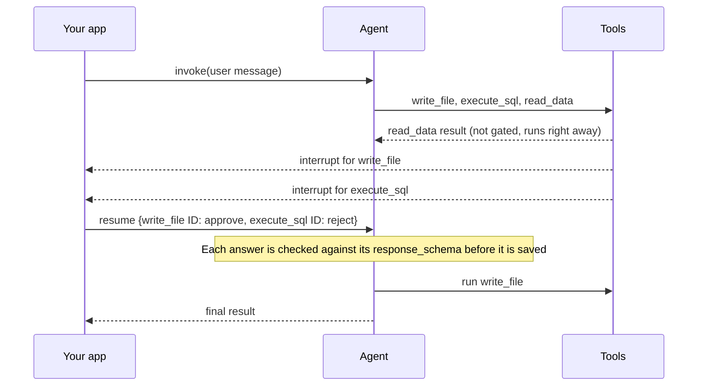

import HitlDecisionTypesTable from '/snippets/python/oss/hitl-decision-types-table.mdx';

人类在回路中（HITL）会在工具调用运行之前暂停智能体，以便人员进行审查。审查者可以原样批准该调用、修改其参数、带反馈拒绝它，或者代替工具直接回答。对于难以撤销或需要审批的动作，例如删除记录、发送邮件或写入文件，可以使用它。

你可以在 [LangChain](/oss/python/langchain/human-in-the-loop) 中使用 [`HumanInTheLoopMiddleware`](https://reference.langchain.com/python/langchain/agents/middleware/human_in_the_loop/HumanInTheLoopMiddleware) 加入审查，或在 [Deep Agents](/oss/python/deepagents/human-in-the-loop) 中使用 `interrupt_on` 参数加入审查。中间件会以两种模式之一暂停：


- **逐调用（per-call）**：每个需要审查的工具调用各暂停一次。
- **批量（batched）**：每个模型轮次暂停一次，覆盖该轮次中的每个工具调用。批量模式是当前的默认模式。

<Note>
逐调用模式需要 `langchain>=1.4.6`。Deep Agents 使用批量模式。
</Note>


## 了解审批从暂停到恢复的流程

无论哪种模式，每次审批都遵循相同的步骤：

1. 模型提出一个或多个工具调用。
2. 中间件将每个调用与你的 `interrupt_on` 策略进行比对。需要审查的调用会通过一个 [interrupt](https://reference.langchain.com/python/langgraph/types/interrupt) 暂停智能体。
3. [checkpointer](/oss/python/langgraph/persistence) 保存智能体的状态，因此运行可以停止并在之后恢复，即使是在另一个进程中。
4. 你的应用向审查者展示待处理的调用，并为每个调用收集一个决策。
5. 你使用 `Command(resume=...)` 恢复智能体。中间件应用每个决策，智能体继续运行。


决策有四种类型：

<HitlDecisionTypesTable />

本页示例使用的智能体包含三个工具。`write_file` 允许所有决策类型。`execute_sql` 只允许 `approve` 和 `reject`。`read_data` 无需审查即可运行。在同一个轮次中，模型调用了全部三个工具。

## 逐个审查每个工具调用

在逐调用模式下，每个需要审查的工具调用在开始时各自暂停：



每个 interrupt 值描述一个调用，并带有 `type: "tool_approval"`。`execute_sql` 的 interrupt 如下所示：

```python
{
    "type": "tool_approval",
    "tool_call_id": "call_sql",
    "name": "execute_sql",
    "args": {"query": "DELETE FROM orders WHERE created_at < '2025-01-01'"},
    "description": "Tool execution requires approval\n\nTool: execute_sql\nArgs: {'query': \"DELETE FROM orders WHERE created_at < '2025-01-01'\"}",
}
```


每个 interrupt 还携带一个 [`response_schema`](/oss/python/langgraph/interrupts#define-an-interrupt-response-schema)，即该调用所接受答案的 JSON Schema。对于 `execute_sql`，该模式允许 `approve` 和 `reject`。对于 `write_file`，它还允许 `respond` 和 `edit`。`edit` 分支包含 `write_file` 自己的参数模式。客户端可以根据模式渲染表单，而不是硬编码决策类型。[LangChain 指南](/oss/python/langchain/human-in-the-loop#read-the-response-schema)展示了每种决策类型对应的模式。

你为每个 interrupt 提供一个决策，以该 interrupt 的 ID 作为键：

```python
Command(resume={
    write_file_interrupt.id: {"type": "approve"},
    execute_sql_interrupt.id: {"type": "reject", "message": "Archive the rows before deleting them."},
})
```


LangGraph 会在保存之前拒绝无效的答案，因此审查者可以修正后再次回答。未回答的 interrupt 会保持待处理状态，这让审查者可以逐个回答它们。

## 一次审查整个轮次

在批量模式下，中间件在模型响应之后、任何工具运行之前暂停一次。`read_data` 也会等待审查，即使它未受门控。一个 interrupt 在 `action_requests` 中列出每个受门控的调用，并在单独的 `review_configs` 列表中列出每个调用允许的决策：

```python
{
    "action_requests": [
        {"name": "write_file", "args": {"path": "orders_archive.csv", "content": "id,total\n1,20\n"}, "description": "..."},
        {"name": "execute_sql", "args": {"query": "DELETE FROM orders WHERE created_at < '2025-01-01'"}, "description": "..."},
    ],
    "review_configs": [
        {"action_name": "write_file", "allowed_decisions": ["approve", "edit", "reject", "respond"]},
        {"action_name": "execute_sql", "allowed_decisions": ["approve", "reject"]},
    ],
}
```

你用一个决策列表来回答，顺序与 `action_requests` 相同：

```python
Command(resume={"decisions": [
    {"type": "approve"},
    {"type": "reject", "message": "Archive the rows before deleting them."},
]})
```


该 interrupt 没有 `response_schema`。中间件只有在应用每个决策时才会检查它，也就是在 LangGraph 保存答案之后。

## 比较批量模式的问题

批量模式按位置将答案与调用匹配，并且只有在保存答案之后才检查每个答案。下表的每一行展示了示例智能体在批量模式中遇到的一个问题，以及逐调用模式如何避免它：

| 批量模式下 | 会发生什么 | 逐调用模式下 |
| --- | --- | --- |
| 决策按位置与调用匹配 | 审查者本意是批准 `write_file` 并拒绝 `execute_sql`，但发送了 `[reject, approve]`。`DELETE` 会执行。 | 每个决策都以它所属调用的 interrupt ID 作为键。 |
| 允许的决策存放在 `review_configs` 中 | 客户端按位置配对两个列表，并为每种决策类型硬编码一个按钮。 | 每个 interrupt 的 `response_schema` 列出它的决策和编辑参数。 |
| 答案在检查之前被保存 | 两个调用只提供一个决策会抛出 `ValueError: Number of human decisions (1) does not match number of hanging tool calls (2).` 随后，修正后的答案会因同样的错误再次失败，线程因此卡住。 | 答案会先被检查。修正后再次回答即可。 |
| 编辑后的参数不会被检查 | 对 `write_file` 的编辑缺少 `content` 时，工具仍会运行，模型会为一个它从未发起的调用收到错误。 | 该编辑会被拒绝，报错为 `edit.edited_action.args.content Field required`。 |


## 选择中断模式

| | 逐调用 | 批量（默认） |
| --- | --- | --- |
| **何时暂停** | 在每个受门控的工具调用开始时 | 在模型响应之后、任何工具运行之前 |
| **每轮次 interrupt 数量** | 每个受门控的工具调用一个 | 整个轮次一个 |
| **轮次中未受门控的调用** | 立即运行 | 等待审查 |
| **回答方式** | 每个 interrupt 一个决策，以 interrupt ID 作为键 | 一个决策列表，按位置匹配 |
| **最适合** | 新智能体、每个调用一张审批卡片或一条消息、根据模式构建的表单 | 已经读取 `action_requests` 的审批 UI |


对于新智能体，请使用逐调用模式。LangChain 计划在下一个主要版本中将其设为默认模式。

如果你的审批 UI 读取批量格式，例如使用 [`useStream` 审批模式](/oss/python/langchain/frontend/human-in-the-loop)构建的 UI，请继续使用批量模式。

逐调用模式还会改变中间件顺序和多答案恢复的行为。在切换之前，请阅读[为逐调用审查排列中间件顺序](/oss/python/langchain/human-in-the-loop#order-middleware-for-per-call-review)和[按 ID 逐个恢复调用](/oss/python/langchain/human-in-the-loop#resume-each-call-by-id)。

## 另请参阅

- [LangChain 中的人类在回路中](/oss/python/langchain/human-in-the-loop)：配置中间件并回答每种决策类型。
- [Deep Agents 中的人类在回路中](/oss/python/deepagents/human-in-the-loop)：deep agent 及其子 agent 的审批。
- [定义 interrupt 响应模式](/oss/python/langgraph/interrupts#define-an-interrupt-response-schema)：LangGraph 如何检查恢复值。

---

<div className="source-links">
<Callout icon="terminal-2">
    [Connect these docs](/use-these-docs) to your agent of choice via MCP for real-time answers.
</Callout>
<Callout icon="edit">
    [Edit this page on GitHub](https://github.com/langchain-ai/docs/edit/main/src/oss/concepts/human-in-the-loop.mdx) or [file an issue](https://github.com/langchain-ai/docs/issues/new/choose).
</Callout>
</div>
