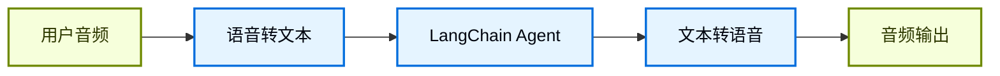
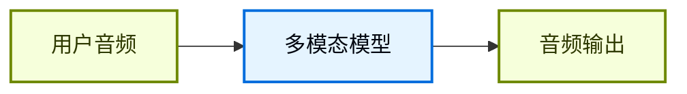

## 概览

聊天界面一直主导着我们和 AI 的交互方式，但多模态 AI 的最新突破正在打开一些令人兴奋的新可能。高质量的生成模型和表现力更强的 text-to-speech（TTS）系统，现在让构建起来像对话伙伴而不是工具的 agent 成为可能。

语音智能体就是其中一个例子。你不再需要键盘和鼠标把输入打进 agent，而是可以用口语和它交互。这通常是一种更自然、更有参与感的交互方式，在某些场景下尤其有用。

### 什么是语音智能体？

语音智能体是可以与用户进行自然口语对话的 [agents](/oss/python/langchain/agents)。这类 agent 结合了语音识别、自然语言处理、生成式 AI 和 text-to-speech 技术，从而实现流畅自然的对话。

它们适合很多场景，包括：

- 客户支持
- 个人助理
- 免手操作界面
- 辅导和培训

### 语音智能体如何工作？

从高层看，每个语音智能体都需要处理三件事：

1. **Listen** - 捕获音频并转写
2. **Think** - 解释意图、推理、规划
3. **Speak** - 生成音频并把它流回用户

差别在于这些步骤如何编排、如何耦合。实践中，生产级 agent 通常遵循两种主要架构之一：

#### 1. STT > Agent > TTS 架构（“三明治”）

三明治架构由三个独立组件组成：speech-to-text（STT）、基于文本的 LangChain agent，以及 text-to-speech（TTS）。



**优点：**
- 对每个组件都有完全控制权，可以按需替换 STT/TTS provider
- 能直接使用现代文本模态模型的最新能力
- 边界清晰，行为透明

**缺点：**
- 需要编排多个服务
- 管线管理更复杂
- 从语音到文本的转换会丢失部分信息，例如语气和情绪

#### 2. Speech-to-Speech 架构（S2S）

Speech-to-speech 使用一个原生处理音频输入并生成音频输出的多模态模型。



**优点：**
- 架构更简单，移动部件更少
- 对于简单交互，通常延迟更低
- 直接处理音频，可以捕捉语气和其他语音细节

**缺点：**
- 可选模型较少，provider lock-in 风险更高
- 功能可能落后于文本模态模型
- 音频处理的透明度较低
- 可控性和定制能力更弱

本指南演示的是 **三明治架构**，因为它在性能、可控性和对现代模型能力的访问之间取得了平衡。某些 STT 和 TTS provider 下，三明治架构可以把延迟压到 700ms 以下，同时保留模块化组件的控制权。

### Demo 应用概览

我们会按照三明治架构来构建一个基于语音的 agent。这个 agent 会管理一家三明治店的订单。应用会展示三明治架构的全部三个组件，使用 [AssemblyAI](https://www.assemblyai.com/) 做 STT，使用 [Cartesia](https://cartesia.ai/) 做 TTS（当然也可以为大多数 provider 编写适配器）。

完整的参考应用可以在 [voice-sandwich-demo](https://github.com/langchain-ai/voice-sandwich-demo) 仓库中找到。这里我们会逐步讲解这个应用。

这个 demo 使用 WebSockets 实现浏览器和服务器之间的实时双向通信。同样的架构也可以适配电话系统（Twilio、Vonage）或 WebRTC 连接等其他传输方式。

### 架构

这个 demo 实现了一个流式管线，其中每个阶段都会异步处理数据：

**客户端（浏览器）**
- 捕获麦克风音频并将其编码为 PCM
- 与后端服务器建立 WebSocket 连接
- 实时向服务器流式发送音频 chunk
- 接收并播放合成的语音音频

**服务端（Python）**


- 接收来自客户端的 WebSocket 连接
- 编排三步管线：
  - [Speech-to-text (STT)](#1-speech-to-text)：把音频转发给 STT provider（例如 AssemblyAI），接收 transcript events
  - [Agent](#2-langchain-agent)：用 LangChain agent 处理 transcripts，流式输出 response tokens
  - [Text-to-speech (TTS)](#3-text-to-speech)：把 agent responses 发送给 TTS provider（例如 Cartesia），接收音频 chunk

- 把合成音频返回给客户端播放

这个管线使用 async generators，让每个阶段都可以流式处理。这样下游组件可以在上游阶段完成前就开始处理，从而尽量降低端到端延迟。


## 设置

有关详细安装说明和设置，请参见 [repository README](https://github.com/langchain-ai/voice-sandwich-demo#readme)。

## 1. 语音转文本

STT 阶段会把传入的音频流转换成文本 transcripts。这个实现使用生产者-消费者模式并发处理音频流式传输和 transcript 接收。

### 关键概念

**生产者-消费者模式**：音频 chunk 会在向 STT 服务发送的同时，持续接收 transcript events。这样在所有音频到齐之前，转写就可以开始。

**事件类型**：
- `stt_chunk`：STT 服务处理音频时给出的部分 transcript
- `stt_output`：最终、格式化后的 transcript，会触发 agent 处理

**WebSocket 连接**：维持到 AssemblyAI 实时 STT API 的持久连接，配置为 16kHz PCM 音频并自动 turn formatting。

### 实现

```python
from typing import AsyncIterator
import asyncio
from assemblyai_stt import AssemblyAISTT
from events import VoiceAgentEvent

async def stt_stream(
    audio_stream: AsyncIterator[bytes],
) -> AsyncIterator[VoiceAgentEvent]:
    """
    Transform stream: Audio (Bytes) → Voice Events (VoiceAgentEvent)

    Uses a producer-consumer pattern where:
    - Producer: Reads audio chunks and sends them to AssemblyAI
    - Consumer: Receives transcription events from AssemblyAI
    """
    stt = AssemblyAISTT(sample_rate=16000)

    async def send_audio():
        """Background task that pumps audio chunks to AssemblyAI."""
        try:
            async for audio_chunk in audio_stream:
                await stt.send_audio(audio_chunk)
        finally:
            # Signal completion when audio stream ends
            await stt.close()

    # Launch audio sending in background
    send_task = asyncio.create_task(send_audio())

    try:
        # Receive and yield transcription events as they arrive
        async for event in stt.receive_events():
            yield event
    finally:
        # Cleanup
        with contextlib.suppress(asyncio.CancelledError):
            send_task.cancel()
            await send_task
        await stt.close()
```


这个应用实现了一个 AssemblyAI client，用来管理 WebSocket 连接和消息解析。具体实现见下文；其他 STT provider 也可以构建类似的适配器。

<Accordion title="AssemblyAI Client">

```python
class AssemblyAISTT:
    def __init__(self, api_key: str | None = None, sample_rate: int = 16000):
        self.api_key = api_key or os.getenv("ASSEMBLYAI_API_KEY")
        self.sample_rate = sample_rate
        self._ws: WebSocketClientProtocol | None = None

    async def send_audio(self, audio_chunk: bytes) -> None:
        """Send PCM audio bytes to AssemblyAI."""
        ws = await self._ensure_connection()
        await ws.send(audio_chunk)

    async def receive_events(self) -> AsyncIterator[STTEvent]:
        """Yield STT events as they arrive from AssemblyAI."""
        async for raw_message in self._ws:
            message = json.loads(raw_message)

            if message["type"] == "Turn":
                # Final formatted transcript
                if message.get("turn_is_formatted"):
                    yield STTOutputEvent.create(message["transcript"])
                # Partial transcript
                else:
                    yield STTChunkEvent.create(message["transcript"])

    async def _ensure_connection(self) -> WebSocketClientProtocol:
        """Establish WebSocket connection if not already connected."""
        if self._ws is None:
            url = f"wss://streaming.assemblyai.com/v3/ws?sample_rate={self.sample_rate}&format_turns=true"
            self._ws = await websockets.connect(
                url,
                additional_headers={"Authorization": self.api_key}
            )
        return self._ws
```


</Accordion>

## 2. LangChain agent

Agent 阶段会通过一个 LangChain [agent](/oss/python/langchain/agents) 处理文本 transcripts，并流式输出 response tokens。在这个例子里，我们会流式传输 agent 生成的所有 [text content blocks](/oss/python/langchain/messages#content-block-reference)。

### 关键概念

**流式响应**：agent 使用 [`stream_events(version="v3")`](/oss/python/langchain/streaming) 和 `stream.messages`，在生成过程中就发出 response tokens，而不是等完整回复生成完毕。这使得 TTS 阶段可以立刻开始合成。

**对话记忆**：通过唯一的 thread ID，[checkpointer](/oss/python/langchain/short-term-memory) 可以在多个轮次之间保留对话状态。这样 agent 就能引用对话中的前面交换内容。

### 实现

```python
from langchain_core.utils.uuid import uuid7
from langchain.agents import create_agent
from langchain.messages import HumanMessage
from langgraph.checkpoint.memory import InMemorySaver

# Define agent tools
def add_to_order(item: str, quantity: int) -> str:
    """Add an item to the customer's sandwich order."""
    return f"Added {quantity} x {item} to the order."

def confirm_order(order_summary: str) -> str:
    """Confirm the final order with the customer."""
    return f"Order confirmed: {order_summary}. Sending to kitchen."

# Create agent with tools and memory
agent = create_agent(
    model="google_genai:gemini-3.6-flash",  # Select your model
    tools=[add_to_order, confirm_order],
    system_prompt="""You are a helpful sandwich shop assistant.
    Your goal is to take the user's order. Be concise and friendly.
    Do NOT use emojis, special characters, or markdown.
    Your responses will be read by a text-to-speech engine.""",
    checkpointer=InMemorySaver(),
)

async def agent_stream(
    event_stream: AsyncIterator[VoiceAgentEvent],
) -> AsyncIterator[VoiceAgentEvent]:
    """
    Transform stream: Voice Events → Voice Events (with Agent Responses)

    Passes through all upstream events and adds agent_chunk events
    when processing STT transcripts.
    """
    # Generate unique thread ID for conversation memory
    thread_id = str(uuid7())

    async for event in event_stream:
        # Pass through all upstream events
        yield event

        # Process final transcripts through the agent
        if event.type == "stt_output":
            # Stream agent response with conversation context
            stream = await agent.astream_events(
                {"messages": [HumanMessage(content=event.transcript)]},
                {"configurable": {"thread_id": thread_id}},
                version="v3",
            )

            # Yield agent response chunks as they arrive
            async for message in stream.messages:
                async for token in message.text:
                    yield AgentChunkEvent.create(token)
```


## 3. 文本转语音

TTS 阶段会把 agent 的回复文本合成为音频，并流式返回给客户端。和 STT 阶段一样，它也使用生产者-消费者模式并发处理文本发送和音频接收。

### 关键概念

**并发处理**：这个实现会合并两条异步流：
- **上游处理**：透传所有事件，并把 agent 的文本 chunk 发送给 TTS provider
- **音频接收**：接收来自 TTS provider 的合成音频 chunk

**流式 TTS**：某些 provider（例如 [Cartesia](https://cartesia.ai/)）一收到文本就开始合成音频，这样音频播放可以在 agent 生成完整回复之前就开始。

**事件透传**：所有上游事件都原样流过，客户端或其他观察者因此可以跟踪完整的管线状态。

### 实现

```python
from cartesia_tts import CartesiaTTS
from utils import merge_async_iters

async def tts_stream(
    event_stream: AsyncIterator[VoiceAgentEvent],
) -> AsyncIterator[VoiceAgentEvent]:
    """
    Transform stream: Voice Events → Voice Events (with Audio)

    Merges two concurrent streams:
    1. process_upstream(): passes through events and sends text to Cartesia
    2. tts.receive_events(): yields audio chunks from Cartesia
    """
    tts = CartesiaTTS()

    async def process_upstream() -> AsyncIterator[VoiceAgentEvent]:
        """Process upstream events and send agent text to Cartesia."""
        async for event in event_stream:
            # Pass through all events
            yield event
            # Send agent text to Cartesia for synthesis
            if event.type == "agent_chunk":
                await tts.send_text(event.text)

    try:
        # Merge upstream events with TTS audio events
        # Both streams run concurrently
        async for event in merge_async_iters(
            process_upstream(),
            tts.receive_events()
        ):
            yield event
    finally:
        await tts.close()
```


这个应用实现了一个 Cartesia client，用来管理 WebSocket 连接和音频流式传输。具体实现见下文；其他 TTS provider 也可以构建类似的适配器。

<Accordion title="Cartesia Client">

```python
import base64
import json
import websockets

class CartesiaTTS:
    def __init__(
        self,
        api_key: Optional[str] = None,
        voice_id: str = "f6ff7c0c-e396-40a9-a70b-f7607edb6937",
        model_id: str = "sonic-3",
        sample_rate: int = 24000,
        encoding: str = "pcm_s16le",
    ):
        self.api_key = api_key or os.getenv("CARTESIA_API_KEY")
        self.voice_id = voice_id
        self.model_id = model_id
        self.sample_rate = sample_rate
        self.encoding = encoding
        self._ws: WebSocketClientProtocol | None = None

    def _generate_context_id(self) -> str:
        """Generate a valid context_id for Cartesia."""
        timestamp = int(time.time() * 1000)
        counter = self._context_counter
        self._context_counter += 1
        return f"ctx_{timestamp}_{counter}"

    async def send_text(self, text: str | None) -> None:
        """Send text to Cartesia for synthesis."""
        if not text or not text.strip():
            return

        ws = await self._ensure_connection()
        payload = {
            "model_id": self.model_id,
            "transcript": text,
            "voice": {
                "mode": "id",
                "id": self.voice_id,
            },
            "output_format": {
                "container": "raw",
                "encoding": self.encoding,
                "sample_rate": self.sample_rate,
            },
            "language": self.language,
            "context_id": self._generate_context_id(),
        }
        await ws.send(json.dumps(payload))

    async def receive_events(self) -> AsyncIterator[TTSChunkEvent]:
        """Yield audio chunks as they arrive from Cartesia."""
        async for raw_message in self._ws:
            message = json.loads(raw_message)

            # Decode and yield audio chunks
            if "data" in message and message["data"]:
                audio_chunk = base64.b64decode(message["data"])
                if audio_chunk:
                    yield TTSChunkEvent.create(audio_chunk)

    async def _ensure_connection(self) -> WebSocketClientProtocol:
        """Establish WebSocket connection if not already connected."""
        if self._ws is None:
            url = (
                f"wss://api.cartesia.ai/tts/websocket"
                f"?api_key={self.api_key}&cartesia_version={self.cartesia_version}"
            )
            self._ws = await websockets.connect(url)

        return self._ws
```


</Accordion>

### LangSmith

你用 LangChain 构建的很多应用都会包含多个步骤和多次 LLM 调用。随着应用越来越复杂，能够检查 chain 或 agent 内部到底发生了什么就变得至关重要。最好的方式是使用 [LangSmith](https://smith.langchain.com?utm_source=docs&utm_medium=cta&utm_campaign=langsmith-signup&utm_content=oss-langchain-voice-agent)。

在上面的链接注册后，记得设置环境变量以开始记录 traces：

```shell
export LANGSMITH_TRACING="true"
export LANGSMITH_API_KEY="..."
```

或者，也可以在 Python 里设置：

```python
import getpass
import os

os.environ["LANGSMITH_TRACING"] = "true"
os.environ["LANGSMITH_API_KEY"] = getpass.getpass()
```


## 把所有内容整合起来

完整的管线会把这三个阶段串联在一起：

```python
from langchain_core.runnables import RunnableGenerator

pipeline = (
    RunnableGenerator(stt_stream)      # Audio → STT events
    | RunnableGenerator(agent_stream)  # STT events → Agent events
    | RunnableGenerator(tts_stream)    # Agent events → TTS audio
)

# Use in WebSocket endpoint
@app.websocket("/ws")
async def websocket_endpoint(websocket: WebSocket):
    await websocket.accept()

    async def websocket_audio_stream():
        """Yield audio bytes from WebSocket."""
        while True:
            data = await websocket.receive_bytes()
            yield data

    # Transform audio through pipeline
    output_stream = pipeline.atransform(websocket_audio_stream())

    # Send TTS audio back to client
    async for event in output_stream:
        if event.type == "tts_chunk":
            await websocket.send_bytes(event.audio)
```

这里用 [RunnableGenerators](https://reference.langchain.com/python/langchain-core/runnables) 来组合管线的每一步。它是 LangChain 内部用来管理[跨组件流式传输](https://reference.langchain.com/python/langchain-core/runnables)的一个抽象。


每个阶段都独立且并发地处理事件：音频一到达就开始转写，transcript 一可用 agent 就开始推理，agent 文本一生成就开始语音合成。这种架构可以把延迟做到 700ms 以下，支撑自然的对话。

要了解更多用 LangChain 构建 agent 的内容，请参见 [Agents 指南](/oss/python/langchain/agents)。

---

<div className="source-links">
<Callout icon="terminal-2">
    [Connect these docs](/use-these-docs) to your agent of choice via MCP for real-time answers.
</Callout>
<Callout icon="edit">
    [Edit this page on GitHub](https://github.com/langchain-ai/docs/edit/main/src/oss/langchain/voice-agent.mdx) or [file an issue](https://github.com/langchain-ai/docs/issues/new/choose).
</Callout>
</div>
