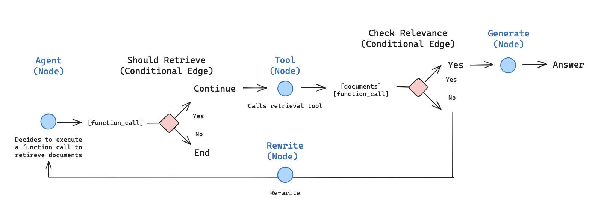
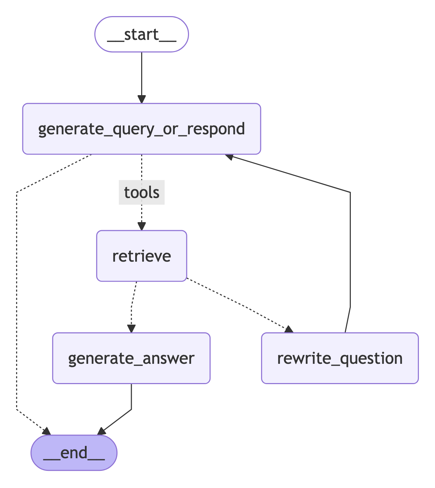

import AgenticRagAssembleGraphJs from '/snippets/python/code-samples/agentic-rag-assemble-graph-js.mdx';
import AgenticRagAssembleGraphPy from '/snippets/python/code-samples/agentic-rag-assemble-graph-py.mdx';
import AgenticRagCreateRetrieverPy from '/snippets/python/code-samples/agentic-rag-create-retriever-py.mdx';
import AgenticRagCreateRetrieverToolJs from '/snippets/python/code-samples/agentic-rag-create-retriever-tool-js.mdx';
import AgenticRagCreateRetrieverToolPy from '/snippets/python/code-samples/agentic-rag-create-retriever-tool-py.mdx';
import AgenticRagGenerateAnswerJs from '/snippets/python/code-samples/agentic-rag-generate-answer-js.mdx';
import AgenticRagGenerateAnswerPy from '/snippets/python/code-samples/agentic-rag-generate-answer-py.mdx';
import AgenticRagGenerateQueryOrRespondJs from '/snippets/python/code-samples/agentic-rag-generate-query-or-respond-js.mdx';
import AgenticRagGenerateQueryOrRespondPy from '/snippets/python/code-samples/agentic-rag-generate-query-or-respond-py.mdx';
import AgenticRagGradeDocumentsJs from '/snippets/python/code-samples/agentic-rag-grade-documents-js.mdx';
import AgenticRagGradeDocumentsPy from '/snippets/python/code-samples/agentic-rag-grade-documents-py.mdx';
import AgenticRagGradeIrrelevantPy from '/snippets/python/code-samples/agentic-rag-grade-irrelevant-py.mdx';
import AgenticRagGradeRelevantPy from '/snippets/python/code-samples/agentic-rag-grade-relevant-py.mdx';
import AgenticRagPreprocessJs from '/snippets/python/code-samples/agentic-rag-preprocess-js.mdx';
import AgenticRagPreprocessPy from '/snippets/python/code-samples/agentic-rag-preprocess-py.mdx';
import AgenticRagRewriteQuestionJs from '/snippets/python/code-samples/agentic-rag-rewrite-question-js.mdx';
import AgenticRagRewriteQuestionPy from '/snippets/python/code-samples/agentic-rag-rewrite-question-py.mdx';
import AgenticRagRunAgentJs from '/snippets/python/code-samples/agentic-rag-run-agent-js.mdx';
import AgenticRagRunAgentPy from '/snippets/python/code-samples/agentic-rag-run-agent-py.mdx';
import AgenticRagSetupEnvPy from '/snippets/python/code-samples/agentic-rag-setup-env-py.mdx';
import AgenticRagSplitDocumentsJs from '/snippets/python/code-samples/agentic-rag-split-documents-js.mdx';
import AgenticRagSplitDocumentsPy from '/snippets/python/code-samples/agentic-rag-split-documents-py.mdx';
import AgenticRagTestRetrieverToolJs from '/snippets/python/code-samples/agentic-rag-test-retriever-tool-js.mdx';
import AgenticRagTestRetrieverToolPy from '/snippets/python/code-samples/agentic-rag-test-retriever-tool-py.mdx';
import AgenticRagTryGenerateAnswerPy from '/snippets/python/code-samples/agentic-rag-try-generate-answer-py.mdx';
import AgenticRagTryGreetingPy from '/snippets/python/code-samples/agentic-rag-try-greeting-py.mdx';
import AgenticRagTryRetrievalQuestionPy from '/snippets/python/code-samples/agentic-rag-try-retrieval-question-py.mdx';
import AgenticRagTryRewritePy from '/snippets/python/code-samples/agentic-rag-try-rewrite-py.mdx';
import AgenticRagVisualizeGraphPy from '/snippets/python/code-samples/agentic-rag-visualize-graph-py.mdx';


使用 LangGraph 构建一个 [检索](/oss/python/deepagents/retrieval) 智能体，让它决定是搜索向量存储，还是直接回复用户。

LangChain 提供了内置的 [agent](/oss/python/langchain/agents) 实现，这些实现基于 [LangGraph](/oss/python/langgraph/overview) 原语构建。当你需要更深入的自定义时，可以直接在 LangGraph 中实现智能体。本教程将介绍一种检索智能体的实现模式。

在本教程中，你将：

1. 获取并预处理用于检索的文档。
2. 为这些文档建立语义搜索索引，并为智能体创建一个检索器工具。
3. 构建一个 agentic RAG 系统，让它能够决定何时使用检索器工具。



### 概念

本教程涉及以下概念：

- 使用以下组件进行[检索](/oss/python/deepagents/retrieval)：
  - [文档加载器](/oss/python/integrations/document_loaders)，
  - [文本分割器](/oss/python/integrations/splitters)、[嵌入](/oss/python/integrations/embeddings)，以及
  - [向量存储](/oss/python/integrations/vectorstores)
- LangGraph [Graph API](/oss/python/langgraph/graph-api)，包括 state、nodes、edges 和 conditional edges。

## 设置

安装所需的软件包并设置 API keys：

```python
pip install -U langgraph langchain langchain-openai langchain-text-splitters beautifulsoup4 requests
```

<AgenticRagSetupEnvPy />


### 设置 LangSmith

RAG 应用会按顺序执行检索和生成。运行本教程中的示例时，[LangSmith](/langsmith/observability) 会为每个查询记录一条 trace，方便你检查检索、工具调用和模型响应。
[注册 LangSmith](https://smith.langchain.com?utm_source=docs&utm_medium=cta&utm_campaign=langsmith-signup&utm_content=oss-langgraph-agentic-rag) 后，设置环境变量即可开始记录 trace：

```shell
export LANGSMITH_TRACING="true"
export LANGSMITH_API_KEY="..."
```

也可以在 Python 中设置：

```python
import getpass
import os

os.environ["LANGSMITH_TRACING"] = "true"
os.environ["LANGSMITH_API_KEY"] = getpass.getpass()
```


<Tip>
如果你正在构建生产级智能体，我们还建议设置 [LangSmith Engine](/langsmith/engine)，它可以监控 trace、检测问题并提出修复建议。
</Tip>

## 预处理文档

<Steps>
<Step title="获取文档">

使用 [Lilian Weng 的博客](https://lilianweng.github.io/) 中的三篇文章。通过一个基于 `requests` 和 `BeautifulSoup` 的最小辅助函数抓取页面内容。

<AgenticRagPreprocessPy />

</Step>
<Step title="切分文档">

将抓取到的文档切分成更小的块，以便索引到向量存储中。有关如何选择 chunk size 和拆分策略的指导，请参阅[为检索切分文档](/oss/python/langchain/chunking)。

<AgenticRagSplitDocumentsPy />

</Step>
</Steps>


## 创建检索器工具

将切分后的文档索引到向量存储中，以便进行语义搜索。

<Steps>
<Step title="索引文档">

使用内存向量存储和 OpenAI embeddings：

<AgenticRagCreateRetrieverPy />

</Step>
<Step title="创建检索器工具">

使用 `@tool` 装饰器创建检索器工具：

<AgenticRagCreateRetrieverToolPy />

</Step>
<Step title="测试工具">

<AgenticRagTestRetrieverToolPy />

</Step>
</Steps>


## 生成查询或回复

检索器工具准备好后，就可以开始把智能体构建为 LangGraph 图。在 [Graph API](/oss/python/langgraph/graph-api) 中，图由以下部分组成：

- **[State](/oss/python/langgraph/graph-api#state)**：节点读取和更新的共享数据。本教程使用 [`MessagesState`](/oss/python/langgraph/graph-api#messagesstate)，它存储一个由 [chat messages](/oss/python/langchain/messages) 组成的 `messages` 列表。


- **[Nodes](/oss/python/langgraph/graph-api#nodes)**：接收当前状态、执行一个步骤（例如调用模型或工具）并返回状态更新的函数。
- **[Edges](/oss/python/langgraph/graph-api#edges)**：定义下一个运行哪个节点的连接，包括根据状态进行分支的 [conditional edges](/oss/python/langgraph/graph-api#conditional-edges)。

第一个节点是智能体的决策点。根据此前的对话，模型要么直接回答用户，要么在问题需要博客上下文时调用检索器工具。正是这一选择让系统具备 agentic 特性，而不是固定的“先检索再生成”流水线：只有当模型请求时才执行检索。

<Steps>
<Step title="构建节点">

构建 `generate_query_or_respond` 节点，在当前消息上调用模型，并使用 `.bind_tools` 绑定 `retriever_tool`：

<AgenticRagGenerateQueryOrRespondPy />

</Step>
<Step title="尝试简单的问候">

<AgenticRagTryGreetingPy />

**输出：**

```text wrap
================================== Ai Message ==================================

Hello! How can I help you today?
```

</Step>
<Step title="提出需要检索的问题">

提出一个需要语义搜索的问题：

<AgenticRagTryRetrievalQuestionPy />

**输出：**

```text wrap
================================== Ai Message ==================================
Tool Calls:
retrieve_blog_posts (call_tYQxgfIlnQUDMdtAhdbXNwIM)
Call ID: call_tYQxgfIlnQUDMdtAhdbXNwIM
Args:
    query: types of reward hacking
```

</Step>
</Steps>


## 评估文档

普通边总是把图发送到同一个下一个节点。[conditional edge](/oss/python/langgraph/graph-api#conditional-edges) 会在运行时对当前状态执行函数，从而选择下一个节点。检索之后，可以用这种模式评估文档是否相关：如果相关，就继续生成答案；如果不相关，就重写问题并重试。

<Steps>
<Step title="添加文档评分">

添加 `grade_documents` 路由函数，它使用带结构化输出 schema `GradeDocuments` 的模型。该函数根据评分结果返回下一个节点的名称（`generate_answer` 或 `rewrite_question`）：

<AgenticRagGradeDocumentsPy />

</Step>
<Step title="使用无关文档测试">

在工具响应中使用无关文档运行：

<AgenticRagGradeIrrelevantPy />

</Step>
<Step title="使用相关文档测试">

确认相关文档会被正确分类：

<AgenticRagGradeRelevantPy />

</Step>
</Steps>


## 重写问题

如果评分器把检索到的文档标记为不相关，图就不应基于该上下文回答。此时应把原始用户问题重写为更清晰的搜索查询，然后把控制权交回 generate-query-or-respond 节点，让智能体重新检索。这个重试循环能让智能体在首次检索效果不佳时恢复，而不是停止或编造答案。

<Steps>
<Step title="构建重写节点">

构建 `rewrite_question` 节点，在检索未命中时改进原始用户问题：

<AgenticRagRewriteQuestionPy />

</Step>
<Step title="试一试">

<AgenticRagTryRewritePy />

**输出：**

```text wrap
What are the different types of reward hacking described by Lilian Weng, and how does she explain them?
```

</Step>
</Steps>


## 生成答案

当评分器接受检索到的文档后，图会进入答案生成阶段。这个节点是经典的 RAG 步骤：把原始用户问题与包含检索上下文的 tool message 结合，然后让模型生成有依据的回复。保持提示词紧凑，让模型基于提供的上下文回答，而不是编造细节。

<Steps>
<Step title="构建答案节点">

构建 `generate_answer` 节点，根据问题和检索到的上下文生成最终回复：

<AgenticRagGenerateAnswerPy />

</Step>
<Step title="试一试">

<AgenticRagTryGenerateAnswerPy />

**输出：**

```text wrap
================================== Ai Message ==================================

Lilian Weng categorizes reward hacking into two types: environment or goal misspecification, and reward tampering. She considers reward hacking as a broad concept that includes both of these categories. Reward hacking occurs when an agent exploits flaws or ambiguities in the reward function to achieve high rewards without performing the intended behaviors.
```

</Step>
</Steps>


## 组装图

把节点和边组装成一个完整的图：

- 从 `generate_query_or_respond` 开始，判断是否需要调用 `retriever_tool`。
- 根据模型是否发出 tool calls 路由到下一步：
  - 如果 `generate_query_or_respond` 返回了 `tool_calls`，就调用 `retriever_tool` 检索上下文。
  - 否则，直接回复用户。
- 对检索到的文档内容进行与问题的相关性评分（`grade_documents`），并路由到下一步：
  - 如果不相关，就使用 `rewrite_question` 重写问题，然后再次调用 `generate_query_or_respond`。
  - 如果相关，就进入 `generate_answer`，并使用带有检索到文档上下文的 [ToolMessage](https://reference.langchain.com/python/langchain-core/messages/tool/ToolMessage) 生成最终回复。

<AgenticRagAssembleGraphPy />

可视化这个图：

<AgenticRagVisualizeGraphPy />




## 运行 agentic RAG

通过一个问题运行完整的图来进行测试：

<AgenticRagRunAgentPy />


## 另请参阅

- [检索](/oss/python/deepagents/retrieval)
- [Graph API](/oss/python/langgraph/graph-api)
- [智能体](/oss/python/langchain/agents)
- [构建 RAG 智能体](/oss/python/deepagents/rag)
- [构建语义搜索引擎](/oss/python/langchain/knowledge-base)
- [为检索切分文档](/oss/python/langchain/chunking)

---

<div className="source-links">
<Callout icon="terminal-2">
    [Connect these docs](/use-these-docs) to your agent of choice via MCP for real-time answers.
</Callout>
<Callout icon="edit">
    [Edit this page on GitHub](https://github.com/langchain-ai/docs/edit/main/src/oss/langgraph/agentic-rag.mdx) or [file an issue](https://github.com/langchain-ai/docs/issues/new/choose).
</Callout>
</div>
