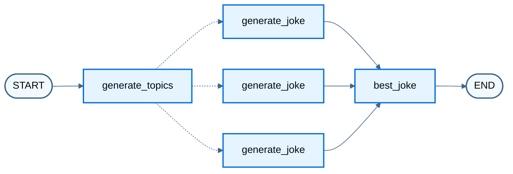
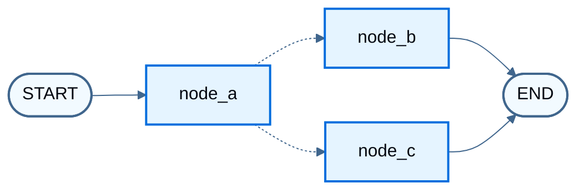

import LanggraphGraphApiSendCommandCommandGraphBuildJs from '/snippets/python/code-samples/langgraph-graph-api-send-command-command-graph-build-js.mdx';
import LanggraphGraphApiSendCommandCommandGraphBuildPy from '/snippets/python/code-samples/langgraph-graph-api-send-command-command-graph-build-py.mdx';
import LanggraphGraphApiSendCommandCommandGraphInvokeJs from '/snippets/python/code-samples/langgraph-graph-api-send-command-command-graph-invoke-js.mdx';
import LanggraphGraphApiSendCommandCommandGraphInvokePy from '/snippets/python/code-samples/langgraph-graph-api-send-command-command-graph-invoke-py.mdx';
import LanggraphGraphApiSendCommandCommandGraphNodesJs from '/snippets/python/code-samples/langgraph-graph-api-send-command-command-graph-nodes-js.mdx';
import LanggraphGraphApiSendCommandCommandGraphNodesPy from '/snippets/python/code-samples/langgraph-graph-api-send-command-command-graph-nodes-py.mdx';
import LanggraphGraphApiSendCommandCommandParentGraphJs from '/snippets/python/code-samples/langgraph-graph-api-send-command-command-parent-graph-js.mdx';
import LanggraphGraphApiSendCommandCommandParentGraphPy from '/snippets/python/code-samples/langgraph-graph-api-send-command-command-parent-graph-py.mdx';
import LanggraphGraphApiSendCommandCommandParentInvokeJs from '/snippets/python/code-samples/langgraph-graph-api-send-command-command-parent-invoke-js.mdx';
import LanggraphGraphApiSendCommandCommandParentInvokePy from '/snippets/python/code-samples/langgraph-graph-api-send-command-command-parent-invoke-py.mdx';
import LanggraphGraphApiSendCommandCommandParentShapeJs from '/snippets/python/code-samples/langgraph-graph-api-send-command-command-parent-shape-js.mdx';
import LanggraphGraphApiSendCommandCommandParentShapePy from '/snippets/python/code-samples/langgraph-graph-api-send-command-command-parent-shape-py.mdx';
import LanggraphGraphApiSendCommandCommandShapeJs from '/snippets/python/code-samples/langgraph-graph-api-send-command-command-shape-js.mdx';
import LanggraphGraphApiSendCommandCommandShapePy from '/snippets/python/code-samples/langgraph-graph-api-send-command-command-shape-py.mdx';
import LanggraphGraphApiSendCommandCommandToolJs from '/snippets/python/code-samples/langgraph-graph-api-send-command-command-tool-js.mdx';
import LanggraphGraphApiSendCommandCommandToolPy from '/snippets/python/code-samples/langgraph-graph-api-send-command-command-tool-py.mdx';
import LanggraphGraphApiSendCommandSendJs from '/snippets/python/code-samples/langgraph-graph-api-send-command-send-js.mdx';
import LanggraphGraphApiSendCommandSendPy from '/snippets/python/code-samples/langgraph-graph-api-send-command-send-py.mdx';
import LanggraphGraphApiSendCommandSendStreamJs from '/snippets/python/code-samples/langgraph-graph-api-send-command-send-stream-js.mdx';
import LanggraphGraphApiSendCommandSendStreamPy from '/snippets/python/code-samples/langgraph-graph-api-send-command-send-stream-py.mdx';

当项目数量只有在运行时才能确定时（映射缩减），[`Send`](https://reference.langchain.com/python/langgraph/types/Send) 会为每个项目以自定义输入运行同一个节点一次。[`Command`](https://reference.langchain.com/python/langgraph/types/Command) 在一次返回中更新状态并选择下一个节点。普通的序列、分支和循环请参阅[控制流](/oss/python/langgraph/graph-api-control-flow)。概念说明请参阅 Graph API 概览中的 [Send](/oss/python/langgraph/graph-api#send) 和 [Command](/oss/python/langgraph/graph-api#command)。

## 使用 Send 进行映射缩减

从[条件边](/oss/python/langgraph/graph-api#conditional-edges)返回一个或多个 `Send` 对象。每个 `Send` 指定目标节点并传入该次调用的输入。LangGraph 会并行运行这些调用。当多个工作节点写入同一个状态键时，使用 [reducer](/oss/python/langgraph/graph-api#reducers) 合并更新（例如连接列表）。

下面的工作节点不会收到完整的图状态。`Send` 将 `{ "subject": ... }` 作为该次运行的输入传入，因此工作节点的 schema 包含 `subject`，即使整体状态不包含。

<LanggraphGraphApiSendCommandSendPy />

```python
from IPython.display import Image, display

display(Image(graph.get_graph().draw_mermaid_png()))
```



虚线边表示 `Send` 扇出：每个主题一次 `generate_joke` 调用。

流式传输节点更新（此示例没有聊天模型，因此没有可迭代的消息 token）：

<LanggraphGraphApiSendCommandSendStreamPy />

```
{'generate_topics': {'subjects': ['lions', 'elephants', 'penguins']}}
{'generate_joke': {'jokes': ["Why don't lions like fast food? Because they can't catch it!"]}}
{'generate_joke': {'jokes': ["Why don't elephants use computers? They're afraid of the mouse!"]}}
{'generate_joke': {'jokes': ["Why don't penguins like talking to strangers at parties? Because they find it hard to break the ice."]}}
{'best_joke': {'best_selected_joke': 'penguins'}}
```


## 将控制流和状态更新与 `Command` 结合起来

当某个步骤既要更新状态又要决定下一步运行什么时，从节点返回 [Command](https://reference.langchain.com/python/langgraph/types/Command)。仅做路由时，优先使用[条件边](/oss/python/langgraph/graph-api#conditional-edges)。

`Command` 返回的结构（完整图见下文）：

<LanggraphGraphApiSendCommandCommandShapePy />


端到端示例使用三个节点：A，然后 B 或 C。节点 A 更新状态并使用 `Command` 选择下一个节点，因此 A、B 和 C 之间没有条件边。

<LanggraphGraphApiSendCommandCommandGraphNodesPy />

构建 [`StateGraph`](https://reference.langchain.com/python/langgraph/graph/state/StateGraph)。控制流位于 `node_a` 中，因此 A、B 和 C 之间没有[条件边](/oss/python/langgraph/graph-api#conditional-edges)。

<LanggraphGraphApiSendCommandCommandGraphBuildPy />

<Warning>
将返回类型注解为带可能目标节点的 [`Command`](https://reference.langchain.com/python/langgraph/types/Command)，例如 `Command[Literal["node_b", "node_c"]]`。该声明是图渲染所必需的，并告诉 LangGraph `node_a` 可以导航到 `node_b` 和 `node_c`。
</Warning>

```python
from IPython.display import Image, display

display(Image(graph.get_graph().draw_mermaid_png()))
```



虚线边表示从 `node_a` 出发的 `Command` 路由。重复调用会根据节点 A 中的随机选择走不同路径（A → B 或 A → C）。

<LanggraphGraphApiSendCommandCommandGraphInvokePy />

```
Called A
Called C
```


### 导航到父图中的节点

在[子图](/oss/python/langgraph/use-subgraphs)内的节点中，使用 `graph=Command.PARENT` 路由到父图中的节点：

<LanggraphGraphApiSendCommandCommandParentShapePy />


下面的示例将节点 A 变为单节点子图，并将其添加到仍包含 B 和 C 的父图中。

<Warning>
**使用 `Command.PARENT` 进行状态更新**
当子图节点更新父图和子图[状态 schema](/oss/python/langgraph/graph-api#schema)中都存在的键时，在父图上为该键定义 [reducer](/oss/python/langgraph/graph-api#reducers)。请参阅下面的示例。
</Warning>

<LanggraphGraphApiSendCommandCommandParentGraphPy />

<LanggraphGraphApiSendCommandCommandParentInvokePy />

```
Called A
Called C
```


### 在工具内使用

在工具中返回 `Command(update=...)`，在对话轮次中写入图状态（例如客户查询结果）。下面的片段假设存在 `get_user_info` / `getUserInfo` 以及名为 `messages` 的消息历史键。请在应用中补全导入和辅助函数。

<LanggraphGraphApiSendCommandCommandToolPy />


<Warning>
从工具返回 [`Command`](https://reference.langchain.com/python/langgraph/types/Command) 时，请在 `Command.update` 中包含 `messages`（或保存消息历史的任意状态键），并且该列表必须包含 `ToolMessage`。LLM 提供方要求带工具调用的 AI 消息后面跟工具结果消息。
</Warning>

对于返回 [`Command`](https://reference.langchain.com/python/langgraph/types/Command) 的工具，优先使用预构建的 [`ToolNode`](https://reference.langchain.com/python/langgraph/agents/#langgraph.prebuilt.tool_node.ToolNode)，它会将这些对象传播到图状态。在自定义工具调用节点中，需要自行传播工具返回的 [`Command`](https://reference.langchain.com/python/langgraph/types/Command)。

## 中断后恢复

仅当需要在[中断](/oss/python/langgraph/interrupts)后恢复时，才将 `Command` 作为 `invoke` / `stream` 的输入（`resume=...`，恢复时可选带 `update`）。不要只传 `Command(update=...)` 来继续对话：任何作为输入的 `Command` 都会从最新检查点恢复，而不是从 `START`。要开始新一轮，请传入普通的状态更新。

完整的反模式示例请参阅[输入到 invoke 或 stream](/oss/python/langgraph/graph-api#input-to-invoke-or-stream)。中断模式请参阅[中断](/oss/python/langgraph/interrupts)。

## 另请参阅

- Graph API 概览中的 [Send](/oss/python/langgraph/graph-api#send) 和 [Command](/oss/python/langgraph/graph-api#command)
- [中断](/oss/python/langgraph/interrupts)
- [控制流](/oss/python/langgraph/graph-api-control-flow)
- [使用子图](/oss/python/langgraph/use-subgraphs)
- [配置节点](/oss/python/langgraph/graph-api-nodes)

---

<div className="source-links">
<Callout icon="terminal-2">
    [Connect these docs](/use-these-docs) to your agent of choice via MCP for real-time answers.
</Callout>
<Callout icon="edit">
    [Edit this page on GitHub](https://github.com/langchain-ai/docs/edit/main/src/oss/langgraph/graph-api-send-command.mdx) or [file an issue](https://github.com/langchain-ai/docs/issues/new/choose).
</Callout>
</div>
