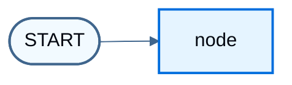

import LanggraphGraphApiMultipleSchemasJs from '/snippets/python/code-samples/langgraph-graph-api-multiple-schemas-js.mdx';
import LanggraphGraphApiMultipleSchemasPy from '/snippets/python/code-samples/langgraph-graph-api-multiple-schemas-py.mdx';
import LanggraphGraphApiReducersMergeDoesNotClearJs from '/snippets/python/code-samples/langgraph-graph-api-reducers-merge-does-not-clear-js.mdx';
import LanggraphGraphApiReducersMergeDoesNotClearPy from '/snippets/python/code-samples/langgraph-graph-api-reducers-merge-does-not-clear-py.mdx';
import LanggraphGraphApiReducersOverwriteClearJs from '/snippets/python/code-samples/langgraph-graph-api-reducers-overwrite-clear-js.mdx';
import LanggraphGraphApiReducersOverwriteClearPy from '/snippets/python/code-samples/langgraph-graph-api-reducers-overwrite-clear-py.mdx';
import LanggraphGraphApiReducersReplaceJs from '/snippets/python/code-samples/langgraph-graph-api-reducers-replace-js.mdx';
import LanggraphGraphApiStreamPrivateChannelPy from '/snippets/python/code-samples/langgraph-graph-api-stream-private-channel-py.mdx';
import LanggraphGraphApiStreamPrivateChannelJs from '/snippets/python/code-samples/langgraph-graph-api-stream-private-channel-js.mdx';
import LanggraphGraphApiStateAddMessagesInvokePy from '/snippets/python/code-samples/langgraph-graph-api-state-add-messages-invoke-py.mdx';
import LanggraphGraphApiStateAddMessagesPy from '/snippets/python/code-samples/langgraph-graph-api-state-add-messages-py.mdx';
import LanggraphGraphApiStateAltAnnotationRootJs from '/snippets/python/code-samples/langgraph-graph-api-state-alt-annotation-root-js.mdx';
import LanggraphGraphApiStateAltChannelsClassesJs from '/snippets/python/code-samples/langgraph-graph-api-state-alt-channels-classes-js.mdx';
import LanggraphGraphApiStateAltChannelsShorthandJs from '/snippets/python/code-samples/langgraph-graph-api-state-alt-channels-shorthand-js.mdx';
import LanggraphGraphApiStateAltZodV3Js from '/snippets/python/code-samples/langgraph-graph-api-state-alt-zod-v3-js.mdx';
import LanggraphGraphApiStateAltZodV4Js from '/snippets/python/code-samples/langgraph-graph-api-state-alt-zod-v4-js.mdx';
import LanggraphGraphApiStateBuildGraphJs from '/snippets/python/code-samples/langgraph-graph-api-state-build-graph-js.mdx';
import LanggraphGraphApiStateBuildGraphPy from '/snippets/python/code-samples/langgraph-graph-api-state-build-graph-py.mdx';
import LanggraphGraphApiStateDefineJs from '/snippets/python/code-samples/langgraph-graph-api-state-define-js.mdx';
import LanggraphGraphApiStateDefinePy from '/snippets/python/code-samples/langgraph-graph-api-state-define-py.mdx';
import LanggraphGraphApiStateInputOutputJs from '/snippets/python/code-samples/langgraph-graph-api-state-input-output-js.mdx';
import LanggraphGraphApiStateInputOutputPy from '/snippets/python/code-samples/langgraph-graph-api-state-input-output-py.mdx';
import LanggraphGraphApiStateInspectJs from '/snippets/python/code-samples/langgraph-graph-api-state-inspect-js.mdx';
import LanggraphGraphApiStateInvokeJs from '/snippets/python/code-samples/langgraph-graph-api-state-invoke-js.mdx';
import LanggraphGraphApiStateInvokePy from '/snippets/python/code-samples/langgraph-graph-api-state-invoke-py.mdx';
import LanggraphGraphApiStateMessagesStatePy from '/snippets/python/code-samples/langgraph-graph-api-state-messages-state-py.mdx';
import LanggraphGraphApiStateMessagesValueInvokeJs from '/snippets/python/code-samples/langgraph-graph-api-state-messages-value-invoke-js.mdx';
import LanggraphGraphApiStateMessagesValueJs from '/snippets/python/code-samples/langgraph-graph-api-state-messages-value-js.mdx';
import LanggraphGraphApiStateOverwriteJs from '/snippets/python/code-samples/langgraph-graph-api-state-overwrite-js.mdx';
import LanggraphGraphApiStateOverwriteJsonJs from '/snippets/python/code-samples/langgraph-graph-api-state-overwrite-json-js.mdx';
import LanggraphGraphApiStateOverwriteJsonPy from '/snippets/python/code-samples/langgraph-graph-api-state-overwrite-json-py.mdx';
import LanggraphGraphApiStateOverwritePy from '/snippets/python/code-samples/langgraph-graph-api-state-overwrite-py.mdx';
import LanggraphGraphApiStatePrettyPrintPy from '/snippets/python/code-samples/langgraph-graph-api-state-pretty-print-py.mdx';
import LanggraphGraphApiStatePrivateStateJs from '/snippets/python/code-samples/langgraph-graph-api-state-private-state-js.mdx';
import LanggraphGraphApiStatePrivateStatePy from '/snippets/python/code-samples/langgraph-graph-api-state-private-state-py.mdx';
import LanggraphGraphApiStatePydanticCoercionPy from '/snippets/python/code-samples/langgraph-graph-api-state-pydantic-coercion-py.mdx';
import LanggraphGraphApiStatePydanticInvalidPy from '/snippets/python/code-samples/langgraph-graph-api-state-pydantic-invalid-py.mdx';
import LanggraphGraphApiStatePydanticMessagesPy from '/snippets/python/code-samples/langgraph-graph-api-state-pydantic-messages-py.mdx';
import LanggraphGraphApiStatePydanticPy from '/snippets/python/code-samples/langgraph-graph-api-state-pydantic-py.mdx';
import LanggraphGraphApiStatePydanticSerializationPy from '/snippets/python/code-samples/langgraph-graph-api-state-pydantic-serialization-py.mdx';
import LanggraphGraphApiStateReducerDefineJs from '/snippets/python/code-samples/langgraph-graph-api-state-reducer-define-js.mdx';
import LanggraphGraphApiStateReducerDefinePy from '/snippets/python/code-samples/langgraph-graph-api-state-reducer-define-py.mdx';
import LanggraphGraphApiStateReducerInvokeJs from '/snippets/python/code-samples/langgraph-graph-api-state-reducer-invoke-js.mdx';
import LanggraphGraphApiStateReducerInvokePy from '/snippets/python/code-samples/langgraph-graph-api-state-reducer-invoke-py.mdx';
import LanggraphGraphApiStateReducerNodeJs from '/snippets/python/code-samples/langgraph-graph-api-state-reducer-node-js.mdx';
import LanggraphGraphApiStateReducerNodePy from '/snippets/python/code-samples/langgraph-graph-api-state-reducer-node-py.mdx';
import LanggraphGraphApiStateStreamOutputKeysJs from '/snippets/python/code-samples/langgraph-graph-api-state-stream-output-keys-js.mdx';
import LanggraphGraphApiStateStreamOutputKeysPy from '/snippets/python/code-samples/langgraph-graph-api-state-stream-output-keys-py.mdx';
import LanggraphGraphApiStateUpdateNodeJs from '/snippets/python/code-samples/langgraph-graph-api-state-update-node-js.mdx';
import LanggraphGraphApiStateUpdateNodePy from '/snippets/python/code-samples/langgraph-graph-api-state-update-node-py.mdx';

[State](/oss/python/langgraph/graph-api#state) 是节点读取和写入的共享 schema。[Reducers](/oss/python/langgraph/graph-api#reducers) 控制每次更新如何合并进当前值。本页涵盖：

1. 如何使用 state 定义图的 [schema](/oss/python/langgraph/graph-api#schema)
2. 如何使用 reducer 控制状态更新的处理方式

## Define state

LangGraph 中的 [State](/oss/python/langgraph/graph-api#state) 可以是 `TypedDict`、`Pydantic` 模型或 dataclass。下面的示例使用 `TypedDict`。大多数图都推荐这种形式；需要对输入做运行时校验时，请参阅 [Use Pydantic models for graph state](#use-pydantic-models-for-graph-state)。


默认情况下，图的输入和输出使用同一个 schema，并由 state 决定该 schema。需要不同的输入和输出 schema 时，请参阅 [Define input and output schemas](#define-input-and-output-schemas)。

先从 [messages](/oss/python/langgraph/graph-api#working-with-messages-in-graph-state) 字段开始。这种结构适合许多 LLM 应用。更多细节请参阅 [Working with messages in graph state](/oss/python/langgraph/graph-api#working-with-messages-in-graph-state)。

<LanggraphGraphApiStateDefinePy />

此 state 跟踪 [message](/oss/python/langchain/messages) 对象列表，以及一个额外的整数字段。此时还没有 reducer，因此更新 `messages` 的节点必须返回完整列表。


## Update state

构建一个只包含单个[节点](/oss/python/langgraph/graph-api#nodes)的图。该节点是一个 Python 函数，读取图状态并返回更新。第一个参数始终是 state：

<LanggraphGraphApiStateUpdateNodePy />

该节点在返回值中通过拼接来追加一条消息（此时还没有 reducer），并设置 `extra_field`。


<Warning>
节点应直接返回对状态的更新，而不是修改状态。
</Warning>

用这个节点定义一个简单的图。使用 [`StateGraph`](/oss/python/langgraph/graph-api#stategraph) 定义在该 state 上运行的图，再用 [`add_node`](/oss/python/langgraph/graph-api#nodes) 填充图：

<LanggraphGraphApiStateBuildGraphPy />


LangGraph 提供了可视化图的内置工具。详情请参阅 [Visualize your graph](/oss/python/langgraph/graph-api-visualize)。

```python
from IPython.display import Image, display

display(Image(graph.get_graph().draw_mermaid_png()))
```




这个图只执行一个节点。调用它：

<LanggraphGraphApiStateInvokePy />

```
{'messages': [HumanMessage(content='Hi'), AIMessage(content='Hello!')], 'extra_field': 10}
```


注意：

* 调用从更新 state 的单个键开始。
* 调用结果包含整个 state。

使用 pretty-print 检查 [message](/oss/python/langchain/messages) 内容：

<LanggraphGraphApiStatePrettyPrintPy />

```
================================ Human Message ================================

Hi
================================== Ai Message ==================================

Hello!
```


## Process state updates with reducers

状态中的每个键都可以有自己独立的 [reducer](/oss/python/langgraph/graph-api#reducers) 函数，用于控制如何应用节点返回的更新。如果没有指定 reducer，对该键的更新会替换之前的值。

对于 `TypedDict` 状态 schema，通过用 reducer 函数注解字段来定义 reducer。

在前面的示例中，节点通过返回完整的拼接列表来更新 `"messages"`。添加 reducer 后，更新会自动追加：

<LanggraphGraphApiStateReducerDefinePy />

这样节点只需返回新消息：

<LanggraphGraphApiStateReducerNodePy />


<LanggraphGraphApiStateReducerInvokePy />

```
================================ Human Message ================================

Hi
================================== Ai Message ==================================

Hello!
```


### MessagesState

在实践中，消息列表需要的不仅仅是简单拼接：

* 按 ID 更新 state 中已有的消息。
* 接受简写形式的 [message formats](/oss/python/langgraph/graph-api#serialization)，例如 `{"role": "user", "content": "..."}`。

LangGraph 包含内置 reducer [`add_messages`](https://reference.langchain.com/python/langgraph/graph/message/add_messages) 来处理这些情况：

<LanggraphGraphApiStateAddMessagesPy />

<LanggraphGraphApiStateAddMessagesInvokePy />

```
================================ Human Message ================================

Hi
================================== Ai Message ==================================

Hello!
```

这种结构适合使用 [chat models](/oss/python/langchain/models) 的应用。为了方便，可以继承预构建的 `MessagesState`：

<LanggraphGraphApiStateMessagesStatePy />


## Resetting a reducer field

使用合并型 reducer 时有一个常见困惑点：返回空值并**不会**清空该字段。因为 reducer 会把右参数合并进左参数，一个空更新会被合并进去，之前累积的值依然保留。

对于错误缓冲区或重试计数器这类需要在重试之间清空的字段，这个模式非常关键：

<LanggraphGraphApiReducersMergeDoesNotClearPy />

要在保留合并型 reducer 的同时清空该字段，请使用 [`Overwrite`](https://reference.langchain.com/python/langgraph/types/) 包裹这次更新：

<LanggraphGraphApiReducersOverwriteClearPy />

更多信息请参见 [Bypass reducers with Overwrite](#bypass-reducers-with-overwrite)。


## Bypass reducers with `Overwrite`

在某些情况下，可能需要绕过 reducer 直接覆盖 state 值。当节点返回用 `Overwrite` 包裹的值时，reducer 会被绕过，channel 直接设置为该值。

当需要重置或替换累积状态，而不是把它与现有值合并时，这很有用。

LangGraph 为此提供了 [`Overwrite`](https://reference.langchain.com/python/langgraph/types/) 类型。

<LanggraphGraphApiStateOverwritePy />

```
['replacement message']
```

也可以使用带特殊键 `"__overwrite__"` 的 JSON 格式：

<LanggraphGraphApiStateOverwriteJsonPy />

<Warning>
当节点并行执行时，在同一个 super-step 中只有一个节点能对同一个 state 键使用 `Overwrite`。如果多个节点在同一 super-step 中尝试覆盖同一个键，会抛出 `InvalidUpdateError`。
</Warning>


## Define input and output schemas

默认情况下，`StateGraph` 使用单个 schema 运行，所有节点都通过该 schema 通信。也可以定义不同的输入和输出 schema。

指定不同的 schema 时，节点之间仍然使用内部 schema 通信。输入 schema 校验传入的输入。输出 schema 过滤内部数据，使 `invoke` 只返回输出 schema 中的字段。

定义不同的输入和输出 schema：

<LanggraphGraphApiStateInputOutputPy />

```
{'answer': 'bye'}
```


注意，invoke 的输出只包含输出 schema。

## Pass private state between nodes

节点有时需要一些中间数据，这些数据不应出现在图的主输入或输出 schema 中。把这部分数据保持为私有，只让需要它的节点读取。

下面的顺序图有三个节点。私有数据在前两步之间传递。第三步只能看到公共的 overall state。

<LanggraphGraphApiStatePrivateStatePy />

```
Entered node `node_1`:
    Input: {'a': 'set at start'}.
    Returned: {'private_data': 'set by node_1'}
Entered node `node_2`:
    Input: {'private_data': 'set by node_1'}.
    Returned: {'a': 'set by node_2'}
Entered node `node_3`:
    Input: {'a': 'set by node_2'}.
    Returned: {'a': 'set by node_3'}

Output of graph invocation: {'a': 'set by node_3'}
```


## Private channels and streaming

输入、输出和私有 schema 约束每个节点读取的内容，以及 `invoke` 返回的内容。它们**不会**对[流式传输](/oss/python/langgraph/streaming)隐藏 channel。

values streaming 默认会发出**所有** state channel，包括私有 channel。这适用于 [event streaming](/oss/python/langgraph/event-streaming) 的 values 投影（在 `stream_events` / `streamEvents` 上使用 `version="v3"` 时的 `stream.values`），也适用于 `stream_mode="values"` / `streamMode: "values"` 的 `graph.stream`。values streaming 使用的是完整 state，而不是输出 schema。私有 channel 可能不出现在 `invoke` 的输出中，但在流里可见。

这个示例使用了不同的 input、output、overall 和 private schema。`invoke` 只返回输出 schema：

<LanggraphGraphApiMultipleSchemasPy />

使用 values 投影进行流式传输时，仍然会包含私有的 `bar` channel：

<LanggraphGraphApiStreamPrivateChannelPy />

要把流式输出的值限制在特定 channel（例如只输出 schema），请向 `graph.stream` 传入 `output_keys`：

<LanggraphGraphApiStateStreamOutputKeysPy />

如果只需要每一步节点实际产生的 channel（而不是完整的累积状态），请改用 `stream_mode="updates"`。参见 [Streaming](/oss/python/langgraph/streaming)。


## Use pydantic models for graph state

[StateGraph](https://reference.langchain.com/python/langgraph/graph/state/StateGraph) 接受 [`state_schema`](https://reference.langchain.com/python/langchain/middleware/#langchain.agents.middleware.AgentMiddleware.state_schema) 参数，用于指定节点可以访问和更新的状态结构。

本页大多数示例使用 Python 原生的 `TypedDict` 或 [`dataclass`](https://docs.python.org/3/library/dataclasses.html) 作为 `state_schema`。[`state_schema`](https://reference.langchain.com/python/langchain/middleware/#langchain.agents.middleware.AgentMiddleware.state_schema) 可以是任何 [type](https://docs.python.org/3/library/stdtypes.html#type-objects)。

当需要对**输入**做运行时校验时，使用 [Pydantic BaseModel](https://docs.pydantic.dev/latest/api/base_model/) 作为 [`state_schema`](https://reference.langchain.com/python/langchain/middleware/#langchain.agents.middleware.AgentMiddleware.state_schema)。

<Note>
**已知限制**
* 图的输出**不是** Pydantic 模型的实例。
* 运行时校验只发生在图中第一个节点的输入上，不会发生在后续节点或输出上。
* Pydantic 的校验错误信息不会显示错误来自哪个节点。
* Pydantic 的递归校验可能很慢。对性能敏感的应用，推荐使用 `dataclass`。
</Note>

<LanggraphGraphApiStatePydanticPy />

使用**无效**输入调用图

<LanggraphGraphApiStatePydanticInvalidPy />

```
An exception was raised because `a` is an integer rather than a string.
1 validation error for OverallState
a
  Input should be a valid string [type=string_type, input_value=123, input_type=int]
    For further information visit https://errors.pydantic.dev/2.9/v/string_type
```

下面介绍 Pydantic 模型状态的其他功能：

<Accordion title="Serialization Behavior">
  使用 Pydantic 模型作为状态 schema 时，序列化在以下场景中尤其重要：

  * 把 Pydantic 对象作为输入传入
  * 接收图的输出
  * 使用嵌套的 Pydantic 模型

  下面的示例展示了这些行为：

  <LanggraphGraphApiStatePydanticSerializationPy />
</Accordion>

<Accordion title="Runtime Type Coercion">
  Pydantic 会对某些数据类型执行运行时类型转换。这可能有帮助，但如果不加注意，也可能产生意外的值。

  <LanggraphGraphApiStatePydanticCoercionPy />
</Accordion>

<Accordion title="Working with Message Models">
  在状态 schema 中使用 LangChain 消息类型时，序列化很重要。当消息对象需要跨进程传输时，使用 `AnyMessage`（而不是 `BaseMessage`）以获得正确的序列化和反序列化。

  <LanggraphGraphApiStatePydanticMessagesPy />
</Accordion>


## 了解更多

* [Graph API 概览](/oss/python/langgraph/graph-api#state)
* [在图 state 中使用 messages](/oss/python/langgraph/graph-api#working-with-messages-in-graph-state)
* [事件流式传输](/oss/python/langgraph/event-streaming)
* [流式输出](/oss/python/langgraph/streaming)
* [Graph API 构建检查清单](/oss/python/langgraph/use-graph-api)

---

<div className="source-links">
<Callout icon="terminal-2">
    [Connect these docs](/use-these-docs) to your agent of choice via MCP for real-time answers.
</Callout>
<Callout icon="edit">
    [Edit this page on GitHub](https://github.com/langchain-ai/docs/edit/main/src/oss/langgraph/graph-api-state.mdx) or [file an issue](https://github.com/langchain-ai/docs/issues/new/choose).
</Callout>
</div>
