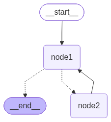

import LanggraphGraphApiVisualizeGraphPy from '/snippets/python/code-samples/langgraph-graph-api-visualize-graph-py.mdx';
import LanggraphGraphApiVisualizeGraphJs from '/snippets/python/code-samples/langgraph-graph-api-visualize-graph-js.mdx';
import LanggraphGraphApiVisualizeMermaidPy from '/snippets/python/code-samples/langgraph-graph-api-visualize-mermaid-py.mdx';
import LanggraphGraphApiVisualizeMermaidJs from '/snippets/python/code-samples/langgraph-graph-api-visualize-mermaid-js.mdx';
import LanggraphGraphApiVisualizeGraphvizPy from '/snippets/python/code-samples/langgraph-graph-api-visualize-graphviz-py.mdx';

把编译后的图渲染为 Mermaid 文本或 PNG 图片，用于检查拓扑结构和调试路由。需要交互式界面时，可使用 [LangSmith Studio](/langsmith/studio) 配合[本地服务器](/oss/python/langgraph/local-server)。

可以可视化任何暴露 `get_graph()` 的已编译图，包括 [`StateGraph`](https://reference.langchain.com/python/langgraph/graph/state/StateGraph)。参见 [Graph](https://reference.langchain.com/python/langgraph/graphs/) 参考文档。


下面的示例在两种语言中使用同一个小图：两个节点，一条从 `node1` 出发的条件边，以及一条从 `node2` 回到 `node1` 的循环。

<LanggraphGraphApiVisualizeGraphPy />


## Mermaid

在 drawable graph 上调用 `draw_mermaid()` 获取 Mermaid 语法。可以把结果粘贴到任意 Mermaid 渲染器，或保留在文档和 PR 中。

<LanggraphGraphApiVisualizeMermaidPy />

```
---
config:
  flowchart:
    curve: linear
---
graph TD;
	__start__([<p>__start__</p>]):::first
	node1(node1)
	node2(node2)
	__end__([<p>__end__</p>]):::last
	__start__ --> node1;
	node1 -.-> __end__;
	node1 -.-> node2;
	node2 --> node1;
	classDef default fill:#f2f0ff,line-height:1.2
	classDef first fill-opacity:0
	classDef last fill:#bfb6fc
```


## PNG

可以用三种方式之一把同一个图渲染为 `.png`：

* Mermaid.ink API（默认方式，无需额外安装包）
* Mermaid + Pyppeteer（`pip install pyppeteer`）
* Graphviz（`pip install pygraphviz`，另需系统安装 [Graphviz](https://graphviz.org/download/) 二进制）

**使用 Mermaid.ink**

默认情况下，`draw_mermaid_png()` 使用 Mermaid.ink API 生成图表。

```python
from IPython.display import Image, display

display(Image(app.get_graph().draw_mermaid_png()))
```



**使用 Mermaid + Pyppeteer**

```python
import nest_asyncio
from IPython.display import Image, display
from langchain_core.runnables.graph import CurveStyle, MermaidDrawMethod, NodeStyles

nest_asyncio.apply()  # Required for Jupyter Notebook to run async functions

display(
    Image(
        app.get_graph().draw_mermaid_png(
            curve_style=CurveStyle.LINEAR,
            node_colors=NodeStyles(first="#ffdfba", last="#baffc9", default="#fad7de"),
            wrap_label_n_words=9,
            output_file_path=None,
            draw_method=MermaidDrawMethod.PYPPETEER,
            background_color="white",
            padding=10,
        )
    )
)
```

**使用 Graphviz**

<LanggraphGraphApiVisualizeGraphvizPy />


## 了解更多

* [Graph API 概览](/oss/python/langgraph/graph-api)
* [Graph API 构建检查清单](/oss/python/langgraph/use-graph-api)
* [LangSmith Studio](/langsmith/studio)
* [运行本地服务器](/oss/python/langgraph/local-server)

---

<div className="source-links">
<Callout icon="terminal-2">
    [Connect these docs](/use-these-docs) to your agent of choice via MCP for real-time answers.
</Callout>
<Callout icon="edit">
    [Edit this page on GitHub](https://github.com/langchain-ai/docs/edit/main/src/oss/langgraph/graph-api-visualize.mdx) or [file an issue](https://github.com/langchain-ai/docs/issues/new/choose).
</Callout>
</div>
