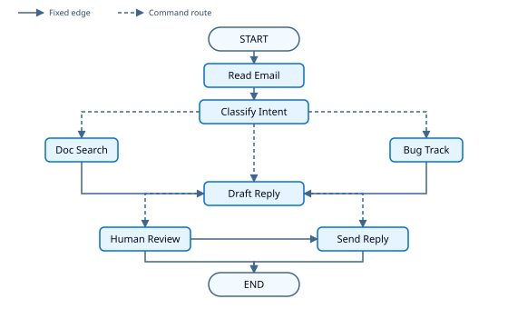

import LanggraphThinkingInGraphApiStatePy from '/snippets/python/code-samples/langgraph-thinking-in-graph-api-state-py.mdx';
import LanggraphThinkingInGraphApiStateJs from '/snippets/python/code-samples/langgraph-thinking-in-graph-api-state-js.mdx';
import LanggraphThinkingInGraphApiRetryPolicyPy from '/snippets/python/code-samples/langgraph-thinking-in-graph-api-retry-policy-py.mdx';
import LanggraphThinkingInGraphApiRetryPolicyJs from '/snippets/python/code-samples/langgraph-thinking-in-graph-api-retry-policy-js.mdx';
import LanggraphThinkingInGraphApiNodesPy from '/snippets/python/code-samples/langgraph-thinking-in-graph-api-nodes-py.mdx';
import LanggraphThinkingInGraphApiNodesJs from '/snippets/python/code-samples/langgraph-thinking-in-graph-api-nodes-js.mdx';
import LanggraphThinkingInGraphApiGraphPy from '/snippets/python/code-samples/langgraph-thinking-in-graph-api-graph-py.mdx';
import LanggraphThinkingInGraphApiGraphJs from '/snippets/python/code-samples/langgraph-thinking-in-graph-api-graph-js.mdx';
import LanggraphThinkingInGraphApiTryOutPy from '/snippets/python/code-samples/langgraph-thinking-in-graph-api-try-out-py.mdx';
import LanggraphThinkingInGraphApiTryOutJs from '/snippets/python/code-samples/langgraph-thinking-in-graph-api-try-out-js.mdx';

用 [Graph API](/oss/python/langgraph/graph-api) 构建 agent 时，先把流程拆成称为**节点**的离散步骤。然后描述从每个节点出发的决策和转换。最后，通过一个共享的 **state** 连接各个节点，每个节点都能读写这个 state。

这篇 walkthrough 用 Graph API 构建一个客户支持邮件 agent。

## Start with the process you want to automate

假设你需要构建一个 AI agent 来处理客户支持邮件。产品团队给你的需求如下：

```txt
The agent should:

- Read incoming customer emails
- Classify them by urgency and topic
- Search relevant documentation to answer questions
- Draft appropriate responses
- Escalate complex issues to human agents

Example scenarios to handle:

1. Simple product question: "How do I reset my password?"
2. Bug report: "The export feature crashes when I select PDF format"
3. Urgent billing issue: "I was charged twice for my subscription!"
4. Feature request: "Can you add dark mode to the mobile app?"
5. Complex technical issue: "Our API integration fails intermittently with 504 errors"
```

本指南用五个步骤演示如何用 Graph API 实现 agent。第 1、2 步用于规划。第 3 到第 5 步把规划落实为 state、节点和可运行的已编译图。

## Step 1: Map out your workflow as discrete steps

先识别流程中的不同步骤。每一步都会变成一个**节点**（只负责做一件事的函数）。然后画出这些步骤之间的连接方式。在写代码之前完成这一步。



实线箭头是固定边：构建图时就要声明，因为运行前就能确定下一个节点。虚线箭头是运行时在节点内部通过 [`Command`](https://reference.langchain.com/python/langgraph/types/Command) 选择的路由。

组件识别完成后，明确每个节点需要做什么：

- `Read Email`：提取并解析邮件内容
- `Classify Intent`：用 LLM 判定紧急程度和主题，然后路由到搜索、bug 跟踪或起草
- `Doc Search`：在知识库中查询相关信息
- `Bug Track`：在跟踪系统中创建或更新 issue
- `Draft Reply`：生成合适的回复，然后路由到人工审核或发送
- `Human Review`：升级给人工客服进行审批或处理
- `Send Reply`：发送邮件回复

<Tip>
有些节点始终沿固定边继续（`Read Email` 到 `Classify Intent`）。另一些则通过 `Command` 选择下一个节点（`Classify Intent`、`Draft Reply`、`Human Review`）。
</Tip>

## Step 2: Identify what each step needs to do

对第 1 步中的每个节点，确定它属于哪类工作、需要什么上下文。先用下面的分类，再展开邮件 agent 的示例，查看具体字段和重试策略的选择。

<CardGroup cols={2}>
    <Card title="LLM 步骤" icon="brain" href="#llm-steps">
        需要理解、分析、生成文本或做推理决策时使用
    </Card>
    <Card title="数据步骤" icon="database" href="#data-steps">
        需要从外部来源检索信息时使用
    </Card>
    <Card title="动作步骤" icon="bolt" href="#action-steps">
        需要执行外部动作时使用
    </Card>
    <Card title="用户输入步骤" icon="user" href="#user-input-steps">
        需要人工介入时使用
    </Card>
</CardGroup>

### LLM steps

当某一步需要理解、分析、生成文本或做推理决策时：

<AccordionGroup>
    <Accordion title="Classify intent">
        - 静态上下文（prompt）：分类类别、紧急程度定义、响应格式
        - 动态上下文（来自 state）：邮件内容、发件人信息
        - 目标结果：决定路由的结构化分类结果
    </Accordion>

    <Accordion title="Draft reply">
        - 静态上下文（prompt）：语气指南、公司政策、回复模板
        - 动态上下文（来自 state）：分类结果、搜索结果
        - 目标结果：可供审核的专业邮件回复
    </Accordion>
</AccordionGroup>

### Data steps

当某一步需要从外部来源检索信息时：

<AccordionGroup>
    <Accordion title="Document search">
        - 参数：根据 intent 和 topic 构造的查询
        - 重试策略：需要，针对短暂失败使用指数退避
        - 缓存：可以缓存常见查询，以减少 API 调用
    </Accordion>
</AccordionGroup>

### Action steps

当某一步需要执行外部动作时：

<AccordionGroup>
    <Accordion title="Send reply">
        - 执行时机：审批之后（人工或自动）
        - 重试策略：需要，针对网络问题使用指数退避
        - 不应缓存：每次发送都是一次独立动作
    </Accordion>

    <Accordion title="Bug track">
        - 执行时机：intent 为 "bug" 时始终执行
        - 重试策略：需要，不能丢失 bug 报告
        - 返回值：包含在回复中的 ticket ID
    </Accordion>
</AccordionGroup>

### User input steps

当某一步需要人工介入时：

<AccordionGroup>
    <Accordion title="Human review">
        - 决策上下文：原始邮件、草稿回复、紧急程度、分类结果
        - 预期输入格式：审批布尔值，外加可选的编辑后回复
        - 触发条件：高紧急度、账单问题或复杂问题
        - 拒绝时：结束运行且不发送（由人工在图外处理这封邮件）
    </Accordion>
</AccordionGroup>

## Step 3: Design your state

State 是所有节点都能访问的共享 [memory](/oss/python/concepts/memory)。可以把它看作 agent 用来记录在执行流程中学到和决定的一切的笔记本。

### What belongs in state?

针对每一条数据，问自己这些问题：

<CardGroup cols={2}>
    <Card title="放进 state" icon="check">
        它是否需要跨步骤保留？如果是，就放进 state。
    </Card>

    <Card title="不要存储" icon="code">
        它能否从其他数据推导出来？如果能，就在需要时计算，而不是存进 state。
    </Card>
</CardGroup>

对于这个邮件 agent，需要跟踪：

- 原始邮件和发件人信息（之后无法重建）
- 分类结果（后续节点需要）
- 搜索结果或工单上下文（重新获取成本高）
- 草稿回复（需要经过审核流程保留）
- 执行元数据（用于调试和恢复）

### Keep state raw, format prompts on demand

<Tip>
在 state 中存原始数据，而不是格式化后的 prompt 文本。需要时在节点内部格式化 prompt。
</Tip>

这样分离意味着：

- 不同节点可以按各自需要，以不同方式格式化同一份数据
- 可以修改 prompt 模板，而不必改动 state schema
- 调试时能看到每个节点实际接收的数据，而不是预先拼接好的 prompt 字符串

现在定义 state。后续步骤中的节点会使用这些字段。

<LanggraphThinkingInGraphApiStatePy />


## Step 4: Build your nodes

节点是一个 Python 函数，接收当前 state 并返回对它的更新。当节点还要选择下一步时，返回 [`Command`](https://reference.langchain.com/python/langgraph/types/Command)。


### Handle errors appropriately

在填充节点函数体之前，先考虑每个节点可能如何失败。对调用外部 API 的节点附加重试。人工输入使用 `interrupt()`。可以用下表作为参考：

| 错误类型 | 谁来修复 | 策略 | 适用场景 |
|------------|--------------|----------|-------------|
| 短暂性错误（网络问题、限流） | 系统（自动） | 节点上的重试策略 | 通常重试后能恢复的临时失败 |
| LLM 可恢复错误（工具失败、解析问题） | LLM | 把错误存入 state 并回到原处 | 模型可以借助更多上下文调整 |
| 用户可修复错误（缺少信息、指令不清） | 人工 | 用 `interrupt()` 暂停 | 需要用户输入才能继续 |
| 重试耗尽后的可恢复失败 | 开发者 | `error_handler`（Python）/ `errorHandler`（TypeScript） | 重试耗尽后运行补偿分支 |
| 未预期错误 | 开发者 | 让运行失败 | 需要改代码修复的 bug |

关于重试策略、超时、补偿处理器、LLM 可恢复循环、何时让错误冒泡，以及图级默认值，请参阅 [Fault tolerance](/oss/python/langgraph/fault-tolerance#recovery-strategies)。

在这个示例中，为可能遇到短暂失败的节点附加重试策略：

<LanggraphThinkingInGraphApiRetryPolicyPy />


### Implementing the email agent nodes

把每个工作单元变成一个节点。每个节点读取共享 state，完成一件事，然后返回更新。当下一步取决于结果时，返回同时包含更新和目的地的 `Command`。人工审核仍然是一个节点：它在函数内部调用 `interrupt()`，而不是单独的图原语。

下面的存根展示了邮件 agent 的函数签名、state 更新和路由。把占位实现替换为真实的 LLM 调用和 API 集成。把这些节点与第 3 步的 state 放在同一个文件里。

`read_email` 在这个 walkthrough 中只是原样传递。把它保留为独立节点，仍然能在分类之前提供检查点，并为之后添加真正的 MIME 解析留出位置。

<LanggraphThinkingInGraphApiNodesPy />


现在有了节点函数。接下来把它们接入一个已编译的图。

## Step 5: Wire it together

把各个节点连接成图。因为路由在 `Command` 节点内部，所以只需要少量固定边。编译时带上 [checkpointer](/oss/python/langgraph/persistence)，`interrupt()` 依赖它来暂停和恢复。

<LanggraphThinkingInGraphApiGraphPy />

返回 `Command[Literal[...]]` 的 Python 节点在类型提示中声明目的地。LangGraph 据此确定有效的边。


### Try out your agent

图编译完成后，用一封示例邮件调用它。上面的占位分类器会把这条紧急账单消息视为高紧急度，因此运行会起草回复、触发 `interrupt()`，你可以练习恢复。首次调用和恢复调用使用同一个 `thread_id`。

<LanggraphThinkingInGraphApiTryOutPy />


图在 `interrupt()` 处暂停，把 state 保存到 checkpointer 并等待。用 `Command(resume=...)` 恢复时，`human_review` 节点会从头重新执行，`interrupt()` 返回你传入的恢复值，图继续运行。`thread_id` 把这段对话的 state 保持在一起。

## Summary and next steps

### Key insights

构建这个邮件 agent 展示了 Graph API 的思考方式：

<CardGroup cols={2}>
    <Card title="拆成离散步骤" icon="sitemap" href="#step-1-map-out-your-workflow-as-discrete-steps">
        每个节点只做好一件事。节点边界正是图的检查点位置，因此失败和恢复需要重做的工作更少。
    </Card>

    <Card title="State 是共享记忆" icon="database" href="#step-3-design-your-state">
        存原始数据，不存格式化文本。不同节点可以以不同方式使用同一份信息。
    </Card>

    <Card title="Node 就是函数" icon="code" href="#step-4-build-your-nodes">
        它们接收 state，完成工作，返回更新。需要路由时，用 `Command` 同时返回更新和下一个目的地。
    </Card>

    <Card title="错误也是流程的一部分" icon="alert-triangle" href="#handle-errors-appropriately">
        短暂失败交给节点重试策略，用户可修复的问题用 `interrupt()` 暂停，未预期错误让运行失败。
    </Card>

    <Card title="人工输入是一等公民" icon="user" href="/oss/python/langgraph/interrupts">
        `interrupt()` 暂停执行并保存 state。恢复时节点会从头重新执行，因此 `interrupt()` 之前的操作要保持幂等。
    </Card>

    <Card title="图结构保持精简" icon="sitemap" href="#step-5-wire-it-together">
        只声明必要的边。需要动态路由的节点返回 `Command`，使控制流保持显式且可追踪。
    </Card>
</CardGroup>

### Node granularity trade-offs

大多数应用可以直接使用上面的拆分方式。在决定合并还是拆分节点时，再阅读这一节。

LangGraph 在**节点**边界创建检查点。运行在中断或失败后恢复时，会从停止位置所在节点的开头重新开始。节点越小，检查点越频繁，需要重复的工作越少。

这个拆分为什么适合邮件 agent：

- **外部服务隔离：** Doc Search 和 Bug Track 是独立节点，因此重试只作用于这些 API 调用。
- **可见性：** 分类是独立节点，可以在下一步动作之前检查结构化结果。
- **不同的失败模式：** LLM 调用、查询和邮件发送使用不同的重试策略。
- **测试：** 更小的节点更容易做单元测试和复用。

把 `Read Email` 和 `Classify Intent` 合并成一个节点也是可行的。这样会失去两者之间的检查点，失败时两个操作都要重做。对大多数 agent 来说，独立节点带来的可观测性收益值得这点权衡。

缓存搜索结果属于节点函数内部的应用层选择，LangGraph 不为它规定缓存 API。更多节点不一定意味着运行更慢：默认情况下，检查点在后台写入（[async durability mode](/oss/python/langgraph/checkpointers#durability-modes)）。

### Where to go from here

这篇 walkthrough 介绍 Graph API 的设计方式。可以用下面的操作指南和相关教程继续扩展：

<CardGroup cols={2}>
    <Card title="构建检查清单" icon="route" href="/oss/python/langgraph/use-graph-api">
        关于 state、控制流、Send、Command 和节点的决策指南
    </Card>

    <Card title="定义和更新状态" icon="database" href="/oss/python/langgraph/graph-api-state">
        schema、reducer、消息和私有 channel
    </Card>

    <Card title="控制流" icon="arrows-split-2" href="/oss/python/langgraph/graph-api-control-flow">
        序列、分支、循环和递归限制
    </Card>

    <Card title="Send 和 Command" icon="send" href="/oss/python/langgraph/graph-api-send-command">
        一步完成 map-reduce 扇出以及更新并路由
    </Card>

    <Card title="配置节点" icon="settings" href="/oss/python/langgraph/graph-api-nodes">
        重试、超时、运行时上下文和缓存
    </Card>

    <Card title="人在环中模式" icon="user-check" href="/oss/python/langgraph/interrupts">
        工具审批、批量审批以及其他 interrupt 模式
    </Card>

    <Card title="添加记忆" icon="database" href="/oss/python/langgraph/add-memory">
        短期 checkpointer 和长期 store
    </Card>

    <Card title="容错" icon="shield" href="/oss/python/langgraph/fault-tolerance">
        重试、超时、错误处理器和图级默认值
    </Card>

    <Card title="子图" icon="hierarchy" href="/oss/python/langgraph/use-subgraphs">
        用于复杂多步骤操作的嵌套图
    </Card>

    <Card title="流式输出" icon="broadcast" href="/oss/python/langgraph/streaming">
        为用户提供实时进度更新
    </Card>
</CardGroup>

---

<div className="source-links">
<Callout icon="terminal-2">
    [Connect these docs](/use-these-docs) to your agent of choice via MCP for real-time answers.
</Callout>
<Callout icon="edit">
    [Edit this page on GitHub](https://github.com/langchain-ai/docs/edit/main/src/oss/langgraph/thinking-in-graph-api.mdx) or [file an issue](https://github.com/langchain-ai/docs/issues/new/choose).
</Callout>
</div>
