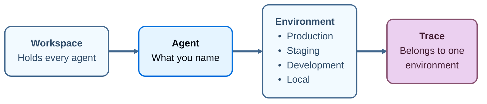

import AgentAvailabilityNote from '/snippets/langsmith/agent-availability-note.mdx';

随着组织构建的 agent 越来越多，要弄清有哪些 agent、它们在哪里运行会变得越来越困难。LangSmith Agent Registry 提供了集中注册 agent 的位置，让你在一个地方治理组织运行的每个 agent，无论它托管在哪里。Agent Registry 在 [LangSmith Cloud](/langsmith/cloud) 上可用。创建 agent 即为注册，你可以通过四种方式创建 agent：

- [在 LangSmith Studio 中构建](/langsmith/build-an-agent)。
- 在 **Connect an agent** 对话框中[创建](/langsmith/create-an-agent#name-an-agent-traced-from-outside-langsmith)，适用于在 LangSmith 外部运行的 agent。
- [通过 SDK 调用或 API 请求创建](/langsmith/create-an-agent#create-an-agent-programmatically)。
- [通过 LangSmith 部署](/langsmith/deploy-to-agent-environment)。

agent 创建后，你可以从它运行的任何位置、任何能向 LangSmith 发送 trace 的框架[发送 trace](/langsmith/log-traces-to-agent)。

每个 agent 都会获得一个唯一的 [identifier](#identifiers-and-display-names)，LangSmith 用它来定位该 agent 的 trace。

LangSmith 的其他部分都依附于这些 agent。dataset、evaluator、deployment、trace 和 alert 在 Agent Registry 中都依附于某个 agent：

  
LangSmith

  <CardGroup cols={4}>
    <Card title="Build" icon="hammer" href="/build-overview" />
    <Card title="Test" icon="flask" href="/langsmith/evaluation" />
    <Card title="Deploy" icon="rocket" href="/langsmith/deployment" />
    <Card title="Monitor" icon="chart-line" href="/langsmith/observability" />
  </CardGroup>

  <Card title="Agent Registry" icon="sitemap" href="#agent" className="registry-diagram-foundation" />

<AgentAvailabilityNote />

## Agent

_agent_ 是一个利用 tools、skills 和 subagents 端到端完成任务的 AI 系统。在 LangSmith 中，agent 也是 workspace 组织的基本单元。只需命名一次，LangSmith 就会把该 agent 所做的一切记录在这个名称下，并划分到固定的四个 [environments](/langsmith/agent-environments) 中：Production、Staging、Development 和 Local。一条 trace、一个 alert、一个 evaluator 和一个 prebuilt dashboard 都分别属于某一个 agent 的某一个 environment。[dataset](/langsmith/evaluation-concepts#datasets) 和自定义 dashboard 是例外。dataset 附加到一个或多个 agents 上，而不附加到任何 environment；自定义 dashboard 附加到某个 agent，而不是某个 environment。

每条 trace 都携带其 agent 以及该 agent 的一个 environment，因此在 trace 到达时就会记录下是什么产生了它、它运行在哪里。随后 LangSmith 可以基于这一上下文采取行动：alert 只监视 production 而对 local runs 保持安静，每个 environment 都有自己的 prebuilt dashboard，[Insights](/langsmith/insights) 报告则覆盖你运行它所在 environment 的流量。

### Environments

_environment_ 记录 agent 产生某条 trace 时运行在何处。名称是固定的：Production、Staging、Development 和 Local。

更多信息请参阅 [Agent environments](/langsmith/agent-environments)。

### Identifiers 和 display names

每个 agent 都有两个名称，它们承担不同的工作：

- **Identifier**：在 agent 创建时设置，之后不可编辑。它是你提供的还是 LangSmith 生成的，取决于[该 agent 是如何被创建的](/langsmith/create-an-agent)。LangSmith 用它来定位 traces，因此即使 display name 改变，它也保持稳定。
- **Display name**：显示在 UI 中出现该 agent 的所有地方。对于[在 LangSmith Studio 中构建](/langsmith/build-an-agent)的 agent，可以在其配置的 **Name** 字段中重命名。重命名不会移动已有的 traces，也不会改变新 traces 的落点。

请使用 identifier 进行 tracing，而不是 agent Overview 上 **ID** 徽章所复制的 UUID。如果 header 中显示 **Identifier**，请打开它以复制用于目标 environment 的 identifier。

## 查找和治理 agent

agent 注册后，可以从以下页面找到它们并跟踪对它们的更改：

- **查找 agent**：agent 切换器在 agent 列表（**All agents**）和单个 agent 之间切换。请参阅 [Navigate agents](/langsmith/navigate-agents)。
- **审计更改**：[Audit logs](/langsmith/audit-logs) 会记录 agent 何时被创建、更新或删除，以及何时为其添加 environment。

## 下一步

<CardGroup cols={2}>

<Card
  title="Environments"
  cta="Learn more"
  href="/langsmith/agent-environments"
  icon="stack"
>
agent 的 trace 所划分到的四个 environment，以及如何在它们之间切换。
</Card>

<Card
  title="Navigate agents"
  cta="Learn more"
  href="/langsmith/navigate-agents"
  icon="compass"
>
agent 切换器、agent 列表和 agent Overview。
</Card>

<Card
  title="Log traces to an agent"
  cta="Learn more"
  href="/langsmith/log-traces-to-agent"
  icon="target"
>
agent addressing 如何把 traces 发送到某个 agent 和某个 environment，以及如何移除冲突的目标设置。
</Card>

<Card
  title="Create an agent"
  cta="Learn more"
  href="/langsmith/create-an-agent"
  icon="plus"
>
在开始追踪之前注册 agent、选择其 identifier，并配置它的 environment。
</Card>

</CardGroup>
