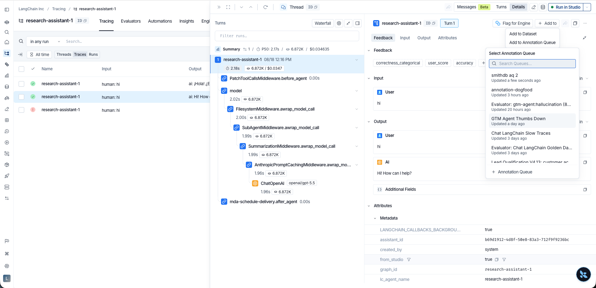
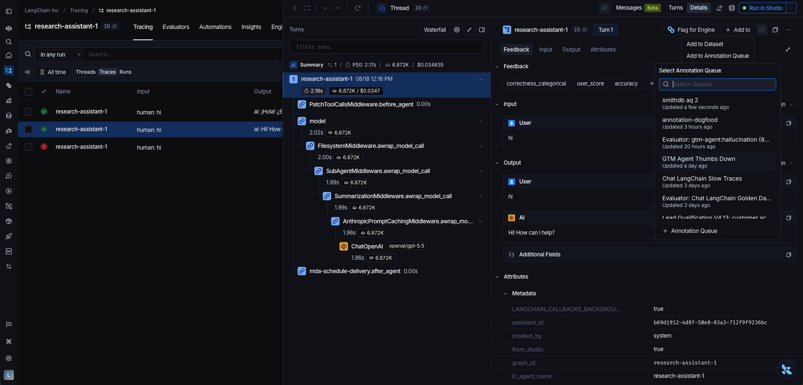
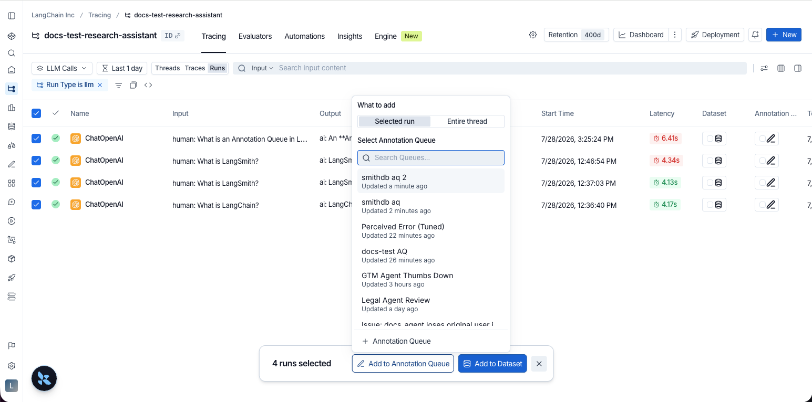
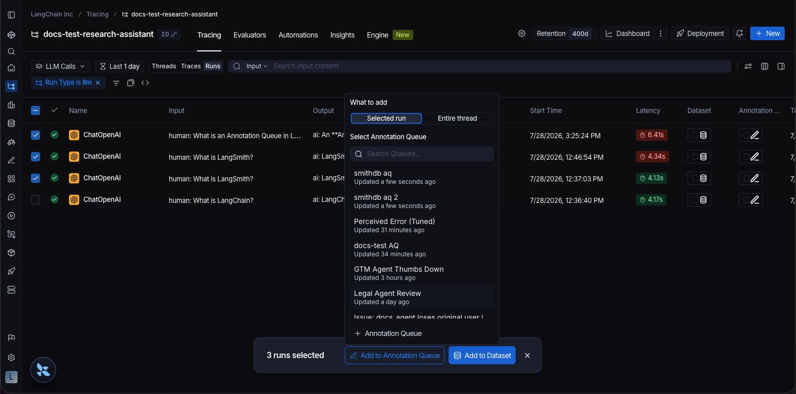
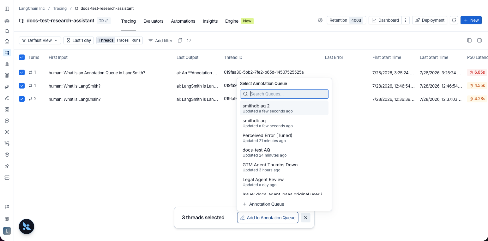
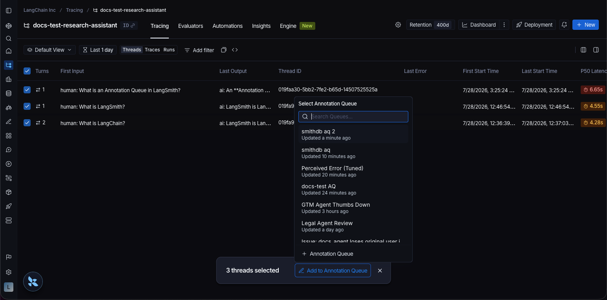
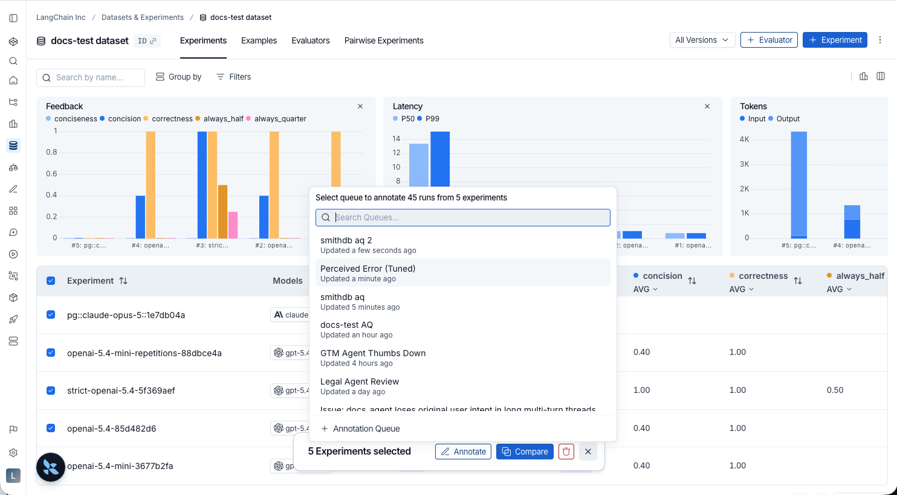
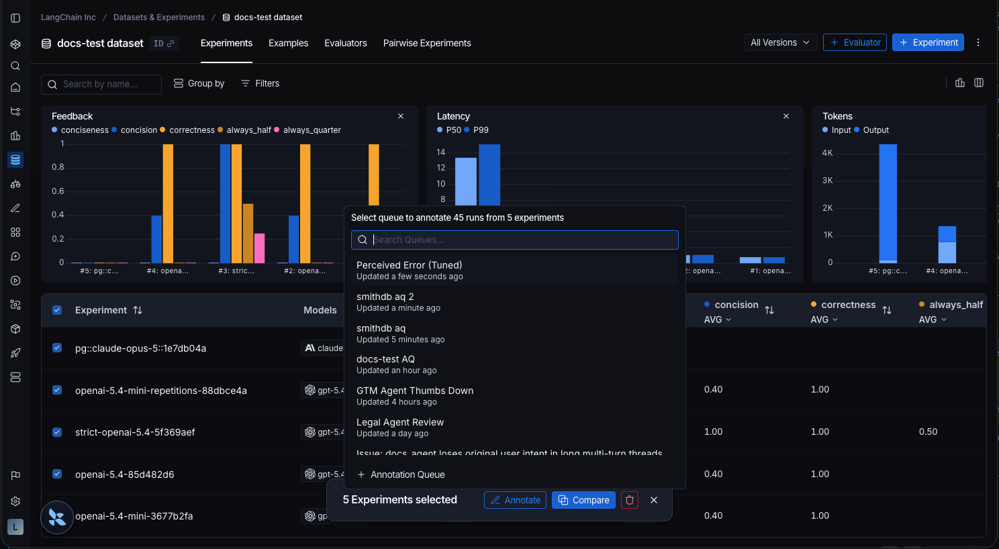
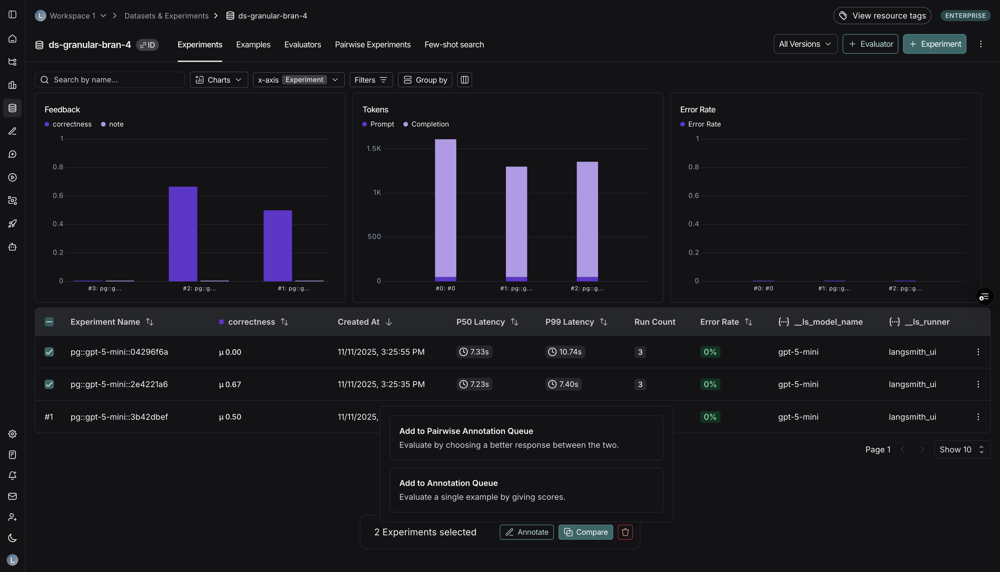
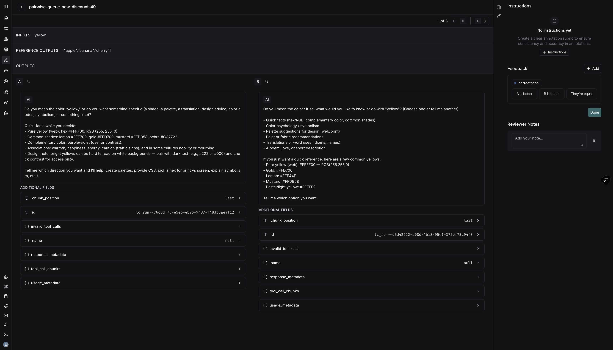

_Annotation queues_ 为人工审核者提供了一套聚焦的工作流，用于给特定的[runs](/langsmith/observability-concepts#runs)或[threads](/langsmith/observability-concepts#threads)附加反馈。虽然你始终可以[内联标注 traces](/langsmith/annotate-traces-inline)，但 annotation queues 允许你把 runs 和 threads 组织成组、预设 rubric，并跟踪审核者进度。审核整个 thread 可以让你评估一段完整的多轮对话，捕获单个 run 无法反映的质量信号。

<Info>
你也可以通过 SDK 以编程方式管理 annotation queues 和 feedback configs。请参阅[以编程方式管理反馈与 annotation queues](/langsmith/annotation-queues-sdk)。
</Info>

LangSmith 支持两种 queue 样式：

- [**Single-run annotation queues**](#single-run-annotation-queues) 每次展示一个 queue 条目，可以是一个 run 或一个 thread，并允许审核者提交你配置好的任意 rubric 反馈。对于由 [LangSmith Engine 提议为离线示例](/langsmith/engine-issues#add-offline-examples) 的 **run** 条目，single-run queues 还会显示 [assertions](/langsmith/assertions)，供你在将其保存用于离线评估之前审核。
- [**Pairwise annotation queues (PAQs)**](#pairwise-annotation-queues) 并排展示两个 runs，让审核者根据你定义的 rubric 项快速判断哪个输出更好，或者两者是否等价。

<Tip>
如果想看 annotation queues 的演示，请观看[Getting started with annotation queues](#video-guide)视频指南。
</Tip>

## Single-run annotation queues

Single-run queues 每次展示一个条目，并允许审核者提交你配置好的任意 rubric 反馈。你可以直接在 [LangSmith UI](https://smith.langchain.com) 的 **Annotation Queues** 页面创建它们。一个 queue 可以混合包含 run 条目和 thread 条目。_Thread 条目_ 表示一整段对话，并使用与 run 条目相同的 rubric 进行审核。

Run 条目和 thread 条目支持不同的能力：

| 能力 | Run 条目 | Thread 条目 |
| --- | --- | --- |
| Rubric feedback | 是 | 是 |
| Reviewer notes | 是 | 否 |
| Assertions | 仅 Engine 提议的 runs | 否 |
| Add to Dataset | 是 | 是 |
| Default dataset | 是 | 否 |
| Automation rules | 是 | 是 |

### 创建 single-run queue

1. 在左侧边栏中点击 **Annotation Queues**。
1. 点击左上角的 **+ Annotation Queue**，打开 **Create Annotation Queue** 面板。

#### Basic details

1. 填写 queue 的 **Name** 和 **Description**。
1. 可选择指定一个 **Agent**。
1. 可选择 **Select a default dataset**，这样在把审核后的 runs 导出为数据集时会更方便，该数据集位于你的 LangSmith [workspace](/langsmith/administration-overview#workspaces) 中。Default datasets 适用于你在 run 条目上使用 **Add to Dataset** 的情况；thread 条目不支持 default datasets。

#### Annotation rubric

Feedback rubric 是审核者为每个 queue 条目填写的有序条目列表。每个 rubric 条目都会使用一个 [feedback tag](/langsmith/set-up-feedback-criteria)，并添加该 queue 专属的说明、该条目是否为必填，以及基于先前答案的可选条件。你可以在 rubric 中定义应用的良好响应应具备什么特征，因此每位审核者都会按同一套标准为条目评分。

<Note>
Rubric 条件、rubric 复制、多选 feedback tags 和共享审核者备注可在 LangSmith Cloud 以及自托管 LangSmith v0.18 或更高版本中使用。更早的自托管版本不包含这些功能。
</Note>

你可以在 **Create Annotation Queue** 面板的 **Feedback Rubric** 区域构建 rubric。要更改现有 single-run queue 的 rubric，请打开该 queue，然后点击右上角的 **Rubric**。仅当你拥有编辑该 queue 的权限时，此按钮才会显示。

要构建 rubric：

1. 为审核者编写一些高层级的 **Instructions**，这些内容会显示在每个条目的侧边栏中。
1. 点击 **Add rubric item** 并选择一个 feedback tag。菜单会先列出 **Used in other queues** 中的 tags，然后列出 **All tags**。在搜索框中输入内容可筛选 workspace 的 tags，或点击 **+ Create new** 创建 tag。若要从已构建的 rubric 开始，请参阅[从另一个 queue 复制 rubric](#copy-a-rubric-from-another-queue)。

    每个 rubric 条目都会显示其 tag 的类型，例如 **Categorical · 2 options**。使用[多选](/langsmith/set-up-feedback-criteria#allow-multiple-selections) tag 的条目还会显示 **Multi-select** 徽标。

1. 为每个条目添加说明。如果该条目使用分类 tag，还要为每个类别添加简短说明。
1. （可选）对于 freeform 条目，输入 **Regex validator**，例如 `CASE-\d+`。每个答案都必须与之匹配才能保存。
1. （可选）选择 **Required**，让审核者必须填写该条目，然后才能将 queue 条目标记为已完成。
1. （可选）点击 **Add logic**，根据先前的答案显示该条目或将其设为必填。详情请参阅[为 rubric 条目添加条件](#add-conditions-to-rubric-items)。
1. 如果你是通过 **Rubric** 按钮打开的 rubric，请点击 **Save**。

审核者会在 UI 右侧面板中看到 **Instructions** 和 rubric 条目。

对于自由文本反馈，请添加一个使用 freeform feedback tag 的 rubric 条目。每个答案仅对撰写它的审核者可见。该条目在 CSV 导出中会有独立的一列，并且可以触发[条件](#add-conditions-to-rubric-items)。要让审核者撰写其他审核者可以读取的备注，请开启[共享审核者备注](#collaborator-settings)。

#### Data formatting

Data formatting 设置决定审核者查看 run 条目时使用的布局。这些设置不适用于 thread 条目。

<Note>
Default view 和 **Classic Trace View** 设置可在 LangSmith Cloud 以及自托管 LangSmith v0.18 或更高版本中使用。更早的自托管版本会为每个 queue 使用 classic 布局。
</Note>

每个 queue 会使用以下两种布局之一：

- **Default view**：run 条目会在该 run 的 [trajectory](/langsmith/view-traces#trajectory-view) 中打开，并滚动到正在评分的那一轮。审核者可以按照 tracing 中显示的方式阅读对话，而不再查看原始 inputs 和 outputs。该视图为只读。参考输出和附件会移到该 run 的 [**Details**](/langsmith/view-traces#details-view) 面板中。完整审核流程请参阅[审核 single-run queue](#审核-single-run-queue)。
- **Classic Trace View**：默认关闭。启用后，run 条目会以 classic 布局打开，审核者可以在其中编辑 run 的 inputs、outputs 和 messages。启用后还会显示以下设置：

    - 一个选择器，用于在 run 的 inputs 和 outputs 中隐藏选定的 JSON 路径。你可以从基于示例 run 生成的复选框中勾选字段，也可以直接输入路径。该选择器会在你保存 queue 后出现。
    - **Show Feedback**：显示该 run 上已有的 feedback。
    - **Show Metadata**：显示该 run 的 metadata。

#### Collaborator settings

你可以设置每个条目的审核人数，或者设置条目被保留给某个协作者的最长时间。当一个条目需要多个标注者时，你可以选择让该条目在所有审核者都将其标记为已完成之前一直保留在队列中。在这些设置中，"run" 指的是任意 queue 条目，包括 thread 条目。具体设置如下：

- **All workspace members review each run**：启用后，一个条目会一直留在队列中，直到每位 [workspace](/langsmith/administration-overview#workspaces) 成员都将自己的审核标记为已完成。

- **Enable reservations on runs**：为某个条目建立保留后，它会在指定时长内被锁定给你审核。条目被保留期间，其他审核者仍可查看，但不能添加反馈或备注。如果启用了所有 workspace 成员都审核每个 run，则不会启用 reservations。

    如果审核者查看了某个条目，但离开前没有将其标记为已完成，那么在指定的 **Reservation length** 之后，这个 reservation 会过期。该条目会重新释放回队列，供其他审核者保留。

- **Number of reviewers per run**：这决定了一个条目需要被多少位审核者标记为已完成，才会从队列中移除。

    - 审核者不能查看其他审核者留下的 rubric 反馈。
    - 只有在开启 [**Let reviewers leave notes for each other**](#collaborator-settings) 时，审核者才能读取彼此的备注。

    <Note>
    启用 **Use assigned reviewers** 后，此项 **Number of reviewers per run** 设置会被隐藏（见下文）。
    </Note>

- **Use assigned reviewers**：启用此开关后，不再按人数阈值计算，而是使用指定的 workspace 成员。启用后：

    - 会出现一个多选用户选择器，让你选择具体的 workspace 成员作为指定审核者。
    - 只有当每位指定审核者都提交完审核后，该条目才会被标记为 **Completed**。队列条目会依次经历三种状态：**Needs Review**、**Needs Others' Review** 和 **Completed**。
    - 未被指定的 workspace 成员仍然可以标注条目，但他们的提交不会计入完成条件。
    - 任意 workspace 成员都可以在 queue settings 中编辑指定审核者列表。

    <Note>
    如果你为一个已经包含已完成条目的 queue 新增指定审核者，这些已完成条目不会重新变为待处理。如果移除某位指定审核者，则其尚未审核的条目会重新计算完成状态。
    </Note>

- **Let reviewers leave notes for each other**：默认关闭。审核者备注是审核者之间的消息，例如关于某个条目的问题或背景信息，而不是对该条目的反馈。启用后，每个 run 条目都会在审核窗格中显示 **Reviewer Note** 按钮。审核者可以用它撰写自己的备注，并读取其他审核者的备注，每条备注都会显示作者和时间。如需提供反馈，请改用 freeform [rubric 条目](#annotation-rubric)。

    共享关闭时，新建的 queue 没有备注框。在共享关闭的旧 queue 中，每位审核者的私人备注会作为 `note` rubric 条目显示在 rubric 末尾，并显示 “Only you can see your note.” 标记。将 queue 导出为 CSV 时，备注会显示在独立的一列中，该列列出每位审核者的备注。

由于这些设置，不同审核者看到的条目数量可能与队列总大小不同。

### 编辑 queue 设置

1. 打开你想编辑的 annotation queue 的 **Edit Annotation Queue** 面板。你可以通过以下两种方式访问：

    - 在 **Annotation queues** 列表中，点击队列所在行右侧的 **Actions** 图标 <Icon icon="dots-vertical"/>。然后在下拉菜单中选择 <Icon icon="pencil"/> **Edit**。
    - 在 annotation queue 视图中，点击右上角的 **Settings** 图标 <Icon icon="settings"/>。

2. 在 **Edit Annotation Queue** 面板中，修改你在创建 queue 时配置的任意设置，然后点击 **Save**。

### 从另一个 queue 复制 rubric {#copy-a-rubric-from-another-queue}

复制 rubric 可以让你在另一个 queue 中复用其条目，而不必重新构建。仅当 single-run queue 的 rubric 为空时才能复制。

要复制 rubric：

1. 在空的 **Feedback Rubric** 区域中，点击 **Copy existing rubric**。选择器会列出 workspace 中的其他 single-run queues，最近更新的排在最前面。使用 **Search Queues...** 筛选列表。
1. 选择一个来源 queue。预览会列出每个条目的 key、类型、必填要求和条件。
1. 点击 **Copy *N* items**，其中 *N* 是要复制的条目数。

每个复制的条目都会保留其说明、类别说明、必填要求、条件、regex validator 和 feedback tag。复制会链接现有 tag，而不会创建新 tag。来源 queue 不会发生变化。

大多数 rubric 会完整复制。如果来源 rubric 中的某些条目无法由 LangSmith 复制，例如位于旧版 rubric 中或通过 API 创建的条目，预览会将这些条目置灰，并在 **Condition** 列中显示原因：

- **Duplicate key**：来源 rubric 中的另一个条目具有相同的 key（忽略大小写和空格）。
- **No feedback tag**：该条目没有 feedback tag。
- **Assertion item**：该条目是一个 assertion。
- **Reserved for notes**：该条目使用 `note` key，该 key 保留给审核者备注。

如果某个复制条目的条件依赖于未被复制的条目，LangSmith 会丢弃该条件，并在预览中列出该条件。最终不再包含任何条件的条目会变为可选。

### 为 rubric 条目添加条件 {#add-conditions-to-rubric-items}

条件会根据先前条目的答案显示某个 rubric 条目或将其设为必填，因此审核者只会在条件适用时看到后续问题。例如，仅当审核者将 `correctness` 标记为失败时，才显示 `failure_reason` 条目。single-run queues 支持条件。

条件只能引用 rubric 中位于其前面的条目。第一个 rubric 条目不能带有条件。

要添加条件：

1. 在 rubric 条目上点击 **Add logic**。
1. 在 **When** 行中，选择一个先前的条目、一个运算符，以及（如果该运算符需要）一个值：

    - **is**：先前的答案是所选的值。
    - **is one of**：先前的答案是所选值中的任意一个。
    - **is empty**：先前的条目没有答案。
    - **is not empty**：先前的条目有答案。

    没有类别的条目（例如 freeform 条目）仅支持 **is empty** 和 **is not empty**。对于多选条目，只要任一选中项匹配，**is** 和 **is one of** 就成立。

1. （可选）点击 **+ Add condition** 添加更多条件。要组合条件，请选择 **and** 以要求满足所有条件。选择 **or** 以要求满足任意一个条件。
1. 在 **Then** 行中，选择该条目的行为：

    - **Require**：始终显示，条件满足后变为必填。
    - **Show**：在条件满足前隐藏，满足后为可选。
    - **Show and require**：在条件满足前隐藏，满足后变为必填。

折叠后的 rubric 条目会用简明英文概述其逻辑，例如 “Shown when accuracy is one of 2 values”。如果其他条目依赖于某个条目，该条目会在 **Affects** 下列出那些依赖它的条目。

审核者处理条目时，LangSmith 会根据已保存的答案检查条件。如果更改先前的答案导致某个条目被隐藏，LangSmith 会删除该隐藏条目的答案，因此反馈绝不会包含审核者无法看到的问题的答案。

如果你删除其他条目所依赖的条目，LangSmith 会要求你确认，并移除引用该条目的条件。不再有任何剩余条件的依赖条目会变为可选。

<Note>
LangSmith 会将条件存储在 queue 上，并在审核窗格中应用这些条件。通过 API 或 SDK 直接写入的反馈不会按条件进行检查。若要以编程方式管理条件，请参阅 SDK 指南中的[为 rubric 条目添加条件](/langsmith/annotation-queues-sdk#add-conditions-to-rubric-items)。
</Note>

### 将 runs 和 threads 分配到 single-run queue

有多种方式可以向 single-run queue 中添加条目：

- **From the Details view**：在某个 [agent environment](/langsmith/agent-environments) 的 **Tracing** 页面中，点击任意行打开 [Details view](/langsmith/view-traces#details-view) 中的侧边面板。该面板提供两个操作，各自的作用范围是固定的：

    - **Add to** <Icon icon="plus"/>：在 run 头部打开这个菜单并选择 **Add to Annotation Queue**。这会把你当前选中的 run 作为 run 条目添加。
    - **Add thread to annotation queue** <Icon icon="pencil"/>：在 **Trajectory**、**Turns** 和 **Details** 标签页旁，点击该图标。这会把整个 thread 作为 thread 条目添加。

    两个操作都会打开一个弹出框，供你选择已有的 queue，或创建一个新 queue。

    

    

    <Note>
    只有通过 `thread_id` / `session_id` metadata 标注的 run 才会显示 thread 操作。如果没有这些 metadata，面板会单独打开该 run，此时只有 run 操作可用。
    </Note>

- **From the Traces or Runs tab**：在某个 agent environment 的 **Tracing** 页面中，选择 **Traces** 或 **Runs** 标签页。使用行复选框选中一个或多个条目。点击页面底部的 **Add to Annotation Queue**。在 **What to add** 中，将每个选中项作为 **Selected run** 或其 **Entire thread** 加入队列。

    

    

- **From the Threads tab**：在某个 agent environment 的 **Tracing** 页面中，选择 **Threads** 标签页。使用行复选框选中一个或多个条目。点击页面底部的 **Add to Annotation Queue**。选中的 threads 会作为 thread 条目添加。

    

    

- **Automation rules**：[设置规则](/langsmith/rules)，将匹配某个过滤条件的 **runs** 或 **threads**（例如出错或用户评分较低）自动分配到某个 queue 中。

    <Note>
    规则入队的内容取决于其[条目类型](/langsmith/rules#set-the-item-type-to-runs-or-threads)。条目类型为 **Runs** 的规则会添加 run 条目；条目类型为 **Threads** 的规则会在 thread 进入空闲状态后，将整段对话作为 thread 条目添加。
    </Note>
- **Datasets & Experiments**：在某个数据集中选择一个或多个[实验](/langsmith/evaluation-concepts#experiment)，然后点击 **<Icon icon="pencil"/> Annotate**。选择 **Add to Annotation Queue**，然后选择已有 queue 或创建新 queue。实验标注流程只会添加 run 条目。

    

    

<Note>
单次操作最多可以向 annotation queue 中添加 **100** 个 runs 或 threads。如需添加更多，请以每批 100 或更少的方式重复执行添加流程。

手动向 annotation queue 添加 runs 或 threads 默认不会改变 trace 保留期。trace 会保留为其 project 配置的保留期，除非另有操作显式延长保留期。由[自动化规则](/langsmith/rules)执行的添加则不同：针对标注队列动作，规则的 **Extend Data Retention** 开关默认启用。Run 规则会升级包含每个匹配 run 的整个 trace，而 thread 规则会升级匹配 thread 中的每条 trace。完整的保留模型请参阅[data retention auto-upgrades](/langsmith/usage-and-billing#data-retention-auto-upgrades)。
</Note>

### 审核 single-run queue

1. 在左侧边栏中点击 **Annotation Queues**。

    队列列表中包含 **Assigned Reviewers** 列，用来显示每个 queue 指定了哪些审核者。如果只想看分配给你的 queues，请点击列表顶部的 **Assigned to me** 过滤器。

1. 点击你想审核的 queue。随后会进入一个聚焦、循环的界面，展示该 queue 中需要审核的条目。左侧面板会列出 queue 条目（runs 和 threads），并显示每个条目的状态（**Needs Review**、**Needs Others' Review**、**Completed**）。点击 **Overview** 可打开完整队列列表。

1. 审核当前条目：

    - **Run 条目**：中间面板会以 Trajectory 视图显示该 run。线程中的 run 会打开正在评分的那一轮，并加载前后各轮。不在线程中的 run 会显示其 trace 中的所有消息，并标出 agent 的那一轮。点击 **View item** 可打开该 run 的 **Details** 面板，其中包含 run 详情、参考输出和附件。

        子 run 会显示 inputs 和 outputs，而不是 trajectory。trajectory 不可用的 run 也是如此，例如未[查询 SmithDB](/langsmith/self-host-smithdb-features) 的自托管安装。此视图会将每个中间工具调用折叠为一行，并在 outputs 下方列出参考输出和附件。

        填写 rubric 中的 [**Feedback**](/langsmith/observability-concepts#feedback) 条目，或者将该条目标记为已审核。如果该 queue 已开启[共享审核者备注](#collaborator-settings)，请点击 **Reviewer Note** 添加你的备注并读取其他审核者的备注。若要构建数据集，请点击 **Add to Dataset**，将该 run 保存为示例。对于 [LangSmith Engine 提议为离线示例](/langsmith/engine-issues#add-offline-examples) 的 runs，审核侧边面板还会显示提议的 [**Assertions**](/langsmith/assertions)。请先审核并编辑这些 assertions，再将其保存为该示例的期望输出。一旦该 run 具有 assertions，中间面板会显示该 run 的 inputs，并将 assertions 作为其参考输出。

        两种视图均为只读。若要在将 run 添加到数据集之前编辑其 inputs 和 outputs，请为该 queue 启用 [**Classic Trace View**](#data-formatting)。
    - **Thread 条目**：中间面板会显示该 thread 的对话 transcript。阅读 transcript 并为其 rubric **Feedback** 条件打分。点击 **View item** 可在对话 peek 中打开该 thread。若要将完整对话作为单个示例添加到数据集，请点击 **Add to Dataset**，然后选择一个数据集。若要在选择器中新建数据集，请点击 **New Dataset**。要了解 thread 示例包含哪些内容，请参阅[在应用中管理数据集](/langsmith/manage-datasets-in-application#manually-from-an-agent-environment)。

    填写 rubric 条目时：

    - 对于[多选](/langsmith/set-up-feedback-criteria#allow-multiple-selections)条目，选择所有适用的类别。取消选择会删除对应的反馈。
    - 对于超过 10 个类别的条目，在搜索框中输入内容以查找类别。
    - 带[条件](#add-conditions-to-rubric-items)的条目会随着你回答先前的条目而显示或变为必填。如果更改先前的答案导致某个条目被隐藏，LangSmith 会删除你对该条目的答案。
    - 已回答的条目会显示对勾。必填条目会显示红色星号。
    - 要完成该条目，请点击 **Next (mark as completed)**。在 **Needs Review** 中的最后一个条目上，该按钮显示为 **Done**。如果你尚未填写所有已显示的必填条目就点击该按钮，LangSmith 会列出仍缺失的条目。

    要将当前条目从所有 workspace 成员的队列中移除，请点击 **Remove from queue**（左侧面板中该条目上的 <Icon icon="x"/> 图标，或 <kbd>⌘ ⌫</kbd>），然后确认。当其他审核者已将该条目完全保留时，你无法将其移除。

    <Note>
    对于 thread 条目，你可以提交 rubric feedback 并使用 **Add to Dataset**。Reviewer notes 和 assertions 不可用。请参见[能力表](#single-run-annotation-queues)以比较 run 条目和 thread 条目的能力。
    </Note>

    在审核 annotation queue 期间提交的 feedback 和 notes 不会改变 trace 的[保留层级](/langsmith/usage-and-billing#data-retention-auto-upgrades)。

    <Tip>
        使用每个选项旁边的键盘快捷键可以更快地审核条目。
    </Tip>

### 自定义审核窗格

自定义视图会用你向 LangSmith Chat 描述的一种展示方式，替换中间窗格中默认的 trace 视图，例如不带 tool calls 的对话 transcript。一个视图可以服务多个 queues。更多信息请参阅[为 annotation queues 构建自定义视图](/langsmith/annotation-queue-custom-views)。

## Pairwise annotation queues

Pairwise annotation queues（PAQs）会并排显示两个 runs，让审核者根据你定义的 rubric 项快速判断哪个输出更好，或者两者是否等价。它们专为两个实验之间的快速 A/B 比较而设计，常见用法是基线模型与候选模型对比。PAQs 必须从 **Datasets & Experiments** 页面创建。Pairwise queues 仅使用 run 比较，不会将 thread 条目加入队列。

### 创建 pairwise queue

1. 前往 **Datasets & Experiments**，打开某个数据集，并选择**恰好两个实验**进行比较。
1. 点击 **Annotate**。在弹出的界面中选择 **Add to Pairwise Annotation Queue**。（只有在刚好选择了两个实验时，此按钮才可用。）

    

1. 决定是将实验发送到一个已有的 pairwise queue，还是创建一个新的。
1. 填写 queue 详情：
    - **Basic details**（名称和说明）
    - 适用于成对评分的 **Instructions & rubrics**
    - **Collaborator settings**（审核人数、reservations、reservation length）
1. 提交表单以创建 queue。LangSmith 会立即将两个实验中的 runs 配对，并把它们填充进该 queue。

PAQs 的关键差异在于：

- **Experiments**：你必须预先提供两个 experiment sessions。LangSmith 会按时间顺序自动配对它们的 runs，并在创建期间填充队列。
- **Rubric**：Pairwise rubric 项只需要 feedback key，以及可选的描述。审核者需要为每个 rubric 项判断 Run A、Run B，或两者是否同样更好。
- **Dataset**：Pairwise queues 不使用 default dataset，因为比较横跨两个实验。
- **Reservations & reviewers**：协作者控制逻辑与 single-run queue 相同。Reservations 有助于防止两个人同时评审同一组比较。

### 向 pairwise queue 添加更多比较项

如果你之后还需要添加更多比较项，请返回 **Datasets & Experiments**，再次选中那两个实验，然后选择 **Add to Pairwise Annotation Queue**，以便向现有 queue 追加新的 pairs。

选择两个实验并创建 PAQ 时，LangSmith 会自动完成配对。向现有 PAQ 增补时，LangSmith 会保留历史比较结果，并将新 pairs 追加到队列中。

### 审核 pairwise queue

1. 在 **Annotation queues** 中，选择你要审核的 pairwise queue。
1. 每个 queue 条目会在左侧显示 Run A，在右侧显示 Run B，同时展示你的 rubric。
1. 对于每个 rubric 项：
    - 选择 **A is better**、**B is better** 或 **Equal**。UI 会在后台为两个 runs 记录二值反馈。
    - 使用热键 `A`、`B` 或 `E` 快速完成选择。
1. 完成所有 rubric 项后，按下 **Done**（或者在最后一个 rubric 项上按 `Enter`）进入下一组比较。
1. 可选操作：
    - 留下绑定到任一 run 的评论。
    - 如果之后还要回看，可以 Requeue 该比较项。
    - 打开 Details view 进行更深入的调试。

Reservations、reviewer thresholds 和评论的行为与 single-run queues 完全一致，因此团队无需更改既有工作流，就可以切换使用不同类型的 queues。

    

<Check>
可以考虑把已经带有用户反馈（例如 thumbs-down）的 runs，同时路由到一个 single-run queue 用于分诊，再路由到一个 pairwise queue 中，与更强的基线做 head-to-head 比较。这样可以帮助你更快识别回归。要了解如何从 LLM application 中采集用户反馈，请参阅[附加用户反馈](/langsmith/attach-user-feedback)指南。
</Check>

## 视频指南

<iframe
  className="w-full aspect-video rounded-xl"
  src="https://www.youtube.com/embed/rxKYHA-2KS0?si=V4EnrUmzJaUVJh0m"
  title="YouTube video player"
  frameBorder="0"
  allow="accelerometer; autoplay; clipboard-write; encrypted-media; gyroscope; picture-in-picture"
  allowFullScreen
></iframe>
