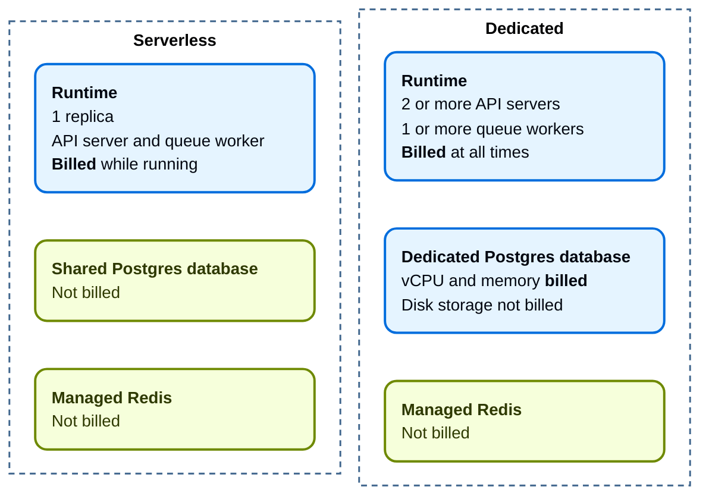
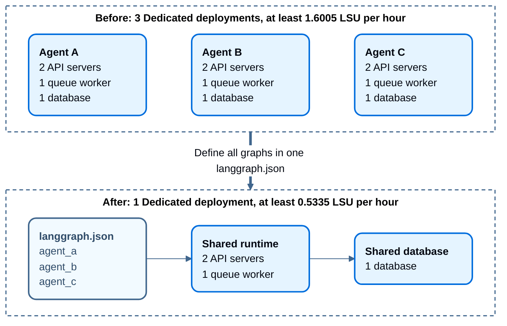

本页介绍如何管理你的 LangSmith 组织计费：

- [为账户设置计费](#set-up-billing-for-your-account)：完成 Developer 和 Plus 方案的计费设置，包括旧账户的特殊说明。
- [跟踪合同用量（Enterprise）](#track-contract-usage-enterprise)：查看预付费合同消耗情况。
- [更新信息](#update-your-information-paid-plans-only)：修改组织的发票邮箱、企业信息和税号。
- [实施支出限制](#enforce-spend-limits)：了解如何通过用量上限和数据保留来管理支出。
- [LangSmith Deployment 计费](#langsmith-deployment-billing)：了解 deployment 费用，比较规格与每小时成本，并降低 deployment 成本。

## 为账户设置计费

<Note>
使用本指南前，请注意以下事项：

- 如果你对 [Enterprise](https://www.langchain.com/pricing) 方案感兴趣，请[联系销售团队](https://www.langchain.com/contact-sales)。本指南仅适用于我们的自助计费方案。
</Note>

要为 LangSmith 组织设置计费，请进入 **Settings** 下的 [Billing and Usage](https://smith.langchain.com/settings/payments) 页面。根据组织当前设置的不同，对应的设置指南也不同：

- [Developer 方案](#developer-plan%3A-set-up-billing-on-your-personal-organization)
- [Plus 方案](#plus-plan%3A-set-up-billing-on-a-shared-organization)

### Developer 方案：为个人组织设置计费

在绑定信用卡之前，个人组织每月最多只能使用 5,000 条 traces。要添加信用卡：

1. 点击 **Add card to remove trace limit**。
1. 填写信用卡信息。
1. 完成后，你将不再受 5,000 条 traces 的限制；超出部分会按照[定价页面](https://www.langchain.com/pricing-langsmith)中的费率收费。

### Plus 方案：为共享组织设置计费

团队组织初始每月可使用 10,000 条 traces。超出部分会按照[定价页面](https://www.langchain.com/pricing-langsmith)中的费率收费。

<Note>
你手动创建的新组织必须使用 Plus 方案。如果你看到提示要求升级到 Plus 才能使用该组织，请按下面的步骤操作。
</Note>

1. 点击 **Upgrade to Plus**。
1. 按需邀请成员加入组织。
1. 输入信用卡信息。然后填写企业信息、发票邮箱和税号。如果该组织属于企业，请勾选 **This is a business** 复选框，并按要求填写相关信息。更多信息请参阅[更新信息](#update-your-information-paid-plans-only)部分。

## 跟踪合同用量（Enterprise）

合同用量跟踪适用于使用预付费承诺的 [**Enterprise 方案**](/langsmith/pricing-plans)客户。你必须拥有 [`organization:manage` 权限](/langsmith/organization-workspace-operations)才能访问该功能。

关于如何查看预付费合同消耗情况，请参阅[合同用量](/langsmith/view-usage#contract-usage)。

<Note>
如需进一步了解 Enterprise 方案，请[联系销售团队](https://www.langchain.com/contact-sales)。
</Note>

## 更新信息（仅付费方案）

要更新 LangSmith 组织的企业信息，请前往 **Settings** 下的 [Billing and Usage](https://smith.langchain.com/settings/payments) 页面。

### 发票邮箱

要更新接收发票的邮箱地址，请按以下步骤操作：

1. 进入 **Plans and Billing** 标签页。
2. 找到支付方式下方当前发票邮箱所在的区域。
3. 在输入框中填写新的发票接收邮箱。
4. 新邮箱会自动保存。

之后所有发票都会发送到更新后的邮箱地址。

### 企业信息和税号

<Note>
在某些司法辖区，LangSmith 需要征收销售税。如果你是企业，提供税号可能使你具备销售税豁免资格。
</Note>

要更新组织的企业信息，请按以下步骤操作：

1. 进入 **Plans and Billing** 标签页。
2. 在发票邮箱区域下方，找到名为 **Business** 的复选框。
3. 如果你的组织属于企业，请勾选 **Business** 复选框。
4. 系统会显示企业信息区域，你可以填写或更新以下内容：
   - 企业名称
   - 地址
   - 适用司法辖区的税号
5. 当你选择国家后，如果适用，会出现 Tax ID 输入框。
6. 填写完必要信息后，点击 **Save** 保存变更。

这样可以确保你的企业信息在计费和税务方面保持最新且准确。

## 实施支出限制

<Check>
在继续阅读本节关于 tracing 支出优化的内容前，你可能会先阅读以下页面：

- [数据保留概念文档](/langsmith/usage-and-billing#data-retention)
- [使用量限制概念文档](/langsmith/usage-and-billing#usage-limits)
</Check>

<Note>
由于 Enterprise 方案采用定制化计费，一些本指南提到的功能目前可能不适用。如果你使用的是 Enterprise 方案，并且对成本优化有疑问，请联系你的销售代表，或通过 [support.langchain.com](https://support.langchain.com) 联系支持团队。
</Note>

### 了解当前用量

任何优化流程的第一步都是了解当前用量。关于用量图表、细粒度用量、发票和合同用量的详情，请参阅 [View usage](/langsmith/view-usage)。

LangSmith 按工作区衡量使用量，因为工作区通常代表组织中的开发环境或团队。

### 设置用量限制

#### 为工作区设置支出上限

1. 要设置限制，请进入 **Settings** -> **Billing and Usage** -> **Usage limits**。
1. 为所选工作区输入支出上限。LangSmith 会根据该金额计算合适的基础 traces 和扩展 traces 数量上限。trace 配额中包含了你当前方案自带的免费 traces 配额（详见[定价页面](https://smith.langchain.com/settings/payments)）。

<Note>
仅对于**拥有多个工作区**的组织：为了简化计算，LangSmith 只会把免费 traces 计入**第一个工作区**的成本计算中。实际上，这些免费 traces 可以被任意工作区“消耗”。因此，对于多工作区组织，工作区级的支出上限只是近似值，而组织级的支出上限才是绝对值。
</Note>

#### 配置 trace 层级分布

LangSmith 有两种 trace 层级：基础 traces 和扩展 traces。基础 traces 使用基础保留策略，存活时间较短（14 天）；扩展 traces 使用扩展保留策略，存活时间较长（默认 180 天，[Enterprise 客户可自定义](/langsmith/data-purging-compliance#customize-extended-retention-policy)）。更多信息请参阅[数据保留概念文档](/langsmith/usage-and-billing#data-retention)。

<Warning>
自 2026 年 9 月 14 日起，SaaS 客户的长期 trace 保留时长上限将变更为 180 天。Enterprise 客户仍可按工作区自定义 extended retention period，但不得超过这一新上限。变更只影响新 traces，不影响已有 traces。
</Warning>

在 **Default data retention** 标签下选择你期望的默认 trace 层级。所有 trace 在被记录时都会默认使用这个层级。请注意，由于扩展 traces 的成本高于基础 traces，如果你把默认数据保留设置为 **Extended**，则在一个计费周期内允许的 trace 总数会减少。默认情况下，更新此设置只会影响未来新进入的 traces。如果你想把该设置应用到工作区中的所有已有 traces，请勾选对应复选框。

如果默认数据保留设置为 **Base**，你还可以通过滑块在基础 traces 和扩展 traces 之间分配配额。LangSmith 会自动给出建议分配，但你也可以根据需求调整。比如，如果你运行了很多会把 trace 升级为扩展层级的 automations 或其他功能，你可能会想提高扩展 trace 配额。关于哪些功能会触发升级，请参阅[这里](https://docs.langchain.com/langsmith/usage-and-billing#how-it-works:~:text=Data%20retention%20auto%2Dupgrades)。

<Note>
一旦扩展数据保留上限被触达，除了 tracing 之外的其他功能也可能停止工作。如果你计划使用该功能，请先了解它的[功能行为和副作用](/langsmith/usage-and-billing#side-effects-of-extended-data-retention-traces-limit)。
</Note>

### 管理 traces 的其他方法

#### 自定义扩展保留时长（仅 [Enterprise](/langsmith/pricing-plans)）

[Enterprise](/langsmith/pricing-plans) 客户可以在工作区级别自定义扩展数据保留时长，以满足合规要求。默认值为 180 天（自 2026 年 9 月 14 日起），但你可以根据组织需求进行调整。更多信息请参阅[自定义扩展保留策略](/langsmith/data-purging-compliance#customize-extended-retention-policy)。

#### 修改项目级默认保留设置

每个 tracing project 都可以调整数据保留设置。在项目级别，你可以在两种层级间选择：基础（14 天）或扩展（180 天）。如果要把扩展时长最大调整到 180 天，需要使用[工作区级配置](/langsmith/data-purging-compliance#customize-extended-retention-policy)（仅 Enterprise）。

在[基于 agent 的工作区](/langsmith/agents)中，agent 的每个[环境（environment）](/langsmith/agent-environments)都是独立的 tracing project，因此保留策略按环境设置而不是按 agent 设置，你需要通过 agent 而不是 **Projects** 列表来访问该设置。

进入 **Projects** > ***Your project name*** > 选择 **Retention**，然后选择期望的默认保留策略。这个设置只会影响**之后新增的 traces** 的保留策略和计费。

#### 对一定比例的 traces 应用扩展数据保留

你可能并不希望所有 traces 都在 14 天后过期。你可以通过创建 [automation rule](/langsmith/rules)，自动把符合某些条件的 traces 延长保留时间。比如，你可能想为以下类型的 traces 应用扩展数据保留：

* 所有 traces 中的 10%：用于长期分析或趋势分析。
* 出错的 traces：便于更深入地排查和调试问题。
* 带有特定元数据的 traces：用于长期观察某些功能或用户流程。

配置方式如下：

1. 进入 **Projects** > ***Your project name*** > 选择 **+ New** > 选择 **New Automation**。在基于 agent 的工作区中，请从 agent 的环境开始。
2. 为规则命名，并可按需设置过滤器或采样率。关于如何配置过滤器，请参阅[过滤技巧](/langsmith/filter-traces-in-application#filter-operators)。

<Note>
当某条 automation rule 匹配到某个 [trace](/langsmith/observability-concepts#traces) 中任意一个 [run](/langsmith/observability-concepts#runs) 时，该 trace 中的所有 runs 都会被升级为扩展数据保留（默认 180 天，[Enterprise 客户可自定义](/langsmith/data-purging-compliance#customize-extended-retention-policy)）。
</Note>

例如，如果你想把所有 traces 中的 10% 保留为扩展数据保留，预期配置如下：

如果你希望出于数据收集目的，把某一部分 traces 保留**超过 180 天**，可以再创建另一条 run rule，把部分 runs 发送到你指定的数据集。数据集可以保存 trace 的输入和输出（例如作为键值型数据集），并且即使 trace 被删除，数据集内容也会永久保留。

### 总结

如果你对如何进一步管理支出有疑问，请通过 [support.langchain.com](https://support.langchain.com) 联系支持团队。

## LangSmith Deployment 计费

除了 traces 外，LangSmith 还会对通过 LangSmith Deployment 部署的 agent 收费。Deployment 的计费基于其消耗的资源：

- **计算（Compute）**：每个正在运行的 replica 所请求的 vCPU 和内存，以 LangChain Standard Units（LSU）计量。[Autoscaling](/langsmith/cloud-platform-features#scaling) 会增加可计费的 replica。[Serverless](/langsmith/cloud-platform-features#serverless) 的计算费用在缩容时停止，而不是在流量停止时停止。[Dedicated](/langsmith/cloud-platform-features#dedicated) 持续运行。
- **数据库（Database）**：Dedicated 数据库按配置的 vCPU 和内存计费，空闲期间同样计费。运行时 autoscaling 不会改变数据库费用。数据库磁盘存储以及 Serverless 的共享数据库不计费。

任何类型、任何规格的 deployment 上的托管 Redis 均不计费。

下图展示了每种 deployment 类型中哪些部分计费。蓝色部分计费，绿色部分不计费：

用量按以下费率换算为 LSU。1 LSU 的价格为 $1.00：

| 资源 | 费率 |
|---|---|
| 运行时 vCPU | 每 vCPU 小时 0.0675 LSU |
| 运行时内存 | 每 GiB 小时 0.009 LSU |
| 数据库 vCPU | 每 vCPU 小时 0.177 LSU |
| 数据库内存 | 每 GiB 小时 0.025 LSU |

用量每 5 分钟采样一次，并按小时汇总。每个正在运行的可计费容器在该时间间隔内按所请求的资源计费，而不是按实际使用率计费。

### 比较规格与每小时成本

下表列出了 LangSmith Cloud GCP 上各个[规格](/langsmith/cloud-platform-features#sizes)的每小时成本。所有成本均以每小时 LSU 计。

Serverless deployment 仅在运行时计费。缩容后的 Serverless deployment 成本为 0 LSU。Serverless deployment 不会横向扩展，其共享数据库也不计费：

| Serverless 规格 | 可计费运行时 | 运行时的成本 |
|---|---|---|
| Small | 0.8 vCPU / 2 GiB | 0.072 LSU |
| Medium | 4 vCPU / 4 GiB | 0.306 LSU |
| Large | 8 vCPU / 8 GiB | 0.612 LSU |

Dedicated deployment 始终按最低运行时和数据库计费。下表假设数据库规格与计算规格一致：

| Dedicated 规格 | 运行时 + 数据库 | 最低总计 |
|---|---|---|
| Small | 0.2565 + 0.277 | 0.5335 LSU |
| Medium | 0.513 + 0.554 | 1.067 LSU |
| Large | 1.026 + 1.108 | 2.134 LSU |

<Note>
Dedicated 的最低运行时为 2 个 API server replica 和 1 个 queue worker。[Autoscaling](/langsmith/cloud-platform-features#scaling) 会增加 API server 或 queue worker replica。每个新增 replica 按其规格的新增 replica 费率计费。
</Note>

下表列出了每种 Dedicated 规格的最低运行时和新增 replica 费率：

| Dedicated 规格 | 最低运行时 | 每个新增 replica |
|---|---|---|
| Small | 3 vCPU / 6 GiB | +0.0855 LSU |
| Medium | 6 vCPU / 12 GiB | +0.171 LSU |
| Large | 12 vCPU / 24 GiB | +0.342 LSU |

LangSmith Cloud GCP 上的 Dedicated 数据库容量如下：

| 数据库规格 | 容量 | 每小时数据库费用 |
|---|---|---|
| Small | 1 vCPU / 4 GiB | 0.277 LSU |
| Medium | 2 vCPU / 8 GiB | 0.554 LSU |
| Large | 4 vCPU / 16 GiB | 1.108 LSU |

数据库容量因云服务商而异。计算和数据库规格可以[独立设置](/langsmith/cloud-platform-features#sizes)。

Tracing 及其他产品用量为单独收费项。

[免费的 Serverless deployment](https://www.langchain.com/pricing) 仅提供 Small 规格。免费 deployment 不对任何容器计费，无论 **Scale down after** 设置如何。Dedicated deployment 永远不免费。

要估算 deployment 的成本，你还可以使用[定价页面](https://www.langchain.com/pricing)上的 deployment 成本计算器。

<Note>
基于用量的定价已于 2026 年 10 月 1 日取代了按次运行和 uptime 定价。缩容到零需要采用新定价。如对过渡有疑问，请联系[支持团队](https://support.langchain.com)。
</Note>

如果你的 deployment 使用量很大，请[联系销售团队](https://www.langchain.com/contact-sales)讨论定制化定价方案。

### 降低 deployment 成本

Deployment 费用基于每个 deployment 所请求的计算和数据库资源。要降低 deployment 账单，请减少 deployment 数量、使用更小的规格，并让空闲的 deployment 缩容：

- **使用 Serverless 并缩短缩容时间**：Serverless deployment 在缩容时会停止计算费用。将 **Scale down after** 设为 `1 hour`，而不是默认的 `1 week`。在默认设置下，每周至少收到一次请求的 deployment 永远不会缩容。Serverless deployment 存在冷启动，并且只运行一个 replica。Serverless 目前尚不适用于 AWS 或 Azure 上的 deployment，也不适用于 self-hosted 和 hybrid deployment。
- **在一个 deployment 上运行多个 agent**：费用按 deployment 收取，而不是按 agent 收取。在一个 `langgraph.json` 中[定义多个图](/langsmith/application-structure#define-multiple-graphs-in-one-deployment)，让你的 agent 共享一组 replica 和一个数据库。这在 Dedicated 上节省最多，因为每个 deployment 至少有 2 个 API server replica、1 个 queue worker，以及自己的数据库。
- **使用能满足需求的最小规格**：每个运行时 replica 和每个数据库都按其规格计费。在 Dedicated deployment 上，你可以分别设置计算规格和数据库规格。参见[规格](/langsmith/cloud-platform-features#sizes)。
- **删除未使用的 deployment**：空闲的 Dedicated deployment 会按其最低 replica 数量和数据库计费。空闲的 Serverless deployment 在缩容前会持续计费。
- **限制 preview deployment**：每个 [preview deployment](/langsmith/preview-builds) 都是独立的 deployment，并按独立 deployment 计费。降低 **Idle TTL** 和 **Max concurrent previews**，以限制运行的 preview deployment 数量和时长。
- **移除不必要的唤醒**：对已缩容的 Serverless deployment 的请求会使其重新启动，包括自动化的健康检查。已启用的 [cron jobs](/langsmith/cron-jobs) 和定时 runs 会在到期前最多 10 分钟启动 deployment。请移除不需要的 cron jobs 和健康检查。

下图对比了三个 Dedicated deployment 与一个运行三个图的 Dedicated deployment：

下表展示了两项变更的效果。月度成本按 720 小时计算：

- **缩短缩容时间**：一个 Serverless Small deployment 每个工作日收到 2 小时请求，每月 22 天。
- **多个图**：三个 agent 运行在 GCP 上的 Dedicated Small deployment 上。

| 变更 | 变更前 | 变更后 |
|---|---|---|
| 缩短缩容时间 | `1 week`（默认）：720 小时运行时间，约使用 51.84 LSU | `1 hour`：约 66 小时运行时间，约使用 4.75 LSU。节省约 47.09 LSU。 |
| 多个图 | 3 个 deployment：约 1,152 LSU | 1 个包含 3 个图的 deployment：约 384 LSU。节省约 768 LSU。 |

Autoscaling 会为两种 Dedicated 配置增加运行时成本。

LangSmith 不支持在创建后更改 deployment 的类型。要迁移到 Serverless，请创建一个新的 Serverless deployment，并使用 [Agent Server API](/langsmith/server-api-ref) 从前一个 deployment 复制数据。你也可以联系[支持团队](https://support.langchain.com)协助完成迁移。
