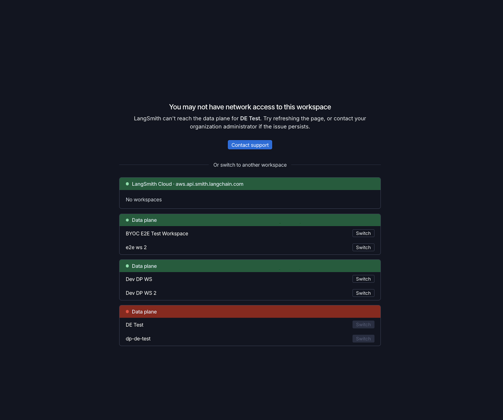

## 设置

<Accordion title="Which clouds and regions can I deploy to?">
BYOC 在 AWS 上已正式发布（GA），使用美国 control plane。GCP 和 Azure 上的 BYOC 目前处于 [beta](/langsmith/release-stages) 阶段。受支持的 AWS regions 以及 GCP 和 Azure 的 region 可用性请参阅 [Regions and cloud providers](/langsmith/byoc#regions-and-cloud-providers)。
</Accordion>

<Accordion title="Does BYOC support government cloud regions or FIPS-compliant images?">
不支持。BYOC 不支持政府云区域，例如 AWS GovCloud (US)，也不提供符合 FIPS 的容器镜像。
</Accordion>

<Accordion title="Can a control plane on one cloud manage a data plane on another cloud?">
不支持。不支持跨云部署。data plane 必须与它的 control plane 运行在同一个云提供商上。例如，AWS control plane 无法管理 GCP 上的 data plane。

每个云提供商都有自己的 LangSmith 实例，拥有独立的用户和组织。要在多个云提供商上部署 data plane，请在每个提供商的实例上分别创建一个 LangSmith 组织。实例 URL 请参阅 [Regions and cloud providers](/langsmith/byoc#regions-and-cloud-providers)。
</Accordion>

<Accordion title="Do I need a dedicated cloud account?">
不需要，但建议使用：

- **AWS**：LangChain 建议使用一个全新的账户，以便计费更清晰，也因为某些权限无法限定到特定资源。
- **GCP**：使用一个仅包含 LangSmith 资源的项目。如果该项目还包含其他资源，请在 Terraform module 中设置 `byo_iam = true`。参见 [GCP 入门前的准备](/langsmith/byoc-onboarding-gcp#before-you-start)。
- **Azure**：建议使用专用订阅。每个 data plane 都运行在自己的资源组中。参见 [Azure 入门前的准备](/langsmith/byoc-onboarding-azure#before-you-start)。
</Accordion>

<Accordion title="Can I install BYOC into an existing VPC?">
在 AWS 上可以。使用 [自带 VPC（BYOVPC）](/langsmith/byoc-byovpc-aws)时，由你提供 VPC 和子网。你可以使用[参考 Terraform module](https://github.com/langchain-ai/terraform/tree/main/modules/byoc/aws/byovpc) 创建 VPC，或使用一个满足网络要求的现有 VPC。

要从客户角色中移除 VPC 创建权限，请在 [`langsmith-byoc-role` Terraform module](https://github.com/langchain-ai/terraform/tree/main/modules/byoc/aws/langsmith-byoc-role) 中设置 `allow_vpc_creation_permissions = false`，并将你的 VPC ID 包含在 `vpc_ids` 中。

在 GCP 和 Azure 上，由 LangSmith 创建 data plane 网络：GCP 上为 VPC，Azure 上为 VNet。
</Accordion>

<Accordion title="Can I deploy multiple data planes in the same VPC?">
在 AWS 上可以。在同一个 VPC 中部署多个 data plane 需要使用[自带 VPC（BYOVPC）](/langsmith/byoc-byovpc-aws)。每个 data plane 必须使用不同的子网。不要在多个 data plane 之间共享子网。

在 GCP 和 Azure 上，LangSmith 会为每个 data plane 创建单独的网络。
</Accordion>

<Accordion title="Can I move an existing data plane into my own VPC?">
不能。不支持将现有 data plane 移动到另一个 VPC，也不支持在创建后更改其 VPC 和子网配置。
</Accordion>

<Accordion title="Can I install BYOC into an existing Kubernetes cluster?">
不能，也没有支持它的计划。LangChain 会代表你运维集群，包括升级和打补丁，而专用集群正是让这种管理能够可靠进行的前提。
</Accordion>

<Accordion title="Can I run my own workloads in the LangSmith network or cluster?">
可以，只要它们不会干扰 LangSmith 的正常运行。

在你的云账户中，请注意，在 AWS 和 GCP 上，LangChain 持有的某些权限无法仅限定到 LangSmith 资源，这也是建议使用专用账户或项目的原因。参见[需要专用云账户吗？](#do-i-need-a-dedicated-cloud-account)

在 Kubernetes 集群中，不干扰 LangSmith 的被动工作负载是可以的，例如可观测性和安全监控 agents。部署它们时：

- 使用你自己的 node groups 和 tolerations，而不是 LangSmith 所使用的那些。
- 部署到 LangSmith 未使用的 namespace 中。
- 不要编辑 LangChain 预置的资源。

对于由干扰性工作负载导致的停机或问题，LangChain 不承担责任。
</Accordion>

<Accordion title="What value do I use for the external ID?">
External ID 由 LangChain 提供。前往 **Settings > Data Planes**，使用 **Data Planes** 标题旁的复制按钮复制它。不要自行创建值。将它传给适用于你的云的 Terraform module：

- **AWS**：在应用 `langsmith-byoc-role` Terraform module 时使用此值。该角色的信任策略必须在 `ExternalId` 条件中使用此值。
- **GCP**：`langsmith-byoc-service-account` Terraform module 会将它设置为 provisioner 服务账户的描述。参见[创建时检查](/langsmith/byoc-architecture-gcp#checks-at-create)。
- **Azure**：Terraform module 会将它设置为资源组上 LangSmith 角色分配的描述。参见[角色分配](/langsmith/byoc-architecture-azure#role-assignments)。
</Accordion>

<Accordion title="How long does provisioning take?">
在所有云上，data plane 的端到端预置大约需要 60 到 90 分钟。如果预置遇到问题，data plane 会转换为 `Provisioning Failed`。参见下一个问题。
</Accordion>

<Accordion title="What happens if provisioning fails?">
Data plane 会转换为 `Provisioning Failed`。

在所有云上，LangSmith 会在预置开始前检查其访问权限，并在检查失败时返回错误。参见[排查 GCP 上的创建错误](/langsmith/byoc-onboarding-gcp#troubleshoot-create-errors)和[排查 Azure 上的 data plane 创建问题](/langsmith/byoc-onboarding-azure#troubleshoot-data-plane-creation)。

在 AWS 上，失败通常由跨账户角色缺少权限引起，或是由阻止 LangChain 所需操作的 service control policy（SCP）引起。请严格按照发布的内容应用 [`langsmith-byoc-role` Terraform module](https://github.com/langchain-ai/terraform/tree/main/modules/byoc/aws/langsmith-byoc-role)，不做任何编辑或修改。修改过的 module 是权限缺失的常见来源。权限修正后，预置会自动完成调和。

如果任何云上的预置失败，请联系 LangChain 团队。
</Accordion>

<Accordion title="What CIDR range should I use for the data plane network?">
使用 `/18` 到 `/16` 之间的私有 RFC 1918 范围。如果计划使用网络对等连接，请选择一个与你要建立对等连接的网络不重叠的范围。CIDR 范围在预置后无法更改。
</Accordion>

<Accordion title="How do I reach a data plane with a private endpoint?">
你需要私有连接，例如网络对等连接、VPN 或 Tailscale。各云上的选项请参见[查找 data plane endpoint](/langsmith/byoc-usage#find-your-data-plane-endpoint)。
</Accordion>

<Accordion title="Why does LangSmith say I may not have network access to this workspace?">
你的机器无法访问承载该 workspace 的 data plane。浏览器加载 LangSmith UI 后，会直接向你的 data plane 发送数据请求。使用私有 endpoint 时，只有位于能够访问你的 data plane 网络的网络上，这些请求才能成功。

该界面会按 data plane 对你的 workspaces 分组。绿色标题栏表示浏览器可以访问该 data plane，红色标题栏表示无法访问。

解决方法：

1. 连接到与该 data plane 建立私有连接的网络。如果你的组织使用企业 VPN，请让 IT 团队把该 data plane 的 endpoint 路由到 VPN 上。
2. 在 Chrome 或 Edge 中，检查是否允许 LangSmith 站点进行本地网络访问。如果不允许，浏览器即使从你的私有网络也会阻止对 data plane 的请求。参见[在 Chrome 和 Edge 中允许本地网络访问](/langsmith/byoc-usage#allow-local-network-access-in-chrome-and-edge)。
3. 刷新页面。

在此期间如需继续工作，请在可访问 data plane 上的 workspace 旁选择 **Switch**。更多信息请参见[查找 data plane endpoint](/langsmith/byoc-usage#find-your-data-plane-endpoint)。
</Accordion>

<Accordion title="Are my service endpoints exposed to the internet?">
默认不会。在所有云上，服务默认位于私有 load balancer 之后，只能从 data plane 的网络内部或通过你配置的私有连接访问。

你可以在创建 data plane 时改为选择公共 endpoint。参见 [在 AWS 上创建 data plane](/langsmith/byoc-onboarding-aws#create-the-data-plane)、[在 GCP 上选择公共或内部 endpoint](/langsmith/byoc-onboarding-gcp#choose-a-public-or-internal-endpoint)，以及 [Azure 上的 BYOC 入门](/langsmith/byoc-onboarding-azure#create-a-data-plane)；在 Azure 上，`public_load_balancer` 用于设置此项。
</Accordion>

<Accordion title="Can I use my own DNS domain?">
不能。Data plane 在标准的 LangChain BYOC 域名下预置。你的 data plane API URL 可以在 **Settings > Data Planes** 下找到。
</Accordion>

<Accordion title="How do I decommission a data plane?">
请先在 LangSmith 中删除 data plane，再移除 LangChain 的访问权限，因为 LangSmith 需要该访问权限来删除资源：

- **AWS**：以 `allow_delete_permissions = true` 重新应用 [`langsmith-byoc-role` Terraform module](https://github.com/langchain-ai/terraform/tree/main/modules/byoc/aws/langsmith-byoc-role)，它会授予删除 LangSmith 托管资源所需的权限。然后在 LangSmith UI 中选择 **Delete Data Plane**。LangChain 会取消预置你账户中的基础设施。
- **GCP**：通过 API 删除 data plane；如果项目中没有其他 data plane 使用它，再运行 `terraform destroy`。参见[在 GCP 上删除 data plane](/langsmith/byoc-onboarding-gcp#delete-a-data-plane)。
- **Azure**：如果你设置了 `reduced_access = true`，请先将其改回 `false`。然后在 LangSmith UI 中或通过 API 删除 data plane。参见[在 Azure 上删除 data plane](/langsmith/byoc-onboarding-azure#delete-a-data-plane)。

在 GCP 和 Azure 上，删除后 trace 数据仍保留在你的账户中。
</Accordion>

## 数据与安全

<Accordion title="Does sensitive data ever leave my cloud environment?">
不会。当用户打开 LangSmith UI 时，浏览器会从 LangChain 的云中获取 UI bundle。加载完成后，应用会将每一个针对敏感数据的请求路由到你的 data plane。

参见 [AWS 上的数据流量](/langsmith/byoc-architecture-aws#data-traffic)、[GCP 上的流量如何流动](/langsmith/byoc-architecture-gcp#how-traffic-flows)和 [Azure 上的连接](/langsmith/byoc-architecture-azure#connectivity)。
</Accordion>

<Accordion title="What can the LangChain team do in my account?">
LangChain 可以管理 LangSmith 所创建资源的基础设施。访问权限的范围取决于云：

- **AWS**：在 AWS 支持资源级范围限定的地方，权限由 `managed_by=langsmith` tag 和名称前缀限定范围。该角色不持有任何授予数据访问权限的权限。参见 [How least privilege is enforced](/langsmith/byoc-architecture-aws#how-least-privilege-is-enforced)。
- **GCP**：大多数权限仅适用于名称以 `langsmith-` 开头的资源，或带有 `managed_by: langsmith` tag 的 GKE 集群。有些权限覆盖整个项目。参见 [What LangChain can and cannot access on GCP](/langsmith/byoc-architecture-gcp#what-langchain-can-and-cannot-access)。
- **Azure**：角色限定到 data plane 资源组及其 AKS 集群。LangChain 没有数据角色，但在你设置 `reduced_access = true` 之前，其 `User Access Administrator` 分配可以授予一个数据角色。参见 [What LangChain can and cannot access on Azure](/langsmith/byoc-architecture-azure#what-langchain-can-and-cannot-access)。
</Accordion>

<Accordion title="Can LangChain read my traces or database contents?">
不能。LangChain 的访问范围限于基础设施，而非数据。它可以管理存放你数据的资源，但其角色不持有读取数据的任何权限：

- **AWS**：跨账户角色不持有 trace 存储桶上的 `s3:GetObject`，不持有 PostgreSQL 的 `rds-db:connect`，也不持有 Redis 的 `elasticache:Connect`。访问数据本身需要你显式授权。参见 [How least privilege is enforced](/langsmith/byoc-architecture-aws#how-least-privilege-is-enforced)。
- **GCP**：provisioner 不持有存储桶上的 `storage.objects.get`，不持有 `secretmanager.versions.access`，也没有数据库登录权限。这些是其角色的限制，而不是拒绝策略：它可以对 `langsmith-` 存储桶设置 IAM 策略，并且在未设置 `byo_iam = true` 时，可以为自己授予能够访问数据的项目角色。参见 [What LangChain can and cannot access on GCP](/langsmith/byoc-architecture-gcp#what-langchain-can-and-cannot-access)。
- **Azure**：LangChain 在 Blob storage、PostgreSQL 或 Redis 上不持有数据角色，但在你设置 `reduced_access = true` 之前，其 `User Access Administrator` 分配可以授予一个数据角色。参见 [What LangChain can and cannot access on Azure](/langsmith/byoc-architecture-azure#what-langchain-can-and-cannot-access)。

LangChain 在任何云上都没有常态化的数据访问权限。如果事件处理需要你的数据，LangChain 会先询问你。参见下一个问题。
</Accordion>

<Accordion title="What access do LangChain employees have to my environment and data?">
不存在常态化的数据访问。如果事件处理需要访问你的数据，LangChain 会要求你自行运行查询，或申请 break-glass 访问权限。
</Accordion>

<Accordion title="Does LangSmith support customer-managed encryption keys?">
在 AWS 上支持。创建 data plane 时，你可以使用自己的 AWS KMS 密钥加密其 S3 buckets、EBS volumes、EKS secrets、RDS databases 和 ElastiCache。请参阅 [Bring your own keys](/langsmith/byoc-byok-aws)。

在所有云上，数据默认使用云提供商托管的密钥进行静态加密。在 Azure 上，所有数据存储都使用 Microsoft 管理的密钥。参见[Azure 上的加密](/langsmith/byoc-architecture-azure#encryption)。
</Accordion>

<Accordion title="How long does BYOC keep traces?">
BYOC 不受适用于 LangSmith Cloud 的延长保留上限的约束。默认情况下，base traces 保留 14 天，extended traces 保留 400 天。你可以在 data plane 设置中更改这两个默认值。Enterprise 客户还可以按 workspace 缩短延长保留期。参见 [Data retention](/langsmith/usage-and-billing#retention-periods) 和 [Customize extended retention policy](/langsmith/data-purging-compliance#customize-extended-retention-policy)。
</Accordion>

<Accordion title="How do I revoke LangChain's access?">
你在自己的账户中创建并拥有 LangChain 使用的访问权限，因此可以在不牵涉 LangChain 的情况下撤销它：

- **AWS**：移除跨账户角色，或移除它与 LangChain 账户之间的信任关系。Control plane 将无法再代入该角色，并停止调和 data plane 资源。
- **GCP**：移除 provisioner 上的 Token Creator 绑定，以及授予 LangChain control plane 服务账户的授权。参见[在 GCP 上移除访问权限](/langsmith/byoc-architecture-gcp#remove-access)。
- **Azure**：移除 LangSmith 服务主体的角色分配。参见[在 Azure 上移除 LangSmith 访问权限](/langsmith/byoc-onboarding-azure#remove-langsmith-access)。

撤销访问权限后，data plane 资源会保留在你的账户中，LangChain 将无法再升级或修复它们。
</Accordion>

<Accordion title="Can I revoke individual permissions granted during provisioning?">
可以，但 LangChain 需要这些权限来持续调和 data plane，并对其进行管理、升级和扩容。移除这些权限可能会破坏这些操作。

如果需要移除特定权限，请先联系 LangChain 团队，以便对变更进行审核。对于未经该审核而移除权限所导致的停机或问题，LangChain 不承担责任。
</Accordion>

<Accordion title="What does LangChain hold in the control plane?">
身份验证、组织和 workspace 配置、计费和使用量元数据、哈希后的 API keys，以及静态前端资源。

Traces、prompts、datasets、evaluators、experiments、insights runs、annotation queues、agent 部署以及 workspace secrets 都存放在你的 data plane 中。
</Accordion>

<Accordion title="What data leaves my account?">
只有运维数据。它通过私有连接而非公共互联网传输，例如 AWS PrivateLink、GCP Private Service Connect 或 Azure Private Link：

- **身份验证请求**：Data plane 调用 control plane 来验证请求、验证 API keys，以及解析角色和权限。
- **配置**：从 control plane 加载的组织和 workspace 配置。
- **计费和使用量元数据**。
- **运维遥测数据**。

Traces 等敏感数据不会离开你的账户。它只从 data plane 发送到请求它的最终用户。参见[敏感数据会离开我的云环境吗？](#does-sensitive-data-ever-leave-my-cloud-environment)
</Accordion>

<Accordion title="Does traffic go over the public internet?">
取决于云和路径。

在 AWS 上，不会：

- **Control plane 到 data plane**：所有通信都通过 AWS PrivateLink 双向传输。
- **S3**：流量通过 VPC endpoint 传输，并使用 HTTPS 加密。
- **容器镜像**：通过 VPC endpoint 从 LangChain 账户拉取。

参见 [AWS 上的连接](/langsmith/byoc-architecture-aws#connectivity)。

在 GCP 上：

- **Data plane 到 control plane**：使用 Private Service Connect，不经过互联网。
- **Control plane 到 GKE**：使用集群基于 DNS 的 control plane endpoint，它接受外部流量并要求 IAM 身份验证。
- **Google APIs 和容器镜像**：使用 Private Google Access，使流量保持在 Google 的网络上。

参见 [GCP 上的流量如何流动](/langsmith/byoc-architecture-gcp#how-traffic-flows)和[出站流量](/langsmith/byoc-networking-gcp#outbound-traffic)。

在 Azure 上：

- **Control plane 和 data plane**：双向使用 Private Link。AKS API 没有公共 endpoint。
- **Control plane 到 Azure Resource Manager**：通过 HTTPS 访问公共 Azure Resource Manager endpoint，并使用 Microsoft Entra ID 进行身份验证。
- **容器镜像**：通过 NAT gateway 从 LangChain 的容器 registry 拉取。

参见 [Azure 上的连接](/langsmith/byoc-architecture-azure#connectivity)。
</Accordion>

<Accordion title="Can I restrict outbound network traffic from the data plane?">
在 AWS 上可以。对于 LangChain 托管的 VPC，BYOC 支持通过一个网络防火墙控制 data plane 的出口流量。联系 LangChain 团队以启用它。

启用后，防火墙默认拒绝所有出站流量。然后你配置一个允许列表，列出 data plane 被允许访问的目标：

- **域名**：完全限定域名，例如模型提供商 API endpoint 或公共 Docker registry。
- **CIDR 范围**：IP 范围，例如内部服务或私有子网。

使用 BYOVPC 时，由你管理自己的防火墙和出口控制。你的网络必须继续满足 [BYOVPC 网络要求](/langsmith/byoc-byovpc-aws#meet-the-network-requirements)。

在 GCP 和 Azure 上，无法使用网络防火墙设置。在 GCP 上，出口流量通过具有静态 IP 地址的 Cloud NAT 离开，或者如果你从中导入默认路由，则通过你的网络离开，你可以在那里对其进行筛选。参见 [GCP 上的出站流量](/langsmith/byoc-networking-gcp#outbound-traffic)。
</Accordion>

<Accordion title="Can I use my own private registry?">
目前不能。容器镜像从 LangChain 的 registry 拉取：在 AWS 上通过 VPC endpoint；在 GCP 上通过 Private Google Access 从 Artifact Registry 拉取；在 Azure 上通过 NAT gateway 拉取。对私有 registry 的支持已在路线图中。
</Accordion>

<Accordion title="How does the control plane reach my Kubernetes API server?">
LangChain 使用 Kubernetes API server 来安装和调和 LangSmith 组件。通过那条连接无法访问你的数据。路径取决于云：

- **AWS**：通过 AWS PrivateLink。管理路径仅暴露你集群的 Kubernetes API server。EKS 集群是私有的：API server endpoint 没有公共访问，worker nodes 没有公共 IP 地址。参见 [AWS 上的连接](/langsmith/byoc-architecture-aws#connectivity)。
- **GCP**：通过 GKE 集群基于 DNS 的 control plane endpoint，该 endpoint 需要具有 `container.clusters.connect` 权限的 Google token，然后还需要 Kubernetes RBAC。节点是私有的。参见 [GKE 和计算](/langsmith/byoc-architecture-gcp#gke-and-compute)。
- **Azure**：通过 Private Link 连接到没有公共 API endpoint 的私有 AKS 集群，并使用 Microsoft Entra ID 和 Azure RBAC。参见 [Azure 上的连接](/langsmith/byoc-architecture-azure#connectivity)。
</Accordion>

<Accordion title="Where does the control plane run if my data plane is outside the US?">
Control plane 在每个云上各运行于一个 region，无论你将 data plane 放在哪里：AWS 上为 `us-east-2`，GCP 上为 `us-central1`，Azure 上为 `centralus`。如果你在美国以外预置一个 data plane，你的敏感应用数据会保留在该 region，而 control plane 元数据仍保留在美国。参见 [Regions and cloud providers](/langsmith/byoc#regions-and-cloud-providers)。
</Accordion>

## Data planes 与 workspaces

<Accordion title="How do organizations, data planes, and workspaces relate?">
Data plane 属于一个组织，而 workspace 恰好属于一个 data plane。使用 data plane 实现数据的物理隔离，使用 workspace 在 data plane 内实现逻辑隔离。参见 [Organizations, data planes, and workspaces](/langsmith/byoc-usage#organizations-data-planes-and-workspaces)。
</Accordion>

<Accordion title="Can I run more than one data plane?">
可以。一个组织可以在同一个云提供商的一个或多个云账户和 region 中拥有多个 data plane。

默认限制是每个组织 5 个 data plane。如果需要部署更多，请联系 LangChain 团队。
</Accordion>

<Accordion title="Can one organization hold both Cloud and BYOC workspaces?">
可以。LangSmith Cloud 上的 workspace 会路由到 LangChain 托管的 backend，而不是 data plane，因此两者可以在同一个组织中并存。这也意味着你可以从 AWS Cloud 试用迁移到 BYOC，同时复用相同的组织、用户、角色和 SSO 配置。
</Accordion>

## 运维

<Accordion title="Who is responsible for what in a BYOC deployment?">
LangChain 运行 control plane，并通过委托的、最小权限的访问管理 data plane 基础设施。你拥有云账户、网络连接、data plane 中的数据，以及账户内部的安全监控。

平台与基础设施、数据与安全、运维与支持之间的完整划分，请参阅 [BYOC shared responsibility model](/langsmith/byoc-shared-responsibility)。
</Accordion>

<Accordion title="Who upgrades LangSmith, and how often?">
LangChain 管理 LangSmith 版本升级以及 Istio 和 KEDA 等配套服务。在 AWS 上，LangChain 每天升级一次你 data plane 中的 LangSmith 版本。升级是滚动进行的，因此不会有整个服务的停机。关于 Kubernetes，请参见 [Kubernetes 升级怎么办？](#what-about-kubernetes-upgrades)

对 release channels 的支持即将推出。参见 [AWS 上的 LangSmith 升级](/langsmith/byoc-operations-aws#langsmith-upgrades)和 [Azure 上的 LangSmith 升级](/langsmith/byoc-operations-azure#langsmith-upgrades)。
</Accordion>

<Accordion title="What about Kubernetes upgrades?">
在 AWS 上，LangChain 负责并主动执行 EKS 升级，先于 AWS 的支持终止日期，并在 data plane 的[维护窗口](/langsmith/byoc-operations-aws#maintenance-window)内进行。Control plane 升级是透明的。Node group 升级以 make-before-break 语义逐个滚动节点，因此当 pods 重启时你可能会看到短暂连接重置，但不会有数据丢失。参见 [Kubernetes cluster upgrades on AWS](/langsmith/byoc-operations-aws#kubernetes-cluster-upgrades)。

在 Azure 上，AKS 会在维护窗口中自动应用 Kubernetes 补丁版本和节点映像更新。参见 [Kubernetes cluster upgrades on Azure](/langsmith/byoc-operations-azure#kubernetes-cluster-upgrades)。

在 GCP 上，GKE 集群运行在 `REGULAR` release channel 上，节点会自动升级。参见 [GKE and compute](/langsmith/byoc-architecture-gcp#gke-and-compute)。
</Accordion>

<Accordion title="Do upgrades cause downtime?">
不会。服务运行由 horizontal pod autoscaler 决定规模的多个副本，并且 pod disruption budgets 限制了同一时间允许多少副本不可用。因此，无论是滚动更新还是节点清空，都不会让服务低于其所需的容量。

可能导致停机的维护（例如数据库重启）会在 data plane 的每周维护窗口中进行：

- **AWS**：在 LangSmith UI 或 API 中设置该窗口。参见 [Maintenance window](/langsmith/byoc-operations-aws#maintenance-window)。
- **Azure**：通过 API 设置该窗口。参见 [Maintenance window on Azure](/langsmith/byoc-operations-azure#maintenance-window)。
- **GCP**：通过 API 设置该窗口。参见 [Change data plane settings](/langsmith/byoc-onboarding-gcp#change-data-plane-settings)。
</Accordion>

<Accordion title="Who monitors the data plane?">
LangChain 在预置后运维 data plane，包括针对可用性和错误恢复的监控、扩缩容、升级以及安全补丁。由于部署运行在你自己的账户中，你已经在使用的云控制手段同样适用于它。
</Accordion>

<Accordion title="Can I set up my own observability for LangSmith BYOC?">
可以。只要不干扰 LangSmith 的运行，你可以将 collectors 和 agents 等可观测性工具安装到 data plane 的 Kubernetes 集群中。

LangSmith 服务发出日志、指标和 traces 的方式与 self-hosted 相同，因此同样的配置适用。参见 [Export LangSmith telemetry to your observability backend](/langsmith/export-backend)。
</Accordion>

<Accordion title="How are high availability and disaster recovery handled?">
Data plane 默认按高可用方式预置，跨单个 region 内的多个可用区运行。数据库会备份。参见[备份如何处理？](#how-are-backups-handled)

Data plane 不会跨 region，因此从整个 region 丢失中恢复依赖这些备份。参见 [AWS 上的高可用](/langsmith/byoc-operations-aws#high-availability)和 [Azure 上的高可用](/langsmith/byoc-operations-azure#high-availability)。
</Accordion>

<Accordion title="How are backups handled?">
备份在你自己的账户中运行。在 AWS 上：

- **RDS**：每天执行备份。
- **SmithDB**：S3 中的对象存储保存持久化的 trace 数据。
- **ClickHouse**：在仍在运行它的 data planes 上，每天执行备份，并存储在 S3 存储桶中。
- **ElastiCache**：不执行备份，因为数据是临时性的。

在 GCP 上，Cloud SQL 会保留自动备份和时间点恢复，Cloud Storage 保存持久化的 trace 数据。参见 [GCP 上的存储](/langsmith/byoc-architecture-gcp#storage)。

在 Azure 上，PostgreSQL 自动备份保留 7 天，Blob storage 保存持久化的 trace 数据。Redis 没有持久化，也没有备份。参见 [Azure 上的保留](/langsmith/byoc-architecture-azure#retention)。
</Accordion>

<Accordion title="Does LangChain offer an uptime SLA for BYOC data planes?">
不提供。Data plane 运行在你的云账户中，因此其可用性取决于你控制的资源，包括账户本身、你为访问 data plane 而配置的私有连接，以及适用于该账户的服务配额和策略。对于并非由 LangChain 单独控制的基础设施，LangChain 不承诺可用性目标。

LangChain 仍会监控 data plane 的可用性和错误恢复，对其进行扩缩容，并应用升级和安全补丁。参见 [AWS](/langsmith/byoc-operations-aws) 和 [Azure](/langsmith/byoc-operations-azure) 上的 BYOC 运维。
</Accordion>

## 成本

<Accordion title="What do I pay for with BYOC?">
两份独立的账单：

- **基础设施**：Data plane 运行在你自己的云账户中，因此基础设施由你拥有，并通过你的云提供商账单付费。
- **LangSmith**：由 LangChain 根据你的合同和使用量开具发票。

有关基础设施成本估算，请参见 [AWS](/langsmith/byoc-data-plane-cost-aws)、[GCP](/langsmith/byoc-data-plane-cost-gcp) 和 [Azure](/langsmith/byoc-data-plane-cost-azure) 的 data plane 成本估算。

在 AWS 上，LangChain 提供与 AWS Marketplace 的集成。参见 [AWS 上的 BYOC 计费](/langsmith/byoc-billing-aws)。
</Accordion>

## 功能与迁移

<Accordion title="Which LangSmith features work on BYOC?">
当前受支持功能的列表请参阅 [Available features](/langsmith/byoc#available-features)。
</Accordion>

<Accordion title="Can I migrate an existing LangSmith instance to BYOC?">
可以。用户、角色、datasets、experiments、prompts、annotation queue 配置、automation rules、dashboards 以及 Fleet 资源可以复制过来。trace 迁移仅在 AWS 上可用，请联系 LangChain 团队安排。参见 [Migrate to BYOC](/langsmith/byoc-migration)。
</Accordion>

## 下一步

- [BYOC 概览](/langsmith/byoc)
- [为什么选择 BYOC](/langsmith/byoc-why)
- [AWS](/langsmith/byoc-architecture-aws)、[GCP](/langsmith/byoc-architecture-gcp) 和 [Azure](/langsmith/byoc-architecture-azure) 上的 BYOC 架构
