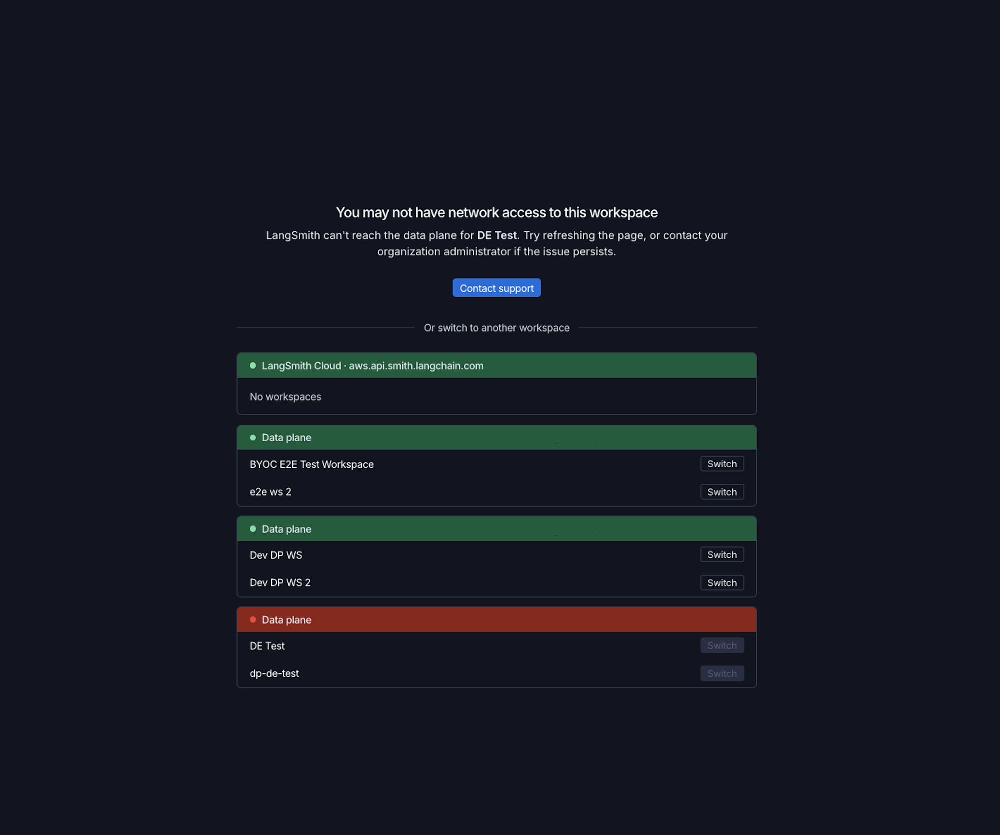

本页介绍 AWS 上的 BYOC。有关 GCP 上的 BYOC，请参阅 [GCP 上的 BYOC 入门](/langsmith/byoc-onboarding-gcp)；有关 Azure 上的 BYOC，请参阅 [Azure 上的 BYOC 入门](/langsmith/byoc-onboarding-azure)。

开始之前，请先查看[前提条件](/langsmith/byoc#prerequisites)。

默认情况下，LangChain 会为你的 data plane 创建一个 VPC。如果你想自己创建和管理网络，请在下方创建 IAM role 和 data plane 之前，遵循[在 AWS 上自带 VPC](/langsmith/byoc-byovpc-aws)。

<Steps>

<Step title="Enable BYOC on your organization">
在位于 [aws.smith.langchain.com](https://aws.smith.langchain.com) 的 LangSmith on AWS 中创建一个组织，或复用现有组织。

将你的组织 ID 发送给 LangChain 团队以启用 BYOC。
</Step>

<Step title="Create the IAM role">
LangChain 会提供 IAM role 的 external ID。前往 **Settings > Data Planes**，使用 **Data Planes** 标题旁的复制按钮复制它。

使用复制的 external ID，在你的 AWS 账户中应用 [`langsmith-byoc-role` Terraform module](https://github.com/langchain-ai/terraform/tree/main/modules/byoc/aws/langsmith-byoc-role)。这会创建 LangChain 用于预置和管理 data plane 的跨账户角色。该角色的信任策略必须在 `ExternalId` 条件中使用此值。

对于 BYOVPC，请设置 `allow_vpc_creation_permissions = false`，并在 `vpc_ids` 中提供你的 VPC ID。参见 [Create the reduced-permission IAM role](/langsmith/byoc-byovpc-aws#create-the-reduced-permission-iam-role)。

要使用你自己的 KMS keys 加密 data plane，还需设置 `cmk_service_key_arns`。参见 [Bring your own keys](/langsmith/byoc-byok-aws)。

<Note>
LangChain 建议使用一个专用于 LangSmith BYOC 的全新 AWS 账户。
</Note>

</Step>

<Step title="Create the data plane">
前往 **Settings > Data Planes**，使用以下参数创建一个 data plane：

- **名称**：小写字母、数字和连字符，最多 24 个字符。
- **AWS region**：[受支持的 regions](/langsmith/byoc#regions-and-cloud-providers) 之一。
- **AWS IAM role ARN**：你在上一步中创建的角色的 ARN，LangSmith 会在你的账户中代入该角色。

在 **Configuration** 下，默认设置适用于大多数 data plane。你可以更改以下设置：

- **Network**：默认情况下，LangSmith 会根据私有 RFC 1918 CIDR 范围（从 `/16` 到 `/18`，例如 `10.20.0.0/16`）创建 VPC。要使用你自己的 VPC，请选择 **Use existing VPC** 并提供 [VPC 和子网 ID](/langsmith/byoc-byovpc-aws#supply-the-vpc-and-subnet-ids)。Load balancer 默认为 **Private**，只能从你的 VPC 内部访问。选择 **Internet-facing** 可为你的应用提供公共 endpoint。使用你自己的 VPC 时，面向互联网的 load balancer 需要公有子网 ID。
- **IAM roles**：默认情况下，LangSmith 会创建 data plane IAM roles。要使用你创建的 role，请选择 **Use existing IAM roles**，并遵循 [Bring your own IAM roles](/langsmith/byoc-byoiam-aws)。
- **Encryption keys**：默认情况下，AWS 托管的密钥会加密静态数据。要使用你自己的 KMS keys，可以选择一个 key 用于所有服务，也可以为每个服务分别选择 key。参见 [Bring your own keys](/langsmith/byoc-byok-aws)。
- **Sandboxes**：默认关闭。开启后可运行 [sandboxes](/langsmith/sandboxes)，Engine 和部分 evaluators 需要它。
- **EKS API access**：新 data plane 默认通过 PrivateLink 访问 EKS API。
- **Tags**：最多 40 个自定义 tags，应用于 LangSmith 创建的 AWS 资源。Keys 必须唯一，值可以为空。AWS 和 LangSmith 系统 tags 为保留项。
</Step>

<Step title="Wait for provisioning">
LangChain 会代表你预置基础设施。Data plane 会从 `Requested` 转到 `Provisioning`，再到 `Active`。

对于 BYOVPC，LangSmith 会在预置之前验证你的 VPC 和子网，然后在你的 VPC 内创建工作负载基础设施。

<Note>
一个 data plane 的端到端预置大约需要 60 到 90 分钟。
</Note>

在 **Settings > Data Planes** 中跟踪其状态。如果 data plane 转换为 `Provisioning Failed`，请联系 LangChain 团队。
</Step>

<Step title="Set up private connectivity">
Data plane 默认以私有 endpoint 预置，因此你需要私有连接方式才能访问它，例如 Tailscale、AWS PrivateLink 或 VPC peering。

API URL 可以在 **Settings > Data Planes** 下找到。

如果打开 workspace 后看到以下界面，说明你的机器无法通过网络安全访问该 workspace 的 data plane。LangSmith frontend 在浏览器中运行，并直接调用 data plane，因此你的机器必须位于能够访问 data plane 私有 endpoint 的网络上。请通过你的私有连接方式接入，然后刷新页面。

在这个界面上，你可以切换到位于可访问 data plane 上的 workspace，该 workspace 也可以是 Cloud workspace。
</Step>

<Step title="Create workspaces">
新 data plane 内会自动预置一个名为 `dp-<data_plane_name>` 的 workspace。在 data plane 可访问之前，它无法被使用。

你可以在 data plane 中创建其他 workspaces。创建每个 workspace 时，请选择目标 data plane：一个 workspace 恰好属于一个 data plane，而一个 data plane 可以容纳多个 workspaces。

<Warning>
创建 workspace 时，请仔细选择正确的 data plane。Workspace 在创建后无法移动到另一个 data plane。
</Warning>
</Step>

<Step title="(Optional) Migrate existing data">
如果你是从现有的 LangSmith Cloud 或 [self-hosted](/langsmith/self-hosted) 实例迁移过来，用户、角色、datasets、prompts、experiments、annotation queue 配置、automation rules、dashboards 以及 Fleet 资源可以复制过来。AWS 上支持 trace 迁移，请联系 LangChain 团队安排。

更多信息，请参阅 [迁移到 BYOC](/langsmith/byoc-migration)。
</Step>

</Steps>

## 下一步

- [使用你的 data plane](/langsmith/byoc-usage)将应用和 API 客户端指向正确的 endpoint。
- [BYOC 架构](/langsmith/byoc-architecture-aws)介绍了 LangChain 会预置哪些资源，以及各 plane 之间如何通信。
