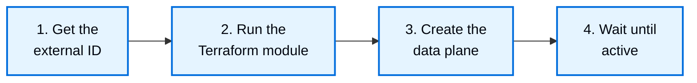

GCP 上的 BYOC 会在你的 GCP 项目中运行 LangSmith data plane，control plane 运行在 [smith.langchain.com](https://smith.langchain.com) 的 LangSmith 美国 region。你需要先创建 LangSmith 用于预置的 service account，然后使用 LangSmith API 创建 data plane。有关 AWS 上的 BYOC，请参阅 [BYOC 入门](/langsmith/byoc-onboarding-aws)。

<Note>
GCP 上的 BYOC 处于 [beta](/langsmith/release-stages) 阶段。输入和行为可能在不同版本之间发生变化。
</Note>

有关 LangSmith 在你的项目中部署的内容以及它获得的访问权限，请参阅 [GCP 上的 BYOC 架构](/langsmith/byoc-architecture-gcp)。

## 开始之前

你需要以下条件：

- **在你的组织上启用 BYOC**：在 [smith.langchain.com](https://smith.langchain.com) 的 LangSmith 中创建一个组织，或复用现有组织，然后将其组织 ID 发送给 LangChain 团队以启用 BYOC。
- **一个组织管理员**：创建 data plane 需要 organization admin 角色，以及该用户的 API key。
- **一个用于 data plane 的 GCP 项目**：请使用仅存放 LangSmith 资源的项目。provisioner 的大多数权限仅适用于名称以 `langsmith-` 开头的资源，但有些权限覆盖整个项目。如果该项目还存放其他资源，请在[第 2 步](#step-2-run-the-terraform-module)中设置 `byo_iam = true`。该项目必须尚未有 `managed_by` 标签键，并且只能包含一份 Terraform module。详细信息请参阅 [LangChain 可以访问和无法访问的内容](/langsmith/byoc-architecture-gcp#what-langchain-can-and-cannot-access)。
- **该项目的权限**：创建 service accounts、授予项目 IAM 角色、启用 API 以及创建标签的权限。标签需要项目上的 Tag Administrator（`roles/resourcemanager.tagAdmin`）。
- **Terraform**：Terraform 1.11.0 或更高版本，并使用 Google provider 6.0 或更高版本、9.0 以下版本。
- **一个 GCP region**：GCP 上的 BYOC 可以在任意 GCP region 中运行。如果你需要的 region 尚未启用，请联系 LangChain 团队添加。
- **资源位置策略**：如果你的 GCP 组织限制了资源位置，请允许 data plane 所在的 region 和 `us-central1`。data plane 会在 `us-central1` 中创建指向 LangSmith 的 Private Service Connect endpoint。

## 设置 data plane



### Step 1. Get the external ID

前往 LangSmith 中的 **Settings > Data Planes**，使用 **Data Planes** 标题旁的复制按钮复制 external ID。不要自行编造该值。

### Step 2. Run the Terraform module

在你的项目中应用 [`langsmith-byoc-service-account` Terraform module](https://github.com/langchain-ai/terraform/tree/main/modules/byoc/gcp/langsmith-byoc-service-account)。该 module 会：

- 启用 data plane 使用的 API。如果你在其他地方管理项目的 API，请设置 `enable_apis = false`。
- 创建 provisioner service account `langsmith-byoc-provisioner`，并将其描述设置为你的 external ID。
- 为其授予自定义角色，其中仅包含预置和拆除所需的权限。其中大多数权限仅适用于名称以 `langsmith-` 开头的资源。
- 在项目中创建标签 `managed_by: langsmith`，并仅对带有该标签的 GKE cluster 授予 LangSmith control plane service account `roles/container.admin`。LangSmith 会为其创建的 data plane GKE cluster 和 Cloud SQL instance 打上标签，而 Postgres 设置账号的 Cloud SQL 权限仅适用于带标签的 instance。
- 允许 LangSmith control plane service account `byoc-crossplane@langchain-prod.iam.gserviceaccount.com` 通过 Service Account Token Creator 角色模拟它。该 module 不信任任何其他 LangSmith 身份。

```hcl
provider "google" {
  project = "<project-id>"
}

module "langsmith_byoc_service_account" {
  source = "github.com/langchain-ai/terraform//modules/byoc/gcp/langsmith-byoc-service-account?ref=v0.17.80"

  project_id                 = "<project-id>"
  crossplane_service_account = "byoc-crossplane@langchain-prod.iam.gserviceaccount.com"
  external_id                = "<external-id-from-langsmith>"
}

output "provisioner_service_account" {
  value = module.langsmith_byoc_service_account.provisioner_service_account
}
```

LangSmith 要求使用 v0.17.80 或更高版本的 module。如果你应用了更早的版本，请在 v0.17.80 或更高版本上重新应用该 module。

如果你要自行创建 data plane 的 service accounts 及其项目角色，请在项目中创建 data plane 之前设置 `byo_iam = true`。此时 provisioner 无法创建 service accounts 或更改项目 IAM 策略。如果项目中存放了不属于 LangSmith 的资源，请设置它。创建 data plane 时，请将 `byoiam_enabled` 设置为 `true`。更多信息，请参阅[自带 IAM](/langsmith/byoc-architecture-gcp#bring-your-own-iam)。

### Step 3. Create the data plane

LangSmith 会在预置过程中自动将你的项目添加到 Private Service Connect accept list。你无需将项目编号发送给 LangChain，也无需在创建 data plane 之前等待手动批准。

使用组织管理员的 API key，通过 LangSmith API 创建 data plane：

```bash
curl -X POST https://api.smith.langchain.com/orgs/current/data-planes \
  -H "X-API-Key: $LANGSMITH_API_KEY" \
  -H "X-Organization-Id: <organization-id>" \
  -H "Content-Type: application/json" \
  -d '{
    "name": "prod",
    "region": "<gcp-region>",
    "gcp_project_id": "<project-id>",
    "provisioner_service_account": "langsmith-byoc-provisioner@<project-id>.iam.gserviceaccount.com",
    "vpc_cidr": "10.80.0.0/16",
    "public_load_balancer": false
  }'
```

请求包含以下字段：

| 字段 | 规则 |
|-------|------|
| `name` | 最多 21 个字符：小写字母、数字和连字符。必须以字母开头，以字母或数字结尾，且不能以 `internal` 开头。在你的组织中必须唯一。 |
| `region` | data plane 的 GCP region。GCP 上的 BYOC 可以在任意 GCP region 中运行。如果你需要的 region 尚未启用，请联系 LangChain 团队添加。 |
| `gcp_project_id` | 来自[第 2 步](#step-2-run-the-terraform-module)的项目。 |
| `provisioner_service_account` | Terraform 输出 `provisioner_service_account`。它必须位于该项目中。 |
| `vpc_cidr` | LangSmith 创建的 VPC 的地址范围。从 `/16` 到 `/18` 的私有 RFC 1918 范围。它不得与 GKE pod 和 service 使用的 `192.168.0.0/17` 重叠。 |
| `public_load_balancer` | `true` 表示公有 endpoint。`false`（默认值）表示内部 endpoint。参见[选择公有或内部 endpoint](#choose-a-public-or-internal-endpoint)。 |
| `byoiam_enabled` | 可选。如果你使用 `byo_iam = true` 应用了该 module，则为 `true`。 |
| `sandboxes_enabled` | 可选。`true` 表示在 data plane 中部署 [LangSmith sandboxes](/langsmith/sandboxes)。默认为 `false`。 |

API 返回 `202`，并附带 data plane 的 `id`、`api_url` 和 `status`。在接受请求之前，LangSmith 会检查它能否模拟 provisioner，以及 provisioner 是否位于该项目中并带有你的 external ID。如果检查失败，响应中会指出问题。参见[排查创建错误](#troubleshoot-create-errors)。

### Step 4. Wait until active

LangSmith 会在你的项目中预置基础设施。data plane 状态会从 `requested` 转到 `provisioning`，再到 `active`。你可以在 **Settings > Data Planes** 中跟踪它，或使用 `GET /orgs/current/data-planes/<id>`。

<Note>
预置最多可能需要 3 小时。超过 3 小时后，状态会变为 `provisioning_failed`。如果出现这种情况，请联系 LangChain 团队。
</Note>

data plane 处于 active 状态后，其中会有一个名为 `dp-<data_plane_name>` 的 workspace 可用，你可以创建更多 workspaces。参见 [BYOC 入门](/langsmith/byoc-onboarding-aws)中的 **Create workspaces** 步骤。

## 使用你的 data plane

### 查找 data plane URL

data plane URL 就是 data plane 的 `api_url`：`https://<data plane ID 的前 8 个字符>.gcp.langchain-byoc.com`。你也可以在 **Settings > Data Planes** 中找到它。

要将应用和 API 客户端指向 data plane，请参阅 [BYOC 使用](/langsmith/byoc-usage)。

<a id="choose-a-public-or-internal-endpoint"></a>

### 选择公有或内部 endpoint

你可以在创建 data plane 时选择 endpoint 类型：

- **公有**：用户可以从互联网访问 data plane。
- **内部**（默认）：ingress 位于内部 load balancer 上，主机名仅在 data plane VPC 内解析。将你的网络连接到该 VPC，例如通过 VPC peering 或 Cloud VPN，并确保主机名可从你的网络解析。

data plane 的出站流量通过 Cloud NAT 以静态 IP 地址发出，因此你可以将 data plane 加入允许列表。

### 更改 data plane 设置

在 GCP 上，你可以更改维护窗口。Blob TTL、Fleet OIDC 和网络防火墙设置不可用。

维护窗口为 UTC 时间的两小时，且从整点开始，例如 `sun:07:00-sun:09:00`。它适用于 Cloud SQL 和 Memorystore，而它们的窗口持续一小时，因此 LangSmith 只使用起始时间。未设置时，由 Google 选择窗口。

```bash
curl -X PATCH https://api.smith.langchain.com/orgs/current/data-planes/<id> \
  -H "X-API-Key: $LANGSMITH_API_KEY" \
  -H "X-Organization-Id: <organization-id>" \
  -H "Content-Type: application/json" \
  -d '{"maintenance_window": "sun:07:00-sun:09:00"}'
```

GKE 节点会在 GKE `REGULAR` release channel 上自动升级。

<a id="troubleshoot-create-errors"></a>

## 排查创建错误

创建请求会返回以下错误码：

| 错误码 | HTTP | 原因 | 解决方法 |
|------|------|-------|-----|
| `gcp_permissions` | 403 | LangSmith 无法模拟 provisioner，或 provisioner 缺少某项权限。 | 应用 Terraform module，并检查 `crossplane_service_account`。 |
| `gcp_api_disabled` | 400 | 项目中某个必需的 API 已禁用。 | 启用消息中提到的 API，或保留 `enable_apis = true`。 |
| `gcp_project_not_found` | 400 | 项目不存在，或 provisioner 无法看到它。 | 检查 `gcp_project_id`。 |
| `gcp_service_account_not_found` | 400 | 项目中不存在 provisioner service account。 | 检查 `provisioner_service_account` 和 `gcp_project_id`。 |
| `gcp_provisioner_project_mismatch` | 400 | provisioner 位于另一个项目中。 | 使用该 module 在 data plane 项目中创建的 provisioner。 |
| `gcp_provisioner_not_owned` | 403 | provisioner 的描述不是你的 external ID。 | 使用 **Settings > Data Planes** 中的 external ID 重新应用该 module。 |
| `byoiam_validation` | 400 | `byoiam_enabled` 为 `true`，但项目中缺少 LangSmith service accounts。 | 使用 `byo_iam = true` 应用该 module。 |
| `gcp_policy_denied` | 403 | 组织策略拒绝了某个请求，例如资源位置限制。 | 在该策略中允许 data plane 所在的 region 和 `us-central1`。 |
| `gcp_throttled` | 429 | GCP 对请求进行了限流。 | 等待一分钟后重试。 |
| `gcp_unavailable` | 502 | GCP 返回了错误。 | 等待一分钟后重试。 |
| `organization_admin_required` | 403 | 该 API key 所属用户不是组织管理员。 | 使用组织管理员的 API key。 |
| `organization_external_id_missing` | 409 | 你的组织尚未设置 BYOC。 | 联系 LangChain 团队。 |
| `data_plane_name_taken` | 409 | 你的组织中已有使用该名称的 data plane。 | 选择另一个 `name`。 |

字段校验失败的请求（例如 region 未启用，或 `vpc_cidr` 与 GKE 地址范围重叠）会返回 `400`，并附带字段名和原因。

## 删除 data plane

<Warning>
在 LangSmith 中删除 data plane 之前，不要销毁 Terraform module。LangSmith 需要使用 provisioner 来删除 data plane 资源。
</Warning>

要删除 data plane：

1. 使用 `DELETE /orgs/current/data-planes/<id>` 删除 data plane。你可以在它处于 `active`、`provisioning` 或 `provisioning_failed` 状态时删除它。LangSmith 会删除它在项目中创建的资源，但数据除外：Cloud Storage 存储桶及其对象会保留，Cloud SQL 备份的存续时间会超过 instance。参见[拆除会保留的内容](#what-teardown-keeps)。
1. 等待 data plane 从 **Settings > Data Planes** 中消失。
1. 如果没有其他 data plane 使用该项目，请运行 `terraform destroy`。

### 拆除会保留的内容

拆除会在你的项目中保留 data plane 的数据：

- **Cloud Storage 存储桶**：存储桶及其对象会保留。其标签包含 data plane ID。
- **最终的 Cloud SQL 备份**：Cloud SQL 在删除 instance 时会创建一份最终备份，并保留 365 天。
- **自动 Cloud SQL 备份**：instance 的自动备份会保留，并每天过期一份。

LangSmith 之后不会删除它们，`terraform destroy` 也不会。当你不再需要它们时，请自行删除。

## 获取帮助

遇到问题时，请[联系 LangChain 支持](https://support.langchain.com)，并提供以下信息：

- 你的组织 ID 和 data plane 名称。
- 你执行了哪些操作，以及发生了什么。
- 错误消息、截图和时间戳。
- 如果是预置问题：你的 GCP 项目 ID、项目编号和 region。

## 另请参阅

- [GCP 上的 BYOC 架构](/langsmith/byoc-architecture-gcp)
- [BYOC 概览](/langsmith/byoc)
- [BYOC 使用](/langsmith/byoc-usage)
