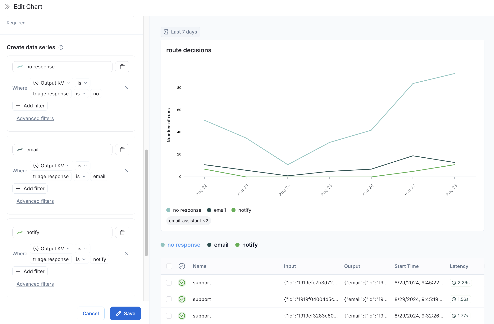

Dashboards 会汇总你的 [trace](/langsmith/observability-concepts#traces) 数据，帮助你发现趋势并监控 agents 的健康状况。在 [LangSmith UI](https://smith.langchain.com) 中，可以在 **Monitoring** 页面的 **Analytics** 标签页找到 prebuilt dashboards，并在侧边栏 **Workspace** 下的 **Dashboards** 页面找到 custom dashboards。

LangSmith 提供两种 dashboard：

- **Prebuilt dashboards**：为每个 [agent environment](/langsmith/agent-environments) 自动生成。
- **Custom dashboards**：可根据自身需求配置的图表集合。根据你的[平台设置](/langsmith/platform-setup)，有两种体验可用：
    - [**Custom dashboards**](#custom-dashboards)：适用于 LangSmith Cloud US，以及[查询 SmithDB](/langsmith/self-host-smithdb-features) 的 LangSmith Self-hosted 安装。
    - [**Custom dashboards (legacy)**](#custom-dashboards-legacy)：适用于 LangSmith Cloud EU/APAC，以及查询 ClickHouse 的 LangSmith Self-hosted 安装。

## Prebuilt dashboards

Prebuilt dashboard 会覆盖关键指标，例如 trace count、error rate 和 token usage。要打开某个 environment 的 prebuilt dashboard，请点击其 **Tracing** 页面右上角的 **Dashboard** 按钮。

**Monitoring** 的 **Analytics** 标签页需要一个 agent，其 dashboard 选择器会把两种 dashboard 类型拆分到不同的标签页：**Environments** 列出 agent 各个环境的 prebuilt dashboard，**Custom** 列出带有该 agent [资源标签](/langsmith/set-up-resource-tags)的 custom dashboard。没有该标签的 custom dashboard 不会出现在 agent 的选择器中。

### Dashboard 分区

Prebuilt dashboard 包含以下几个部分：

| Section | What it shows |
| :------ | :------------ |
| Traces | Trace count、latency 和 error rate。[trace](/langsmith/observability-concepts#traces) 是与单次操作相关的一组 [runs](/langsmith/observability-concepts#runs)。例如，如果一次用户请求触发了某个 agent，那么该 agent 调用过程中的所有 run 都属于同一个 trace。 |
| LLM Calls | LLM call count 和 latency。包括所有 run type 为 `"llm"` 的 run。 |
| Cost & Tokens | token count 和 cost 的总量，以及按 trace 平均后的数据，并按 token type 拆分。cost 通过 [LangSmith's cost tracking](/langsmith/log-llm-trace#provide-token-and-cost-information) 计算。 |
| Tools | 按 tool name 拆分的 tool run 数量、error rate 和 latency 统计。包括所有 run type 为 `"tool"` 的 run。仅展示出现频率最高的前 5 个 tool。 |
| Run Types | 针对 root run 的直接子 run，展示数量、error rate 和 latency 统计。这有助于理解 agent 的高层执行路径。仅展示出现频率最高的前 5 个 run name。 |
| Feedback Scores | 对出现频率最高的前 5 类 feedback 做聚合统计。图表会对数值型 feedback 展示平均分，对分类型 feedback 展示各类别计数。 |

### Group by

使用 group by 按对你的 agent 重要的 [run tag 或 metadata](/langsmith/add-metadata-tags) key 拆分数据。全局 group by 设置位于 dashboard 右上角，并会应用于除 **Tool** 和 **Run Type** 之外的所有图表，因为这两个图表已经应用了 group by。

<Note>为 run 添加 metadata 时，我们建议在 trace 上也添加相同 metadata，同时在具体 run 上也添加，例如 LLM call。Metadata 和 tag 不会自动在 parent run 与 child run 之间传递。如果你希望既能在 trace 图表中按某个 metadata key 分组，也能在 LLM call 图表中按同一个 key 分组，那么 trace，也就是 root run，和 LLM run 都必须分别附加该 [metadata](/langsmith/add-metadata-tags)。</Note>

## Custom dashboards

<Note>适用于 LangSmith [Cloud](/langsmith/cloud) US，以及[查询 SmithDB](/langsmith/self-host-smithdb-install#step-6-switch-queries-to-smithdb) 的 LangSmith [Self-hosted](/langsmith/self-hosted) 安装。</Note>

创建一组定制图表，用来追踪对你的 agents 最重要的指标。

### 创建新 dashboard

1. 在侧边栏的 **Workspace** 下，选择 **Dashboards**。
1. 点击 **+ Dashboard**。
1. 为 dashboard 填写名称和描述。
1. 点击 **Create**。

### 向 dashboard 添加 charts

1. 在某个 dashboard 内，点击 **+ New Chart** 按钮，打开图表创建面板。
1. 使用面板顶部的 **Edit** 图标，为 chart 填写名称和描述。

### Chart 配置

#### 从模板开始（可选）

要从模板开始，请选择其中一个模板，其中包含一些常见的可观测性用例：

- 随时间变化的 error rate
- 按 model 统计的平均 latency
- Run 数量
- 随时间变化的 token usage
- 成本最高的 models

你也可以使用 **Search templates** 查找其他模板。

#### 选择数据源

打开 **+ Select agent or dataset** 来查找数据源。使用弹出框顶部的标签页在两种数据源类型之间切换：**Tracing** 和 **Datasets**。

- **Tracing**：每张图表可添加一个或多个 agent environment。LangSmith 会把所有选中的 environment 中的 run 汇总到一个集合中，而不是分别展示。如果需要按 environment 拆分结果，请使用 [Group by](#filter-and-group)。
- **Datasets**：每个图表只能选择一个 dataset。
  - 选择第二个 dataset 会静默替换前一个。
  - 图表的数据来源要么是 environments，要么是 dataset，不能同时使用两者。当已选中 environments 时选择 dataset，或反之，都会清除已有的选择。

#### 选择 metric

从下拉菜单中选择一个 metric。选项会按你正在度量的内容分组：

| Metric | Description | Aggregations |
| :----- | :---------- | :----------- |
| Count | run 数量。 | — |
| Latency | 对 `latency_seconds` 做聚合。 | Average、Percentile（p50 或 p99） |
| Time to first token | 对 `first_token_seconds` 做聚合。 | Percentile（p50 或 p99）、Average |
| Tokens | 选择 Total、Input 或 Output tokens。 | Sum、Average、Percentile |
| Cost | 选择 Total、Input 或 Output 成本。 | Sum、Average、Percentile |
| Feedback score | 选择一个 feedback key。 | Average、Minimum、Maximum |
| Ratio | 定义分子和分母，二者都是带有各自 filter 的 metric。适用于 error rate、LLM run 占比等。 | — |

如需使用多个 metric 进行过滤，请阅读下面的 [Filter and group](#filter-and-group) 一节。

#### 过滤与分组

使用 filter 精确控制图表中显示的数据，并使用 group 将其拆分为多条 series。

**filters** 出现的位置取决于图表包含多少个 metric：

- **Single metric**：**Filter & group** 面板中有一个 **+ Filter**（`where` 槽位）。它作用于该 metric。
- **Multiple metrics 或 ratio**：每个 metric（或 ratio）都会在 **Pick a metric** 下各自的卡片中内联显示一个 **+ Filter**。不存在单独的图表级 filter。

添加 filter 时，默认在 [run](/langsmith/observability-concepts#runs) 级别进行过滤。要扩大范围，请打开 filter 选择器，然后打开底部的 **Advanced** 子菜单，并选择：

- **Trace filter**：在 [trace](/langsmith/observability-concepts#traces)（root-run）级别过滤。
- **Tree filter**：只要 trace 树中有任意 run 匹配条件，就包含整个 trace 树。

当前生效的范围会作为后缀显示在 **Advanced** 项上（例如 **Advanced Tree Filter**）。点击它旁边的 **X** 可重置回普通的 run filter。

Dataset 数据源不提供 run/trace/tree filter。数据范围由所选 dataset 决定。有关 filter 语法，请参阅 [filtering traces (ClickHouse)](/langsmith/filter-traces-in-application)。

**Grouping** 可通过以下两种方式之一，在同一张图表上创建多条 series：

1. **Group by**：根据一个属性自动将数据拆分为多条 series。可用属性：Run Name、Run Type、Tag、Environment、[Metadata](/langsmith/add-metadata-tags)（可带 `metadata.ls_model_name` 这样的路径）以及 Feedback Key（仅在使用 **Count** metric 时可用）。分组会按频率排序，并最多保留前 20 个。
1. **Data series**：使用 **Add another metric** 按钮手动添加 metric。每条 series 都可以带有自己的 filter，因此你可以在同一张图上比较，例如“status 为 error 的 count”与“status 为 success 的 count”。

<Note>
Group by 与 multi-metric 在同一张图表上互斥。只允许一个 group-by 属性。Donut、ranked bar 和 table 图表不支持多条 data series（多余的会被丢弃或阻止）。
</Note>

#### 选择可视化类型

选择一种可视化类型：

- Line
- Stacked bar
- KPI
- Ranked bar
- Donut
- Table

### 保存并管理 charts

- 点击 **Save**，将 chart 保存到 dashboard 中。
- 点击图表右上角的三点按钮，可编辑或删除某个 chart。
- 点击图表右上角的三横按钮，并选择 **+ Clone**，即可克隆 chart。这会打开一个新的 chart 创建面板，并预填原 chart 的全部配置。

### 排列 dashboard

- **Reorder charts**：拖动任意 chart 的标题栏，即可在网格中移动它。
- **Dashboard time range**：在 dashboard 顶部统一设置。除非某个 chart 覆盖了自己的 bucket size，否则所有 chart 都使用该时间范围。
- **Clone a dashboard**：使用 dashboard 标题栏中的复制图标。克隆 [prebuilt dashboard](#prebuilt-dashboards) 会将其图表转换为可完全编辑的 custom chart。

## Custom dashboards (legacy)

<Note>适用于 LangSmith [Cloud](/langsmith/cloud) EU/APAC 客户，以及查询 ClickHouse 的 LangSmith [Self-hosted](/langsmith/self-hosted) 安装。</Note>

创建一组定制图表，用来追踪对你的 agents 最重要的指标。

### 创建新 dashboard

1. 在侧边栏的 **Workspace** 下，选择 **Dashboards**。
1. 点击 **+ Dashboard**。
1. 为 dashboard 填写名称和描述。
1. 点击 **Create**。

### 向 dashboard 添加 charts

1. 在某个 dashboard 内，点击 **+ New Chart** 按钮，打开图表创建面板。
1. 为 chart 填写名称和描述。
1. 配置图表。

### Chart 配置

#### 选择 environments 并过滤 runs

- 选择一个或多个 agent environment，作为要追踪指标的数据来源。
- 使用 **Chart filters** 区域来收窄匹配的 run。这些 filter 会作用于该图表中的所有数据系列。更多信息请参阅 [filtering traces (ClickHouse)](/langsmith/filter-traces-in-application)。

#### 选择 metric

- 从下拉菜单中选择一个 metric，用作图表 y 轴。在选定 environment 和 metric 后，LangSmith 会显示图表预览及其匹配的 run。
- 对于某些 metric，例如 latency、token usage、cost，LangSmith 支持对相同单位的多个 metric 进行对比。例如，你可能希望在一张图中同时查看 prompt token 和 completion token。每个 metric 会作为一条独立曲线显示。

#### 拆分数据

有两种方式可以在一张图里生成多条 series，也就是多条线：

1. **Group by**：按 [run tag 或 metadata](/langsmith/add-metadata-tags)、run name 或 run type 分组。Group by 会根据所选字段自动拆分为多条 series。请注意，group by 默认为出现频率最高的前 5 项，最多可配置到 20 项。
1. **Data series**：手动定义多条 series，并为每条 series 单独配置 filter。适合在同一 metric 下比较更细粒度的数据。

#### 选择 chart 类型

- 你可以选择使用 line chart 或 bar chart 进行可视化。

### 保存并管理 charts

- 点击 **Save**，将 chart 保存到 dashboard 中。
- 点击图表右上角的三点按钮，可编辑或删除某个 chart。
- 点击图表右上角的三横按钮，并选择 **+ Clone**，即可克隆 chart。这会打开一个新的 chart 创建面板，并预填原 chart 的全部配置。

## 链接到 dashboard

你可以从 agent environment 直接链接到任意 dashboard。默认会选中该 environment 的 prebuilt dashboard。如果你想链接到某个 custom dashboard：

1. 在 agent environment 中，点击 **Dashboard** 按钮旁边的三点菜单。
1. 选择一个 dashboard，并将其设为新的默认 dashboard。

## 示例：user-journey monitoring

你可以使用 monitoring chart 来映射 agent 在某个特定 node 上做出的决策。

以一个 email assistant agent 为例。在某个 node 上，它会对邮件做出如下决策：

- 回发邮件。
- 通知用户。
- 无需回复。

你可以创建一个图表，用来追踪并可视化这些决策的分布。

**创建图表**

1. **Metric Selection**：选择 `Run count` 作为 metric。
1. **Chart Filters**：添加一个 tree filter，把所有名称为 `triage_input` 的 trace 纳入图表。这意味着你只统计经过 `triage_input` node 的 trace。再添加一个 chart filter，要求 `Is Root` 为 `true`，这样 count 就不会被 trace 内部 node 数量放大。
1. **Data Series**：为 `triage_input` node 上可能出现的每种决策都创建一条 data series。该决策结果保存在输出对象的 `triage.response` 字段中，其值可能是 `no`、`email` 或 `notify`。每一种决策都会在图表中生成一条单独的 data series。
   

这样，你就可以随时间可视化 `triage_input` node 上做出的决策分布了。
