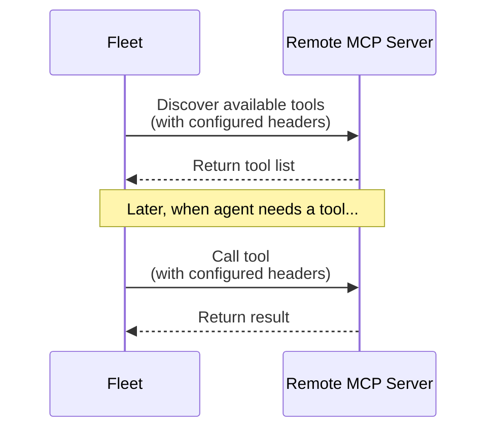

你可以将 LangSmith Fleet 连接到远程 MCP servers，从而为 agents 扩展更多工具和集成能力。本页介绍如何添加自定义 MCP servers，并提供一些常见远程 servers 的配置说明。

[MCP（Model Context Protocol）server](https://modelcontextprotocol.io/docs/getting-started/intro) 会暴露 agent 在运行时可调用的工具。

远程 MCP server：

- 运行在 LangSmith 之外，通常通过 HTTPS 提供服务。
- 自行负责认证和授权。
- 充当你的 agent 与外部系统之间的桥梁。

LangSmith Fleet 本身并不会执行这些工具，它只会把请求转发给 MCP server，并把结果返回给 agent。

### 工作原理

- Fleet 通过标准 MCP 协议从远程 MCP servers 发现工具。
- 你在 workspace 中配置的 headers，会在抓取工具或调用工具时自动附带。Headers 是随每个 HTTP 请求发送到 MCP server 的键值对，通常用于认证（例如 API key 或 bearer token），也可以用来传递配置信息、内容类型或自定义 metadata。
- 远程 server 暴露出来的工具，会与 Fleet 内置工具一起供 agent 使用。

**Runtime**：Fleet 会自动连接到你的 MCP server 并使用其中的工具。



## 添加远程 MCP server

你可以直接从 agent 配置页或 workspace settings 中添加 MCP servers。

<Note>
添加 MCP servers 需要 **MCP Server Create** 权限。Workspace 管理员可以在 workspace settings 中把该权限授予用户。
</Note>

### 添加到某个特定 agent

如果你想把远程 MCP server 添加到某个特定 agent：

<Steps>
  <Step title="Open the Connections drawer">
    打开你的 agent，然后在侧边栏中展开 **Connections** 抽屉。
  </Step>
  <Step title="Add the MCP server">
    1. 点击 **Add connection**，然后点击 **+ Add custom MCP**。
    1. 输入 server 名称和 URL，然后配置认证方式（参见[认证类型](#authentication-types)）。
  </Step>
  <Step title="Discover tools">
    Fleet 会从你的 MCP server 中发现可用工具，并让该 agent 可以使用它们。
  </Step>
</Steps>

### 添加到 workspace 中所有 agents

如果你想把远程 MCP server 添加到 workspace 中所有 agents：

<Tabs>
  <Tab title="From Fleet > Integrations">

    <Steps>
      <Step title="Navigate to Fleet > Integrations">
        在 LangSmith UI 中，进入 [**Fleet** > **Integrations**](https://smith.langchain.com/agents/tools) 标签页。
      </Step>

      <Step title="Add the server">
        1. 点击左侧边栏底部的 **+ Custom MCP**。
        1. 为这个 MCP server 填写 **Name**。
        1. 填写 MCP **URL**（例如 `https://api.example.com/mcp`）。
        1. 选择 **Authentication** 类型。更多信息请参阅[认证类型](#authentication-types)。
      </Step>

      <Step title="Save the server">
        点击 **Save server**。Fleet 会自动发现该 MCP server 暴露的工具，并让它们在你的 agents 中可用。配置好的 headers 会同时应用在工具发现请求和工具执行请求中。
      </Step>
    </Steps>
  </Tab>
  <Tab title="From workspace settings">
    <Steps>
      <Step title="Navigate to MCP server settings">
        在 LangSmith UI 中，进入 [Settings > MCP servers](https://smith.langchain.com/settings/workspaces/mcp-servers) 标签页。
      </Step>
      <Step title="Add the server">
        点击 **Add server**，输入 server 名称和 URL，然后配置认证方式（参见[认证类型](#authentication-types)）。
      </Step>
      <Step title="Save the server">
        点击 **Save server**。Fleet 会自动发现该 MCP server 暴露的工具，并让它们在你的 agents 中可用。配置好的 headers 会同时应用在工具发现请求和工具执行请求中。
      </Step>
    </Steps>
  </Tab>
</Tabs>

### 认证类型

请根据 server 的要求选择认证类型：

- **Static Headers**：添加每次请求都会发送的键值对。最常见的模式是使用 Authorization bearer token：
    - **Key**：`Authorization`
    - **Value**：`Bearer API_KEY`

    <Info>
    如果你的 MCP server 还需要其他认证或配置参数，也可以添加多个 headers。每个 header 键值对都会随发送给 server 的每一次请求一起带上。
    </Info>

- **OAuth 2.1 (Auto)**：适用于通过动态 client registration（DCR）支持 OAuth 的 servers。Fleet 会为你注册一个 client，并提示你使用该服务对应的账号登录。此选项无需任何设置，因此当 server 支持时请优先选择它。
- **OAuth 2.1 (Manual)**：适用于支持 OAuth 但不支持动态 client registration 的 servers。选择你事先[注册](#register-an-oauth-provider)好并带有 client ID 和 secret 的 OAuth provider。该 provider 使用以下两种授权类型之一：
    - **Authorization Code**：每个用户使用自己在该服务中的账号登录。该 provider 必须启用 **PKCE**。
    - **Client Credentials**：agent 以你的应用身份进行机器对机器认证，因此无需用户登录。Fleet 在调用 server 时会从 provider 的 token URL 请求一个新的 access token。

### 注册 OAuth provider

OAuth provider 会在组织级别存储你的 OAuth 应用的 client ID、secret 和 endpoints。注册一次 provider，之后每次添加使用 **OAuth 2.1 (Manual)** 的 MCP server 时都可以选择它。

<Note>
管理 OAuth providers 需要 `workspaces:manage` 权限，该权限包含在 [Workspace Admin](/langsmith/rbac#workspace-admin) 角色中。
</Note>

<Note>
在自托管 LangSmith v0.17 上，Client Credentials 授权需要 v0.17.32 或更高版本（Helm chart 0.17.5 或更高版本）。还需要在 `hostBackend` 和 `platformBackend` 上都设置 `FF_FLEET_OAUTH_CLIENT_CREDENTIALS_ENABLED=true`，例如通过 `hostBackend.deployment.extraEnv` 和 `platformBackend.deployment.extraEnv` 设置。
</Note>

要注册 OAuth provider：

<Steps>
  <Step title="在你的身份提供方创建 OAuth 应用">
    在你的身份提供方（例如 GitHub 或 Google）中创建一个 OAuth 应用。记下它的 client ID 和 client secret。

    对于 Authorization Code 授权，请将应用的重定向（回调）URL 设置为：

    ```txt
    https://<your-langsmith-host>/host-oauth-callback/<provider-id>
    ```

    将 `<provider-id>` 替换为你在下一步中选择的 Provider ID。Client Credentials 授权不使用重定向 URL。
  </Step>
  <Step title="在 LangSmith 中注册该 provider">
    前往 **Settings** > **OAuth providers**，点击 **OAuth Provider**。为每个 provider 填写以下字段：

    - **Provider ID**：由字母、数字、连字符和下划线组成的短标识符（例如 `github`）。此值会出现在重定向 URL 中。
    - **Display Name**：人类可读的名称（例如 `GitHub OAuth`）。
    - **Client ID** 和 **Client Secret**：来自你创建的 OAuth 应用。
    - **Grant Type**：**Authorization Code** 或 **Client Credentials**。
    - **Token URL**：provider 的 token endpoint（例如 `https://example.com/oauth/token`）。

    对于 **Authorization Code**，还需要设置：

    - **Authorization URL**：provider 的授权 endpoint（例如 `https://example.com/oauth/authorize`）。
    - **Enable PKCE**：启用此项。添加手动 OAuth MCP server 时，只有启用了 PKCE 的 provider 才会出现。
    - **Scope**（位于 **Advanced** 下）：可选。覆盖发送到授权 URL 的 `scope` 参数。

    对于 **Client Credentials**，还需要设置：

    - **Token Authentication**：Fleet 将 client ID 和 secret 发送到 token URL 的方式，为 **HTTP Basic**（默认）或 **Request body**。
    - **Scope**（位于 **Advanced** 下）：可选。随 token 请求发送的、以空格分隔的 scopes。
    - **Audience**（位于 **Advanced** 下）：可选。某些 providers（例如 Auth0）需要它。
  </Step>
  <Step title="添加 server 时选择该 provider">
    当你[添加 MCP server](#add-a-remote-mcp-server) 时，选择 **OAuth 2.1 (Manual)** 并选择你注册的 provider。对于 Authorization Code provider，每个用户连接自己的账号。对于 Client Credentials provider，Fleet 以 agent 身份进行授权，因此不会提示任何用户进行连接。
  </Step>
</Steps>

## 更新 MCP server URL

<Warning>
修改自定义 MCP server 的 URL 会导致所有使用该 server 工具的 agents 失效。
</Warning>

Fleet 是按 MCP server URL 来保存工具引用的。如果你更新了某个自定义 MCP server 的 URL，现有 agents 在尝试调用这些工具时会失败，因为保存下来的 URL 已经不再匹配。

如果要更新 MCP server URL：

1. 在 workspace settings 中更新你的 MCP server URL。
2. 对于每个正在使用该 server 工具的 agent：
   - 从 agent 配置中移除受影响的工具。
   - 再重新添加这些工具（它们现在会引用新的 URL）。
3. 测试 agent，确认工具已恢复正常工作。

## 支持的 servers

如果要查看所有可用 MCP servers 及其配置细节，请前往 [Fleet > Integrations 标签页](https://smith.langchain.com/agents/tools)。
