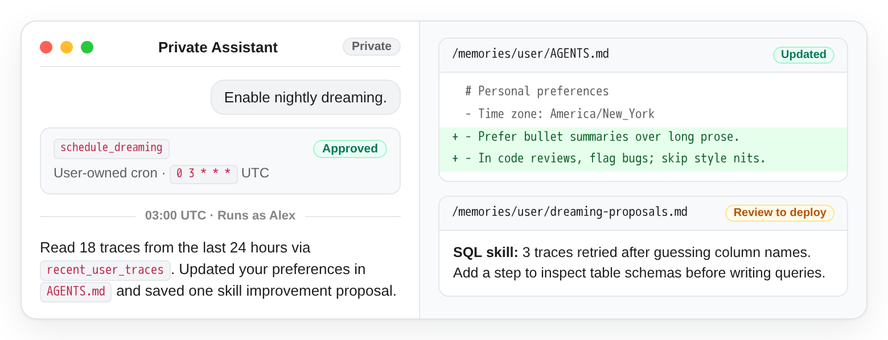
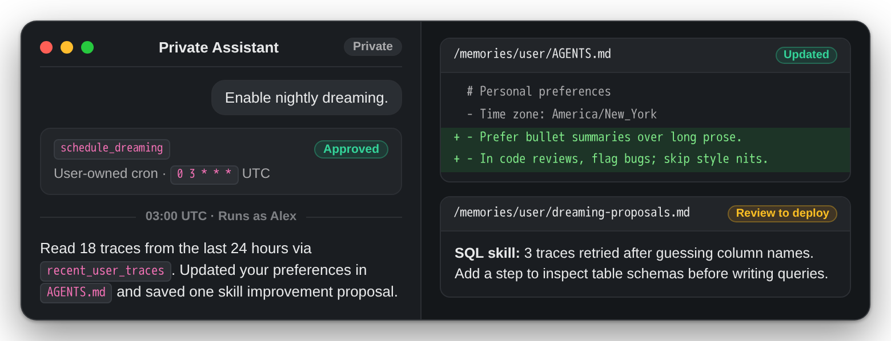

import ManagedDeepAgentsPublicBetaNote from '/snippets/langsmith/managed-deep-agents-public-beta-note.mdx';

Dreaming 是对 agent 过往工作的定期回顾。在此示例中，每个已选择加入的用户都会运行一个夜间 schedule，读取其最近的 traces，并更新其 user memory。

<ManagedDeepAgentsPublicBetaNote />

:::python
<Note>
此 Python 示例需要 `managed-deepagents>=0.10.4`、匹配的 `mda` CLI 以及 `langsmith>=0.10.15`。自托管 LangSmith 必须为 v0.16 或更高版本。
</Note>
:::

:::js
<Note>
此 TypeScript 示例需要 `managed-deepagents` 0.10.4 或更高版本、匹配的 `mda` CLI 以及 `langsmith` 0.11.7 或更高版本。自托管 LangSmith 必须为 v0.16 或更高版本。
</Note>
:::





## 在开始之前

- 配置 [identity](/langsmith/managed-deep-agents-identity)，使每个人以自己的身份登录。User memory 和按用户查询 traces 都要求调用方是已登录的人。
- 将每个人的 traces 路由到其各自的 LangSmith tracing project。
- 将 `DREAM_TRACE_PROJECTS` 添加到 `.env`，并用单引号包裹，以便 `mda deploy` 保留 JSON 中的双引号。将 MDA principal ID 映射到 project ID，并确保 deployment 的 LangSmith 凭据对这些 project 具有读取权限：

```text .env
DREAM_TRACE_PROJECTS='{"<principal-id>": "<project-id>"}'
```

## 添加个人 memory

在项目根目录声明 [user memory](/langsmith/managed-deep-agents-memory)：

:::python
```python memory.py
from managed_deepagents import MemoryLayer, define_memory

memory = define_memory(user=MemoryLayer())
```
:::

:::js
```ts memory.ts
import { defineMemory, memoryLayer } from "managed-deepagents";

export const memory = defineMemory({ user: memoryLayer() });
```
:::

定时运行没有 channel 事件，因此当 run 没有 channel 来源时（例如定时运行和 Studio），请在 agent factory 中选择 user memory。在 channel 触发的 run 中省略 `memory` 会保留 MDA 的默认访问规则：在 Slack 私信中挂载 user memory，在共享 channel 中不挂载。为 `schedule_dreaming` 设置 interrupt 会在创建 schedule 前提示审批：

:::python
```python agent.py
from managed_deepagents import MemoryLayer, define_deep_agent, define_memory

from tools.dreaming import recent_user_traces, schedule_dreaming


def agent(runtime):
    extra = (
        {"memory": define_memory(user=MemoryLayer())}
        if runtime.thread is None or runtime.thread.origin is None
        else {}
    )
    return define_deep_agent(
        name="private-assistant",
        model="openai:gpt-6.1-sol",
        tools=[recent_user_traces, schedule_dreaming],
        interrupt_on={"schedule_dreaming": True},
        **extra,
    )
```
:::

:::js
```ts agent.ts
import {
  defineDeepAgent,
  defineMemory,
  memoryLayer,
  type ManagedServerRuntime,
} from "managed-deepagents";

import { recentUserTraces, scheduleDreaming } from "./tools/dreaming";

export function agent(runtime: ManagedServerRuntime) {
  return defineDeepAgent({
    name: "private-assistant",
    model: "openai:gpt-6.1-sol",
    tools: [recentUserTraces, scheduleDreaming],
    memory: runtime.thread?.origin ? undefined : defineMemory({ user: memoryLayer() }),
    interruptOn: { schedule_dreaming: true },
  });
}
```
:::

MDA 始终挂载已登录者本人的 memory，因此 prompt 无法读取其他人的 memory。

## 添加工具

`recent_user_traces` 最多读取当前用户过去一天的 25 条 traces。`schedule_dreaming` 会创建一个以该用户身份运行的夜间 schedule。

:::python
安装模型 provider 包（factory 定义不会自动安装 provider 包）：

```bash
uv add langchain-openai
```
:::

:::js
使用 `managed-deepagents` 0.10.4 时，请使用 npm：pnpm 可能解析出不兼容的 LangChain 版本。安装工具依赖项和模型 provider 包（factory 定义不会自动安装 provider 包）：

```bash
npm install langchain zod langsmith @langchain/openai
```
:::

:::python
```python tools/dreaming.py expandable
import json
import os
from datetime import datetime, timedelta, timezone

from langchain.tools import tool
from langsmith import Client
from managed_deepagents import ManagedDeepAgentRuntime

DREAM_PROMPT = """Read your recent traces with recent_user_traces. Save useful
preferences and recurring context to /memories/user/AGENTS.md, without secrets.
Write ideas for improving your instructions or skills to
/memories/user/dreaming-proposals.md."""


def trace_project(runtime: ManagedDeepAgentRuntime) -> str | None:
    principal = runtime.server_info.principal if runtime.server_info else None
    if principal is None or principal.kind != "person":
        return None
    return json.loads(os.environ["DREAM_TRACE_PROJECTS"]).get(principal.id)


@tool
async def recent_user_traces(runtime: ManagedDeepAgentRuntime) -> str:
    """Read the current person's traces from the last day."""
    if runtime.thread.origin is not None:
        return "Ask outside Slack or other channels, including DMs."
    project = trace_project(runtime)
    if project is None:
        return "No trace project for this person."
    records = []
    async for run in Client().runs.query(
        project_ids=[project],
        min_start_time=datetime.now(timezone.utc) - timedelta(days=1),
        is_root=True,
        selects=["INPUTS", "OUTPUTS"],
        page_size=25,
    ):
        records.append(json.dumps([run.inputs, run.outputs], default=str)[:6000])
        if len(records) == 25:
            break
    return "\n".join(records) or "No recent traces."


@tool
async def schedule_dreaming(runtime: ManagedDeepAgentRuntime) -> str:
    """Schedule a nightly trace review for the current person."""
    if runtime.thread.origin is not None:
        return "Ask outside Slack or other channels, including DMs."
    if trace_project(runtime) is None:
        return "No trace project for this person."
    item = await runtime.schedules.create(
        owner={"type": "user"},
        cron="0 3 * * *",
        timezone="UTC",
        prompt=DREAM_PROMPT,
    )
    return f"Created nightly dreaming schedule {item['id']}."
```
:::

:::js
```ts tools/dreaming.ts expandable
import { tool } from "langchain";
import { Client } from "langsmith";
import type { ManagedDeepAgentRuntime } from "managed-deepagents";
import { z } from "zod";

type DreamRuntime = Pick<ManagedDeepAgentRuntime, "serverInfo" | "thread" | "schedules">;

const DREAM_PROMPT = `Read your recent traces with recent_user_traces. Save useful
preferences and recurring context to /memories/user/AGENTS.md, without secrets.
Write ideas for improving your instructions or skills to
/memories/user/dreaming-proposals.md.`;

function traceProject(runtime: DreamRuntime): string | undefined {
  const principal = runtime.serverInfo?.principal;
  if (principal?.kind !== "person") return undefined;
  return JSON.parse(process.env.DREAM_TRACE_PROJECTS ?? "{}")[principal.id];
}

export const recentUserTraces = tool(
  async (_input, runtime) => {
    const managed = runtime as typeof runtime & DreamRuntime;
    if (managed.thread?.origin) return "Ask outside Slack or other channels, including DMs.";
    const project = traceProject(managed);
    if (!project) return "No trace project for this person.";
    const records: string[] = [];
    for await (const run of new Client().runs.query({
      project_ids: [project],
      min_start_time: new Date(Date.now() - 24 * 60 * 60 * 1000).toISOString(),
      is_root: true,
      selects: ["INPUTS", "OUTPUTS"],
      page_size: 25,
    })) {
      records.push(JSON.stringify([run.inputs, run.outputs]).slice(0, 6000));
      if (records.length === 25) break;
    }
    return records.join("\n") || "No recent traces.";
  },
  {
    name: "recent_user_traces",
    description: "Read the current person's traces from the last day.",
    schema: z.object({}),
  },
);

export const scheduleDreaming = tool(
  async (_input, runtime) => {
    const managed = runtime as typeof runtime & DreamRuntime;
    if (managed.thread?.origin) return "Ask outside Slack or other channels, including DMs.";
    if (!traceProject(managed)) return "No trace project for this person.";
    const item = await managed.schedules!.create({
      owner: { type: "user" },
      cron: "0 3 * * *",
      timezone: "UTC",
      prompt: DREAM_PROMPT,
    });
    return `Created nightly dreaming schedule ${item.id}.`;
  },
  {
    name: "schedule_dreaming",
    description: "Schedule a nightly trace review for the current person.",
    schema: z.object({}),
  },
);
```
:::

Trace 内容会传给模型，因此请为任何不应让模型看到的内容配置 [trace masking](/langsmith/mask-inputs-outputs)。

## 开始 Dreaming

[部署 agent](/langsmith/managed-deep-agents-deploy)、登录，然后在 channel 之外的直接对话中（例如 LangSmith Studio 或你自己的已登录 app，而不是 Slack 私信）要求它安排夜间 Dreaming。批准 `schedule_dreaming` 调用。每天夜间 UTC 03:00，agent 会回顾你的 traces 并更新 `/memories/user/AGENTS.md`。

部署后的 instructions 和 skills 在运行时为只读。要应用 `/memories/user/dreaming-proposals.md` 中的想法，请编辑项目中的 `instructions.md` 或该 skill，然后重新部署。要停止 Dreaming，请[删除该 schedule](/langsmith/managed-deep-agents-schedules#manage-schedules)。

## 扩展该模式

- 通过修改 cron 和查询时间窗口，改为回顾一周而非一天的 traces。
- 在部署前使用 [evals](/langsmith/managed-deep-agents-evals) 测试建议的 instruction 变更。
- 添加一个定义哪些内容值得记住的 [skill](/langsmith/managed-deep-agents-skills)，使回顾保持一致。

## 另请参阅

- [Schedules](/langsmith/managed-deep-agents-schedules)：管理用户拥有的周期性 runs。
- [Memory](/langsmith/managed-deep-agents-memory)：配置 durable memory 和访问策略。
- [Export traces](/langsmith/export-traces)：查询并分页获取 trace 数据。
