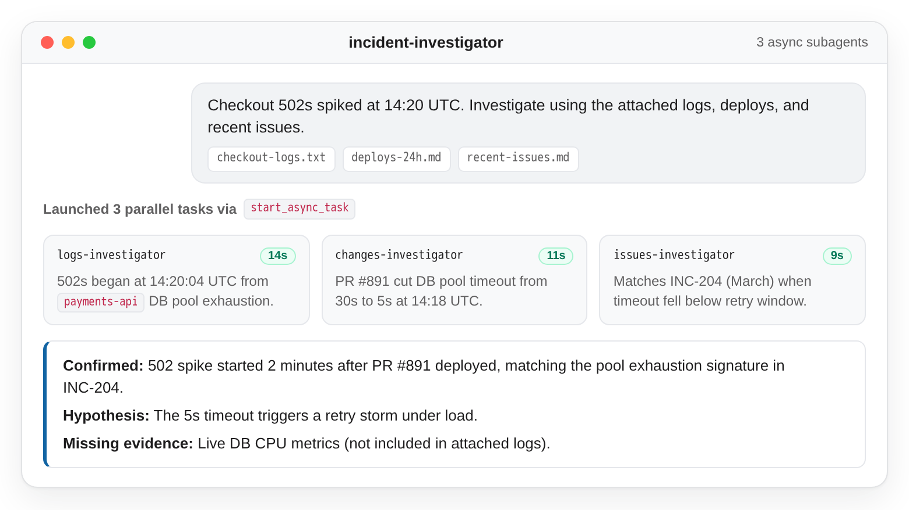
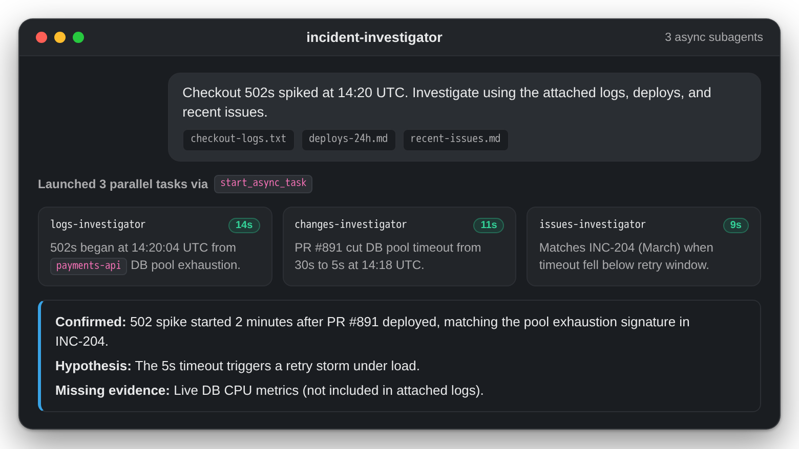

import ManagedDeepAgentsPublicBetaNote from '/snippets/langsmith/managed-deep-agents-public-beta-note.mdx';

Swarm 会把任务拆分给多个并行 subagents，并汇总它们的发现。在本示例中，主 agent 会启动三个专门的 [async subagents](/langsmith/managed-deep-agents-subagents#async-subagents) 并行调查事件，然后撰写一份报告。当并行任务的数量取决于请求时，主 agent 还可以使用内置的 `general-purpose` subagent [动态并行分派任务](#fan-out-dynamically)。

<ManagedDeepAgentsPublicBetaNote />

:::python
<Note>
本 Python 示例需要 `managed-deepagents>=0.10.4` 以及匹配的 `mda` CLI。
</Note>
:::

:::js
<Note>
本 TypeScript 示例需要 `managed-deepagents` 0.10.0 或更高版本，以及匹配的 `mda` CLI。
</Note>
:::





## 声明 subagents

从 [quickstart](/langsmith/managed-deep-agents-quickstart) 中的项目开始，并替换 agent 定义：

:::python
```python agent.py
from managed_deepagents import define_deep_agent

agent = define_deep_agent(
    name="incident-investigator",
    model="openai:gpt-6.1-sol",
    subagents=[
        {
            "name": "logs-investigator",
            "description": "Analyzes incident logs.",
            "system_prompt": "Find symptoms and timing in the logs. Cite sources.",
            "async": True,
        },
        {
            "name": "changes-investigator",
            "description": "Analyzes recent changes.",
            "system_prompt": "Find changes that could explain the incident. Cite sources.",
            "async": True,
        },
        {
            "name": "issues-investigator",
            "description": "Analyzes related issues.",
            "system_prompt": "Find similar past issues. Cite sources.",
            "async": True,
        },
    ],
)
```
:::

:::js
```ts agent.ts
import { defineDeepAgent } from "managed-deepagents";

export const agent = defineDeepAgent({
  name: "incident-investigator",
  model: "openai:gpt-6.1-sol",
  subagents: [
    {
      name: "logs-investigator",
      description: "Analyzes incident logs.",
      systemPrompt: "Find symptoms and timing in the logs. Cite sources.",
      async: true,
    },
    {
      name: "changes-investigator",
      description: "Analyzes recent changes.",
      systemPrompt: "Find changes that could explain the incident. Cite sources.",
      async: true,
    },
    {
      name: "issues-investigator",
      description: "Analyzes related issues.",
      systemPrompt: "Find similar past issues. Cite sources.",
      async: true,
    },
  ],
});
```
:::

Subagents 会继承主 agent 的 model 和 tools。Async subagent 只能看到自己的任务描述，看不到主 agent 的对话。

## 编写 instructions

替换 `instructions.md`：

```markdown instructions.md
# Incident investigator

For an incident, start logs-investigator, changes-investigator, and
issues-investigator as async tasks at the same time. Give each one the
relevant evidence from the request. When all three finish, write one report
that separates confirmed findings from hypotheses and lists missing evidence.
```

主 agent 使用 `start_async_task` 启动每项任务。任务在各自的 thread 中运行，并在每项任务完成时通知主 agent。

## 试用

使用 `mda dev` 运行 agent，或[部署它](/langsmith/managed-deep-agents-deploy)。在新对话中描述事件，并粘贴日志、近期变更和相关 issue。确认主 agent 同时启动全部三项任务，并汇总它们的发现。

<a id="fan-out-dynamically"></a>

## 动态并行分派任务

当并行任务的数量取决于请求时（例如为每个受影响的服务分别进行调查），无需预先声明 subagents。每个已部署或通过 `mda dev` 运行的 agent 都包含一个内置的 [`general-purpose`](/oss/deepagents/subagents#the-general-purpose-subagent) subagent，它会继承主 agent 的 model、tools 和 skills。

让主 agent 在一轮中启动多个 `general-purpose` 任务：后台运行使用 `start_async_task`，等待所有结果则使用 `task`：

```markdown instructions.md
When an incident spans multiple services, launch one `general-purpose` task
per service in the same turn. Include the service, time range, symptoms, and
expected output in each description, then combine the findings.
```

每项任务都在自己的上下文窗口中运行，看不到用户的消息，因此请在 `description` 中包含所有必要细节。

## 扩展该模式

- 添加只读 [tools](/langsmith/managed-deep-agents-tools) 或 [MCP servers](/langsmith/managed-deep-agents-mcp-connectors)，让 subagents 获取实时日志、变更和 issue。
- 添加一个 [Slack channel](/langsmith/managed-deep-agents-channels-slack)，让人们可以通过 mention agent 启动调查。
- 添加更多 async subagents（例如负责指标的一个），并在 `instructions.md` 中写出它们的名称。

## 另请参阅

- [Subagents](/langsmith/managed-deep-agents-subagents)：配置委派和 subagent 访问权限。
- [Async subagents](/oss/deepagents/async-subagents)：管理后台任务。
