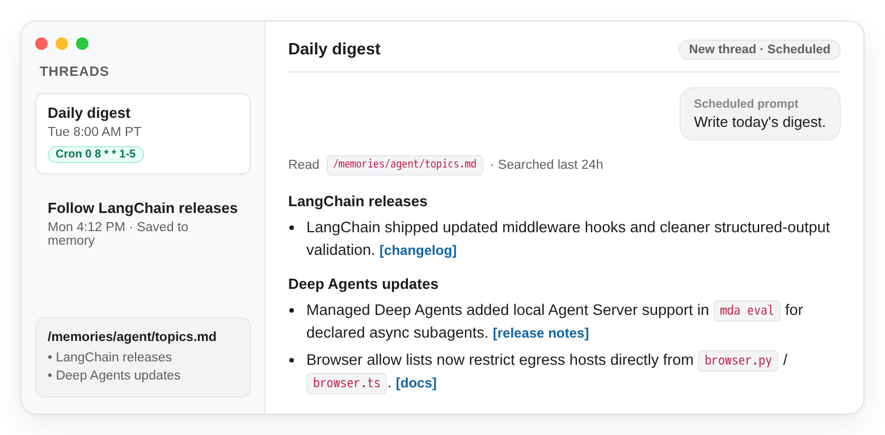
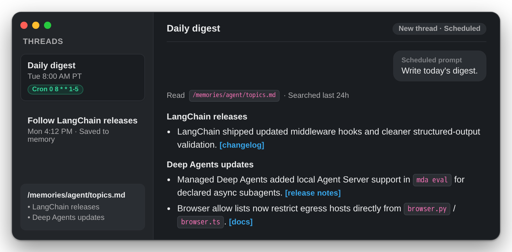

import ManagedDeepAgentsPublicBetaNote from '/snippets/langsmith/managed-deep-agents-public-beta-note.mdx';

每日摘要 agent 结合了持久 memory 和 schedule。告诉它你关注哪些主题，它会在每个工作日早上搜索近期新闻并撰写简短摘要。

<ManagedDeepAgentsPublicBetaNote />

:::python
<Note>
本 Python 示例需要 `managed-deepagents>=0.10.4` 以及匹配的 `mda` CLI。
</Note>
:::

:::js
<Note>
本 TypeScript 示例需要 `managed-deepagents` 0.10.4 或更高版本，以及匹配的 `mda` CLI。
</Note>
:::





## 配置 agent

从 [quickstart](/langsmith/managed-deep-agents-quickstart) 中的研究助手开始，它已经具备 web search。启用共享 [memory](/langsmith/managed-deep-agents-memory)：

:::python
```python memory.py
from managed_deepagents import MemoryLayer, define_memory

memory = define_memory(agent=MemoryLayer())
```
:::

:::js
```ts memory.ts
import { defineMemory, memoryLayer } from "managed-deepagents";

export const memory = defineMemory({ agent: memoryLayer() });
```
:::

替换 `instructions.md`：

```markdown instructions.md
# Digest agent

You are a research assistant. When someone asks you to follow or stop
following a topic, update /memories/agent/topics.md and confirm the change.

When asked for a digest, read that file, search for news from the last day on
each topic, and write a short digest with one or two cited items per topic.
```

## 添加 schedule

添加一个在每个工作日太平洋时间上午 8:00 运行的 [schedule](/langsmith/managed-deep-agents-schedules)：

:::python
```python schedules/daily_digest.py
from managed_deepagents import define_schedule

schedule = define_schedule(
    cron="0 8 * * 1-5",
    timezone="America/Los_Angeles",
    prompt="Write today's digest.",
)
```
:::

:::js
```ts schedules/daily-digest.ts
import { defineSchedule } from "managed-deepagents";

export const schedule = defineSchedule({
  cron: "0 8 * * 1-5",
  timezone: "America/Los_Angeles",
  prompt: "Write today's digest.",
});
```
:::

## 试用

使用 `mda dev` 运行 agent，并让它关注某个主题，例如“Follow LangChain releases.”，然后启动一个新 thread 并要求生成今日摘要。即使新 thread 没有历史记录，agent 也会从 memory 中读取你保存的主题。

[部署 agent](/langsmith/managed-deep-agents-deploy) 以自动运行 schedule。每次定时运行都会在 deployment 上启动一个新 thread。

## 扩展此模式

- 使用 [schedule delivery](/langsmith/managed-deep-agents-schedules#deliver-results-to-slack) 把摘要发布到 Slack。
- 通过 [runtime schedules](/langsmith/managed-deep-agents-schedules#create-schedules-at-runtime) 让人们设置自己的摘要时间。
- 改用内置 [web search](/langsmith/managed-deep-agents-search)，这样搜索无需单独的 API key。

## 另请参阅

- [Memory](/langsmith/managed-deep-agents-memory)：选择并控制持久 memory 层。
- [Schedules](/langsmith/managed-deep-agents-schedules)：配置和管理定时运行。
- [Web search](/langsmith/managed-deep-agents-search)：添加内置搜索，无需单独的 API key。
