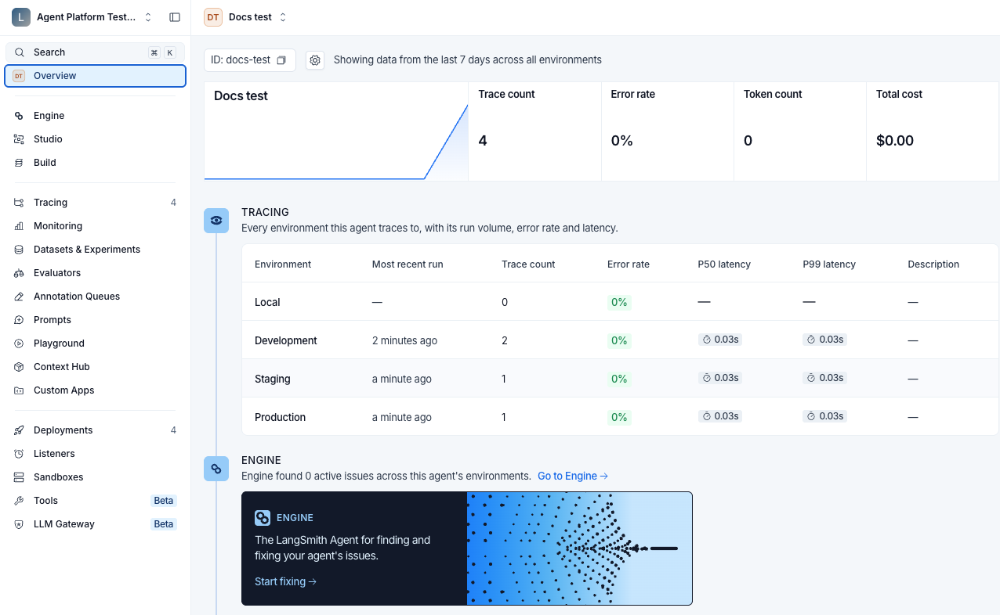
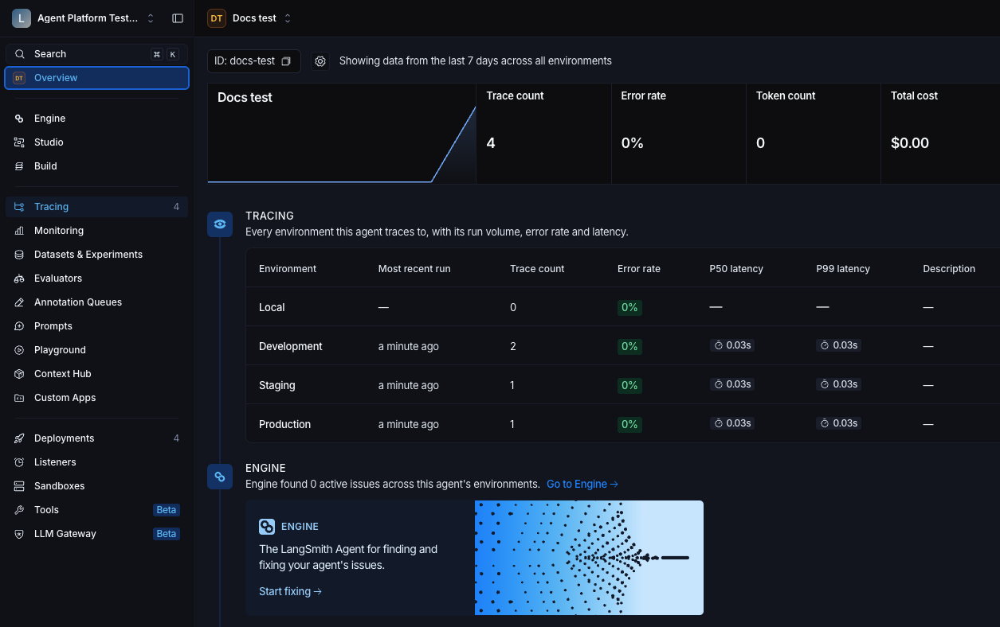
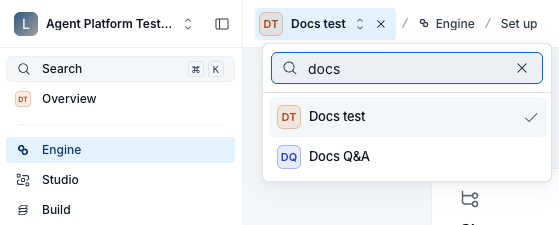
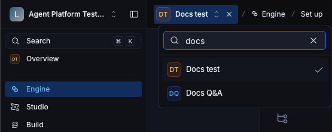

import AgentAvailabilityNote from '/snippets/langsmith/agent-availability-note.mdx';

要在 workspace 中的 [agents](/langsmith/agent-registry#agent) 之间切换，请使用顶栏中的 agent 切换器。选择一个 agent 后，计数、图表和 trace 列表将只显示该 agent 的数据。

<AgentAvailabilityNote />

## 在 agents 之间切换

agent 切换器位于顶栏左侧，在 workspace 切换器和面板折叠开关之后。它显示 **All agents** 或你当前所在 agent 的名称。在 Overview 以外的 section 中，切换器后面会跟随一个 breadcrumb，标明该 section。

它背后的地址为 `/o/<workspaceId>/a/<agentIdentifier>/...`。workspace 位置接受 UUID，agent 位置接受该 agent 的 [identifier](/langsmith/agent-registry#identifiers-and-display-names)。agent 位置中的连字符表示所有 agents，因此 `/a/-` 是 **All agents** 视图，`/a/<agentIdentifier>` 是单个 agent。两种状态都可以通过地址栏设置，这也是直接链接到其中某个视图的方式。

## All agents 与单 agent 视图

切换器在两个视图之间切换：

- **All agents**：agent 列表，workspace 中的每个 agent 对应一张卡片。在空的 workspace 中，它会转而显示一个 get-started 界面，提供构建或连接首个 agent 的方式。关于这些选项，请参阅[新 agent 菜单](/langsmith/create-an-agent#start-from-the-new-agent-menu)。
- **单个 agent**：该 agent 的 Overview。

左侧导航在两种视图中列出相同的条目，只是第一行在 agent 列表中显示为 **All agents**，在 agent 内部显示为 **Overview**。以下两点有所不同：

- **Badge 计数**：在 agent 列表中隐藏（Agent Servers 除外）。选择某个 agent 后，计数会显示出来，并且只涵盖该 agent。
- **Section 可用性**：某些 section 会要求你先选择一个 agent。请参阅[需要选择 agent 的 section](#需要选择-agent-的-section)。

## 需要选择 agent 的 section

大多数 section 在选中 **All agents** 时都能正常工作，包括列出 workspace 中每个 agent 的 agent 列表，以及列出 workspace 中每个 Agent Server 的 Agent Servers。Engine、Studio、Tracing 和 Monitoring 则需要你选择一个 agent。如果在选中 **All agents** 的情况下打开这些 section，你看到的内容取决于 workspace 中是否已有 agents。

如果 workspace 中已有 agents，该 section 会显示一个可搜索的 agent 列表供你选择，标题为 **Pick an agent to view**。顶栏保持不变，因此你也可以从切换器中选择。对于具有 `projects:create` 权限的用户，Tracing 会在列表下方显示 **Connect an agent**。该列表包含 workspace 中的所有 agents。

Studio 会打开自己的页面，标题为 **Agent Studio**，提供三个选项：

- **Build a new agent**：开始[在 Studio 中构建 agent](/langsmith/build-an-agent)。
- **Connect a local server**：从你的机器运行并调试 agent。
- **Select existing agent**：显示 agent 列表，其下方是 **Connect agent server**。

如果 workspace 中没有 agents，Engine、Studio、Tracing 和 Monitoring 中的 agent 列表为空，并提示 **No agents available**。Agent Servers 会显示自己的页面，在 workspace 中还没有 Agent Server 时提供创建首个 Agent Server 的方式。

选择某个 agent 后，在这些 section 之间切换时 LangSmith 会保持该 agent 处于选中状态。要查看 **All agents** 的 agent 列表，请在切换器中悬停于所选 agent 的名称上，然后选择旁边出现的 **X**。

## 打开 Settings

Settings 在其独立的布局中打开：agent 切换器消失，导航拆分为 Organizations 和 Workspace 两个部分，并有一个 **Back to LangSmith** 链接可返回 agent 视图。

## 查看 agent Overview

选择某个 agent 后，LangSmith 会打开其 Overview。

对于 coding agent 以外的 agent，页面头部会显示 agent 名称和资源导航。对于已部署的 agent，选择 **Agent Server** 可查看其 Agent Servers 和 environments。有 active revisions 时，头部会按 environment 显示 revision 信息。对于在 Studio 中构建的 agent，此链接不可用，因为它们改用 Studio runtime。请参阅[对比四种路径](/langsmith/create-an-agent#compare-the-four-routes)。

进行 [agent 寻址](/langsmith/log-traces-to-agent) 时，请使用 agent 的 identifier，而不是其 display name 或 **ID** badge 复制的 UUID。如果头部显示 **Identifier**，请打开它，复制目标 environment 对应的 identifier。请参阅[Identifiers and display names](/langsmith/agent-registry#identifiers-and-display-names)。

Overview 的 profile 包含 [Engine](/langsmith/engine)、agent activity、**Models**、**Tools**、feedback activity 和 Engine issues。Coding agent 使用单独的 usage 和 pull request outcomes 视图。当头部缺少某个资源链接时，请使用左侧导航。

## 另请参阅

- [Agent Registry](/langsmith/agent-registry)
- [Create an agent](/langsmith/create-an-agent)
- [Agent environments](/langsmith/agent-environments)
- [Deploy to an agent environment](/langsmith/deploy-to-agent-environment)
- [Tracing quickstart](/langsmith/observability-quickstart)
