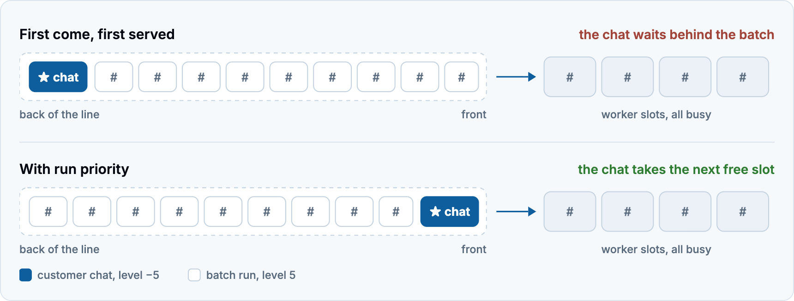

run 优先级决定哪个等待中的 run 先启动，因此紧急工作（例如交互式聊天）会排在后台工作（例如定时任务）之前启动。

<Note>
run 优先级处于 beta 阶段，且仅适用于 Python graph。
</Note>

## 为什么使用 run 优先级

一个 Agent Server deployment 可以服务许多 graph，它们的所有 run 共享同一个队列和同一个 worker slot 池。没有 run 优先级时，队列遵循先到先服务：一波后台 run 会让交互式聊天排在它们后面等待。

使用 run 优先级时，你在服务器上运行的 Python 函数中为每个 thread 设置优先级。当所有 worker slot 都忙碌时，最紧急的等待 run 下一个启动。已经获得 slot 的 run 会保留它。



## 配置 run 优先级

### 步骤 0. 配置依赖项以支持 run 优先级

run 优先级需要 Agent Server 0.18.0 或更高版本（`langgraph-api>=0.18.0`）以及 `langgraph-sdk>=0.4.12`（新构建的默认值）。如果你自行构建镜像，请使用 `langgraph-cli>=0.4.38`。更早的版本会忽略 `priority` 部分，且不报错。

### 步骤 1. 编写优先级函数

在 `langgraph.json` 旁边创建 `priority.py`，并在一个 @[Priority] 实例上用 `@priority.assign` 装饰一个异步函数：

```python
from langgraph_sdk import Priority

priority = Priority()


@priority.assign
async def assign(ctx: Priority.types.PriorityContext):
    if ctx.cron_id is not None:
        return {"priority": 3}  # Scheduled jobs wait behind other runs
    if ctx.assistant_metadata.get("workload") == "chat":
        return {"priority": -3}  # Interactive chat starts first
    return None  # Every other run uses the default priority, 0
```

该函数会收到一个 @[PriorityContext]，包含以下字段：

- **`user` 和 `permissions`**：已认证的用户及其权限。对于由 cron 启动的 run，则是该 cron 的所有者。
- **`thread_id` 和 `thread_metadata`**：thread 及其元数据，包括该 run 添加的元数据。对于没有 thread 的 run，`thread_id` 为 `None`。
- **`assistant_id`、`graph_id` 和 `assistant_metadata`**：assistant、其 graph，以及该 assistant 的元数据。
- **`run_metadata`**：该 run 的元数据。
- **`cron_id`**：启动该 run 的 cron 的 ID，或 `None`。

该函数返回一个 @[PrioritySettings] 字典，或返回 `None` 以使用默认值：

- **`priority`**：-5 到 5 之间的整数，默认值为 0。
- **`fairness_group`**：最多 256 个字符的字符串，默认值为 `"default"`。服务器会将其以未加密方式存储在 thread 上，即使启用了自定义加密也是如此，因此请使用不透明的 ID，而不是个人数据。该字段是为将来支持公平性而规划的，目前不影响 run 顺序。

### 步骤 2. 将函数添加到 `langgraph.json`

添加一个 `priority` 部分，其 `path` 指向 `Priority` 实例：

```json
{
  "dependencies": ["."],
  "graphs": {
    "agent": "./agent.py:graph"
  },
  "priority": {
    "path": "./priority.py:priority"
  }
}
```

### 步骤 3. 重新构建并重新部署

按照你通常为[托管环境](/langsmith/deployment#langsmith-deployment-environments)所做的流程，重新构建并重新部署。

<Note>
在 LangSmith Cloud 上，GCP US 区域的 deployment 会应用 `priority` 部分。其他 Cloud 区域的 deployment 尚未应用。
</Note>

## 最佳实践

- **在优先级之间留出空间**：先使用几个拉开差距的值，例如交互式工作用 -3、默认用 0、后台任务用 3，这样当需求变化时，你可以在上下两侧添加优先级。
- **保持函数轻量**：该函数必须是异步的，并且会在 thread 的第一个 run 创建之前，在 API server 上运行。避免耗时调用，例如网络请求。阻塞式调用（例如同步 HTTP 请求）会拖住该服务器上的每个请求。
- **基于你可控制的值来设置优先级**：没有任何 API 字段可以设置 run 的优先级。如果你的函数读取调用方发送的元数据，调用方就能影响结果，因此优先使用你可控的已认证用户或 assistant 元数据。

## 常见问题

### run 优先级如何工作？

优先级是 -5 到 5 之间的整数：-5 最先启动，5 最后启动，0 是默认值。当有 worker slot 空出时，最紧急的等待 run 会启动；优先级相同的 run 按到期先后顺序启动。只有所有 worker slot 都忙碌时，优先级才起作用。当有 slot 空闲时，无论优先级如何，run 都会立即启动。

你的优先级函数会在 thread 的第一个 run 时设置该 thread 的优先级，且只设置一次；该 thread 之后的每个 run 都使用它。已存在的 thread 会在你部署该函数后的下一个 run 时获得优先级，而函数的新版本只对尚未运行过的 thread 生效。优先级不会改变 run 在 thread 上的执行方式：thread 仍然一次只运行一个 run，最旧的优先，且不会停止正在运行的 run。

计划稍后运行的 run 会从到期时间起按其优先级参与竞争。优先级不会随时间老化，因此在更紧急优先级持续有负载的情况下，较低优先级的 run 可能无限期等待。没有优先级函数时，每个 run 的优先级都是 0，run 的启动顺序与之前相同。

### 如果优先级函数失败会怎样？

如果函数抛出异常或返回无效结果，例如未知的键，或 -5 到 5 之外的优先级，服务器不会创建该 run，并返回 500 错误。要用你自己的状态码拒绝 run，请抛出 @[HTTPException]。无论哪种情况都不会存储任何内容，因此该 thread 的下一个 run 会再次调用该函数。

### 如何确认 run 优先级已启用？

- **服务器日志**：启动时，服务器会记录 `Loaded priority callback from path ...`。如果服务器无法加载该函数，它就不会启动，因此错误的路径会在部署时暴露，而不是在每次 run 时暴露。
- **Thread**：在 thread 的第一个 run 之后，读取该 thread 会返回 `run_priority` 和 `fairness_group`。

`langgraph dev` 会调用你的优先级函数并存储结果，但按到达顺序启动 run。要查看 run 按优先级顺序启动，请在 deployment 上测试。

### 如何监控 run 优先级？

配置了优先级函数后，服务器会报告以下带 `priority` 标签（-5 到 5）的队列指标：

- `lg_api_num_startable_runs`：当前可以启动的 run，即在没有正在运行的 run 的 thread 上，每个 thread 最旧的已到期 run。
- `lg_api_startable_runs_wait_time_max` 和 `lg_api_startable_runs_wait_time_med`：这些 run 从到期以来的最长等待时间和中位等待时间，单位为秒。
- `lg_api_num_running_runs_by_priority`：正在运行的 run。

较低优先级上的等待时间上升，说明有 run 因为更紧急优先级上的持续负载而排在后面等待。

### 如何关闭 run 优先级？

从 `langgraph.json` 中移除 `priority` 部分，然后重新构建并重新部署。此后每个新 run 的优先级都是 0。已经在等待的 run 会保留其创建时的优先级。Thread 会保留已存储的优先级，如果你重新添加该函数，它会再次生效。

## 另请参阅

- [配置文件参考](/langsmith/cli#configuration-file)
- @[`Priority` 参考][Priority]
- [使用 threads](/langsmith/use-threads)
