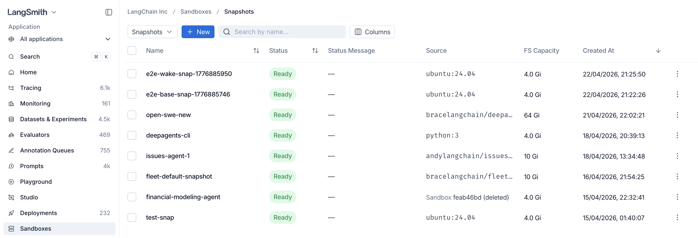

**snapshot** 是一个可复用的 sandbox 文件系统。当你希望从自定义文件系统镜像启动 sandboxes 时，可以基于某个 container image 构建自定义 snapshot。

你也可以从正在运行的 sandbox 中捕获 snapshot。安装 packages、写入数据文件或配置状态，然后对结果制作 snapshot，并将其作为新的起点重复使用。



## 了解系统 snapshot

当你创建 sandbox 时未选择 snapshot，LangSmith 会使用内置的 `system/default:latest` snapshot。当前默认值以 `ubuntu:26.04` container image 为起点，并包含下文列出的工具。较旧的自托管版本可能包含不同的 Ubuntu 版本和 package 集合。

### 检查默认工具

默认文件系统包含以下工具。此列表概括了已安装的能力，而不是完整的软件物料清单（SBOM）。

| 类别 | 包含的工具 |
| --- | --- |
| 语言和 package 管理器 | Python 3（含 pip 和 venv）、uv 和 uvx、Node.js 24（含 npm）、pnpm、Yarn、Go 和 Ruby。 |
| 源代码管理 | Git、GitHub CLI（`gh`）以及 `gh stack` 扩展。 |
| 构建和 container 工具 | `build-essential`、CMake、pkg-config、Docker、Docker Buildx、Docker Compose 和 BuildKit。 |
| Shell 和文件工具 | Bash、Zsh、tmux、ttyd、ripgrep、fd、jq、bat、tree、zip、unzip、rsync 以及常用 Linux 工具。 |
| 网络和数据工具 | curl、wget、OpenSSH client 和 server、DNS 和网络诊断工具、SQLite 以及 PostgreSQL client。 |
| 浏览器自动化 | Chrome for Testing 和 `agent-browser`。 |
| 文档处理 | `python-docx`、`python-pptx`、带 `defusedxml` 的 `openpyxl` 以及 `anydoc`。请参阅 [Fleet 文档依赖](/langsmith/fleet/computer-use#prepare-a-custom-image-for-fleet)。 |
| LangSmith 工具 | LangSmith CLI 和 Custom Apps 开发服务器。 |

Package 版本可能因 LangSmith 版本而异。若要审计确切安装的 packages 及其传递依赖，请按[在自托管部署中检查默认 snapshot 文件系统](#在自托管部署中检查默认-snapshot-文件系统)所述，检查已部署镜像中的文件系统。

### 选择系统 snapshot

系统 snapshot 是由 LangSmith 维护的只读起始文件系统，在各工作区之间共享。常规工作负载请使用 `system/default:latest`，也可以基于自己的 container image [构建自定义 snapshot](#从-container-image-构建-snapshot)。其他系统 snapshot 支撑特定的 LangSmith 功能，由这些功能自动选用。此处列出它们，是为了便于你审计其内容。

引用采用 `system/<name>:<tag>` 的形式。省略 tag 即选择 `latest`。`system/` 命名空间是保留的：你不能在其中构建、捕获、重新打 tag 或删除 snapshot。从使用系统 snapshot 的 sandbox 捕获的 snapshot 归属于你的工作区。

| Snapshot 引用 | 使用者 | 基础内容和附加内容 |
| --- | --- | --- |
| `system/default:latest` | 常规开发以及 [Fleet 计算机](/langsmith/fleet/computer-use) | Ubuntu 26.04，包含[默认工具](#检查默认工具)。 |
| `system/custom-apps:latest` | [Custom apps](/langsmith/custom-apps) | 默认文件系统，外加预置的应用起始模板，以及 `/workspace/app` 中已安装的依赖。 |
| `system/code-evaluators:latest` | Python 和 JavaScript [code evaluators](/langsmith/code-evaluator-ui) | 默认文件系统，外加 NumPy、pandas、jsonschema、SciPy、scikit-learn，以及 LangSmith Python 和 JavaScript SDK。 |
| `system/prebuilt-voice-evaluator:latest` | 托管的[语音指标评估](/langsmith/evaluators#voice-evaluation) | 默认文件系统，外加 `/opt/venv` 中的 NumPy、`ffmpeg`、`ffprobe`，以及 `/opt/langsmith_eval` 中的语音评估模块。 |
| `system/taskset-runner:latest` | Taskset 执行 | 默认文件系统，外加位于 `/opt/smith-harbor/.venv` 的 Python 3.12 环境中的 Harbor 和 `smith-harbor`，并缓存 `langgraph-cli` 以供离线使用。 |

可用目录取决于你的 LangSmith 版本。在自托管部署中，它来自你的 LangSmith 发行版中的 `sandbox-host` 镜像；请参阅[自托管更新日志](/langsmith/self-hosted-changelog)。

LangSmith 可以更新 `latest` 背后的内容；已有 sandbox 会保留其原始 snapshot ID。当你需要复用某个特定版本时，请使用 snapshot ID 而不是可变 tag。

### 在自托管部署中检查默认 snapshot 文件系统

在自托管部署中，LangSmith 会基于 sandbox 运行时 container image（`sandbox-host`）中内嵌的文件系统来创建默认 snapshot：

1. 在构建 `sandbox-host` 镜像时，LangSmith 以 `ubuntu:26.04` 为起点并安装默认工具。
2. LangSmith 将该文件系统打包为一个 16 GiB 的压缩 ext4 文件，位于 `/opt/sandbox-host/bin/builder-base.ext4.gz`。
3. 当 `sandbox-host` 启动时，LangSmith 把这些内嵌文件系统注册为系统 snapshot。

当前的 host 镜像还包含 `/opt/sandbox-host/bin/system-snapshots.json`。该 manifest 记录了每个 snapshot 的名称、tag、payload 路径、文件系统校验和、容量、架构以及运行配置。命名变体的压缩文件位于 `/opt/sandbox-host/bin/system-snapshots/` 下。要审计某个变体，请复制 manifest 中 `payload_path` 指向的文件，而不是默认 payload。将副本在本地保存为 `builder-base.ext4.gz`，即可复用下文的解压和提取命令。

默认 snapshot 文件系统的来源是这个压缩的 ext4 文件，而不是单独拉取的 container image。

仅扫描 `sandbox-host` container image 并不会检查这个压缩制品内部的文件。要验证默认 snapshot，请单独提取并扫描内嵌的文件系统。

<Note>
此流程验证的是默认 snapshot 文件系统。LangSmith 会在 sandbox 启动时单独提供其他所需的运行时组件；它们不属于 snapshot。
</Note>

要独立检查默认 snapshot，请使用你的 Helm release 所配置的确切 `sandbox-host` container image。如果你将镜像同步到了私有 registry，请使用该 registry 中 `images.sandboxHostImage` 的引用。

你需要准备：

- 对已部署的 `sandbox-host` 镜像的访问权限。
- 一个 Linux 系统，其上装有 Docker、`gzip`、GNU `dd`，以及来自 `e2fsprogs` 包的 `debugfs`。
- 一个支持 sparse files 的本地文件系统，以及足以容纳压缩制品和提取后文件的空间。该 ext4 镜像的逻辑大小为 16 GiB，但稀疏解压可以避免为其全零的空闲空间分配磁盘。

将文件提取到一个临时目录，然后用你惯用的文件系统或软件物料清单（SBOM）扫描器扫描该目录。

设置你的部署实际使用的镜像引用，并创建一个临时工作目录：

```bash
export SANDBOX_HOST_IMAGE="<sandbox-host-image-reference>"
export SNAPSHOT_WORKDIR="$(mktemp -d)"

docker pull "$SANDBOX_HOST_IMAGE"
```

在不启动 `sandbox-host` 进程的情况下提取该压缩 ext4 文件：

```bash
SANDBOX_HOST_CONTAINER="$(docker create "$SANDBOX_HOST_IMAGE")"
docker cp \
  "${SANDBOX_HOST_CONTAINER}:/opt/sandbox-host/bin/builder-base.ext4.gz" \
  "$SNAPSHOT_WORKDIR/"
docker rm "$SANDBOX_HOST_CONTAINER"
```

将文件系统解压为稀疏文件：

```bash
gzip -dc "$SNAPSHOT_WORKDIR/builder-base.ext4.gz" | \
  dd of="$SNAPSHOT_WORKDIR/builder-base.ext4" \
    bs=1M conv=sparse status=progress
```

使用 `debugfs` 提取 ext4 内容。除非传入 `-w`，否则 `debugfs` 以只读方式打开文件系统：

```bash
mkdir -p "$SNAPSHOT_WORKDIR/rootfs"
debugfs \
  -R "rdump / $SNAPSHOT_WORKDIR/rootfs" \
  "$SNAPSHOT_WORKDIR/builder-base.ext4"
```

将你的文件系统或 SBOM 扫描器指向 `$SNAPSHOT_WORKDIR/rootfs`。扫描器读取的 package 数据库和文件，与 LangSmith 用于默认 snapshot 的根文件系统完全相同。

## 从 container image 构建 snapshot

你可以直接基于任意 container image 构建 snapshot。这个调用会阻塞，直到 snapshot 准备完成，默认超时 60 秒；如果镜像较大，请调高。

<CodeGroup>

```python Python
from langsmith.sandbox import SandboxClient

client = SandboxClient()

snapshot = client.create_snapshot(
    "python",
    docker_image="python:3.12-slim",
    fs_capacity_bytes=1 * 1024**3,  # 1 GiB
)

print(snapshot.id)
```

```ts TypeScript
import { SandboxClient } from "langsmith/sandbox";

const client = new SandboxClient();

const snapshot = await client.createSnapshot(
  "python",
  "python:3.12-slim",
  1_073_741_824, // 1 GiB
);

console.log(snapshot.id);
```

</CodeGroup>

### 验证基于 container image 构建的 snapshot

LangSmith 会基于你提供的 container image 中的文件系统构建自定义 snapshot。要独立验证这些内容：

1. 将来源 container image 解析为一个不可变的引用，例如 `registry.example.com/example/image@sha256:<digest>`。
2. 检查并扫描这个确切的镜像。
3. 在创建 snapshot 时，将同一个带 digest 的引用作为 `docker_image` 使用。

LangSmith 会在 sandbox 启动时单独提供其所需的运行时工具。它们既不会被添加到你提供的 container image 中，也不包含在自定义 snapshot 里。

### 私有 registry

如果要从私有 registry 拉取镜像，请先创建一个带凭据的 registry，然后在构建 snapshot 时通过 ID 引用它。Registries 是持久化的，因此可以在多个 snapshots 之间复用。

#### 查找仓库和 tags

在 LangSmith UI 中，**Container Image URI** 字段会根据 Docker Hub 或所选私有 registry 提示仓库和 tags。搜索行为取决于 registry 提供商和认证方式：

| 来源 | 仓库发现 | 标签发现 |
| --- | --- | --- |
| Docker Hub（未保存 registry） | 对裸镜像名称或指定的 Docker Hub namespace 搜索 Docker Official Images | 在你选择或输入仓库后搜索 tags |
| Docker Registry | 当 registry 支持时搜索其 catalog | 在你选择或输入仓库后搜索 tags |
| Harbor | 搜索可访问的 catalog | 在你选择或输入仓库后搜索 tags |
| GitHub Container Registry（GHCR） | 在指定的 GitHub owner 范围内搜索 | 在你选择或输入仓库后搜索 tags |
| Google Artifact Registry（GAR） | 在项目和位置范围内搜索仓库，然后在所选仓库内搜索软件包 | 在你选择或输入镜像仓库后搜索 tags |
| Amazon Elastic Container Registry（ECR），使用用户名和密码 | 需要你输入完整的仓库 | 在你输入仓库后搜索 tags |
| Amazon ECR，使用 AWS IAM role | 在所配置 AWS 账号下的仓库中搜索 | 在你选择或输入仓库后搜索 tags |

仓库和 tag 发现是提示性的，并且有边界。你始终可以手动输入已知的仓库、tag 或 digest，包括当提供商不支持搜索或没有返回匹配结果时。当你需要不可变的 snapshot 来源时，请使用带 digest 的镜像 URI。

#### 使用用户名和密码认证

用户名和密码认证方式适用于所有受支持的私有 registry 提供商。对于 ECR，密码是一个 ECR authorization token，并会在 12 小时后过期。请在 token 过期后更新已保存的 registry 凭据。

<CodeGroup>

```python Python
import os

registry = client.registries.create(
    name="internal",
    url="registry.example.com",
    username="me",
    password=os.environ["REGISTRY_PASSWORD"],
)

snapshot = client.create_snapshot(
    "internal-python",
    docker_image="registry.example.com/internal/python:3.12",
    fs_capacity_bytes=2 * 1024**3,
    registry_id=registry.id,
    timeout=600,
)
```

```ts TypeScript
const registry = await client.registries.create({
  name: "internal",
  url: "registry.example.com",
  username: "me",
  password: process.env.REGISTRY_PASSWORD,
});

const snapshot = await client.createSnapshot(
  "internal-python",
  "registry.example.com/internal/python:3.12",
  2_147_483_648,
  {
    registryId: registry.id,
    timeout: 600,
  },
);
```

</CodeGroup>

你可以通过 `client.registries.list()`、`client.registries.retrieve(name)`、`client.registries.update(name, ...)` 和 `client.registries.delete(name)` 来列出、查看、更新和删除 registries。

#### 使用 AWS IAM role 认证 ECR

AWS IAM role 认证方式可以避免在 LangSmith 中存储会过期的 ECR authorization token。它支持商业 AWS 分区中的私有 ECR registry。Public ECR、AWS GovCloud、AWS China 以及自定义的 ECR 兼容域名继续使用用户名和密码认证。

<Note>
只有当你的 LangSmith 部署支持时，**AWS IAM role** 认证方式才会出现。如果该选项不可用，请使用用户名和密码认证。
</Note>

<Note>
**BYOC 部署：**AWS IAM role 认证在 [BYOC](/langsmith/byoc) AWS data plane 上无需额外配置即可使用，按照以下步骤操作即可。如果你的 data plane 使用了[自带 IAM](/langsmith/byoc-byoiam-aws)，请先应用最新版本的 [`byoiam` Terraform module](https://github.com/langchain-ai/terraform/tree/main/modules/byoc/aws/byoiam)。该模块会授予 workload role assume 你的 ECR role 的权限。
</Note>

注册 ECR role 的步骤如下：

1. 在 LangSmith 中打开 **Sandboxes > Registries**，选择 **Register Private Registry**，并按 `<aws-account-id>.dkr.ecr.<aws-region>.amazonaws.com` 格式输入你的 registry URL。
2. 在 **Authentication method** 下选择 **AWS IAM role**。复制 LangSmith 显示的 AWS principal ARN 和 workspace ID。LangSmith 会将该 workspace ID 用作 `sts:ExternalId`。
3. 在 AWS 中创建一个 IAM role，或更新现有 role，使其 trust policy 使用与 LangSmith 中显示的完全一致的值：

```json
{
  "Version": "2012-10-17",
  "Statement": [
    {
      "Effect": "Allow",
      "Principal": {
        "AWS": "<principal-arn-shown-in-langsmith>"
      },
      "Action": "sts:AssumeRole",
      "Condition": {
        "StringEquals": {
          "sts:ExternalId": "<workspace-id-shown-in-langsmith>"
        }
      }
    }
  ]
}
```

<Note>
**BYOC 部署：**BYOC data plane 在 assume 该 role 时会传递 session tags，因此 trust policy 还必须允许 `sts:TagSession`。请将它添加为一个单独的 statement，且不带 `sts:ExternalId` 条件。否则 AWS 会拒绝 assume 该 role：

```json
{
  "Effect": "Allow",
  "Principal": {
    "AWS": "<principal-arn-shown-in-langsmith>"
  },
  "Action": "sts:TagSession"
}
```
</Note>

4. 为该 role 授予发现和拉取所需 ECR 镜像的权限。以下策略授予对一个 AWS 账号和区域中每个仓库的访问权限。请替换其中的占位符，或将仓库资源缩小到 LangSmith 可以使用的仓库：

```json
{
  "Version": "2012-10-17",
  "Statement": [
    {
      "Sid": "GetAuthorizationToken",
      "Effect": "Allow",
      "Action": "ecr:GetAuthorizationToken",
      "Resource": "*"
    },
    {
      "Sid": "DiscoverAndPullImages",
      "Effect": "Allow",
      "Action": [
        "ecr:DescribeRepositories",
        "ecr:ListImages",
        "ecr:BatchCheckLayerAvailability",
        "ecr:BatchGetImage",
        "ecr:GetDownloadUrlForLayer"
      ],
      "Resource": "arn:aws:ecr:<aws-region>:<aws-account-id>:repository/*"
    }
  ]
}
```

5. 对于托管的 LangSmith 和 BYOC，请为该 IAM role 添加 `LangSmithSandboxECR=true` 标签。
6. 返回 LangSmith，在 **AWS role ARN** 中输入该 role ARN，然后注册私有 registry。

LangSmith 会在仓库发现、tag 发现以及每次 snapshot 构建尝试时分别 assume 该 role。它会为延迟任务和重试获取新的 ECR authorization token，并且不会持久化临时的 AWS 凭据或生成的 ECR token。

对于 self-hosted 部署，管理员必须设置 `SANDBOX_ECR_AWS_ROLE_PRINCIPAL_ARN`，并为 platform backend 和 snapshot workers 提供兼容的 AWS SDK 凭据来源。不设置该项会隐藏 AWS IAM role 认证方式，并保留用户名和密码认证。

## 从 Dockerfile 构建 snapshot

如果你手头有本地 `Dockerfile`，但又不想先把 image 发布到 registry，那么可以直接从 `Dockerfile` 及其构建上下文构建 snapshot。LangSmith 会启动一个临时 builder sandbox，上传 context，在其中用 [BuildKit](https://docs.docker.com/build/buildkit/) 执行构建，并将生成的镜像捕获为 snapshot。构建完成后，builder sandbox 会自动销毁。

这个调用会阻塞直到 snapshot 准备完成，默认超时 60 秒；对于大镜像或慢构建，请调高。`fs_capacity_bytes` 必须足够容纳构建上下文、中间层以及最终 image。

<CodeGroup>

```python Python
from langsmith.sandbox import SandboxClient

client = SandboxClient()

snapshot = client.create_snapshot_from_dockerfile(
    "my-app",
    dockerfile="Dockerfile",
    fs_capacity_bytes=2 * 1024**3,  # 2 GiB
    context=".",  # build context directory (default: current directory)
)

print(snapshot.id)
```

```ts TypeScript
import { SandboxClient } from "langsmith/sandbox";

const client = new SandboxClient();

const snapshot = await client.createSnapshotFromDockerfile(
  "my-app",
  "Dockerfile",
  2_147_483_648, // 2 GiB
  { context: "." },
);

console.log(snapshot.id);
```

</CodeGroup>

<Note>
`dockerfile` 默认相对于 `context` 解析，除非你传入绝对路径；并且它必须位于 context 目录内部。`.git` 目录会在上传 context 时自动排除。
</Note>

### Build args 和 target stage

通过 `build_args` / `buildArgs` 传入 Docker 的 `ARG` 值，通过 `target` 指定多阶段构建中的某个 stage 作为终点。

<CodeGroup>

```python Python
snapshot = client.create_snapshot_from_dockerfile(
    "my-app",
    dockerfile="Dockerfile",
    fs_capacity_bytes=2 * 1024**3,
    build_args={"PYTHON_VERSION": "3.12", "ENV": "prod"},
    target="runtime",
)
```

```ts TypeScript
const snapshot = await client.createSnapshotFromDockerfile(
  "my-app",
  "Dockerfile",
  2_147_483_648,
  {
    buildArgs: { PYTHON_VERSION: "3.12", ENV: "prod" },
    target: "runtime",
  },
);
```

</CodeGroup>

### 流式读取构建日志

向 `on_build_log` / `onBuildLog` 传入回调，可以在构建过程中接收 stdout 和 stderr，这对于展示进度或调试失败构建非常有用。

<CodeGroup>

```python Python
snapshot = client.create_snapshot_from_dockerfile(
    "my-app",
    dockerfile="Dockerfile",
    fs_capacity_bytes=2 * 1024**3,
    on_build_log=lambda line: print(line, end=""),
)
```

```ts TypeScript
const snapshot = await client.createSnapshotFromDockerfile(
  "my-app",
  "Dockerfile",
  2_147_483_648,
  { onBuildLog: (line) => process.stdout.write(line) },
);
```

</CodeGroup>

### 加速冷启动构建

`vcpus` / `vCpus` 和 `mem_bytes` / `memBytes` 用于配置临时 builder sandbox 的资源。构建过程中，BuildKit 和 native snapshotter 的 layer 复制都在其中运行，默认情况下会争抢 builder 默认的 0.5 vCPU，因此多给 builder 一些 CPU 通常能显著缩短冷构建的总耗时。内存与 CPU 按 4 GiB 每 vCPU 绑定，并且必须在该目标的 50% 范围内，因此一个 2-vCPU 的 builder 接受 4 到 12 GiB。省略内存时它会遵循该比例。

<CodeGroup>

```python Python
snapshot = client.create_snapshot_from_dockerfile(
    "my-app",
    dockerfile="Dockerfile",
    fs_capacity_bytes=2 * 1024**3,
    vcpus=2,
    mem_bytes=8 * 1024**3,  # 8 GiB
    timeout=600,
)
```

```ts TypeScript
const snapshot = await client.createSnapshotFromDockerfile(
  "my-app",
  "Dockerfile",
  2_147_483_648,
  {
    vCpus: 2,
    memBytes: 8_589_934_592, // 8 GiB
    timeout: 600,
  },
);
```

</CodeGroup>

<Tip>
同步 `SandboxClient` 和 `AsyncSandboxClient` 都暴露了这个方法，参数一致。在异步 client 上使用时，请写成 `await client.create_snapshot_from_dockerfile(...)`。
</Tip>

## 从运行中的 sandbox 捕获 snapshot

先基于已有 snapshot 启动一个 sandbox，安装 packages 或准备数据，然后把结果捕获为新的 snapshot。返回的 snapshot 会把其 `source_sandbox_id` 设为来源 sandbox 的 ID，之后你可以在任何 `create_sandbox` 调用中，将其作为 `snapshot_id` 使用。

<CodeGroup>

```python Python
sb = client.create_sandbox(snapshot_id=base_snapshot_id, name="setup-box")
sb.run("pip install numpy pandas scikit-learn", timeout=180)
sb.write("/opt/config.yaml", "model: gpt-5\n")

# Capture the current filesystem as a new snapshot
snapshot = sb.capture_snapshot("ml-ready")
print(snapshot.id, snapshot.source_sandbox_id)

sb.delete()

# Boot fresh sandboxes pre-loaded with those dependencies
with client.sandbox(snapshot_id=snapshot.id) as sb:
    sb.run("python -c 'import numpy; print(numpy.__version__)'")
    assert sb.read("/opt/config.yaml") == b"model: gpt-5\n"
```

```ts TypeScript
const running = await client.createSandbox(baseSnapshotId, { name: "setup-box" });
await running.run("pip install numpy pandas scikit-learn", { timeout: 180 });
await running.write("/opt/config.yaml", "model: gpt-5\n");

const snapshot = await running.captureSnapshot("ml-ready");
console.log(snapshot.id, snapshot.source_sandbox_id);

await running.delete();

const sandbox = await client.createSandbox(snapshot.id);
try {
  await sandbox.run("python -c 'import numpy; print(numpy.__version__)'");
  const cfg = await sandbox.read("/opt/config.yaml");
  console.log(new TextDecoder().decode(cfg));
} finally {
  await sandbox.delete();
}
```

</CodeGroup>

<Note>
默认情况下，捕获时只会保留**文件系统**。安装的 packages，位于 `/usr/local`、`/root`、`/opt`、home 目录等，和你写入这些位置的文件都会被保留，`/tmp` 也会被保留。只有 `/dev/shm` 是 tmpfs，其他所有内容都存放在 sandbox 的磁盘上。运行中的进程、打开的 sockets 和内存中的状态**不会**被保留：新 sandbox 启动后，仍需重新启动你需要的进程，或者[连同内存一起捕获](#resume-from-memory)。
</Note>

<Tip>
你也可以通过 snapshot 的**名称**而不是 ID 来启动 sandbox，这在你记得捕获时使用的人类可读标签时会很方便：

<CodeGroup>

```python Python
sb = client.create_sandbox(snapshot_name="ml-ready")
```

```ts TypeScript
const sb = await client.createSandbox({ snapshotName: "ml-ready" });
```

</CodeGroup>

`snapshot_id` / `snapshot_name`，或 TypeScript 中的 `snapshotId` / `snapshotName`，两者最多传一个。如果都不传，则会使用 `system/default:latest`。
</Tip>

### 调整捕获等待时间

`capture_snapshot` 会阻塞，直到新的 snapshot 准备完成。如果你的文件系统很大，或存储后端较慢，请提高 `timeout` 参数，默认值为 60 秒。

<CodeGroup>

```python Python
snapshot = sb.capture_snapshot("ml-ready-v2", timeout=600)
```

```ts TypeScript
const snapshot = await sb.captureSnapshot("ml-ready-v2", { timeout: 600 });
```

</CodeGroup>

### 从内存恢复

一个 snapshot 可以在携带文件系统的同时携带 sandbox 的 RAM。从这样的 snapshot 启动时，sandbox 会从上次中断处恢复，其进程仍在运行，而不是冷启动。对于预热较慢的环境（例如已加载的模型或已启动的数据库）非常有用。

<Note>
内存快照仅通过 REST API 提供。`langsmith.sandbox` 的 Python 和 TypeScript 客户端目前尚未暴露这些字段。
</Note>

在捕获时设置 `include_memory` 即可捕获内存：

```bash
curl -X POST \
  "$LANGSMITH_ENDPOINT/api/v2/sandboxes/boxes/my-vm/snapshot" \
  -H "x-api-key: $LANGSMITH_API_KEY" \
  -H "Content-Type: application/json" \
  -d '{"name": "warm-model", "include_memory": true}'
```

当捕获了内存时，响应中会报告 `memory_snapshot_size_bytes`。`include_memory` 要求 sandbox 处于运行中或已停止状态，且不能与 `checkpoint` 或 `docker_image` 组合使用。

某些 sandbox 运行在无法携带内存镜像的 overlay 文件系统 runtime 上。捕获此类内存会返回 `include_memory is not supported for overlay-rootfs sandboxes`。该 runtime 由 LangSmith 分配，因此不是你可以按 sandbox 选择的内容。

创建时有两个字段控制另一半行为：

| 字段 | 作用 |
|-------|--------------|
| `restore_memory` | 省略时：当 snapshot 拥有内存则从内存恢复，否则冷启动。`true` 要求必须有内存，若 snapshot 没有内存则请求失败。`false` 始终冷启动。 |
| `preserve_memory_on_stop` | `true` 时，在主动停止（空闲超时或显式停止）时挂起 RAM，使 sandbox 下次唤醒时从上次中断处恢复，而非冷启动。默认为 `false`，即仅保留文件系统。由基础设施维护触发的重启无论该值如何都会保留内存。 |

```bash
curl -X POST "$LANGSMITH_ENDPOINT/api/v2/sandboxes/boxes" \
  -H "x-api-key: $LANGSMITH_API_KEY" \
  -H "Content-Type: application/json" \
  -d '{
    "name": "warm-vm",
    "snapshot": "warm-model",
    "restore_memory": true,
    "preserve_memory_on_stop": true
  }'
```

从**已停止**的 sandbox 捕获内存，仅在该 sandbox 创建时设置了 `preserve_memory_on_stop` 时才有效。否则停止会丢弃 RAM，没有可捕获的内容。

## 列出、获取和删除 snapshots

<CodeGroup>

```python Python
# List all snapshots in the workspace
snapshots = client.list_snapshots()
for s in snapshots:
    print(s.id, s.name, s.status)

# Fetch a single snapshot by ID
snapshot = client.get_snapshot("550e8400-e29b-41d4-a716-446655440000")

# Delete a snapshot (fails if any sandbox still references it)
client.delete_snapshot(snapshot.id)
```

```ts TypeScript
const snapshots = await client.listSnapshots();
for (const s of snapshots) {
  console.log(s.id, s.name, s.status);
}

const snapshot = await client.getSnapshot("550e8400-e29b-41d4-a716-446655440000");

await client.deleteSnapshot(snapshot.id);
```

</CodeGroup>

<Note>
`list_snapshots` / `listSnapshots` 在服务端分页，默认页大小为 50，最大 500，并接受可选过滤参数：`name_contains` / `nameContains`，对 name 做大小写不敏感的子串匹配，`limit`，1–500，和 `offset`，≥ 0。若需翻页，请递增 `offset`。

<CodeGroup>

```python Python
page = client.list_snapshots(name_contains="ml", limit=100)
```

```ts TypeScript
const page = await client.listSnapshots({ nameContains: "ml", limit: 100 });
```

</CodeGroup>

</Note>

## 已停止的 sandboxes

已停止的 sandbox 会保留其文件系统，下一次请求会自动唤醒它。你无需自行启动：发送你想运行的命令，sandbox 就会重新启动来处理它。

<CodeGroup>

```python Python
sb = client.create_sandbox(snapshot_id=snapshot.id, name="my-vm")
sb.run("echo 'hello' > /tmp/state.txt")

# Stop early to release resources. The idle timeout does this for you.
sb.stop()

# No start call: this wakes the sandbox and runs once it is up.
result = sb.run("cat /tmp/state.txt")
assert result.stdout.strip() == "hello"
```

```ts TypeScript
const sb = await client.createSandbox(snapshot.id, { name: "my-vm" });
await sb.run("echo 'hello' > /tmp/state.txt");

await sb.stop();

const result = await sb.run("cat /tmp/state.txt");
console.log(result.stdout.trim()); // "hello"
```

</CodeGroup>

停止后的第一次请求需要承担启动开销，因此比之后的请求更慢。在创建 sandbox 时设置 `preserve_memory_on_stop`，即可[从内存恢复](#resume-from-memory)而非冷启动。

## 下一步

- [使用 SDK 从 snapshots 创建 sandboxes](/langsmith/sandbox-sdk)
- [通过 Service URLs 暴露 HTTP 服务](/langsmith/sandbox-service-urls)
- [通过 Auth proxy 注入凭据](/langsmith/sandbox-auth-proxy)
