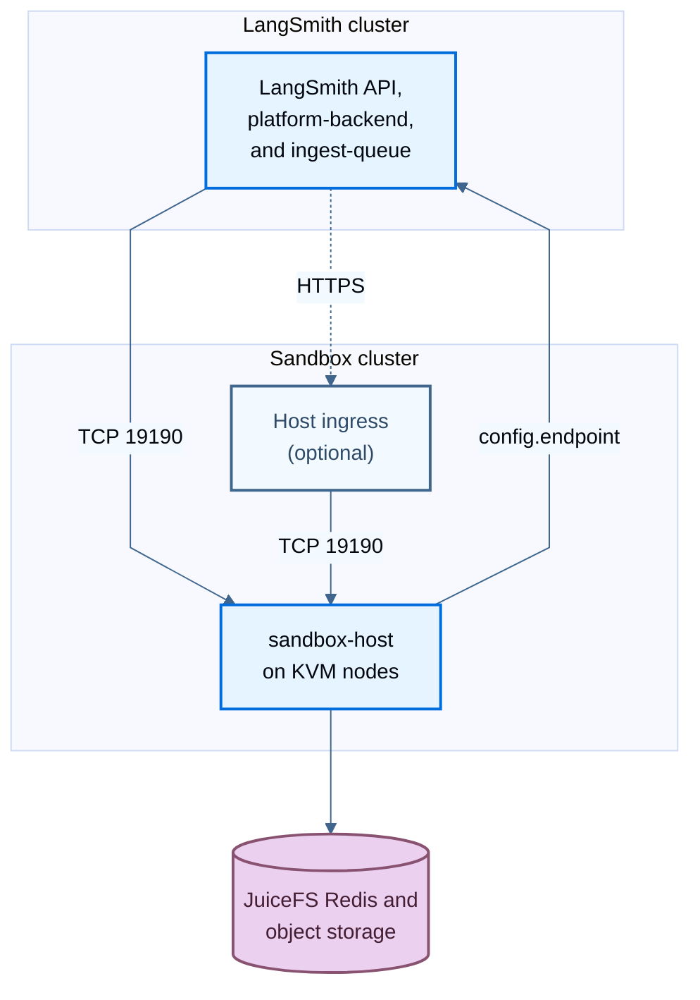

import SandboxCallbackSigningJwk from '/snippets/langsmith/sandbox-callback-signing-jwk.mdx';
import { SandboxDiagram } from '/snippets/sandbox-diagram.jsx';

默认情况下，`langsmith` Helm release 在与 LangSmith 相同的 Kubernetes 集群中运行 [Sandbox](/langsmith/sandboxes) runtime。设置 `sandboxes.external.enabled: true` 后，runtime 变为外部 runtime：由第二个 chart `langsmith-sandbox` 安装它，此处即安装在专用集群中。本指南介绍该拓扑的要求、网络规则、Secret 和 Helm 步骤。

关于默认拓扑以及两种拓扑共用的设置，请参阅[启用 Sandboxes](/langsmith/enable-self-hosted-sandboxes)。关于升级，请参阅[升级独立的 sandbox 集群](/langsmith/self-host-upgrades#upgrade-separate-sandbox-clusters)。

<Note>
独立 sandbox 集群需要 v0.18 preview 中 LangSmith Helm chart 0.18.0-rc.51 或更高版本，以及 appVersion 与你的 `langsmith` chart 匹配的 `langsmith-sandbox` chart。更早的 chart 会忽略 `sandboxes.external.enabled`，并部署内嵌 runtime。要列出 runtime chart 的版本及其 appVersion，请运行 `helm search repo langchain/langsmith-sandbox --versions --devel`。
</Note>

## 确定何时使用独立集群

在以下情况下使用独立集群：

- **你的 LangSmith 集群无法承载 sandbox 节点**：sandbox runtime 需要支持 KVM 的节点和 privileged pod。例如，GKE Autopilot 集群无法运行该 runtime，因此安装在 Autopilot 上的 LangSmith 需要为 Sandboxes 使用独立的 GKE Standard 集群。
- **你需要隔离 sandbox 工作负载**：Sandboxes 在 privileged host 上运行用户代码。独立集群让这些节点远离运行 LangSmith 并保存其应用 Secret 的集群。runtime 只会收到它需要的两个 secret 值。

否则，请保留默认的内嵌 runtime。此时一个 Helm release 会一起安装和升级 control plane 与 runtime，无需维护集群之间的网络路径。

## 了解拓扑

LangSmith 集群保留 Sandbox API 和 control plane：身份验证、放置、PostgreSQL 中的 sandbox 记录，以及用于 exec、文件和 [service URL](/langsmith/sandbox-service-urls) 流量的 proxy。Sandbox 集群运行 host 及其 microVM。

<Frame caption="LangSmith 集群保留 API、放置和 sandbox 记录。Sandbox 集群运行 host、保存两个 secret 的副本，并访问 sandbox 存储。">
  <SandboxDiagram name="separate-cluster" />
</Frame>

可将其与[默认架构](/langsmith/self-host-sandbox-architecture#understand-the-deployment-model)对比，在默认架构中 `sandbox-host` 运行在 LangSmith 集群内。

| | LangSmith 集群 | Sandbox 集群 |
| --- | --- | --- |
| Helm release | `langsmith`，设置 `sandboxes.external.enabled: true` | `langsmith-sandbox`，设置 `sandboxHost.enabled: true` |
| 运行 | `platform-backend`、`ingest-queue` 以及 LangSmith 的其余部分 | 支持 KVM 的节点上的 `sandbox-host`、JuiceFS formatter Job，以及可选的 host ingress |
| 持有 | Sandbox 记录、callback signing JWK 和 sandbox service-auth secret | 一个仅包含这两个值副本的精简 Secret，以及 egress proxy CA |

使用外部 runtime 时，`langsmith` release 不会渲染 `sandbox-host`、JuiceFS formatter、JuiceFS 配置 Secret 或 proxy CA。Sandbox 集群会访问 JuiceFS Redis metadata 存储和对象存储；LangSmith 集群不需要它们。

runtime chart 使用与内嵌 runtime 相同的设置，但不带 `sandboxes.` 前缀：

| `langsmith` chart，内嵌 runtime | `langsmith-sandbox` chart |
| --- | --- |
| `sandboxes.sandboxHost.*` | `sandboxHost.*` |
| `sandboxes.juicefs.*` | `juicefs.*` |
| `sandboxes.juicefsFormatJob.*` | `juicefsFormatJob.*` |
| `sandboxes.proxyCa.*` | `proxyCa.*` |
| `sandboxes.authProxy.httpProxy.noProxy` | `authProxy.httpProxy.noProxy` |
| `sandboxes.authProxy.httpProxy.url` | runtime Secret 中的 `sandbox_egress_proxy_url` 键 |
| `images.sandboxHostImage.*` | `images.sandboxHostImage.*` |
| `config.customCa` | `config.customCa` |
| `sandboxes.sandboxHost.serviceAccount.annotations` 上的 workload identity 注解 | `workloadIdentity` |

[扩缩容](/langsmith/self-host-sandbox-scaling)和[运维](/langsmith/self-host-sandbox-operations)指南使用内嵌 runtime 的名称。请在 runtime chart 中应用相同的设置。

## 检查要求

### 所有云平台

- **节点**：支持 KVM 的 `linux/amd64` 节点，带有 `sandbox.langsmith.com/host=true:NoSchedule` taint，并添加与 `sandboxHost.deployment.nodeSelector` 匹配的 label。node selector 没有默认值，缺失时 chart 无法渲染。默认 toleration 与上述 taint 匹配；对于其他 taint，请覆盖 `sandboxHost.deployment.tolerations`。关于节点级要求，请参阅[启用 Sandboxes 的前置条件](/langsmith/enable-self-hosted-sandboxes#prerequisites)和[裸金属及本地部署集群的节点要求](/langsmith/enable-self-hosted-sandboxes#node-requirements-for-bare-metal-and-on-premises-clusters)。
- **JuiceFS metadata Redis**：使用 `maxmemory-policy noeviction`。当其他集群可以访问它时，要求启用 AUTH、TLS 或 IAM 身份验证。启用 Sandboxes 前置条件中的存储后端和 bucket 格式适用于 `juicefs.storage` 和 `juicefs.bucket`。
- **LangSmith 主机名**：将 `langsmith` release 中的 `config.hostname` 设置为 sandbox 集群可访问的地址。使用外部 runtime 时，如果未设置该项，或者使用的是 loopback 或集群内 Service 地址，chart 将无法渲染。
- **`config.endpoint`**：将 runtime chart 的 `config.endpoint` 设置为 `https://<LangSmith hostname>[/<base path>]/api`，即外部可访问的 LangSmith API，并包含 `/api` 前缀。
- **私有 CA**：如果 LangSmith API 证书、host ingress 证书或 HTTPS egress proxy 证书由私有 CA 签发，请将该 CA 添加到 runtime chart 的 `config.customCa`。
- **网络**：开放[配置网络](#configure-the-network)中列出的路径。
- **Secrets**：按照[创建 runtime Secret](#create-the-runtime-secret) 创建 Secret。

如果 sandbox 集群无法从公共 registry 拉取镜像，请按照 [Sandboxes 的其他镜像](/langsmith/self-host-mirroring-images#additional-images-for-sandboxes)中的说明镜像 `sandbox-host` 镜像，并将 runtime chart 中的 `images.sandboxHostImage.repository` 设置为镜像仓库。在镜像仓库中保留该镜像的 release tag，并让 `images.sandboxHostImage.tag` 保持为空，使镜像跟随 chart 的 appVersion。固定 tag 在升级 chart 时不会改变。

### Amazon EKS

- **身份**：为 sandbox 集群配置 IAM OIDC provider，以及一个信任 `system:serviceaccount:<namespace>:<service-account-name>` 的 IAM role。设置 `sandboxHost.serviceAccount.name`，使 subject 保持稳定。设置 `workloadIdentity.provider: aws` 和 `workloadIdentity.aws.roleArn`。
- **存储授权**：在 `arn:aws:s3:::<bucket>/<juicefs.name>/*` 上授予 `s3:GetObject`、`s3:PutObject`、`s3:DeleteObject` 和 `s3:AbortMultipartUpload`，并在 `arn:aws:s3:::<bucket>` 上授予 `s3:ListBucket`，条件为 `s3:prefix` 匹配 `<juicefs.name>/*`。仅由 JuiceFS 使用的 bucket 不需要此条件。
- **节点**：暴露 KVM 的实例类型，例如裸金属实例。
- **缓存**：JuiceFS 缓存默认位于根卷上的 `/var/cache/juicefs`。在使用本地 NVMe 的实例类型（例如 `m5d.metal`）上，挂载这些磁盘并将 `juicefs.hostMount.cacheDirs` 指向它们。

### Google Kubernetes Engine

- **集群**：Standard 集群（而非 Autopilot），其 node pool 使用 `UBUNTU_CONTAINERD` 并支持嵌套虚拟化（N2、N1、C3 或 C4）。将 node pool 的 OAuth scope 设置为 `cloud-platform`，由 IAM 授权决定访问权限。
- **身份**：设置 `workloadIdentity.provider: gcp`。`sandbox-host` 使用 host 网络，chart 也在那里运行 JuiceFS formatter，因此两者都以 node pool 的 service account 身份验证，无需 Workload Identity 绑定。让 `juicefsFormatJob.nodeSelector` 保持为空，使 formatter 运行在 sandbox node pool 上。
- **存储授权**：使用仅由 JuiceFS 使用的 bucket，启用统一 bucket 级访问（uniform bucket-level access），并在其上为 node pool 的 service account 授予 `roles/storage.objectAdmin`。如果 JuiceFS 必须共享 bucket，请启用统一 bucket 级访问，并使用条件 `resource.name.startsWith("projects/_/buckets/<bucket>/objects/<juicefs.name>/") || resource.type == "storage.googleapis.com/Bucket"`。仅前缀条件会阻止 JuiceFS 发起的 list 调用。第二个子句允许 sandbox 节点列出 bucket 中每个对象的名称和 metadata。
- **Redis**：使用 `juicefs.redis.iamAuthProvider: gcp` 时，使用 Memorystore for Redis Cluster，并为 node pool 的 service account 授予 `roles/redis.dbConnectionUser`。
- **缓存**：将 `juicefs.hostMount.cacheDirs` 指向节点本地 SSD。
- **Namespace**：如果 sandbox 集群与 LangSmith 集群共享同一个 Google Cloud 项目，并且启用了 Workload Identity，请将 runtime 安装在 LangSmith 所用 namespace 之外的 namespace 中。Workload Identity 会在项目内的每个集群中信任同一 namespace 和 ServiceAccount 名称。

### Azure Kubernetes Service

- **节点**：支持嵌套虚拟化的 VM 规格。
- **身份**：启用 OIDC issuer 和 Workload Identity，并配置 subject 为 `system:serviceaccount:<namespace>:<service-account-name>` 的联合凭据（federated credential）。设置 `sandboxHost.serviceAccount.name`，使 subject 保持稳定。设置 `workloadIdentity.provider: azure` 和 `workloadIdentity.azure.clientId`；如果 `tenantId` 与集群的租户不同，也需设置。chart 会为 `sandbox-host` 和 formatter 添加 `azure.workload.identity/use` label。
- **存储授权**：在容器上授予 `Storage Blob Data Contributor`。设置 `juicefs.storage: wasb` 和 `juicefs.storageAccountName`。
- **Redis**：通过 `rediss://` 使用 database 0 上的 Azure Managed Redis，并在该 database 上设置 `NoEviction` 逐出策略。JuiceFS 无法更改它。
- **缓存**：将 `juicefs.hostMount.cacheDirs` 指向 `/mnt` 下的临时磁盘。

## 配置网络

默认情况下，LangSmith control plane 直接在 TCP 端口 `19190` 上连接 `sandbox-host` 公布的节点 IP。请允许以下路径：

| 源 | 目标 | 端口 | 用途 |
| --- | --- | --- | --- |
| LangSmith `platform-backend` 和 `ingest-queue` pod | Sandbox 节点 | TCP `19190` | sandbox 放置、生命周期调用、exec、文件以及其他 sandbox 流量 |
| 其他 sandbox 节点 | Sandbox 节点 | TCP `19190` | 转发的 ingress 请求、sandbox 链接以及 live migration 流 |
| 启用时的 host ingress controller 或负载均衡器 | Sandbox 节点 | TCP `19190` | 通过 [host ingress](#use-the-host-ingress) 到达的请求 |
| Sandbox 节点 | `config.endpoint` | 端点的端口，通常为 `443` | host 上报、生命周期回调，以及从 Sandboxes 内部对 LangSmith API 的调用 |
| Sandbox 节点 | JuiceFS Redis 和对象存储 | 各存储的端口 | sandbox 存储 |

对于第一行，请允许 LangSmith pod 在你的网络上出现的地址：根据 CNI 的不同，可能是节点安全组、pod CIDR 或 SNAT 地址。



<Warning>
端口 `19190` 上的流量是纯 HTTP，会携带 sandbox 命令、文件和凭证。请让它保持在可信任的私有网络中。如果集群之间没有可路由的私有网络，或者流量会离开可信任的网络，请使用带 TLS 的 [host ingress](#use-the-host-ingress)。
</Warning>

从 sandbox 节点到 `config.endpoint` 的路径是该拓扑中新增的。使用内嵌 runtime 时，`sandbox-host` 通过集群内 Service DNS 访问 LangSmith。使用外部 runtime 时，它通过网络调用 `config.endpoint`，因此该调用必须通过该地址前的每一项控制措施：

- **负载均衡器允许列表**：如果 LangSmith 负载均衡器限制来源地址，请允许 sandbox 节点流量到达时使用的地址。对于内部负载均衡器，通常是 sandbox 节点的私有地址；对于面向互联网的负载均衡器，通常是 sandbox 节点所用 NAT 网关的公网地址。
- **Egress 过滤**：如果防火墙过滤 sandbox 集群的 egress，请允许 LangSmith 主机名。
- **DNS**：sandbox 节点必须能解析 LangSmith 主机名。仅在 LangSmith 集群私有 DNS 中可解析的地址不可用。对于内部负载均衡器，请在安装 runtime 之前将记录添加到 sandbox 网络使用的私有 DNS zone：启动时失败的查询可能会被缓存数分钟。

### 使用 host ingress

runtime chart 可以在 `sandbox-host` 前创建 Ingress。当 LangSmith 集群无法访问 sandbox 节点 IP，或该纯 HTTP 流量会离开你信任的私有网络时，请使用它。

要通过 host ingress 路由 control plane 流量：

1. 在 runtime values 中，使用主机名和 TLS 启用 `sandboxHost.ingress`：

   ```yaml
   sandboxHost:
     ingress:
       enabled: true
       ingressClassName: "<ingress-class>"
       hostname: "sandbox-hosts.example.com"
       tls:
         - secretName: "sandbox-hosts-tls"
           hosts:
             - "sandbox-hosts.example.com"
   ```

2. 在 `langsmith` values 中，设置 ingress origin，不要包含路径或结尾斜杠：

   ```yaml
   sandboxes:
     external:
       hostIngressEndpoint: "https://sandbox-hosts.example.com"
   ```

TLS 在 ingress 处终止。在 sandbox 集群内部，从 ingress 到 host 以及 host 之间的流量仍是端口 `19190` 上的纯 HTTP，因此请保持该网络私有。

Ingress 只路由 `/internal/SandboxHost/`（host 调用）和 `/guest-operation/`（exec、文件、隧道、sandbox 链接，以及 browser 和 service URL）。它不路由 `/metrics` 或 `/readyz`；请在每个 `sandbox-host` pod 的 `19190` 端口上抓取和探测这些端点。在依赖该 ingress 之前，请检查：

- **客户端**：LangSmith `platform-backend` 和 `ingest-queue` pod 会连接该 ingress，sandbox host 也是如此，它们会为该 ingress 拨号以获取 sandbox 链接。如果 ingress 限制来源地址，请同时允许两者。sandbox host 还必须能解析 ingress 主机名并信任其证书。如果证书由私有 CA 签发，请将该 CA 添加到 runtime chart 的 `customCa` 和 `langsmith` chart 的 `config.customCa`。
- **健康检查**：负载均衡器会直接检查 `sandbox-host` pod，而许多负载均衡器默认会检查 `/` 或 Ingress 路径，这会返回 `404`。请将健康检查路径设置为 `/readyz`。使用 AWS Load Balancer Controller 时，将 `alb.ingress.kubernetes.io/healthcheck-path: /readyz` 和 `alb.ingress.kubernetes.io/target-type: ip` 添加到 `sandboxHost.ingress.annotations`，因为 Service 是 `ClusterIP`。在 GKE 上，让 `ingressClassName` 保持为空，设置 `kubernetes.io/ingress.class: gce` 注解，并通过 `sandboxHost.ingress.service.annotations`（`cloud.google.com/backend-config`）附加一个带有 `healthCheck.requestPath: /readyz` 和 `healthCheck.port: 19190` 的 `BackendConfig`。
- **超时**：LangSmith 对 exec 请求最多等待 310 秒。exec 流、隧道、sandbox 链接和 browser 会话是长连接的 WebSocket 或 server-sent event 连接。请将 controller 的 read、idle 和 backend 超时设置为 310 秒以上；如果长会话需要保持打开，则设置得更高。默认的 30 到 60 秒会中断它们。在 GKE 上，在同一 `BackendConfig` 中设置 `timeoutSec`。
- **请求大小**：文件上传会经过 ingress。请将 controller 的请求体大小限制提高到至少等于你最大的上传大小。在 ingress-nginx 上，设置 `nginx.ingress.kubernetes.io/proxy-body-size`，其默认为 `1m`。
- **WebSockets**：controller 必须允许在 Ingress 路由上进行 WebSocket 升级。Azure Application Gateway for Containers 仅通过 Gateway API 支持 WebSockets，因此无法服务此 Ingress。请使用其他 controller，或者让 `sandboxHost.ingress` 保持禁用，并使用你自己的 Service 和 Gateway API `HTTPRoute` 将这两个路径路由到 `sandbox-host` pod 的 `19190` 端口。

## 创建 runtime Secret

runtime 从你在 sandbox namespace 中创建的 Secret 读取凭证。在 `config.existingSecretName` 中设置其名称。该 Secret 包含两个从 LangSmith 侧复制的值：

- **Sandbox service-auth secret**：用于对 control plane 与 sandbox host 之间的调用进行签名。将其存储在 `sandbox_service_auth_secret` 下，或存储在 `serviceAuth.secretKey` 指定的键下。
- **Callback signing JWK**：用于对 sandbox 回调进行签名的 Ed25519 私有 JWK。将其存储在 `sandbox_callback_signing_jwk` 下，或存储在 `config.callbackSigningJwkSecretKey` 指定的键下。

这两个值必须与 control plane 的值相同。可在 LangSmith app Secret 中找到它们：

| 值 | 使用 chart 管理的 Secret 时 | 使用 `config.existingSecretName` 时 |
| --- | --- | --- |
| Service-auth secret | 键 `sandbox_service_auth_secret`，由 `sandboxes.serviceAuth.secret` 设置 | `sandboxes.serviceAuth.secretKey` 指定的键 |
| Callback signing JWK | 键 `sandbox_callback_signing_jwk`，由 `sandboxes.callbackSigningJwk` 设置 | 键 `sandbox_callback_signing_jwk` |

使用外部 runtime 时，`langsmith` release 的 Helm 安装说明会打印适用于你的配置的键名。

```yaml
apiVersion: v1
kind: Secret
metadata:
  name: langsmith-sandbox-runtime
  namespace: langsmith-sandbox
type: Opaque
stringData:
  sandbox_service_auth_secret: '<same-value-as-the-control-plane>'
  sandbox_callback_signing_jwk: '<same-ed25519-private-jwk-as-the-control-plane>'
```

避免将此文件提交到版本控制。如果由外部 secret manager 提供你的 Secret，请将相同的两个值同步到此 Secret 中。

<Warning>
只复制这两个值。切勿将整个 LangSmith app Secret 复制到 sandbox 集群。
</Warning>

service-auth secret 必须是独立的随机值。不要复用 `api_key_salt`：该值还用于加盐 LangSmith API key 并对其他 LangSmith 服务调用进行签名，因此它不能离开 LangSmith 集群。使用外部 runtime 时，如果没有专用值，`langsmith` chart 会拒绝渲染。请生成一个值，例如使用 `openssl rand -hex 32`，并在 control plane 上设置它：

- **Chart 管理的 Secret**：设置 `sandboxes.serviceAuth.secret`。它必须与 `config.apiKeySalt` 不同。
- **`config.existingSecretName`**：将包含新值的键添加到 Secret 中，并在 `sandboxes.serviceAuth.secretKey` 中指定其名称。

不要更改 `api_key_salt` 本身的值：这会使所有现有 API key 失效。要更改运行中安装的 service-auth 值，请按照[轮换 service-auth secret](#rotate-the-service-auth-secret) 操作。

### 生成 callback signing JWK

如果 `langsmith` release 尚未配置 callback signing JWK，请生成一个。在 control plane 上将其设置为 `sandboxes.callbackSigningJwk`，或设置为 `config.existingSecretName` 中的 `sandbox_callback_signing_jwk` 键，并将相同的值复制到 runtime Secret 中。

<SandboxCallbackSigningJwk />

## 使用 Helm 安装

先安装 `langsmith` release，再安装 `langsmith-sandbox` release。示例使用 namespace `langsmith-sandbox` 和 release 名称 `langsmith-sandbox`。

<Steps>
  <Step title="配置 LangSmith release">
    在 LangSmith 集群中，将 sandbox 设置添加到 `langsmith_config.yaml`，并添加[创建 runtime Secret](#create-the-runtime-secret) 中描述的 callback signing JWK：

    ```yaml
    config:
      hostname: "langsmith.example.com"

    sandboxes:
      enabled: true
      external:
        enabled: true
        # Only when you use the host ingress:
        # hostIngressEndpoint: "https://sandbox-hosts.example.com"
      # Required: a dedicated service-auth value, never api_key_salt. With
      # config.existingSecretName, set serviceAuth.secretKey to its key instead.
      serviceAuth:
        secret: "<random-secret>"
    ```

    使用外部 runtime 时，chart 会忽略 `sandboxes.juicefs`、`sandboxes.sandboxHost` 和 `sandboxes.proxyCa`。如果设置了 `sandboxes.authProxy.httpProxy` 或 `sandboxes.juicefs.redis.iamAuthProvider`，chart 将无法渲染；请在 runtime chart 中配置这些项。

    应用 chart：

    ```bash
    helm upgrade -i langsmith langchain/langsmith \
      --kube-context <langsmith-context> \
      --namespace <langsmith-namespace> \
      --version <langsmith-chart-version> \
      --values langsmith_config.yaml \
      --wait
    ```
  </Step>

  <Step title="准备 sandbox 集群">
    为 sandbox 节点添加 label 和 taint，开放[网络路径](#configure-the-network)，并创建 namespace 和 [runtime Secret](#create-the-runtime-secret)：

    ```bash
    kubectl --context <sandbox-context> create namespace langsmith-sandbox
    kubectl --context <sandbox-context> apply -f langsmith-sandbox-runtime-secret.yaml
    ```

    为了避免将 JuiceFS Redis URL 及其密码写入 values 文件，还可以创建一个包含 `name`、`metaurl`、`storage` 和 `bucket` 键的 JuiceFS 配置 Secret，并设置 `juicefs.existingSecretName` 来替代内联的 `juicefs` values。在 Azure 上，`access-key` 保存存储账户名称。
  </Step>

  <Step title="编写 runtime values">
    创建 `langsmith_sandbox_config.yaml`。将占位符替换为你的值。

    <Tabs>
      <Tab title="EKS">

```yaml
config:
  endpoint: "https://langsmith.example.com/api"
  existingSecretName: "langsmith-sandbox-runtime"

workloadIdentity:
  provider: aws
  aws:
    roleArn: "<role_arn>"

juicefs:
  name: "sandbox-juicefs"
  storage: "s3"
  bucket: "https://bucket-name.s3.us-west-2.amazonaws.com"
  redis:
    metaURL: "rediss://<redis-host>:6379/0"

sandboxHost:
  enabled: true
  serviceAccount:
    name: "langsmith-sandbox-host"
  deployment:
    nodeSelector:
      kubernetes.io/arch: "amd64"
      sandbox.langsmith.com/host: "true"
```

      </Tab>
      <Tab title="GKE">

```yaml
config:
  endpoint: "https://langsmith.example.com/api"
  existingSecretName: "langsmith-sandbox-runtime"

workloadIdentity:
  provider: gcp

juicefs:
  name: "sandbox-juicefs"
  storage: "gs"
  bucket: "gs://bucket-name"
  redis:
    # Memorystore with AUTH. With in-transit encryption, use rediss:// on port 6378.
    metaURL: "redis://:<auth-string>@<redis-host>:6379/0"
  # Without local SSD on the node pool, omit hostMount to keep the cache on the
  # boot disk (/var/cache/juicefs).
  hostMount:
    cacheDirs:
      - "<node-local-ssd-path>/juicefs"

sandboxHost:
  enabled: true
  deployment:
    nodeSelector:
      kubernetes.io/arch: "amd64"
      sandbox.langsmith.com/host: "true"
```

      </Tab>
      <Tab title="AKS">

```yaml
config:
  endpoint: "https://langsmith.example.com/api"
  existingSecretName: "langsmith-sandbox-runtime"

workloadIdentity:
  provider: azure
  azure:
    clientId: "<client_id>"

juicefs:
  name: "sandbox-juicefs"
  storage: "wasb"
  bucket: "https://<container>.blob.core.windows.net"
  storageAccountName: "<storage-account-name>"
  redis:
    # Azure Managed Redis with an access key. With Microsoft Entra authentication,
    # drop the key and set iamAuthProvider: azure.
    metaURL: "rediss://:<url-encoded-access-key>@<redis-host>:10000/0"
  hostMount:
    cacheDirs:
      - "/mnt/juicefs-cache"

sandboxHost:
  enabled: true
  serviceAccount:
    # Must match the subject of the managed identity's federated credential.
    name: "langsmith-sandbox-host"
  deployment:
    nodeSelector:
      kubernetes.io/arch: "amd64"
      sandbox.langsmith.com/host: "true"
```

      </Tab>
    </Tabs>

    让 `images.sandboxHostImage.tag` 保持为空。chart 随后会运行与其 appVersion 对应的 `sandbox-host` 镜像，即它所搭配的 LangSmith release。
  </Step>

  <Step title="安装 runtime chart">
    找到 appVersion 与你所安装的 `langsmith` chart 的 appVersion 相同的最新 `langsmith-sandbox` chart：

    ```bash
    helm repo update
    helm search repo langchain/langsmith-sandbox --versions --devel
    ```

    安装该确切版本：

    ```bash
    helm upgrade -i langsmith-sandbox langchain/langsmith-sandbox \
      --kube-context <sandbox-context> \
      --namespace langsmith-sandbox \
      --version <matching-sandbox-chart-version> \
      --values langsmith_sandbox_config.yaml \
      --wait
    ```
  </Step>
</Steps>

### 使用 Argo CD 或 Flux 安装

将这两个 release 作为两个 application 管理，每个集群一个：

- **顺序**：先部署 `langsmith` release。在 `langsmith` application 同步完成并处于 Healthy 状态后（Flux：HelmRelease 为 `Ready`），再添加 runtime。
- **版本**：将 `langsmith-sandbox` 固定到 appVersion 匹配的确切 chart 版本。切勿使用范围、`*` 或 `*-0`，也不要在 Flux HelmRelease 中省略 `version`。
- **Argo CD 的 proxy CA**：设置 `proxyCa.mode: existingSecret`，将 `proxyCa.existingSecretName` 指向你在 runtime namespace 中创建的 TLS Secret，键为 `tls.crt` 和 `tls.key`，例如使用你生成的 CA 证书执行 `kubectl create secret tls <name> --cert=ca.crt --key=ca.key`。默认的 `generatedSecret` 模式通过 Helm `lookup` 复用其 CA，Argo CD 和其他在无集群访问权限的情况下渲染的工具无法运行该操作，因此每次渲染都会生成新的 CA。Flux 在集群内运行 Helm，因此默认模式在那里可用。
- **安装说明**：Argo CD 和 Flux 不显示 Helm 安装说明。说明中打印的规则已包含在本页中。
- **切回 Helm CLI**：要停止使用 Flux 管理 runtime，请在删除其 HelmRelease 之前设置 `spec.suspend: true`；删除活动的 HelmRelease 会卸载该 release。Helm 4 在服务端应用更改，因此之后的第一次 `helm upgrade` 会因 Flux 的 `helm-controller` 拥有的字段冲突而失败。请使用 `--force-conflicts` 运行那一次升级。

## 验证安装

检查两个 release 是否属于同一个 LangSmith release。`APP VERSION` 列必须一致：

```bash
helm list --kube-context <langsmith-context> -n <langsmith-namespace> --filter '^langsmith$'
helm list --kube-context <sandbox-context> -n langsmith-sandbox --filter '^langsmith-sandbox$'
```

Argo CD 渲染 chart 时不会创建 Helm release，因此 `helm list` 对 Argo CD 安装不显示任何内容，或者只显示 Helm 在 Argo CD 接管之前安装的 release 的过期记录。请改为比较镜像 tag。两者必须以相同的 release 结尾：

```bash
kubectl --context <langsmith-context> -n <langsmith-namespace> get deployment langsmith-platform-backend \
  -o jsonpath='{.spec.template.spec.containers[?(@.name=="platform-backend")].image}{"\n"}'
kubectl --context <sandbox-context> -n langsmith-sandbox get deployment langsmith-sandbox-sandbox-host \
  -o jsonpath='{.spec.template.spec.containers[?(@.name=="sandbox-host")].image}{"\n"}'
```

检查 host 是否就绪：

```bash
kubectl --context <sandbox-context> -n langsmith-sandbox rollout status deployment/langsmith-sandbox-sandbox-host
kubectl --context <sandbox-context> -n langsmith-sandbox get pods
```

然后运行[验证安装](/langsmith/enable-self-hosted-sandboxes#verify-the-installation)中的 sandbox 冒烟测试。如果创建 sandbox 失败并显示 `NoSandboxHostsAvailable`，说明 control plane 没有就绪的 host。请检查 sandbox 节点能否访问 `config.endpoint`（host 用它来注册）以及[配置网络](#configure-the-network)中的其他路径。

当两个 release 持有不同的 service-auth secret 时，也会出现相同的错误：此时 LangSmith 和 sandbox host 会拒绝彼此的调用。请通过校验和比较这两个值，而不打印它们：

```bash
kubectl --context <langsmith-context> -n <langsmith-namespace> get secret <langsmith-app-secret> \
  -o jsonpath='{.data.<service-auth-key>}' | base64 -d | openssl dgst -sha256
kubectl --context <sandbox-context> -n langsmith-sandbox get secret langsmith-sandbox-runtime \
  -o jsonpath='{.data.sandbox_service_auth_secret}' | base64 -d | openssl dgst -sha256
```

`<langsmith-app-secret>` 是 chart 管理的 Secret（对于名为 `langsmith` 的 release，即 `langsmith-secrets`）或你的 `config.existingSecretName`，`<service-auth-key>` 是 `sandbox_service_auth_secret` 或 `sandboxes.serviceAuth.secretKey` 指定的键。两个校验和必须一致。修正值之后，请重启该侧读取它的 Deployment（列于[轮换 service-auth secret](#rotate-the-service-auth-secret)），因为 Secret 数据变化时 Kubernetes 不会重启 pod。previous-secret 设置只覆盖计划内的[轮换](#rotate-the-service-auth-secret)，不覆盖值发生漂移的情况。

## 每个安装只运行一个 runtime

每个 LangSmith 安装只能运行一个 `langsmith-sandbox` release，并且仅在 `langsmith` release 设置 `sandboxes.external.enabled: true` 时运行。同一个安装在多个集群中运行 Sandboxes 不受支持。

LangSmith 一次只接受一个 sandbox runtime 的 host 上报，`langsmith` release 的内嵌 runtime 也算作一个。当一个 runtime 正在上报时，LangSmith 会拒绝其他任何 runtime：被拒绝 runtime 的 host 永远无法加入 host pool，而已接受 runtime 的 Sandboxes 会继续运行。被拒绝的 runtime 会出现在三个地方：

- 其被选出的 `sandbox-host` pod 会在首次上报被拒约 30 秒后变为未就绪，并保持未就绪状态。在最初几秒内完成的 `helm install --wait` 或 `kubectl rollout status` 仍可能报告成功，因此请在一分钟后再次检查该 pod。
- 其 `sandbox-host` 日志每 15 秒重复输出 `the platform refused this sandbox runtime because another runtime already reports to the same LangSmith install`，错误码为 `sandbox_runtime_conflict`。
- LangSmith 会记录 `refused host report from a second sandbox runtime`，并包含已接受和被拒绝 runtime 的实例 ID。

移除多余的 runtime。一旦已接受的 runtime 连续 6 分钟未上报，LangSmith 就会接受另一个 runtime，因此在重新安装或迁移到另一个集群后，新 runtime 最多需要等待 6 分钟，其 host 才会加入。之后它会自行继续。

仅在首次安装 Sandboxes 时设置 `sandboxes.clusterName`。之后重命名会隐藏现有的 Sandboxes、[私有 registry](/langsmith/sandbox-snapshots#private-registries) 和 host 记录。

## 留意 release 不匹配

LangSmith 会将自己的 release 与其 sandbox host 上报的 release 进行比较。当二者出现偏差时，它会在 LangSmith UI 侧栏的 **Notifications** 下向 [Organization Admins](/langsmith/rbac#organization-admin) 和 [Organization Operators](/langsmith/rbac#organization-operator) 发出警告：

| 警告 | 出现时机 |
| --- | --- |
| Sandbox runtime 落后于 LangSmith | 在 LangSmith 首次运行较新 release 72 小时后，host 仍在运行较旧的 release。当 host 落后两个或更多次版本时，该警告会立即以错误形式出现。未上报 release 的 host 视为落后。 |
| Sandbox runtime 比 LangSmith 新 | host 运行比 LangSmith 更新的 release 超过 30 分钟。当该 release 是更新的次版本时，它会以错误形式出现。 |
| Sandbox host rollout 未完成 | 在 LangSmith 首次运行较新 release 72 小时后，部分 host 运行 LangSmith 的 release，但其他 host 仍运行较旧的 release；当它们落后两个或更多次版本时，该警告会立即出现。如果 rollout 没有进展，请参阅[诊断停滞的 rollout](/langsmith/self-host-sandbox-operations#diagnose-a-stalled-rollout)。 |
| Sandbox host 停止上报 | host 之前有上报，但现在没有任何 host 上报。 |

除 **Sandbox hosts stopped reporting** 外，在 LangSmith 切换到新 release 后的最初 15 分钟内（其自身 rollout 尚未完成时），不会出现任何警告。每个警告都会指明要安装的 release。要处理警告，请将 `langsmith-sandbox` release [升级](/langsmith/self-host-upgrades#upgrade-separate-sandbox-clusters)到与你的 `langsmith` release 搭配的 chart；如果 host 更新，则升级 `langsmith` release。关闭警告会将其隐藏 24 小时，或直到 release 发生变化。

## 将现有安装迁移到独立集群

要将安装从内嵌 runtime 迁移到独立集群，请先切换 `langsmith` release，然后针对相同的 JuiceFS metadata 存储和 bucket 安装 runtime。如果顺序相反，在内嵌 runtime 仍在上报期间，LangSmith 会[拒绝新 runtime](#run-one-runtime-per-installation)。在这两个步骤之间，Sandboxes 不可用。完成后，现有的 Sandboxes 和快照会继续正常工作。

<Steps>
  <Step title="准备 sandbox 集群">
    满足[要求](#check-the-requirements)并开放[网络路径](#configure-the-network)。sandbox 集群必须能访问现有的 JuiceFS Redis 和 bucket，并拥有针对它们的存储授权。创建 [runtime Secret](#create-the-runtime-secret)，其中包含专用的 service-auth secret 以及 control plane 当前使用的 callback signing JWK。如果 control plane 仍将 `api_key_salt` 用作 service-auth secret，请生成新值。如果它已使用专用值，则保留该值。
  </Step>
  <Step title="复制 proxy CA">
    从已保存内存恢复的 Sandboxes 会继续信任它们启动时使用的 egress proxy CA。为了让它们的 auth proxy 凭证注入继续工作，请使用相同的 CA 运行新 runtime。将 proxy CA Secret（默认为 `smithbox-proxy-ca`，键为 `tls.crt` 和 `tls.key`）复制到 sandbox namespace，并在 runtime values 中设置 `proxyCa.mode: existingSecret` 和 `proxyCa.existingSecretName`。请在下一步之前复制，因为下一步会删除 `langsmith` chart 生成的 CA Secret：

    ```bash
    kubectl --context <langsmith-context> -n <langsmith-namespace> get secret smithbox-proxy-ca -o json \
      | jq '{apiVersion, kind, type, metadata: {name: .metadata.name, namespace: "langsmith-sandbox"}, data: {"tls.crt": .data["tls.crt"], "tls.key": .data["tls.key"]}}' \
      | kubectl --context <sandbox-context> apply -f -
    ```
  </Step>
  <Step title="切换 LangSmith release">
    设置 `sandboxes.external.enabled: true`，设置与 runtime Secret 相同的专用 service-auth secret（`sandboxes.serviceAuth.secret`，或 `sandboxes.serviceAuth.secretKey` 中指定的键），然后升级 `langsmith` release。保持 `sandboxes.clusterName` 不变。该 release 会移除内嵌的 `sandbox-host` Deployment，每台 host 在关闭时会挂起其 Sandboxes。正在 drain 的 host 会先尝试对每个运行中的 Sandbox 执行 live migration，将其迁移到另一台就绪 host，但在此步骤中没有任何其他 host 就绪，因此每个运行中的 Sandbox 都会被挂起。等待旧 host pod 消失：

    ```bash
    kubectl --context <langsmith-context> -n <langsmith-namespace> wait --for=delete pod \
      -l app.kubernetes.io/component=langsmith-sandbox-host --timeout=15m
    ```

    该 label 假定 release 名称为 `langsmith`。请使用比 host 的 `terminationGracePeriodSeconds` 更长的超时时间。
  </Step>
  <Step title="安装 runtime">
    按照[使用 Helm 安装](#install-with-helm)安装 `langsmith-sandbox`，并让 `juicefs` 设置指向与之前相同的 metadata Redis URL、bucket 和 `juicefs.name`。LangSmith 会在内嵌 host 停止上报约 6 分钟后接受新 runtime。在此之前它会拒绝新 runtime，新 host 启动后不久会变为未就绪，即使 `helm --wait` 已经返回。请等待 host 保持就绪，然后[验证安装](#verify-the-installation)。已停止的 Sandboxes 会在用户或 API 操作启动或唤醒它们时，在新 host 上再次启动。
  </Step>
</Steps>

完成后，LangSmith 集群的 KVM node pool 不再运行 `sandbox-host`。当你不再需要它时，可以将其移除；如果创建过 `sandboxes.juicefs.existingSecretName` 指定的 JuiceFS 配置 Secret，也一并移除。

## 轮换 service-auth secret

分三个步骤轮换 sandbox service-auth secret。每一步之后，应用两个 release，并等待两者完成 rollout，再开始下一步：

1. 在两侧将新值添加为 previous secret。在 `langsmith` chart 中，设置 `sandboxes.serviceAuth.previousSecret`；或者在使用 `config.existingSecretName` 时，添加一个键并在 `sandboxes.serviceAuth.previousSecretKey` 中指定其名称。在 runtime chart 中，向 runtime Secret 添加一个键，并在 `serviceAuth.previousSecretKey` 中指定其名称。
2. 在两侧将新值设为当前值，将旧值设为 previous secret。如果你就地编辑现有 Secret，此步骤不会更改任何 chart values，因此请重启读取该 Secret 的 Deployment，而不是应用 release。
3. 在两侧移除 previous secret。使用现有 Secret 时，先取消 previous-secret 键设置并应用 release，然后从 Secret 中删除该键：引用已删除键的 pod 无法启动。

使用内嵌 runtime 时，每一步只需应用到 `langsmith` release。

现有 Secret 中的数据发生变化时，Kubernetes 不会重启 pod。就地编辑 Secret 后，请重启读取它的 Deployment，例如使用 `kubectl rollout restart`。在 LangSmith 集群中，`<release>-backend`、`<release>-platform-backend`、`<release>-queue` 和 `<release>-ingest-queue` 会读取 service-auth secret；在 sandbox 集群中，`<runtime release>-sandbox-host` 会读取它。重启 `sandbox-host` 会挂起其 Sandboxes，与滚动升级时相同。rollout 完成后的几秒内，创建 Sandbox 可能会失败并显示 `No sandbox hosts are available. Retry shortly.`，直到新 host 向 LangSmith 上报。

callback signing JWK 没有 previous-key 设置。请保持其稳定：在运行中的安装上更改它会导致回调失败，直到两侧都使用新值。

## 通过 forward proxy 路由 egress

要通过企业 forward proxy 发送 sandbox egress，请配置 runtime chart 而不是 `langsmith` chart：

- **Proxy URL**：将 URL 添加到 runtime Secret 的 `sandbox_egress_proxy_url` 键下，或 `authProxy.httpProxy.urlSecretKey` 指定的键下。URL 可能携带凭证，因此 chart 只从 Secret 中读取它。没有该键时，Sandboxes 会直接访问目标。
- **绕过列表**：设置 `authProxy.httpProxy.noProxy`。
- **私有 CA**：对于使用私有 CA 的 HTTPS proxy，请将该 CA 添加到 `config.customCa`。

关于 proxy 的要求和行为，请参阅[通过 forward proxy 路由 Sandbox egress](/langsmith/self-host-sandbox-egress-proxy)。

## 卸载

先卸载 runtime release，然后卸载或重新配置 `langsmith` release。host 在关闭时仍会向 control plane 上报，因此在 control plane 仍在运行时移除它们：

```bash
helm uninstall langsmith-sandbox --kube-context <sandbox-context> -n langsmith-sandbox --wait
```

两个 chart 都不会删除 JuiceFS Redis 或 bucket。它们保存 Sandboxes 的持久化数据；如果不再需要这些数据，请单独删除它们。

## 另请参阅

- [启用 Sandboxes](/langsmith/enable-self-hosted-sandboxes)
- [Sandbox 架构与生命周期](/langsmith/self-host-sandbox-architecture)
- [运维自托管 Sandboxes](/langsmith/self-host-sandbox-operations)
- [升级安装](/langsmith/self-host-upgrades#upgrade-separate-sandbox-clusters)
- [release 策略](/langsmith/release-versions#pair-the-sandbox-runtime-chart)
