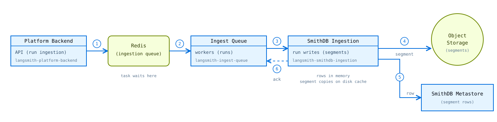
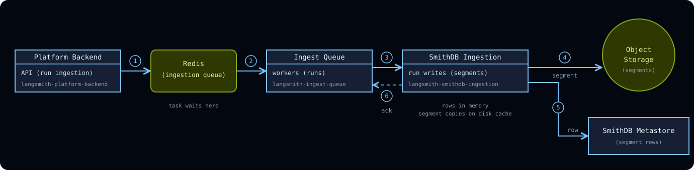
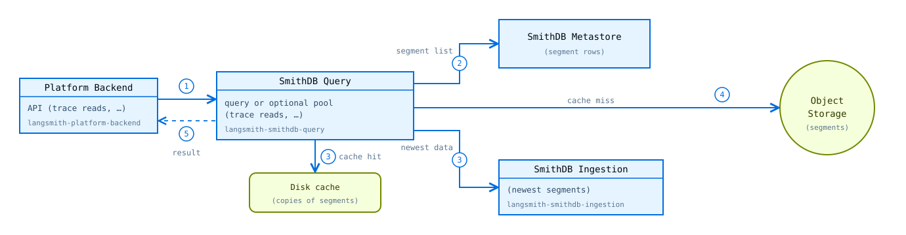
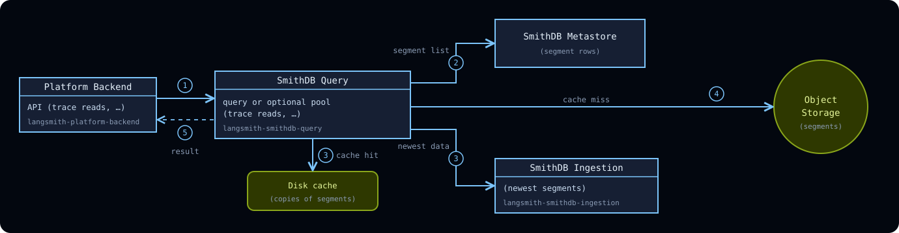
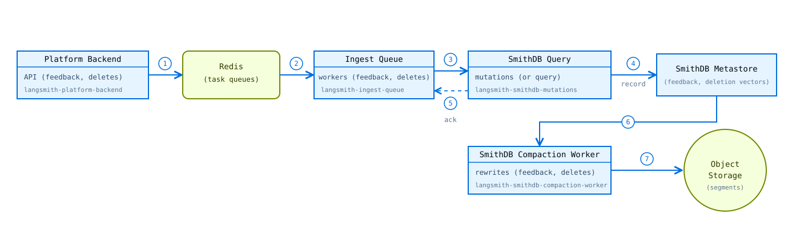
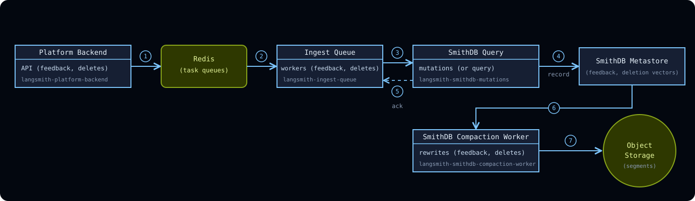

SmithDB 会沿着固定的路径写入 run、响应查询、应用 feedback 和删除，并压缩已存储的数据。了解这些路径有助于你在监控 SmithDB 时判断延迟或故障出现在哪个环节。本页涉及的组件和术语，请参见 [SmithDB 架构](/langsmith/self-host-smithdb-architecture)。

## 写入路径

写入路径指的是来自 SDK 的新 run 如何到达 SmithDB 中的持久存储。

1. platform backend 接收来自 SDK 的 run，并向 Redis 中的 ingestion queue 添加一个 *task*，即一批 run。
2. 一个 ingest queue worker 取走该 task。
3. worker 将这些 run 发送给 SmithDB ingestion。ingestion 会把这些行在内存中短暂保留。
4. ingestion 将这些行作为 *segment* 写入 object storage，该 segment 是 SmithDB 写入后永不更改的数据文件。
5. ingestion 在 *metastore* 中记录该 segment。当 segment 同时存在于 object storage 和 metastore 中时，数据即已持久化。
6. ingestion 向 worker 确认写入，worker 随后从 Redis 中移除该 task。

如果写入失败，task 会留在 Redis 中，worker 稍后会再次尝试。在固定次数的失败尝试后，worker 会放弃，该 task 中的 run 就会丢失。run 数据也会在固定时间后在 Redis 中过期。由于 task 会一直留在 Redis 中，直到 ingestion 确认写入，写入缓慢或失败首先表现为 Redis 中的队列变大。

写入之后，ingestion 会把新 segment 的副本保存在其 *disk cache* 上，以便查询可以从那里读取最新数据。之后，ingestion 会把小 segment 合并成更大的 segment，compaction 会在后台继续这项工作。disk cache 从不保存数据的唯一副本。

## 读取路径

读取路径指的是 SmithDB 如何响应来自 LangSmith 的查询，例如针对 traces、run 列表和 run 统计的查询。

1. platform backend 将 UI 和 API 查询发送给 SmithDB query。
2. query 向 metastore 询问哪些 segment 包含该 tenant、该项目和该时间范围的数据。
3. 对于每个 segment，query 使用拥有它的最快来源。它从写入最新 segment 的 ingestion pod 读取这些 segment，并从其 *disk cache* 读取所有其他 segment。
4. 如果 segment 不在 disk cache 上，或 ingestion pod 不可用，query 会从 object storage 读取它，并在自己的 disk cache 上保留一份副本，供下次查询使用。
5. query 将所有 segment 合并为一个结果，移除已删除和已过期的行，并把结果发送给 platform backend。

一个查询必须读取的 segment 越多，它就越慢。*Compaction* 会把小 segment 合并成更大的 segment，以压低这一数量。如果 compaction 延迟，查询会变慢，query 还会拒绝那些必须读取过多 segment 的查询。

## feedback 和删除路径

feedback 和删除路径指的是 SmithDB 如何更改它已经存储的 run：为 run 添加 feedback，以及移除已删除的 run。

由于 SmithDB 永不更改 segment，feedback 和删除遵循自己的路径，并进入同一个 SmithDB 池。

1. platform backend 接收 feedback 和删除。它向 Redis 中的一个队列添加 task：feedback 进入 *feedback queue*，删除进入另一个 task 队列。
2. 一个 ingest queue worker 取走该 task。
3. worker 将该 task 发送给 SmithDB mutations 池；如果未启用 mutations 池，则发送给 query 池。
4. SmithDB 将 feedback 作为行存储在 metastore 中。对于删除，SmithDB 找出要删除的行，并将它们作为 *deletion vector* 记录在 metastore 中。
5. SmithDB 向 worker 确认更改，worker 随后从 Redis 中移除该 task。从此以后，查询会显示新的 feedback，并隐藏已删除的行。
6. 之后，compaction job 会读取新的 feedback 和 deletion vector。
7. 在 object storage 中，compaction job 会把 feedback 写入 run segment 旁边的文件，并在重写受影响的 segment 时去掉已删除的行。

## compaction 路径

compaction 路径指的是 SmithDB 如何让已存储的数据保持可快速查询：合并小 segment、把 feedback 写入文件，并移除过期和已删除的数据。

1. compaction scheduler 监视 metastore 中新增和变更的 segment，并为它们规划 *compaction jobs*。它把这些 job 保存在内存中的队列里。
2. 一个 compaction worker 取走一个 job，从 object storage 读取其输入 segment，并把新 segment 写入 object storage。例如，它把多个小 segment 合并为一个更大的 segment、把 feedback 写入文件，或重写某个 segment 以去掉其已删除和已过期的行。
3. worker 在一个步骤中于 metastore 内用新 segment 替换旧 segment。如果另一个 job 先更改了其中一个旧 segment，则不会有任何更改，该 job 失败。此类单次失败是正常的。

旧 segment 会在 object storage 中保留至少一小时，以便更早开始的查询仍能读取它们。之后，compaction scheduler 会删除它们。如果 scheduler 重启，它会从 metastore 重新构建队列。worker 在重启期间完成的工作会被保留。

## 另请参阅

- [SmithDB 架构](/langsmith/self-host-smithdb-architecture)
- [SmithDB 指标参考](/langsmith/self-host-smithdb-metrics)
