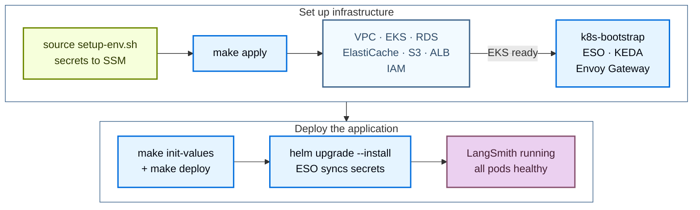

使用公开的 [Terraform modules](https://github.com/langchain-ai/terraform/tree/main/modules/aws) 将 LangSmith 部署到 AWS。以代码方式管理部署，你可以在多个账号之间对 LangSmith 环境进行版本化、审查和复现，而不必在 AWS Console 中逐一点击。

安装分为两个阶段：

1. **Infrastructure**：Terraform 预配 VPC、EKS、RDS、ElastiCache、S3、ALB 和 IAM，然后引导安装集群 add-on。
2. **Application**：Helm 在集群上安装 LangSmith chart。

完成基础安装后，通过设置开关并重新部署来启用可选 add-on。



## 前置条件

### 所需工具

| 工具 | 版本 | 用途 |
|---|---|---|
| AWS CLI | v2 | 认证、查询 AWS 资源、管理 EKS kubeconfig |
| Terraform | 1.11 或更高版本 | 运行基础设施 module |
| `kubectl` | 1.34 或更高版本 | 检查 EKS 集群 |
| Helm | 3.12 或更高版本 | 安装和管理 LangSmith chart |
| `eksctl` | latest | 可选，便于 kubeconfig 和调试 |

在 macOS 上安装：

```bash
brew install awscli kubectl helm eksctl
brew tap hashicorp/tap && brew install hashicorp/tap/terraform
```

确认每个工具都在 `PATH` 上：

```bash
aws --version
terraform version
kubectl version --client
helm version
```

在 Linux 上，请遵循 [AWS CLI install guide](https://docs.aws.amazon.com/cli/latest/userguide/getting-started-install.html)，其余工具使用你的发行版自带的包管理器安装。

### 所需的 AWS IAM 权限

运行 Terraform 的 IAM 用户或角色需要 `AdministratorAccess`，或 `PowerUserAccess` 加上 `IAMFullAccess`。module 会为 IRSA 创建 IAM 角色和策略，因此仅有 `PowerUserAccess` 不够。如需收窄权限的策略，请参见 module 中的 [`PERMISSIONS.md`](https://github.com/langchain-ai/terraform/blob/main/modules/aws/PERMISSIONS.md)。

<Tip>
完成认证并创建 `infra/terraform.tfvars`（参见[克隆并配置](#clone-and-configure)）后，在 `modules/aws/` 中运行 `make preflight`。这些只读检查会确认 CLI 工具、`tfvars` 文件、当前凭证和 region，然后探测对 module 使用的每个 AWS 服务的读取权限。若还要测试凭证能否创建资源，请运行 `make preflight ARGS="--create-test-resources"`。
</Tip>

### 认证

使用 CLI 配置 AWS 凭证：

```bash
aws configure
```

或导出环境变量：

```bash
export AWS_ACCESS_KEY_ID="..."
export AWS_SECRET_ACCESS_KEY="..."
export AWS_DEFAULT_REGION="us-west-2"
```

确认凭证有效，且目标 region 已在账号中启用：

```bash
aws sts get-caller-identity
aws ec2 describe-availability-zones --query 'AvailabilityZones[].ZoneName' --output table
```

### License key 与域名

- **LangSmith license key。** 可[联系 LangChain 销售团队](https://www.langchain.com/contact-sales)申请。setup 脚本会将该 key 存入 AWS SSM Parameter Store，而不是存放在 `tfvars` 中。
- **域名（可选）。** 设置 `langsmith_domain` 即可通过自己的 hostname 访问 LangSmith。设置了域名且未设置 `acm_certificate_arn` 时，Terraform 会创建 Route 53 hosted zone、申请 ACM 证书并创建 ALB alias 记录。要改用已有的 hosted zone，请设置 `dns_create_zone = false` 和 `dns_existing_zone_id`。要自带证书，请设置 `acm_certificate_arn`。将 `langsmith_domain` 留空即可通过 ALB hostname 访问 LangSmith。没有域名时，请设置 `tls_certificate_source = "none"` 以提供纯 HTTP。`acm_certificate_arn` 也可以在没有域名的情况下使用，但 `make preflight-post` 的 TLS 检查会失败，因为 `acm` 要求 `langsmith_domain`。

### 集群容量参考

容量由两个相互独立的设置控制：

- **Infrastructure capacity** 通过基础设施变量 `eks_managed_node_groups`、`postgres_instance_type` 和 `redis_instance_type` 直接设置实例类型和节点数量。module 默认值为一个 `m5.4xlarge` 节点组（最少 3 个、最多 10 个节点）、RDS 使用 `db.t3.large`、ElastiCache 使用 `cache.m6g.xlarge`。`infra/terraform.tfvars.dev`、`terraform.tfvars.minimum` 和 `terraform.tfvars.production` 模板会设置更小或更大的值。
- **`sizing_profile`** 选择 Helm sizing overlay（pod 资源 requests 和 limits）。由 `init-values.sh` 和 `deploy.sh` 读取；Terraform 不读取它。

部署之前，请按目标层级规划好基础设施容量。各层级建议请参见[扩缩容指引](/langsmith/self-host-scale)。

<Note>
对于生产工作负载，还需计划预配外部的 [LangChain Managed ClickHouse](/langsmith/langsmith-managed-clickhouse) 或自行管理的外部 ClickHouse 集群。In-cluster ClickHouse 仅支持 dev/POC。
</Note>

## 快速开始

<Tip>
关于 `make` 目标、必需变量和常见约束的精简速查表，请参见 [AWS 速查参考](/langsmith/self-host-terraform-aws-quick-reference)。
</Tip>

要从零最快启动一个运行中的 LangSmith 实例，请按顺序执行以下命令：

```bash
# 1. Clone the public modules
git clone https://github.com/langchain-ai/terraform.git
cd terraform/modules/aws

# 2. Generate terraform.tfvars interactively (Enter accepts current values)
make quickstart

# 3. Load secrets into SSM Parameter Store
#    Must be sourced, not executed
source infra/scripts/setup-env.sh

# 4. Provision infrastructure
make init
make plan
make apply

# 5. Configure kubectl
source infra/scripts/set-kubeconfig.sh
kubectl get nodes

# 6. Deploy LangSmith with Helm
make init-values
make deploy

# 7. Confirm
kubectl get pods -n langsmith
kubectl get httproute -n langsmith
```

`make deploy` 会在完成时打印 LangSmith URL。

要在一条命令中串联基础设施和应用部署，请先在同一个 shell 中运行 `make quickstart` 和 `source infra/scripts/setup-env.sh`，然后：

```bash
make quickdeploy          # interactive, prompts before terraform apply
make quickdeploy-auto     # non-interactive, auto-approves terraform
```

`make quickdeploy` 会先检查 `setup-env.sh` 的导出是否已加载、`infra/terraform.tfvars` 是否存在，若任一缺失则停止并给出要运行的命令。如果 `infra/.terraform/` 不存在，它会先运行 `terraform init`，然后运行 `terraform apply`、source `set-kubeconfig.sh`，并运行 `init-values` 和 `deploy.sh`。如果 `terraform apply` 失败，请修复问题后重新运行 `make quickdeploy`。如果后续步骤失败，命令会打印要重试的 `make` 目标。

以下各节详细介绍每个阶段。

## 预配基础设施

Terraform 会预配以下 AWS 资源：

| 资源 | 用途 |
|---|---|
| VPC + subnets + NAT | 集群和托管服务的私有网络 |
| EKS cluster + node groups | Kubernetes 计算资源 |
| RDS PostgreSQL | LangSmith 运营数据 |
| ElastiCache Redis | 队列与缓存 |
| S3 bucket + VPC endpoint | Trace payload blob storage |
| ALB + listeners | 入口点；使用 `acm` 终止 TLS |
| IRSA roles + IAM policies | 每个服务的 AWS 访问权限 |
| KEDA, External Secrets Operator, Envoy Gateway | 随基础设施一同安装的引导工作负载。Envoy Gateway 是默认 ingress。cert-manager 仅在 Let's Encrypt 时添加。 |

应用机密存放在 SSM Parameter Store 中。由 `setup-env.sh` 写入（而非 Terraform），External Secrets Operator 会将其同步到集群。

### 克隆并配置

```bash
git clone https://github.com/langchain-ai/terraform.git
cd terraform/modules/aws
```

`main` 分支和 `v0.17.*` release tag 部署的是 LangSmith Helm chart v17，即本指南所描述的版本。

<Note>
要继续使用 chart v16，请运行 `git checkout release/0.16` 或检出某个 `v0.16.*` tag。本指南中的提示会标注 chart v16 的差异之处。
</Note>

后续所有命令都在 `modules/aws/` 中运行。完整目标列表请运行 `make help`。

使用交互式向导生成 `terraform.tfvars`：

```bash
make quickstart
```

向导会依次走过 13 个部分，包括命名、region、网络、EKS 规格、数据源、TLS 和 DNS、ingress，以及可选 add-on 开关，并写入 `infra/terraform.tfvars`。当文件已存在时，向导会提供三个选项：以预选现有值的方式更新、从头开始，或取消，并且会先备份原文件。有些设置（例如自带安全组变量 `*_existing_security_group_id`）不在向导中，需要手动写入 `terraform.tfvars`。向导更新已有文件时会丢弃这类手写设置，请从 `infra/terraform.tfvars.backup` 恢复它们。

更喜欢手动编辑？复制示例文件并填写必需字段：

```bash
cp infra/terraform.tfvars.example infra/terraform.tfvars
vi infra/terraform.tfvars
```

最少必需的变量：

```hcl
name_prefix = "acme"
environment = "prod"
region      = "us-west-2"

eks_cluster_version = "1.34"
eks_managed_node_groups = {
  default = {
    name           = "node-group-default"
    instance_types = ["m5.4xlarge"]
    min_size       = 3
    max_size       = 10
  }
}

postgres_source = "external"
redis_source    = "external"

tls_certificate_source = "acm"
langsmith_domain       = "langsmith.example.com"
# dns_create_zone      = false                    # write records into a zone that already resolves
# dns_existing_zone_id = "<hosted-zone-id>"
# acm_certificate_arn  = "arn:aws:acm:us-west-2:<account-id>:certificate/<cert-id>"  # optional with a domain
```

<Note>
设置了域名且未设置 `acm_certificate_arn` 时，Terraform 会申请 ACM 证书，`make apply` 会等待 DNS 验证成功。使用默认的 `dns_create_zone = true` 时，Terraform 会为 `langsmith_domain` 创建新的 hosted zone，只有在你从父域名委托该 zone 的 NS 记录之后验证才会成功。要在已解析的 zone 中验证，请设置 `dns_create_zone = false` 和 `dns_existing_zone_id`。要在委托完成之前部署，请遵循 [自动预配的 DNS](/langsmith/self-host-terraform-aws-architecture#auto-provisioned-dns) 中的分阶段部署模式。
</Note>

所有输入变量请参见 [AWS 变量参考](/langsmith/self-host-terraform-aws-variables)。

<Tip>
在 apply 之前配置远程 state 后端。将 `infra/backend.tf.example` 复制为 `infra/backend.tf`，并设置 S3 bucket、key、region 和 DynamoDB 锁表。没有它时，Terraform 会在本地保存 state。
</Tip>

### 将机密写入 SSM Parameter Store

```bash
source infra/scripts/setup-env.sh
```

该脚本读取 `terraform.tfvars`，推导出 SSM 路径 `/langsmith/{name_prefix}-{environment}/`，然后对每个机密依次尝试：复用已导出的值、读取已有的 SSM 参数、自动生成，或提示你输入。你需要交互输入三个值：license key、管理员密码和管理员邮箱。脚本必须以 `source` 方式加载（而非直接执行），因为 `make` 无法把环境变量导回父 shell。

该脚本管理以下 SSM 参数：

| SSM key | 设置方式 | 说明 |
|---|---|---|
| `postgres-password` | 自动生成（`openssl rand -hex 32`） | RDS master password |
| `redis-auth-token` | 自动生成（hex） | ElastiCache auth token |
| `sandbox-juicefs-redis-auth-token` | 自动生成（hex） | 仅在 `enable_sandboxes = true` 时 |
| `langsmith-api-key-salt` | 自动生成（`openssl rand -base64 32`） | 切勿轮换，否则所有 API key 失效 |
| `langsmith-jwt-secret` | 自动生成（`openssl rand -base64 32`） | 切勿轮换，否则所有会话失效 |
| `sandbox-callback-signing-jwk` | 自动生成 Ed25519 key | 仅在 `enable_sandboxes = true` 时 |
| `langsmith-license-key` | 提示输入 | 来自 [LangChain 销售团队](https://www.langchain.com/contact-sales) |
| `langsmith-admin-password` | 提示输入 | 至少 12 个字符，包含小写字母、大写字母和一个符号 |
| `langsmith-admin-email` | 提示输入 | 初始组织 admin |
| `deployments-encryption-key` | 自动生成 Fernet key | LangSmith Deployment add-on |
| `agent-builder-encryption-key` | 自动生成 Fernet key | 由 Fleet 使用；名称沿用改名前的叫法 |
| `insights-encryption-key` | 自动生成 Fernet key | Insights add-on |
| `polly-encryption-key` | 自动生成 Fernet key | LangSmith Chat（原 Polly）add-on |

如果之后才开启 `enable_sandboxes`，请在 `make apply` 之前重新 source `setup-env.sh`，以便它创建 sandbox 机密。

确认机密已存在且 `TF_VAR_*` 环境变量已导出：

```bash
make secrets
```

### 执行 apply

```bash
make init
make plan
make apply
```

`make plan` 会显示拟议的变更。执行 apply 前请先审查输出。`make apply` 会跨所有 module 运行单个 `terraform apply`；Terraform 按依赖顺序排列资源。传入 `ARGS="-auto-approve"` 可跳过确认提示。

### 配置 kubectl

```bash
source infra/scripts/set-kubeconfig.sh
kubectl get nodes
kubectl get pods -A
```

`set-kubeconfig.sh` 会写入专用的 `~/.kube/langsmith-<cluster>` 文件并导出 `KUBECONFIG`，因此不会改动 `~/.kube/config`。`make kubeconfig` 只会打印这条命令。

所有节点都应报告 `Ready`。核心 add-on 应处于 `Running` 状态：`kube-system` 中的 CoreDNS、kube-proxy 和 VPC CNI，`keda` 中的 KEDA，`external-secrets` 中的 External Secrets Operator，以及 `envoy-gateway-system` 中的 Envoy Gateway。cert-manager 仅在 `tls_certificate_source = "letsencrypt"` 或 `create_cert_manager_irsa = true` 时运行。

## 部署 LangSmith

```bash
make init-values
make deploy
```

`make init-values` 从 `terraform.tfvars` 读取 `sizing_profile` 和 `enable_*` 开关，根据 Terraform outputs 写出 `helm/values/langsmith-values-overrides.yaml`，并把对应的 values 文件从 `helm/values/examples/` 复制到 `helm/values/`。管理员邮箱会复用已有 overrides 文件中的值，或取自 `LANGSMITH_ADMIN_EMAIL`（由 `setup-env.sh` 设置），否则提示输入。重复运行时会刷新 Terraform outputs，并且只在其缺失时才复制 add-on values 文件，因此你对已有文件的修改会保留下来。

`make deploy` 会运行 `helm/scripts/deploy.sh`，它会：

1. 解析 chart 版本，并确认其位于 v17 线上。
2. 使用 `aws eks update-kubeconfig` 刷新 kubeconfig。
3. 运行 preflight 检查（AWS 凭证、集群可达性、`langchain` Helm 仓库）。
4. 应用 External Secrets Operator 的 `ClusterSecretStore` 和 `ExternalSecret`，让集群直接从 SSM 读取机密。
5. 使用分层 values 文件运行 `helm upgrade --install`，并等待核心 pods 就绪。
6. 在未设置 `langsmith_domain` 且负载均衡器 hostname 发生变化时再升级一次，然后打印 LangSmith URL。

### 固定 chart 版本

`deploy.sh` 默认安装 LangSmith Helm chart v17 线（`~0.17.0`）上的最新补丁版本。要固定到某个确切的补丁版本，请在 `terraform.tfvars` 中设置 `langsmith_helm_chart_version = "0.17.x"`，或运行 `CHART_VERSION=0.17.x make deploy`。环境变量优先于 `tfvars` 设置。`deploy.sh` 会拒绝 v17 线之外的版本，Terraform 验证也会在 plan 阶段拒绝 v17 线之外的 `langsmith_helm_chart_version`。`deploy.sh` 还会拒绝仍在使用 chart v15 key（`config.insights`、`config.polly`、`backend.agentBootstrap`）的 values 文件。

<Note>
在 chart v16 上，请使用 `v0.16.*` module release 或 `release/0.16` 分支。这些 release 固定在 `~0.16.0`，且只接受 `0.16.x` 版本。要将现有的 chart v16 部署迁移到 v17，请遵循[从 chart v16 升级到 v17](#upgrade-from-chart-v16-to-v17)。
</Note>

### 验证

```bash
kubectl get pods -n langsmith
kubectl get httproute -n langsmith
```

当所有 pods 处于 `Running` 后，打开 `make deploy` 打印的 URL。设置了 `langsmith_domain` 时会使用该域名，否则使用 ALB hostname。随时可以运行 `make status`，查看每一层的摘要和下一步要运行的命令。

### 从 chart v16 升级到 v17

<Warning>
不支持从 chart v17 降级到 v16。升级前请备份数据库。
</Warning>

`enable_sandboxes = false` 且 `enable_smithdb = false` 的部署只需移动 chart 固定版本。Sandboxes 和 SmithDB 需要以下额外步骤。module 不会设置 Engine values，因此如果你在自己的 values overrides 中启用了 Engine，还请在[从 v16 升级到 v17](/langsmith/self-host-upgrades#upgrade-from-v16-to-v17) 中一并应用 Engine 的变更。

1. 检出某个 `v0.17.*` tag，或拉取 `main`。
1. 如果 `terraform.tfvars` 将 `langsmith_helm_chart_version` 固定在某个 `0.16.x` 补丁版本上，请清除它或设置为 `0.17.x` 补丁版本；如果你的 shell 设置了 `CHART_VERSION`，请运行 `unset CHART_VERSION`。Terraform 验证会在 plan 阶段拒绝 `0.16.x` 固定版本，`deploy.sh` 也会拒绝 `CHART_VERSION` 中的 `0.16.x` 值。
1. 运行 `make apply`。从 module release `v0.16.83` 或更高版本开始，v17 module 不会更改任何 AWS 资源，因此 Terraform 不会报告基础设施变更。如果来自更早的 `v0.16.*` release，请在 apply 前先审查 `make plan` 的输出。
1. 运行 `make init-values`。它会按 chart v17 的 sandbox schema 重写 `langsmith-values-overrides.yaml`。
1. 如果 `enable_smithdb = true`，请更新 `make init-values` 不会覆盖的 values 文件中的 SmithDB key。Chart v17 无法渲染旧 key：
   - 在 `helm/values/langsmith-values-smithdb.yaml` 中，将 `smithdb.migration.deployment` 重命名为 `smithdb.migration.job`。
   - 在 `helm/values/langsmith-values-sizing-*.yaml` 中，将 `smithdb.query.autoscaling.*`、`smithdb.ingestion.autoscaling.*` 和 `smithdb.compactionWorker.autoscaling.*` 移到 `autoscaling.hpa.*` 下。在 `langsmith-values-sizing-production-large.yaml` 中，将 `local-ssd-storage` 卷重命名为 `cache`。

   如果你没有自定义过这些文件，直接删除它们并重新运行 `make init-values`，以复制 v17 版本。这些 key 背后的 chart 变更请参见 [Cache storage](/langsmith/self-host-smithdb-infrastructure#cache-storage)。

   只有 `production-large` sizing 文件定义了 `cache` 卷。使用 `dev`、`minimum` 或 `production` profile 时，chart v17 会根据 `smithdb.cache.storageClassName` 为每个 SmithDB cache 提供每 pod 的 PVC，未设置该值时则使用集群默认的 StorageClass。在 chart v16 上，每个 cache 是一个 `emptyDir`。要选择 cache 的存放位置，请设置 `smithdb.cache.storageClassName`，或为每个使用磁盘的 SmithDB 组件定义一个名为 `cache` 的卷。
1. 运行 `make deploy`。当 chart v16 上有正在运行的 sandboxes 时，第一次运行会以 `namespace langsmith still mounts sandbox volumes through the chart 0.16 JuiceFS CSI driver` 停止，并打印排出（drain）旧卷的命令。运行这些命令，等到只剩下 `juicefs-csi-*` pods 后，再次运行 `make deploy`。正在运行的 sandboxes 会在 drain 期间停止。它们的数据保留在 S3 和 Redis 中，chart v17 会挂载同一个 JuiceFS 卷。
1. 验证 sandbox 切换：

   ```bash
   kubectl get jobs -n langsmith -l app.kubernetes.io/component=juicefs-format
   kubectl rollout status deployment -n langsmith -l app=sandbox-host --timeout=10m
   kubectl get daemonset,statefulset -n langsmith | grep juicefs-csi   # expect no output
   ```

v17 中的所有 chart 变更请参见[从 v16 升级到 v17](/langsmith/self-host-upgrades#upgrade-from-v16-to-v17)，以及 Terraform 仓库中的 [`MIGRATION-0.16-to-0.17.md`](https://github.com/langchain-ai/terraform/blob/main/MIGRATION-0.16-to-0.17.md) 指南。

## 启用 add-on

每个 add-on 都由 `infra/terraform.tfvars` 中的一个开关控制。设置开关后，运行 `make apply`，重新运行 `make init-values` 以复制对应的 values 文件，然后重新运行 `make deploy`。对于由 Terraform 预配的 add-on，`make apply` 是必需的：使用外部存储的 Fleet（默认）、使用外部存储的 LangSmith Chat 或 Insights、sandboxes，以及 SmithDB。Sandboxes 和 SmithDB 会创建 AWS 资源。外部存储会在现有 RDS 实例上创建数据库，并创建对应的 Kubernetes 机密。其余 add-on 的 `make apply` 不会做任何更改。

```hcl
enable_deployments     = true            # LangSmith Deployment (listener, operator, host-backend)
enable_fleet           = true            # Fleet (formerly Agent Builder)
fleet_storage          = "external"      # default; "in-cluster" uses chart StatefulSets
enable_polly           = true            # LangSmith Chat (formerly Polly)
polly_storage          = "in-cluster"    # default; "external" uses RDS and ElastiCache
enable_insights        = true            # AI-powered trace analysis
insights_storage       = "in-cluster"    # default; "external" uses RDS and ElastiCache
enable_sandboxes       = false           # LangSmith Sandboxes
enable_smithdb         = false           # SmithDB
enable_usage_telemetry = false           # Extended usage telemetry
```

```bash
make apply
make init-values
make deploy
```

`enable_agent_builder` 在 chart v16 中已被移除。将其设置为 `true` 会在 `terraform plan` 时验证失败，因此请从现有的 `tfvars` 文件中删除它，改用 `enable_fleet`。`enable_standalone_polly` 和 `enable_standalone_insights` 作为旧版简写保留，它们以外部存储启用对应 add-on（即 `enable_polly = true` 加 `polly_storage = "external"`，Insights 同理）。

agent 部署的详细信息请参见 [LangSmith Deployment](/langsmith/deploy-self-hosted-full-platform)。

### Fleet

<Note>
Fleet 是原 Agent Builder 功能的现有形态。它要求 LangSmith Helm chart v15 或更高版本，且 license 中包含 Fleet entitlement。
</Note>

通过 `enable_fleet = true` 启用 Fleet。Fleet 会安装它所需的 host-backend，因此 `enable_deployments` 是可选的。

使用默认的 `fleet_storage = "external"` 时，Fleet 要求外部 Postgres 和 Redis（`postgres_source = "external"` 和 `redis_source = "external"`）。Terraform 会在 RDS 上创建专用的 `langsmith_fleet` 数据库，并把 `langsmith-fleet-postgres` 和 `langsmith-fleet-redis` 机密接到现有的 RDS 和 ElastiCache 实例上。设置 `fleet_storage = "in-cluster"` 可改用 chart 中的 PostgreSQL 和 Redis StatefulSets。

Fleet 会复用 `agent-builder-encryption-key` SSM 参数，因此从 Agent Builder 迁移的部署会保留相同的 key 和数据。

### LangSmith Chat 与 Insights

`enable_polly` 开启 LangSmith Chat（原 Polly），`enable_insights` 开启 Insights。两者都不要求 `enable_deployments`，默认都使用 in-cluster 存储。设置 `polly_storage = "external"` 或 `insights_storage = "external"` 可使用共享 RDS 和 ElastiCache 实例上的专用数据库；这要求 `postgres_source = "external"` 和 `redis_source = "external"`。每个 add-on 都需要 license 中包含对应的 entitlement。

### Sandboxes

`enable_sandboxes = true` 会添加一个基于带 KVM 的裸金属 x86_64 实例的 sandbox-host 节点组（默认 `m5d.metal`），以及一个用于 JuiceFS metadata 的专用 ElastiCache 实例。Sandboxes 要求 LangSmith Helm chart v16 或更高版本。

`sandbox-host` 自身挂载 JuiceFS，并由一个 `juicefs-format` Job 格式化卷。`make init-values` 会写入指向 `juicefs-csi-config` Secret 的 `sandboxes.juicefs.existingSecretName`，在 sandbox-host 节点有本地 NVMe 缓存路径时将 `sandboxes.juicefs.hostMount.cacheDirs` 设置为这些路径，并把 IRSA 角色标注放到 `sandboxes.sandboxHost.serviceAccount` 上。

<Note>
在 chart v16 上，chart 改为捆绑 JuiceFS CSI driver。来自 `v0.16.*` module release 的 `make init-values` 会写入 `sandboxes.juicefs.csi.existingSecretName`，并把 IRSA 角色标注放到 `sandboxes.juicefs.csi.node.serviceAccount` 上。`juicefs-csi-config` Secret 在两条版本线上相同。
</Note>

在现有部署上启用 sandboxes：

```bash
# After setting enable_sandboxes = true in infra/terraform.tfvars
source infra/scripts/setup-env.sh
make apply
make init-values
make deploy
```

重新 source `setup-env.sh` 会创建 JuiceFS Redis auth token 和 sandbox 回调签名 key。`sandbox_*` 变量控制节点数量、实例类型和 JuiceFS 设置；参见[变量参考](/langsmith/self-host-terraform-aws-variables#sandboxes)。

### SmithDB

`enable_smithdb = true` 会预配 SmithDB 的依赖：一个 metastore PostgreSQL 实例、一个 S3 bucket、一个 IRSA role，以及基于本地 NVMe 实例的 Karpenter node pool。随后 `make init-values` 会写出 `langsmith-values-smithdb.yaml` 和 `langsmith-values-smithdb-overrides.yaml`，`make deploy` 在任一文件缺失时会停止。

服务健康后，三个开关将流量迁移到 SmithDB：

- `smithdb_ingestion_enabled` 将新的写入路由到 SmithDB。
- `smithdb_migration_enabled` 迁移历史 ClickHouse 数据。它要求先开启 ingestion。
- `smithdb_query_enabled` 由 SmithDB 提供查询服务。它要求先开启 ingestion。

三者都要求 `enable_smithdb = true`。请按照 [Karpenter 兼容性矩阵](https://karpenter.sh/docs/upgrading/compatibility/)使 `smithdb_karpenter_chart_version`（默认 `1.6.3`）与 `eks_cluster_version` 保持兼容。完整列表参见[变量参考](/langsmith/self-host-terraform-aws-variables#smithdb)。

## 可选：带 bastion 的私有 EKS 集群

对于必须运行完全私有 EKS API endpoint 的部署，这些 module 提供了 bastion 主机模式：

1. 首先，在工作站上以 `create_bastion = true` 和 `enable_public_eks_cluster = true` 运行，以便创建 bastion。
2. 初始部署完成后，设置 `enable_public_eks_cluster = false` 并重新 apply。EKS API endpoint 将变为仅私有。
3. 后续所有 Terraform 工作都在 bastion 上进行。通过 SSM 登录 bastion，克隆仓库，复制你的 `terraform.tfvars` 和 SSM 机密，然后从那里运行部署。

```hcl
enable_public_eks_cluster = false
create_bastion            = true

# Optional SSH access (SSM is the default and requires no key):
# bastion_key_name          = "my-keypair"
# bastion_enable_ssh        = true
# bastion_ssh_allowed_cidrs = ["203.0.113.0/24"]
```

通过 SSM Session Manager 连接：

```bash
make tf ARGS="output bastion_ssm_command"
aws ssm start-session --target <instance-id> --region us-west-2
```

<Note>
bastion 运行在没有公网 IP 的私网子网中，并通过 NAT gateway 访问 SSM。设置 `bastion_enable_ssh = true` 会将其移到带公网 IP 的公共子网。设置 `bastion_existing_security_group_id` 可挂载你自己的安全组。bastion 预装了 `kubectl`、`helm`、`terraform`、`git` 和 `jq`，kubeconfig 已为 EKS 集群配置好。请在你的工作站上为 AWS CLI 安装 [Session Manager plugin](https://docs.aws.amazon.com/systems-manager/latest/userguide/session-manager-working-with-install-plugin.html)。
</Note>

## Ingress、DNS 与 TLS

ALB 始终是入口点。使用 `acm` 时，由它终止 TLS。它后面的 [Envoy Gateway](https://gateway.envoyproxy.io/) 是默认 ingress：ALB 通过 TargetGroupBinding 将流量转发到 Envoy pods，LangSmith chart 会创建 `HTTPRoute` 资源而不是 `Ingress`。

| `terraform.tfvars` 中的设置 | Ingress |
|---|---|
| 未设置任何开关 | ALB 后面的 Envoy Gateway（默认） |
| `enable_envoy_gateway = false` | 由 AWS Load Balancer Controller 创建的 ALB Ingress |
| `enable_istio_gateway = true` | ALB 后面的 Istio gateway |
| `enable_nginx_ingress = true` | ALB 后面的 NGINX ingress controller（旧版） |

Terraform 会拒绝同时开启其中多个的配置。

在 ALB Ingress 模式下，AWS Load Balancer Controller 会创建自己的 ALB，Terraform ALB 则不会被使用。Terraform 为 `langsmith_domain` 创建的 Route 53 alias 记录仍指向 Terraform ALB，因此需要你自行将域名指向 Ingress hostname（`kubectl get ingress -n langsmith`）。

<Warning>
在 Envoy Gateway 成为默认值之前创建、且未设置任何 gateway 开关的部署，会在下一次 `make apply` 时切换到 Envoy Gateway。要保留 ALB Ingress，请在 apply 之前设置 `enable_envoy_gateway = false`。
</Warning>

`tls_certificate_source` 选择证书：

- `acm`（默认）：ALB 上的 ACM 证书，由 Terraform 为 `langsmith_domain` 创建，或通过 `acm_certificate_arn` 提供。适用于所有 ingress 选项。
- `letsencrypt`：使用 Let's Encrypt 的 cert-manager，通过 ALB Ingress class 解决 HTTP-01 challenge。仅在 ALB Ingress 模式（`enable_envoy_gateway = false`）下可用。要求设置 `letsencrypt_email`。
- `none`：不带证书的纯 HTTP。

对于 Istio 要求的经 Route 53 的 Let's Encrypt DNS-01，请设置 `create_cert_manager_irsa = true`、`cert_manager_hosted_zone_id` 和 `letsencrypt_email`。设置 `langsmith_domain` 时，Terraform 会创建 DNS-01 issuer。`create_cert_manager_irsa` 与 `tls_certificate_source = "letsencrypt"` 互斥。

设置了 `langsmith_domain` 且 `acm_certificate_arn` 为空时，`make apply` 会创建 ACM 证书和 Route 53 alias 记录。`make tls` 可以在 Terraform 之外做同样的事：它申请并通过 DNS 验证一张证书、写入 alias 记录，并把证书 ARN 写入 `terraform.tfvars`。

<Warning>
在 `make apply` 已为 `langsmith_domain` 创建证书和 alias 之后，不要再运行 `make tls`。`make tls` 写入的 ARN 会关闭 Terraform DNS module，因此下一次 `make apply` 会销毁 Terraform 证书、alias 记录，以及 Terraform 创建的 hosted zone（`dns_create_zone = true` 时）。
</Warning>

### 分离式 dataplane namespace

Envoy Gateway 支持路由到运行在独立 namespace 的 `langgraph-dataplane` chart。每个 dataplane namespace 需应用一次 RBAC manifest：

```bash
kubectl apply -f helm/values/examples/dataplane-rbac.yaml
```

该 manifest 面向 `langsmith-agents` namespace；如需其他 namespace，请自行编辑。它会授予 `langsmith-host-backend` ServiceAccount 对 dataplane namespace 中 pods、pod 日志、deployments 和 ReplicaSets 的读取权限。缺少它时，agent 运行日志不会在 LangSmith UI 中流式显示。

## 后续步骤

- 查阅 [AWS 变量](/langsmith/self-host-terraform-aws-variables)和[速查参考](/langsmith/self-host-terraform-aws-quick-reference)。
- 查看 [AWS 架构](/langsmith/self-host-terraform-aws-architecture)，了解平台分层、IRSA 和 module 依赖。
- 出现问题时，请查阅 [AWS 故障排查指南](/langsmith/self-host-terraform-aws-troubleshooting)。
- 使用 [LangSmith Deployment](/langsmith/deploy-self-hosted-full-platform) 在 UI 中启用 agent 部署。
