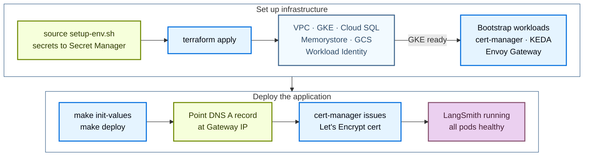

使用公开的 [Terraform modules](https://github.com/langchain-ai/terraform/tree/main/modules/gcp) 将 LangSmith 部署到 GCP。以代码方式管理部署，你可以在多个项目之间对 LangSmith 环境进行版本化、审查和复现，而不必在 Google Cloud console 中逐一点击。

安装分为两个阶段：

1. **Infrastructure**：Terraform 预配 VPC、GKE、Cloud SQL、Memorystore、GCS 和 Workload Identity。
2. **Application**：LangSmith Helm chart，通过部署脚本或直接使用 `helm` 安装。

完成基础安装后，通过设置开关并重新部署来启用可选 add-on。



当你通过 `tls_certificate_source = "letsencrypt"` 设置域名时，DNS 和证书步骤才适用。如果 `tls_certificate_source = "none"` 且 `langsmith_domain = ""`，LangSmith 会通过 Gateway IP 提供 HTTP 服务。

## 前置条件

### 所需工具

| 工具 | 版本 | 用途 |
|---|---|---|
| Google Cloud SDK (`gcloud`) | 450 | 认证、查询 GCP 资源、管理 GKE 凭证 |
| Terraform | 1.11 | 运行基础设施 module |
| `kubectl` | 1.28 | 检查 GKE 集群 |
| Helm | 3.12 | 安装和管理 LangSmith chart |

在 macOS 上安装：

```bash
brew install --cask google-cloud-sdk
brew install kubectl helm
brew tap hashicorp/tap && brew install hashicorp/tap/terraform

gcloud version
terraform version
kubectl version --client
helm version
```

### 所需的 GCP API

首次 apply 时 Terraform 会自动启用这些 API，但必须先启用 `cloudresourcemanager.googleapis.com`，Terraform 才能启用其余 API。为了加快首次运行，可以手动启用全部 API：

```bash
gcloud services enable \
  container.googleapis.com \
  compute.googleapis.com \
  sqladmin.googleapis.com \
  redis.googleapis.com \
  storage.googleapis.com \
  iam.googleapis.com \
  secretmanager.googleapis.com \
  certificatemanager.googleapis.com \
  servicenetworking.googleapis.com \
  cloudresourcemanager.googleapis.com \
  logging.googleapis.com \
  monitoring.googleapis.com \
  --project <your-project-id>
```

### 所需的 IAM 角色

运行 Terraform 的主体需要在目标项目上拥有以下角色。待初始部署稳定后，再收窄为最小权限。

| 角色 | 用途 |
|---|---|
| `roles/container.admin` | 创建和管理 GKE 集群 |
| `roles/compute.networkAdmin` | 创建 VPC、子网、防火墙规则 |
| `roles/iam.serviceAccountAdmin` | 为 Workload Identity 创建 service account |
| `roles/cloudsql.admin` | 创建和管理 Cloud SQL 实例 |
| `roles/redis.admin` | 创建和管理 Memorystore Redis |
| `roles/storage.admin` | 创建 GCS bucket 和 lifecycle 策略 |
| `roles/resourcemanager.projectIamAdmin` | 在预配过程中授予 IAM 绑定 |
| `roles/servicenetworking.networksAdmin` | 创建私有服务连接（Cloud SQL 和 Redis 必需） |
| `roles/compute.securityAdmin` | 创建防火墙规则和 SSL 证书 |
| `roles/iam.serviceAccountUser` | 将 service account 挂接到 GKE 节点 |
| `roles/serviceusage.serviceUsageAdmin` | 启用所需的 GCP API |

另外添加 `roles/secretmanager.admin`，以便 `setup-env.sh` 和可选的 `secrets` module 能写入 Secret Manager；当 `enable_dns_module = true` 时添加 `roles/dns.admin`；当设置了 `smithdb_bucket_kms_key` 时在该 key 上添加 `roles/cloudkms.admin`。module 的 [PERMISSIONS.md](https://github.com/langchain-ai/terraform/blob/main/modules/gcp/PERMISSIONS.md) 列出了完整的角色集合。

### 认证

```bash
gcloud auth login
gcloud config set project <your-project-id>
gcloud auth application-default login
```

你还需要 LangSmith license key（可[联系销售团队](https://www.langchain.com/contact-sales)申请）。如需 HTTPS，还需要一个你拥有 DNS 控制权的域名或子域名。

## 快速开始

<Tip>
有关 `make` targets、所需变量和常见约束的精简速查表，参见 [GCP quick reference](/langsmith/self-host-terraform-gcp-quick-reference)。
</Tip>

要从零开始以最快路径得到一个运行中的 LangSmith 实例，请按顺序运行以下命令。它们部署 Helm chart 0.17。要部署 chart 0.16，参见[克隆与配置](#克隆与配置)。

```bash
# 1. Clone the public modules
git clone https://github.com/langchain-ai/terraform.git
cd terraform/modules/gcp

# 2. Generate terraform.tfvars interactively (Enter accepts current values)
make quickstart

# 3. Load secrets into Secret Manager
#    Must be sourced, not executed
source infra/scripts/setup-env.sh
export LANGSMITH_ADMIN_EMAIL="<your-admin-email>"

# 4. Validate environment
make preflight

# 5. Provision infrastructure (~25 to 35 min)
make init
make plan
make apply

# 6. Configure kubectl
make kubeconfig
kubectl get nodes

# 7. Deploy LangSmith via Helm (~8 to 12 min)
make init-values
make deploy

# 8. Get the Gateway IP for DNS
kubectl get gateway -n envoy-gateway-system \
  -o jsonpath='{.items[0].status.addresses[0].value}'
```

以下各节详细介绍每个阶段。

## 预配基础设施

Terraform 会预配以下 GCP 资源：

| 资源 | 用途 |
|---|---|
| VPC + subnet + Cloud NAT | 集群和托管服务的私有网络 |
| Private service connection | 用于 Cloud SQL 和 Memorystore 私有 IP 的 VPC peering |
| GKE cluster（Standard 或 Autopilot） | Kubernetes 计算，启用 Workload Identity |
| Cloud SQL PostgreSQL | LangSmith 运营数据、HA 备用实例、私有 IP |
| Memorystore Redis | 队列和缓存、STANDARD_HA 层级、私有 IP |
| GCS bucket | Trace payload blob 存储、lifecycle 规则 |
| Workload Identity service account | 每个 pod 的 GCP 访问，无需静态 key |
| cert-manager、KEDA、Envoy Gateway | 随基础设施一同安装的 bootstrap 工作负载 |

### 克隆与配置

```bash
git clone https://github.com/langchain-ai/terraform.git
cd terraform/modules/gcp
```

后续所有命令都在 `modules/gcp/` 中运行。运行 `make help` 查看完整的 target 列表。

<Note>
`main` 分支和 `v0.17.x` release tag 部署 Helm chart 0.17，本指南描述的就是它们。`v0.16.x` tag 部署 chart 0.16。要继续使用 chart 0.16，请列出 tag 并检出最新的 `v0.16.x` tag：

```bash
git tag -l 'v0.16.*' --sort=-v:refname | head -1
git checkout <tag>
```

以 "On chart 0.16" 开头的提示描述了 0.16 版本线的差异。要将现有部署迁移到 chart 0.17，参见[从 chart 0.16 升级](#upgrade-from-chart-0-16)。
</Note>

使用交互式向导生成 `terraform.tfvars`：

```bash
make quickstart
```

向导会先让你选择 Dev/POC 或 Production 配置，然后提示输入 project ID、命名前缀、region、GKE 规格、TLS 来源、外部还是 in-cluster 服务，以及可选的 add-on 开关。Production 配置会提供这些 add-on；Dev/POC 配置会将它们关闭。它会写入 `infra/terraform.tfvars`。重新运行时会预填现有值；在每个提示处按 Enter 即可保留当前配置。

也可以手动编辑：

```bash
cp infra/terraform.tfvars.example infra/terraform.tfvars
vi infra/terraform.tfvars
```

如需占用空间最小的 dev 安装，请改从 `infra/terraform.tfvars.minimum` 入手。典型的生产配置：

```hcl
project_id       = "<your-gcp-project-id>"
name_prefix      = "ls"
environment      = "prod"
langsmith_domain = "langsmith.example.com"

region = "us-west2"
zone   = "us-west2-a"

postgres_source = "external"
redis_source    = "external"

clickhouse_source = "in-cluster"

tls_certificate_source = "letsencrypt"
letsencrypt_email      = "ops@example.com"

enable_langsmith_deployment = true
```

license key 和密码不要放进 `terraform.tfvars`。`setup-env.sh` 会把它们存入 Secret Manager，并导出为 `TF_VAR_*` 变量。所有输入变量参见 [GCP variables reference](/langsmith/self-host-terraform-gcp-variables)。

<Tip>
在 apply 之前配置 remote state backend。将 `infra/backend.tf.example` 复制为 `infra/backend.tf`，并指向你控制的 GCS bucket。本地 state 很脆弱，在目录结构调整过程中可能丢失。
</Tip>

### 将 secrets 载入 Secret Manager

```bash
source infra/scripts/setup-env.sh
```

脚本会从 `terraform.tfvars` 读取 `project_id`、`name_prefix`、`environment` 和 `region`，并将每个 secret 以 `langsmith-<name_prefix>-<environment>-<key>` 的形式存储。对每个 secret，它依次尝试：复用已导出的值、读取现有的 Secret Manager secret、自动生成（针对 API key salt、JWT secret 和 Fernet keys），或提示你输入。Postgres 密码、license key 和初始 admin 密码需要你提供。admin 密码至少需要 12 个字符，包含小写字母、大写字母和一个符号。该脚本必须以 source 方式运行，因为 `make` 无法将环境变量导出回父 shell。

`make deploy` 会从同一个 shell 读取这些 `TF_VAR_*` 值和 `LANGSMITH_ADMIN_EMAIL`，因此请在你 source 脚本的 shell 中运行它。之后如需列出、读取或轮换某个 secret，运行 `make secrets`。

### Preflight 检查

```bash
make preflight
```

`make preflight` 会验证 `gcloud` 认证、项目计费、所需的 GCP API、Terraform 所需的 IAM 权限，以及 CPU 等区域配额。传入 `ARGS="--domain <your-domain>"` 还可以检查是否存在匹配的 Cloud DNS zone。在这里发现缺口，比在 `terraform apply` 中途才发现要快。

### Apply

<Note>
在干净的项目上，预配 GCP 云基础需要 25 到 35 分钟。不要中断 apply。
</Note>

```bash
make init
make plan
make apply
```

`make plan` 显示拟议的 diff。apply 前请审查输出。`make apply` 按依赖顺序预配：VPC 和网络，然后是 GKE（约 10 到 15 分钟）、私有服务连接、Cloud SQL（启用 HA 时约 10 分钟）、Memorystore、GCS，最后是 bootstrap 工作负载。

等价的直接 Terraform 流程：

```bash
cd modules/gcp/infra

terraform init
terraform plan
terraform apply
```

### 配置 kubectl

```bash
make kubeconfig
kubectl get nodes
```

所有节点都应报告 `Ready`。

### 验证 bootstrap 组件

```bash
kubectl get pods -n cert-manager
kubectl get pods -n keda
kubectl get secrets -n langsmith
```

cert-manager、KEDA 和 LangSmith namespace 的 secrets 应全部就位。

## 部署 LangSmith

使用两种受支持的部署路径之一：

| 路径 | 命令 | 适用场景 |
|---|---|---|
| [脚本驱动的 Helm 部署 _（推荐）_](#script-driven-helm-deploy-recommended) | `make init-values && make deploy` | 交互式输出、刷新 kubeconfig、preflight 检查。最适合首次部署和日常重新部署。 |
| [手动 Helm 安装](#manual-helm-install) | `helm upgrade --install langsmith langchain/langsmith ...` | 不使用包装脚本、直接使用 `helm`。最适合已有 Helm 工具链的团队。 |

### 脚本驱动的 Helm 部署（推荐）

两条命令即可安装 LangSmith chart，默认值来自 Terraform 输出：

```bash
cd modules/gcp

make init-values
make deploy
```

`init-values.sh` 从 `LANGSMITH_ADMIN_EMAIL` 获取 admin email（或提示输入），然后从 `terraform.tfvars` 读取 `sizing_profile` 和 `enable_*` 开关，并把匹配的 values 文件从 `helm/values/examples/` 复制到 `helm/values/`。它还会生成包含你的 hostname、Workload Identity annotation 和 GCS bucket 名称的 `values-overrides.yaml`。该文件还以明文保存 secrets：license key、API key salt、JWT secret、admin 密码，以及启用 SSO 时的 OIDC client secret。module 的 `.gitignore` 已排除它，不要提交或分享该文件。

`make deploy` 会运行 `helm/scripts/deploy.sh`，它会刷新 kubeconfig、运行 preflight 检查、根据 `TF_VAR_*` 值和 `LANGSMITH_ADMIN_EMAIL` 构建 `langsmith-config` Kubernetes Secret、应用分层 values 文件，并执行 `helm upgrade --install`。

<Note>
部署脚本默认安装 Helm chart `~0.17.0`，并拒绝 0.17 版本线之外的版本。要固定某个具体的 0.17 release，在 `terraform.tfvars` 中设置 `langsmith_helm_chart_version` 或导出 `CHART_VERSION`。

在 chart 0.16 上，默认值为 `~0.16.0`，脚本会拒绝 0.16 版本线之外的版本。
</Note>

chart 安装和 pods 就绪预计需要 8 到 12 分钟。

如果已完成脚本驱动的部署，直接跳到[验证并配置 DNS](#verify-and-configure-dns)。以下路径是脚本驱动部署的替代方案。

### 手动 Helm 安装

最适合不使用脚本、直接运行 `helm` 的团队。先生成所需的 secrets：

```bash
export API_KEY_SALT=$(openssl rand -base64 32)
export JWT_SECRET=$(openssl rand -base64 32)
export AGENT_BUILDER_ENCRYPTION_KEY=$(python3 -c \
  "from cryptography.fernet import Fernet; print(Fernet.generate_key().decode())")
export INSIGHTS_ENCRYPTION_KEY=$(python3 -c \
  "from cryptography.fernet import Fernet; print(Fernet.generate_key().decode())")
export ADMIN_EMAIL="admin@example.com"
export ADMIN_PASSWORD="<strong-password>"
```

随附的 `helm/values/values.yaml` 设置了 `config.blobStorage.engine: GCS`（原生 GCS 模式），因此 blob 存储通过 Workload Identity 认证，无需 HMAC keys。每个组件的 Workload Identity annotation 位于 `values-overrides.yaml` 中；使用 `make init-values` 生成它，或手动添加每个组件的 `serviceAccount.annotations."iam.gke.io/gcp-service-account"`。

以下命令安装 chart 0.17。在 chart 0.16 上，请使用 `--version ~0.16.0`。

```bash
helm repo add langchain https://langchain-ai.github.io/helm
helm repo update

helm upgrade --install langsmith langchain/langsmith \
  --namespace langsmith \
  --create-namespace \
  --version ~0.17.0 \
  -f helm/values/values.yaml \
  -f helm/values/values-overrides.yaml \
  --set config.langsmithLicenseKey="<your-license-key>" \
  --set config.apiKeySalt="$API_KEY_SALT" \
  --set config.basicAuth.jwtSecret="$JWT_SECRET" \
  --set config.hostname="<your-langsmith-domain>" \
  --set config.basicAuth.initialOrgAdminEmail="$ADMIN_EMAIL" \
  --set config.basicAuth.initialOrgAdminPassword="$ADMIN_PASSWORD" \
  --set config.agentBuilder.encryptionKey="$AGENT_BUILDER_ENCRYPTION_KEY" \
  --set insights.encryptionKey="$INSIGHTS_ENCRYPTION_KEY" \
  --set config.blobStorage.bucketName="$(terraform -chdir=infra output -raw storage_bucket_name)" \
  --set gateway.enabled=true \
  --set ingress.enabled=false \
  --wait --timeout 15m
```

<Note>
要改用 S3 兼容的 blob 存储而不是 Workload Identity，添加 `--set config.blobStorage.engine=S3`，并使用 `--set config.blobStorage.accessKey=<key>` 和 `--set config.blobStorage.accessKeySecret=<secret>` 传入 HMAC keys。在 **Cloud Storage** > **Settings** > **Interoperability** 下创建 HMAC key。
</Note>

### 验证并配置 DNS

```bash
kubectl get pods -n langsmith

EXTERNAL_IP=$(kubectl get gateway -n envoy-gateway-system \
  -o jsonpath='{.items[0].status.addresses[0].value}')

echo "Create A record: $EXTERNAL_IP -> <your-langsmith-domain>"

kubectl get certificate -n langsmith
```

Terraform 也会记录该地址：`make tf ARGS="output -raw ingress_ip"`。在 Gateway 获得地址之前，该输出显示 `pending`；这种情况下请使用上面的 `kubectl get gateway` 查询。Gateway 名为 `<name_prefix>-<environment>-gateway`。

在 DNS A record 解析到 Gateway IP 之前，cert-manager 无法签发 Let's Encrypt 证书。在你的 DNS 服务商处创建该记录，等待传播完成，然后重新检查证书状态。

### 规格档位

在 `terraform.tfvars` 中设置 `sizing_profile`，然后重新运行 `make init-values && make deploy`。

```hcl
sizing_profile = "production"   # default | minimum | dev | production | production-large
```

| 档位 | 适用场景 |
|---|---|
| `default` | Chart 默认值，不应用任何 overlay |
| `minimum` | 绝对下限，适配 `e2-standard-4`。用于成本占位或 CI 冒烟测试 |
| `dev` | 单副本，最小资源 |
| `production` | 多副本加 HPA。推荐用于真实工作负载 |
| `production-large` | 高内存、高 CPU。50+ 用户或 1000+ traces/秒 |

### 预期的 pods

```txt
langsmith-ace-backend-xxx          1/1  Running    0
langsmith-backend-xxx              1/1  Running    0
langsmith-backend-auth-bootstrap   0/1  Completed  0
langsmith-backend-ch-migrations    0/1  Completed  0
langsmith-backend-migrations       0/1  Completed  0
langsmith-clickhouse-0             1/1  Running    0
langsmith-frontend-xxx             1/1  Running    0
langsmith-ingest-queue-xxx         1/1  Running    0
langsmith-platform-backend-xxx     1/1  Running    0
langsmith-playground-xxx           1/1  Running    0
langsmith-queue-xxx                1/1  Running    0
```

## 启用 add-on

每个 add-on 都由 `infra/terraform.tfvars` 中的一个开关控制。设置开关，然后重新运行 `make init-values && make deploy`。对于会创建云资源的 add-on，先运行 `make apply`：

- SmithDB 和 Sandboxes。
- 当 Postgres 或 Redis 为外部时，Fleet、standalone Polly 和 standalone Insights。

<Note>
本节中的 add-on 要求 Helm chart 0.16.0 或更高版本。
</Note>

### LangSmith Deployment

添加 `host-backend`、`listener` 和 `operator`。启用已弃用的 Agent Builder 路径或 `enable_polly` 之前必须先启用它。当 `enable_langsmith_deployment = true`（默认值）时，KEDA 由 Terraform 安装。

```hcl
# infra/terraform.tfvars
enable_deployments = true
```

```bash
cd modules/gcp

make init-values  # copy langsmith-values-agent-deploys.yaml
make deploy       # roll out host-backend + listener + operator
```

如果你使用[手动 Helm 命令](#manual-helm-install)安装，请改为把 overlay 和 deployment URL 加入该命令，然后重新运行。在 `--wait --timeout 15m` 行上方直接插入这两行：

```bash
-f helm/values/examples/langsmith-values-agent-deploys.yaml \
--set config.deployment.url="https://<your-langsmith-domain>" \
```

该 overlay 会设置 `config.deployment.enabled: true`，并启用 `host-backend`、`listener` 和 `operator`。

验证：

```bash
kubectl get pods -n langsmith | grep -E "host-backend|listener|operator"
kubectl get lgp -n langsmith
kubectl get crd | grep langchain
kubectl get pods -n keda
```

<Warning>
`config.deployment.url` 必须包含 `https://`。缺少协议时，operator 拉起的 agent 会一直卡在 `DEPLOYING` 状态。
</Warning>

### Fleet

<Note>
Fleet 是原名为 Agent Builder 的功能的当前形态，以独立 service 形式部署。
</Note>

可以使用 `enable_fleet` 启用 Fleet。与已弃用的 `enable_agent_builder` 路径不同，它不要求 LangSmith Deployment。当 Postgres 和 Redis 为外部时，Terraform 会在 Cloud SQL 上预配一个专用的 `langsmith_fleet` 数据库，并创建指向现有 Cloud SQL 和 Memorystore 实例的 `langsmith-fleet-postgres` 和 `langsmith-fleet-redis` secrets。Fleet 复用 `langsmith_agent_builder_encryption_key`，因此从 `enable_agent_builder` 迁移会保留相同的 key 和数据。

<Note>
Fleet 要求 license 中包含 Agent Builder 或 Fleet entitlement。
</Note>

```hcl
# infra/terraform.tfvars
enable_fleet = true
```

```bash
cd modules/gcp

make apply        # provision the Fleet Cloud SQL database + secrets
make init-values  # copy langsmith-values-fleet.yaml
make deploy       # roll out the standalone-fleet-* services
```

验证：

```bash
kubectl get pods -n langsmith | grep standalone-fleet
```

<Warning>
不要同时启用 `enable_fleet` 和 `enable_agent_builder`。部署脚本会拒绝这种组合，因为 Fleet 取代了旧版 Agent Builder 路径。
</Warning>

### Agent Builder（已弃用）

<Note>
在 GCP 上，`enable_agent_builder` 已被 [Fleet](#fleet)（`enable_fleet`）取代。新部署请使用 Fleet。本节为现有安装记录旧路径。
</Note>

前置条件：LangSmith Deployment 处于健康状态。添加 Agent Builder UI 及其 tool 和 trigger server。Helm chart 0.16 移除了内置的 agent bootstrap Job，因此该路径不再注册 agent runtime，并且在未启用 Fleet 的情况下启用它时，部署脚本会发出警告。

```hcl
# infra/terraform.tfvars
enable_agent_builder = true
```

```bash
make init-values
make deploy
```

验证：

```bash
kubectl get pods -n langsmith | grep -E "tool-server|trigger-server"
```

### Insights 和 Polly

Insights 启用基于 ClickHouse 的 trace 分析。Polly 是 AI eval 和监控 agent。

```hcl
# infra/terraform.tfvars
enable_insights = true
enable_polly    = true   # requires enable_deployments = true
```

```bash
make init-values
make deploy
```

当 `clickhouse_source = "in-cluster"` 时，`init-values.sh` 会直接写入 Insights values 文件。ClickHouse 为外部时，它会提示输入连接详情，并创建 `langsmith-clickhouse` Kubernetes Secret。

要让 Insights 或 Polly 使用 Cloud SQL 和 Memorystore 实例而不是集群内数据库，还需设置 `enable_standalone_insights = true` 或 `enable_standalone_polly = true`。两者都不要求 LangSmith Deployment。当 Postgres 和 Redis 为外部时，先运行 `make apply`，让 Terraform 创建专用数据库和 secrets。

验证：

```bash
kubectl get pods -n langsmith | grep -E "insights|polly"
kubectl get pods -n langsmith -w
```

<Warning>
`langsmith_insights_encryption_key` 和 `langsmith_polly_encryption_key` 在首次启用后绝不能更改。轮换其中任何一个都会永久破坏现有加密数据。
</Warning>

### SmithDB

SmithDB 是 LangSmith release 中与 ClickHouse 并行运行的列式存储和查询引擎。`enable_smithdb` 会预配专用的 Cloud SQL metastore（PostgreSQL 18）、GCS object-store bucket、Workload Identity service account，以及缓存和计算 node pool。SmithDB 要求 GKE Standard；Terraform 会拒绝在 Autopilot 上启用它。

两个变量决定部署形态：

- **`smithdb_sizing`**：`minimal`、`small`、`medium` 或 `large`。未设置时跟随 `sizing_profile`。`minimal` 规格不创建 SmithDB node pool，运行在通用 node pool 上。
- **`smithdb_cache_storage`**：`local-ssd` 表示使用 Local SSD 缓存节点，`network-disk` 表示在 C3 缓存池上为每个 pod 使用一个 Hyperdisk Balanced 卷。未设置时，`minimal` 使用 `network-disk`，其他规格使用 `local-ssd`。

各规格对应的 node pool 和 metastore 默认值，参见 [SmithDB 变量](/langsmith/self-host-terraform-gcp-variables#smithdb)。

```hcl
# infra/terraform.tfvars
enable_smithdb = true
```

```bash
make apply
make init-values  # copy langsmith-values-smithdb.yaml and generate its sizing and overrides files
make deploy
```

生成的 `langsmith-values-smithdb-sizing.yaml` 设置 SmithDB 资源、缓存卷和节点放置。不要在 `langsmith-values-smithdb.yaml` 中设置这些内容。之后如需更改规格或缓存，运行 `make smithdb-configure SIZING=<size> [CACHE=<local-ssd|network-disk>]`，然后运行 `make deploy-all`。

随后 LangSmith 分阶段迁移到 SmithDB。ClickHouse 全程保持启用。`make smithdb-phase` 会在 `terraform.tfvars` 中设置阶段开关。每个阶段之后运行 `make deploy-all`，并且只有在前一阶段健康之后才进入下一阶段：

1. `make smithdb-phase PHASE=dual-write` 设置 `smithdb_ingestion_enabled = true`，把新写入同时路由到 SmithDB 和 ClickHouse。`make quickstart` 让新安装从该阶段开始。
2. `make smithdb-phase PHASE=backfill` 还会设置 `smithdb_migration_enabled = true`，从 ClickHouse 回填历史数据。要选择回填起点，添加 `START_TIME=<RFC 3339 timestamp>`。
3. `make smithdb-phase PHASE=cutover` 设置 `smithdb_query_enabled = true` 并关闭回填，UI 和 API 读取改由 SmithDB 提供。在回填完成之前，目标会拒绝 cutover。如果没有需要等待的回填，添加 `FORCE=true`。

`make smithdb-status` 报告当前阶段、规格、pods、Jobs 和回填进度。

回填运行期间，每次 chart 版本变更都需要在下次部署前删除回填 Job。`make deploy` 会停止并打印 `kubectl delete job` 命令。回填进度会保留，新 Job 会从上次进度继续，而不是重新开始。

<Note>
在 chart 0.16 上，SmithDB 始终使用 Local SSD 和计算 node pool，且 `smithdb_sizing`、`smithdb_cache_storage` 和 `make smithdb-*` targets 不存在。请手动在 `terraform.tfvars` 中设置三个阶段开关，并在每次变更后运行 `make deploy-all`。回填阶段需要它的 `make apply` 步骤：只有当 `smithdb_migration_enabled = true` 时，Terraform 才会授予 SmithDB service account 对 traces bucket 的读取权限并提高 namespace 配额。回填阶段要求 Helm chart 0.16.6 或更高版本。
</Note>

验证：

```bash
kubectl get pods -n langsmith | grep smithdb
```

### Sandboxes

`enable_sandboxes` 为 LangSmith Sandboxes 预配基础设施：支持 KVM 的 sandbox-host node pool、用于 JuiceFS metadata 的专用 Memorystore 实例，以及 JuiceFS 配置 Secret。sandbox-host pods 自行挂载 JuiceFS，首次部署时由一个 `juicefs-format` Job 准备卷。Sandboxes 要求 GKE Standard 和 `enable_gcp_iam_module = true`，并且该 module 期望外部 Redis（`redis_source = "external"`）。

```hcl
# infra/terraform.tfvars
enable_sandboxes = true
```

```bash
make apply
source infra/scripts/setup-env.sh   # generates the sandbox callback signing key
make init-values
make deploy
```

如果你的 Helm release 名称不是 `langsmith`，请将 `platform_backend_component_label` 设置为 `<release-name>-platform-backend`，以便 sandbox host 访问 platform backend。

部署脚本会根据 chart 的 app version 设置 sandbox-host 镜像 tag，因此镜像始终与 chart 匹配。

<Note>
在 chart 0.16 上，sandboxes 通过 chart 安装的 JuiceFS CSI driver 挂载 JuiceFS，且 `terraform.tfvars` 中必须设置 `sandbox_host_image_tag`。Chart 0.17 会忽略该变量。
</Note>

### 各 add-on 的预期 pods

**LangSmith Deployment 添加：** `langsmith-host-backend`、`langsmith-listener`、`langsmith-operator`。

**Fleet 添加：** `langsmith-standalone-fleet-api-server`、`langsmith-standalone-fleet-queue`、`langsmith-fleet-tool-server`、`langsmith-fleet-trigger-server`。

**Agent Builder 添加：** `langsmith-fleet-tool-server`、`langsmith-fleet-trigger-server`。

**Insights 和 Polly 添加：** `langsmith-standalone-insights-api-server`、`langsmith-standalone-polly-api-server`，以及它们的 queue 工作负载。使用 `enable_insights` 或 `enable_polly`（而非 standalone 开关）时，每个还会运行集群内的 `-postgres` 和 `-redis` StatefulSet。

**SmithDB 添加：** `langsmith-smithdb-cluster-manager`、`langsmith-smithdb-ingestion`、`langsmith-smithdb-query`、`langsmith-smithdb-compaction`、`langsmith-smithdb-compaction-worker`。

## 从 chart 0.16 升级

<Warning>
升级前请备份数据库。不支持从 chart 0.17 降级到 0.16。
</Warning>

要将部署从 `v0.16.x` tag 迁移到 chart 0.17：

1. 检出 `main` 或最新的 `v0.17.x` tag。
2. 在运行 `make apply` 之前，编辑 `infra/terraform.tfvars`：
   - 如果设置了 `sandbox_host_image_tag`，将其移除。0.17 module 会忽略它。
   - 清除 `langsmith_helm_chart_version` 中的 `0.16.x` 值，或设置一个 `0.17.x` patch；如果你的 shell 设置了 `CHART_VERSION`，运行 `unset CHART_VERSION`。`deploy.sh` 从 Terraform 输出读取该 pin，因此 `terraform.tfvars` 中的变更只有在 `make apply` 之后才会生效。
   - 如果启用了 SmithDB，选择规格。未设置的 `smithdb_sizing` 现在会跟随 `sizing_profile`：`production` 对应 `medium`，`production-large` 对应 `large`，`minimum` 对应 `minimal`（没有 SmithDB node pool）。对 `medium` 和 `large`，Terraform 会替换缓存池；对 `large`，还会替换计算池。`large` 运行 12 个 SmithDB pods，大约需要 350 个 vCPU。要保留 chart 0.16 的 pool，运行 `make smithdb-configure SIZING=small CACHE=local-ssd`。
   - 如果启用了 SmithDB 且使用创建的 metastore，未设置的 `smithdb_metastore_tier` 现在会跟随规格，调整大小会使 Cloud SQL 离线不到 60 秒。要保留当前 tier，设置 `smithdb_metastore_tier = "db-custom-2-8192"`。
   - 如果启用了 SmithDB，移除 `smithdb_metastore_use_ssl = true`。Cloud SQL Auth Proxy 现在是创建 metastore 时的默认值，两者同时设置时 plan 会失败。要继续不通过代理连接（模式 2，仅用于测试和预发布环境），设置 `smithdb_metastore_use_auth_proxy = false`。
   - 如果启用了 sandboxes、`sizing_profile` 设置为 `production` 或 `production-large` 且未设置 `sandbox_host_machine_type`，设置 `sandbox_host_machine_type = "n2-standard-8"`。该 pin 会保留当前的 sandbox-host 节点及其挂载的卷，直到第 7 步的排空（drain）。
3. 如果启用了 SmithDB，删除已完成的回填 Job。chart 会保留已完成的 Job 7 天，而升级会更改其 pod template。命令参见[部署因 SmithDB 回填 Job 变更而拒绝](/langsmith/self-host-terraform-gcp-troubleshooting#deploy-refuses-because-the-smithdb-backfill-job-changed)。
4. 如果启用了 SmithDB，替换 chart 0.17 拒绝的 0.16 overlay。然后只加回那些不设置 `nodeSelector`、`tolerations`、`volumes`、`volumeMounts` 或 `resources` 的修改：

   ```bash
   cp helm/values/langsmith-values-smithdb.yaml helm/values/langsmith-values-smithdb-0.16.yaml
   cp helm/values/examples/langsmith-values-smithdb.yaml helm/values/langsmith-values-smithdb.yaml
   ```

5. 运行 `make apply`。当 `ingress_type = "envoy"`（默认值）时，它还会将 Envoy Gateway 升级到 v1.9.2。请规划维护窗口：control plane 必须运行 Kubernetes 1.33 到 1.36，Envoy 代理会重启一次，打开超过 60 秒的连接会断开。启用 SmithDB 时，在 Terraform state 包含 0.17 module 输出之前，`make init-values` 会失败。
6. 运行 `make init-values`，重新生成不含 chart 0.16 `sandboxes.juicefs.csi` 块的 sandbox values。
7. 运行 `make deploy`。启用 Sandboxes 时，如果 sandbox 卷仍通过 JuiceFS CSI driver 挂载，部署会停止，并打印针对 sandbox-host 工作负载和 JuiceFS claims 的 `kubectl delete` 命令。运行这些命令，等待只剩 `juicefs-csi-*` pods，然后再次运行 `make deploy`。运行中的 sandboxes 会停止，但数据仍保留在对象存储和 Redis 中，chart 0.17 会挂载同一个 JuiceFS 卷。
8. 如果你在第 2 步固定了 `sandbox_host_machine_type`，移除该 pin 并再次运行 `make apply`。GKE 会为新机型重建每个 sandbox-host 节点，运行中的 sandboxes 会停止。

如果你在自己的 values 中启用了 Engine，chart 0.17 还要求 `engine.usageSigningSecret`（至少 32 个字符），或在 `config.existingSecretName` 指定的 Secret 中提供 `engine_usage_signing_secret` key。

0.17 module 也不再向 LangSmith service account 授予项目级 Secret Manager 访问权限。如果你添加的工作负载以该 service account 身份读取 Secret Manager，设置 `grant_project_secret_accessor = true`，或对具体的 secrets 授予访问权限。

完整变更列表参见 Terraform 仓库中的 [`MIGRATION-0.16-to-0.17.md`](https://github.com/langchain-ai/terraform/blob/main/MIGRATION-0.16-to-0.17.md) 和 [SmithDB 升级步骤](https://github.com/langchain-ai/terraform/blob/main/modules/gcp/SMITHDB.md#upgrade-from-chart-016)。

## 关键注意事项

- `config.deployment.url` 必须包含 `https://`。缺少它时，operator 拉起的 agent 会一直卡在 `DEPLOYING` 状态。
- LangSmith Deployment 需要 `config.deployment.enabled: true`。只设置 URL 而不设置 `enabled: true`，chart 会静默跳过 `listener` 和 `operator`。
- 加密 key 在首次启用后绝不能更改。轮换 `langsmith_insights_encryption_key` 或 `langsmith_polly_encryption_key` 会永久破坏现有加密数据。
- Envoy Gateway IP 在拆除时会变化。删除 Gateway 后 GCP 会释放 external IP。重新 apply 之后会分配新的 IP，因此需要更新你的 DNS A record。
- `langsmith-ksa` annotation 不是永久的。Terraform 在 `k8s-bootstrap` module 中创建 `langsmith-ksa`，位于 Helm release 之外，因此 namespace 删除后它不会保留。`deploy.sh` 会以幂等方式重新创建并添加 annotation。如果集群重建后 operator pods 失去 GCS 访问权限，重新运行 `make deploy`。

## 后续步骤

- 查阅 [GCP variables](/langsmith/self-host-terraform-gcp-variables) 和 [quick reference](/langsmith/self-host-terraform-gcp-quick-reference)。
- 阅读 [GCP 架构](/langsmith/self-host-terraform-gcp-architecture)，了解 module 结构、流量流向和 Workload Identity。
- 出现故障时，查看 [GCP 故障排查指南](/langsmith/self-host-terraform-gcp-troubleshooting)。
- 在 UI 中通过 [LangSmith Deployment](/langsmith/deploy-self-hosted-full-platform) 启用 agent 部署。
