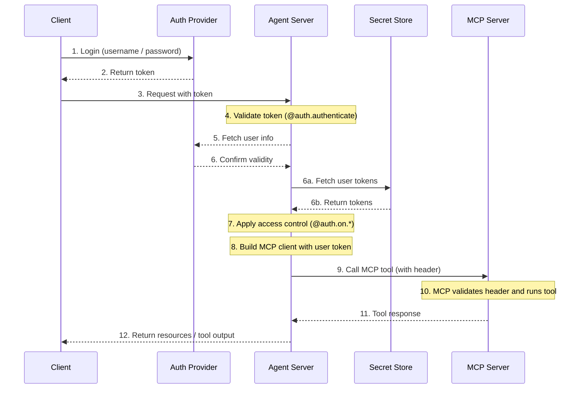

Model Context Protocol，MCP，是一种开放协议，用于以模型无关的格式描述 tools 和数据源，让 LLM 能够通过结构化 API 发现并使用它们。

[Agent Server](/langsmith/agent-server) 使用 [Streamable HTTP transport](https://modelcontextprotocol.io/specification/2025-03-26/basic/transports#streamable-http) 实现了 MCP。这使得 LangGraph **agents** 可以被暴露为 **MCP tools**，从而能够被任何支持 Streamable HTTP 的 MCP 兼容客户端使用。

MCP 端点位于 [Agent Server](/langsmith/agent-server) 的 `/mcp`。

Agent Server 支持 `2024-11-05` 到 `2026-07-28` 的 MCP 协议修订版本。使用 `2025-11-25` 及更早修订版本的客户端会先进行 `initialize` 握手。在 `2026-07-28` 中，每个请求都通过 `_meta` 和 `MCP-Protocol-Version` header 携带自己的协议元数据，因此客户端无需握手即可连接。当 agent 暂停等待输入时，Agent Server 会向支持 elicitation 的客户端发起询问。更多信息，请参阅 [Human-in-the-loop over MCP](/langsmith/server-mcp-elicitation)。

<Note>
本页所述的协议修订版本、tool 字段、结果格式、会话行为以及 `Origin` 检查均要求 `langgraph-api>=0.18.0`。
</Note>

Managed Deep Agents 部署运行在 Agent Server 上，因此它们暴露相同的 `/mcp` 端点。关于 Managed Deep Agents 的 URL 发现和身份 headers，请参见 [Connect MCP clients to a managed deep agent](/langsmith/managed-deep-agents-mcp-endpoint)。

你可以设置[自定义认证中间件](/langsmith/custom-auth)，让用户通过 MCP server 完成认证，从而在 LangSmith deployment 中访问用户作用域的 tools。

这一流程的一个示例架构如下：



## 要求

要使用 MCP，请确保安装了以下依赖：

* `langgraph-api >= 0.2.3`
* `langgraph-sdk >= 0.1.61`

安装方式如下：

<CodeGroup>
```bash pip
pip install "langgraph-api>=0.2.3" "langgraph-sdk>=0.1.61"
```

```bash uv
uv add "langgraph-api>=0.2.3" "langgraph-sdk>=0.1.61"
```
</CodeGroup>

在 `langgraph-api` 0.18.0 或更高版本中，该端点还需要 `mcp` 包，并且版本要落在 `langgraph-api` 要求的范围内。安装 `langgraph-api` 时会一并提供。如果你的依赖固定了另一个版本的 `mcp`，Agent Server 启动时不会启用该端点，并会记录日志 `MCP endpoint disabled: the installed MCP SDK is not supported`。此时 `/info` 响应会在 `flags` 下报告 `"mcp": false`。

## 使用概览

要启用 MCP：

* 升级到 `langgraph-api>=0.2.3`。如果你是在部署 LangSmith，那么只要创建一个新 revision，系统会自动为你完成这一步。
* MCP tools，也就是 agents，会自动暴露出来。
* 使用任意支持 Streamable HTTP 的 MCP 兼容客户端进行连接。

### 客户端

使用 MCP 兼容客户端连接到 Agent Server。下面的示例展示了如何在不同编程语言中完成连接。

<Tabs>
    <Tab title="JavaScript/TypeScript">
    ```bash
    npm install @modelcontextprotocol/sdk
    ```

        > **Note**
        > 请将 `serverUrl` 替换为你的 Agent Server URL，并根据需要配置认证 headers。

    ```js
    import { Client } from "@modelcontextprotocol/sdk/client/index.js";
    import { StreamableHTTPClientTransport } from "@modelcontextprotocol/sdk/client/streamableHttp.js";

    // Connects to the LangGraph MCP endpoint
    async function connectClient(url) {
        const baseUrl = new URL(url);
        const client = new Client({
            name: 'streamable-http-client',
            version: '1.0.0'
        });

        const transport = new StreamableHTTPClientTransport(baseUrl);
        await client.connect(transport);

        console.log("Connected using Streamable HTTP transport");
        console.log(JSON.stringify(await client.listTools(), null, 2));
        return client;
    }

    const serverUrl = "http://localhost:2024/mcp";

    connectClient(serverUrl)
        .then(() => {
            console.log("Client connected successfully");
        })
        .catch(error => {
            console.error("Failed to connect client:", error);
        });
    ```
    </Tab>
    <Tab title="Python">
    安装带 MCP extra 的 LangChain：

    <CodeGroup>
    ```bash pip
    pip install "langchain[mcp]"
    ```

    ```bash uv
    uv add "langchain[mcp]"
    ```
    </CodeGroup>

    连接远程 MCP 端点，并将 agent 作为 tool 使用：

    ```python
    import asyncio
    import os

    from fastmcp.client import Client
    from fastmcp.client.transports import StreamableHttpTransport
    from langchain.agents import create_agent
    from langchain.mcp import MCPAdapter


    async def main():
        async with MCPAdapter(
            Client(
                StreamableHttpTransport(
                    "https://mcp-finance-agent.xxx.us.langgraph.app/mcp",
                    headers={"X-Api-Key": os.environ["LANGSMITH_API_KEY"]},
                )
            )
        ) as adapter:
            # Load the remote graph as if it was a tool
            tools = await adapter.list_tools()

            agent = create_agent("gpt-5.5", tools)
            agent_response = await agent.ainvoke(
                {"messages": "What can the finance agent do for me?"}
            )
            print(agent_response)


    if __name__ == "__main__":
        asyncio.run(main())
    ```
    </Tab>
</Tabs>

## 将 agent 暴露为 MCP tool

部署完成后，你的 agent 会以如下配置出现在 MCP 端点中：

* **Tool name**：agent 的名称。Agent Server 会去除其首尾空白，并将每一段连续空白替换为 `_`。它还会移除 MCP 不允许在 tool 名称中使用的字符，并将名称截断为 128 个字符。
* **Tool title**：agent 的名称。
* **Tool description**：agent 的描述；如果 agent 没有描述，则为 `Tool based on the <name> assistant`。
* **Tool input schema**：agent 的输入 schema。
* **Tool annotations**：`readOnlyHint`、`destructiveHint` 和 `idempotentHint` 为 `false`，`openWorldHint` 为 `true`。

无法生成输入 schema 的 agent 不会出现在 tool 列表中。

该 tool 会将 agent 的最终输出以 JSON 文本形式返回。当 run 失败时，结果是一个错误，其文本给出异常类型和消息，两者以冒号分隔。

若要设置 agent 的[运行时上下文](/oss/langgraph/graph-api#runtime-context)，请在 `tools/call` 参数中、`arguments` 旁边添加一个 `context` 对象。

### 设置名称和描述

你可以在 `langgraph.json` 中设置 agent 的名称和描述：

```json
{
    "graphs": {
        "my_agent": {
            "path": "./my_agent/agent.py:graph",
            "description": "A description of what the agent does"
        }
    },
    "env": ".env"
}
```

部署后，你还可以通过 LangGraph SDK 更新名称和描述。

### Schema

定义清晰、最小化的输入和输出 schema，可以避免向 LLM 暴露不必要的内部复杂性。

默认的 [MessagesState](/oss/langgraph/graph-api#messagesstate) 使用的是 `AnyMessage`，它支持很多消息类型，但对于直接暴露给 LLM 来说过于宽泛。

更推荐的做法是定义**自定义 agents 或 workflows**，并使用显式类型化的输入和输出结构。

例如，一个用于回答文档问题的 workflow 可以写成这样：

```python
from langgraph.graph import StateGraph, START, END
from typing_extensions import TypedDict

# Define input schema
class InputState(TypedDict):
    question: str

# Define output schema
class OutputState(TypedDict):
    answer: str

# Combine input and output
class OverallState(InputState, OutputState):
    pass

# Define the processing node
def answer_node(state: InputState):
    # Replace with actual logic and do something useful
    return {"answer": "bye", "question": state["question"]}

# Build the graph with explicit schemas
builder = StateGraph(OverallState, input_schema=InputState, output_schema=OutputState)
builder.add_node(answer_node)
builder.add_edge(START, "answer_node")
builder.add_edge("answer_node", END)
graph = builder.compile()

# Run the graph
print(graph.invoke({"question": "hi"}))
```

更多细节请参阅[低层概念指南](/oss/langgraph/graph-api#state)。

## 在 deployment 中使用用户作用域的 MCP tools

<Tip>
**前提条件**
你已经添加了自己的[自定义认证中间件](/langsmith/custom-auth)，并让它填充 `langgraph_auth_user` 对象，这样在 graph 中的每个 node 都可以通过 configurable context 访问到它。
</Tip>

要让用户作用域的 tools 能在你的 LangSmith deployment 中使用，可以从实现下面这样的代码片段开始：

```python
from fastmcp.client import Client
from langchain.mcp import MCPAdapter


async def mcp_tools_node(state, config):
    user = config["configurable"].get("langgraph_auth_user")
    # user includes github_token, email, etc.

    async with MCPAdapter(
        Client(
            "https://my-github-mcp-server/mcp",  # (1)
            auth=user["github_token"],  # (2)
        )
    ) as adapter:
        tools = await adapter.list_tools()  # (3)

    # Your tool-calling logic here

    tool_messages = ...
    return {"messages": tool_messages}
```

1. 你的 MCP server URL。URL target 使用 Streamable HTTP。
2. 通过 `Client` 上的 `auth=` 传递 bearer token。对于非 bearer headers（例如 `x-api-key`），请改用 `StreamableHttpTransport(url, headers=...)`。参见 [Authentication](/oss/langchain/mcp/auth)。
3. 从 MCP server 中发现 tools。

_也可以通过[在运行时重建 graph](/langsmith/graph-rebuild) 来实现，为新 run 使用不同配置。_

## 会话行为

MCP 端点不使用 sessions。每个 `/mcp` 请求都是独立的，Agent Server 会以 JSON（而不是事件流）响应。该端点只接受 `POST` 请求。因等待输入而暂停的 tool 调用会在各请求之间将状态保留在服务器上，并通过 `requestState` 关联。更多信息，请参阅 [Human-in-the-loop over MCP](/langsmith/server-mcp-elicitation)。

## 认证

`/mcp` 端点使用与 LangGraph API 其他部分相同的认证方式。具体设置请参阅[认证指南](/langsmith/auth)。

包含 `Origin` header 的请求（例如来自浏览器的请求）必须来自允许的 origin。Agent Server 会从 [`http.cors` 配置](/langsmith/cli#customizing-http-middleware-and-headers)中的 `allow_origins` 或 `allow_origin_regex` 读取允许的 origins，也会从 `CORS_ALLOW_ORIGINS` 环境变量读取。通配符（`*`）不会在此端点上允许任何 origin。Agent Server 始终允许来自 `localhost`、`127.0.0.1` 和 `[::1]` 的 origins，并以 HTTP 403 拒绝来自其他任何 origin 的请求。

## 禁用 MCP

若要禁用 MCP 端点，请在 `langgraph.json` 配置文件中将 `disable_mcp` 设为 `true`：

```json
{
  "$schema": "https://langgra.ph/schema.json",
  "http": {
    "disable_mcp": true
  }
}
```

这样服务器就不会暴露 `/mcp` 端点了。

该端点会通过 runs API 执行每个 tool 调用。当 `disable_runs` 为 `true` 时，每个 tool 调用都会失败，并返回 JSON-RPC 错误 `-32602`。
