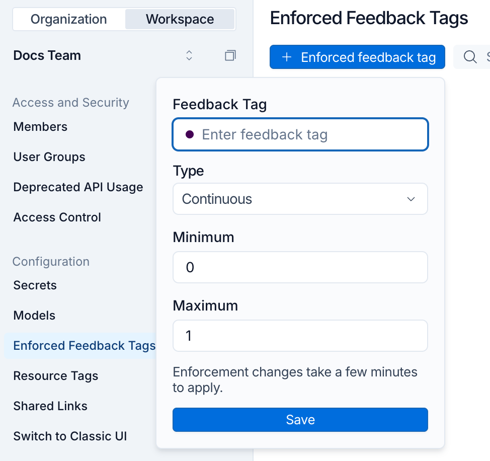
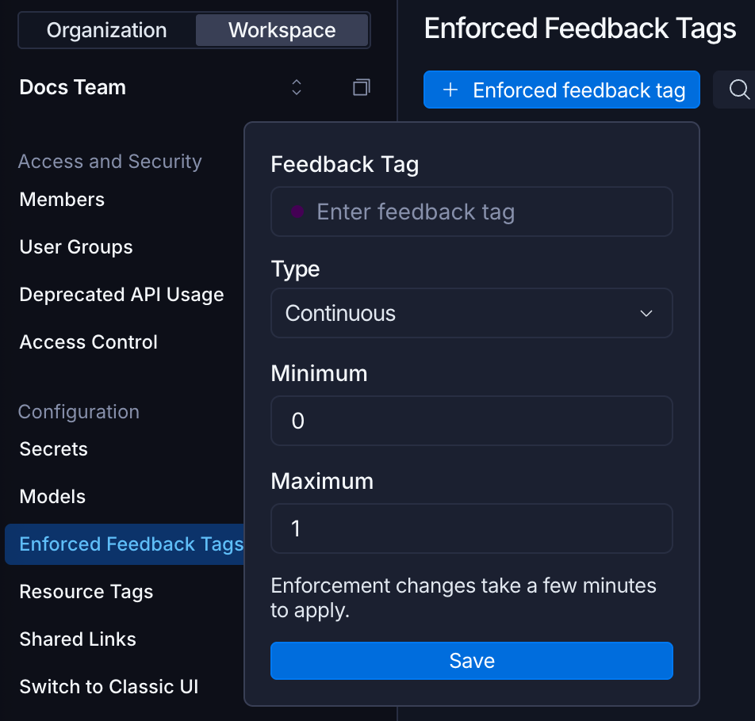
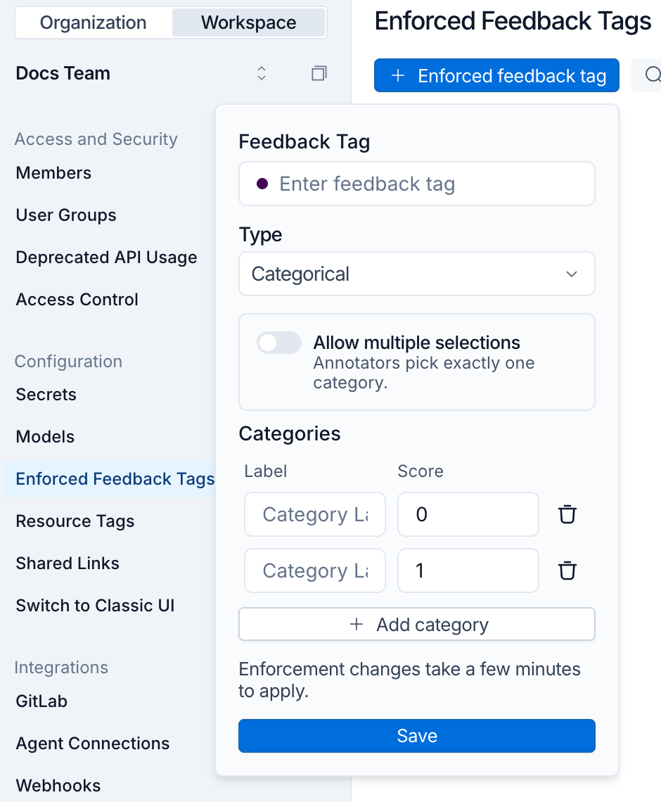
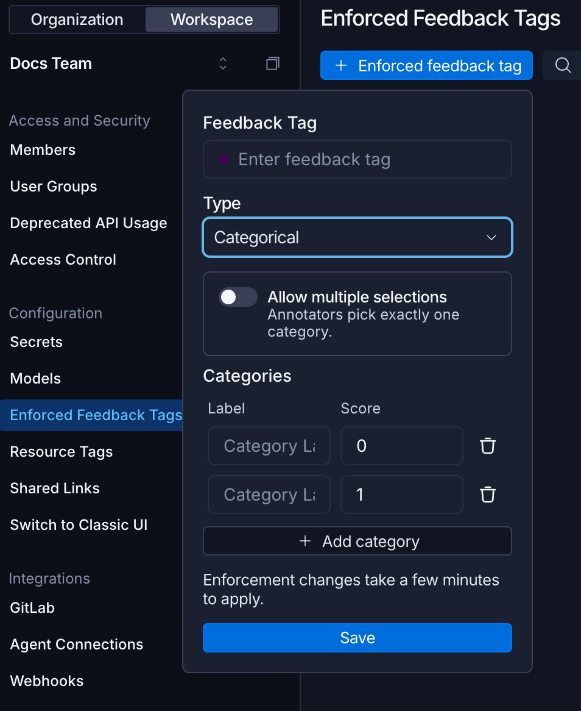
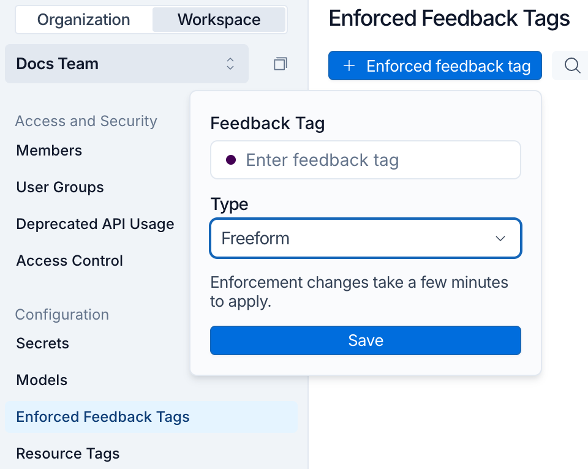
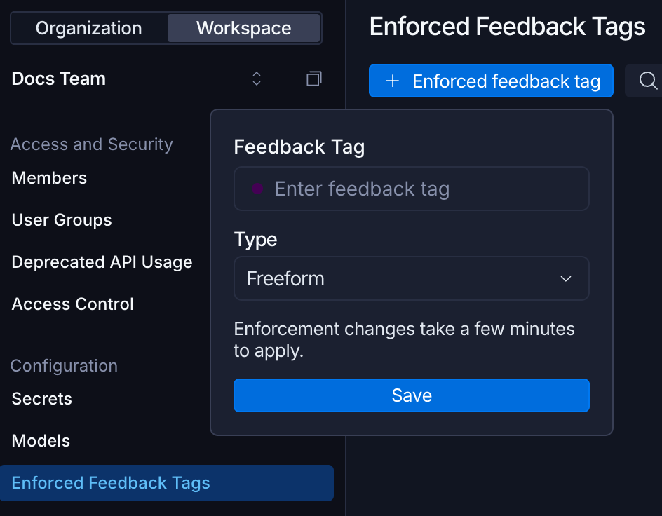

<Tip>
**建议阅读**

在深入阅读本内容之前，先阅读以下文档会更有帮助：

- [tracing 与 feedback 的概念指南](/langsmith/observability-concepts)
- [feedback 数据格式参考指南](/langsmith/feedback-data-format)

</Tip>

在 [LangSmith UI](https://smith.langchain.com) 中，feedback criteria 称为 feedback tags。对于人工反馈，你可以把新的 feedback criteria 设置为连续型、分类型或自由形式反馈。

<Info>
你也可以通过 SDK 以编程方式管理 feedback tags。请参阅 [Manage feedback & annotation queues programmatically](/langsmith/annotation-queues-sdk)。
</Info>

Enforced feedback tag 会为它的 key 在整个工作区中设定规则，因此 [annotation queues](/langsmith/annotation-queues) 和 [traces](/langsmith/annotate-traces-inline) 中的反馈表单都会遵循这些规则。创建、编辑和删除 enforced feedback tags 需要 `feedback-configs:manage-enforced` 权限。内置的 [Workspace Admin](/langsmith/rbac#workspace-admin) 角色包含该权限。要让 [custom role](/langsmith/rbac#custom-roles) 获得此访问权限，请为其授予该权限。

要设置新的 feedback criteria，请前往 **Settings** > **Workspace** > **Enforced Feedback Tags**，然后点击 **+ Enforced feedback tag**。对 enforced feedback tags 的更改需要几分钟才能生效。

## Continuous feedback

对于连续型反馈，你可以输入一个 feedback tag 名称，然后选择最小值和最大值。这个范围内的所有数值，包括浮点数，都会被接受为反馈分数。

## Categorical feedback

对于分类型反馈，你可以输入一个 feedback tag 名称，然后添加一组 categories，每个 category 映射到一个 score。当你提供反馈时，可以从这些 categories 中选择一个作为反馈分数。
系统会分别把 category label 和 score 记录到 `value` 与 `score` 字段中。

### Allow multiple selections

默认情况下，审核者只能选择一个 category。要让审核者为同一个条目选择多个 categories（例如一段对话涉及的每个 topic），请在创建或编辑 categorical tag 时开启 **Allow multiple selections**。启用此设置的 tags 会在 tags 列表中显示 **Multi-select** 徽标。

LangSmith 会把每个选中项作为独立的反馈条目保存在该 tag 的 key 下。取消选择会删除对应条目。在 [annotation queue](/langsmith/annotation-queues) 中，必填的多选条目至少需要一个选中项。

[composite evaluator](/langsmith/composite-evaluators-ui) 不能包含多选 tag，因为同一个 run 在该 tag 的 key 下可能有多个分数。

当你把 annotation queue 中已完成的 runs 下载为 CSV 时，每个多选 tag 都会保留一列。每个 run 的单元格会按审核者选择的顺序列出不同的选中项，并用分号分隔。多位审核者都选过的项只出现一次。如果选择 **Include reviewer detail (name, comment per row)**，单元格会改为列出每位审核者的反馈。

类别超过 10 个的 tags 会在审核窗格中显示搜索框，而不是选项列表；单选和多选 tag 都是如此。

## Freeform feedback

对于 freeform feedback，请输入 feedback tag 名称，并选择 **Freeform** 作为类型。审核者输入文本，而不是分数或 category。在 [annotation queue](/langsmith/annotation-queues) 中，freeform rubric 条目还可以设置 **Regex validator**，每条答案都必须与之匹配才能保存。对于定性的观察或解释，请使用 freeform tags。

## See also

- [Use assertions](/langsmith/assertions)：审查 [LangSmith Engine](/langsmith/engine) 针对反复出现的问题提出的自由形式验收标准。
- [Use annotation queues](/langsmith/annotation-queues)：在审核 rubric 中使用 feedback tags。
