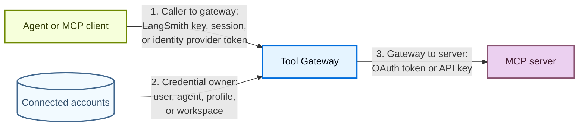

import ToolGatewayBetaNote from '/snippets/langsmith/tool-gateway-beta-note.mdx';

<ToolGatewayBetaNote />

本页介绍 [Tool Gateway](/langsmith/tool-gateway) 背后的模型。内容涵盖每次调用如何验证身份、使用哪个已存储的凭证、工具包和策略控制什么，以及适用的限制。在为多个用户或 agent 规划设置之前，请先阅读本页。每一节都会链接到包含操作步骤的页面。

## Three layers of authentication

通过 Tool Gateway 的工具调用涉及三个独立的身份验证步骤。调用方只向 LangSmith 进行身份验证。随后 Tool Gateway 选择一个已存储的凭证，并用它向 MCP 服务器进行身份验证。因此，调用方从不持有服务器的令牌或 API 密钥。

- **调用方到 gateway**：调用方向 LangSmith 证明自己的身份。它可以使用个人访问令牌、服务密钥、UI 中的 LangSmith 会话，或来自你的身份提供商的令牌。调用方还可以指定使用谁的凭证。请参见[以用户和 agent 的身份调用](/langsmith/tool-gateway-identity)。
- **凭证所有者**：Tool Gateway 根据调用方所代表的身份，确定该调用使用哪个已存储的凭证。请参见[凭证所有者](#credential-owners)和[连接账户](/langsmith/tool-gateway-connect-accounts)。
- **Gateway 到服务器**：MCP 服务器收到它期望的内容：OAuth 令牌、放在指定请求头中的 API 密钥，或对于公共服务器不发送任何内容。你在添加服务器时声明这一点。请参见[添加 MCP 服务器](/langsmith/tool-gateway-servers)。

添加服务器和连接账户是两项独立的工作。管理员一次性添加工作区服务器，并声明它需要的凭证类型，但此时尚不存在任何凭证。随后，每个用户、agent 或 profile 各自将自己的凭证连接到该服务器。

## Credential owners

每个已存储的凭证都属于一个所有者。所有者决定工具调用在上游服务上以谁的账户运行。

| 所有者 | 由谁连接 | 调用何时使用它 |
|-------|-----------------|---------------------|
| 用户 | 每个用户，为自己的账户连接 | 调用以该用户的身份执行 |
| Agent | 管理员通过 [agent auth](/langsmith/agent-auth) 为 agent 自身的身份连接 | 调用以该 agent 的身份执行 |
| Profile | 管理员一次性连接，作为一组共享凭证 | 调用指定该 profile，适用于无人登录时运行的 agents |
| 工作区 | 工作区管理员，作为一个工作区服务器的单个 API 密钥连接 | 对该服务器的每次调用，无论调用方是谁 |

在实践中，调用以两种方式之一执行。它要么以用户身份执行，使用该用户自己的访问权限；要么以 agent 身份执行，使用该 agent 的凭证或某个 profile。一次调用只使用一个身份。它不能同时以用户和 profile 的身份执行。

工作区凭证会覆盖其他凭证。在服务器上设置工作区凭证会移除该服务器上其他所有所有者的凭证；在它存储期间，其他所有者无法连接凭证。操作步骤请参见[连接账户](/langsmith/tool-gateway-connect-accounts)。

### 当凭证缺失时

当所有者尚未连接时会发生什么，取决于是否有人员在场可以登录：

- **用户**：调用会返回一个登录链接。支持 MCP URL elicitation 的客户端会把链接显示给用户。否则，调用会返回 `428` 并附带该链接。用户连接后，后续调用将使用已存储的凭证。
- **Agent 或 profile**：调用会返回 `409`，因为无人可以登录。管理员必须先连接凭证，agent 才能调用工具。

关于这些响应以及如何处理它们，请参见[调用工具](/langsmith/tool-gateway-call-tools)。

## 服务器、工具包和范围

服务器和工具包各自有一个范围：

- **工作区**：工作区中的每个人都可以使用。每个人仍需连接自己的账户，除非该服务器有工作区凭证。
- **个人**：只有创建者可以使用。工作区工具包不能包含个人服务器。

Tool Gateway 通过三种 MCP 端点提供工具，它们都位于 `/v1/managed-tools/` 下：

| 端点 | 提供的内容 |
|----------|--------|
| `kits/<kit-id>/mcp` | 一个工具包中的工具 |
| `kits/me/mcp` | 调用方可以使用的所有工具，每次请求时构建 |
| `servers/<server-id>/mcp` | 一个服务器上的工具 |

Agents 通常连接到一个工具包。创建方法请参见[创建工具包](/langsmith/tool-gateway-tool-kits)。

## Tool kits curate, policies enforce

工具包和策略回答不同的问题：

- **工具包**决定 agent 能看到哪些工具。为每个 agent 提供一个小的工具包，可以让其工具列表保持相关，工具选择保持准确。工具包不是访问控制：同一调用方可以使用 `kits/me/mcp`，它会提供调用方可用的所有工具。
- **策略**决定调用方可以调用什么。无论调用使用哪个端点，Tool Gateway 都会在每次调用时评估策略。策略要么拒绝该调用，要么要求其在运行前获得批准。

工具默认允许。当多条策略匹配同一次调用时，拒绝策略优先。批准策略会要求使用 MCP 客户端的人确认该调用。不支持由单独的审核者批准。要限制调用方可以做什么，请使用策略，而不是工具包。请参见[设置策略](/langsmith/tool-gateway-policies)。

## Traces

Tool Gateway 可以为每次工具调用记录一条 trace。trace 记录有关该调用的 metadata，例如工具、服务器以及运行时所使用的身份。它不记录发送给工具或由工具返回的数据。请参见 [Traces 和审计日志](/langsmith/tool-gateway-traces)。

## Limits

以下限制适用于每次工具调用：

- **请求大小**：1 MB。
- **响应大小**：8 MB。
- **上游超时**：MCP 服务器开始响应的时限为 60 秒。
- **每个工具包的工具数**：10,000。
- **速率限制**：每秒 100 个请求，突发最高 1,000。

## 已知限制

在 beta 阶段，Tool Gateway 有以下限制：

- **仅支持通过 HTTPS 的远程服务器**：Tool Gateway 连接到使用基于 HTTPS 的 Streamable HTTP 的 MCP 服务器。要访问你自己网络内的服务器，请使用 [tunnel](/langsmith/tunnels)。
- **工具输出不可信**：Tool Gateway 将每个服务器的响应原样传递给调用方。请将工具输出视为 agent 的不可信输入。
- **每次调用一个身份**：一次调用以一个用户、一个 agent 或一个 profile 的身份执行。
- **身份提供商令牌可访问整个工作区**：仅通过身份提供商令牌进行身份验证的调用方可以访问工作区中的任何服务器或工具包。请使用策略限制这些调用方可以调用什么。
- **没有用量仪表盘**：要查看工具用量，请使用 [traces 和审计日志](/langsmith/tool-gateway-traces)。

## 另请参见

- [Tool Gateway 快速入门](/langsmith/tool-gateway-quickstart)
- [以用户和 agent 的身份调用](/langsmith/tool-gateway-identity)
- [连接账户](/langsmith/tool-gateway-connect-accounts)
- [设置策略](/langsmith/tool-gateway-policies)
