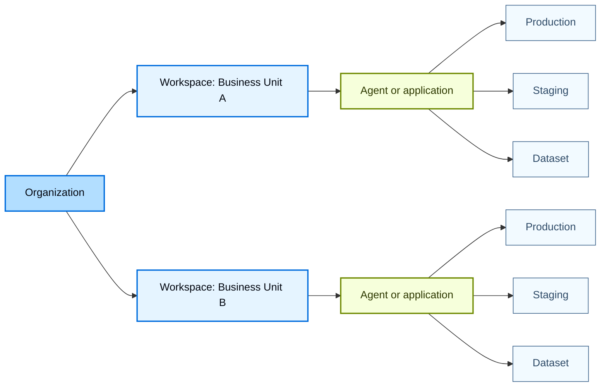
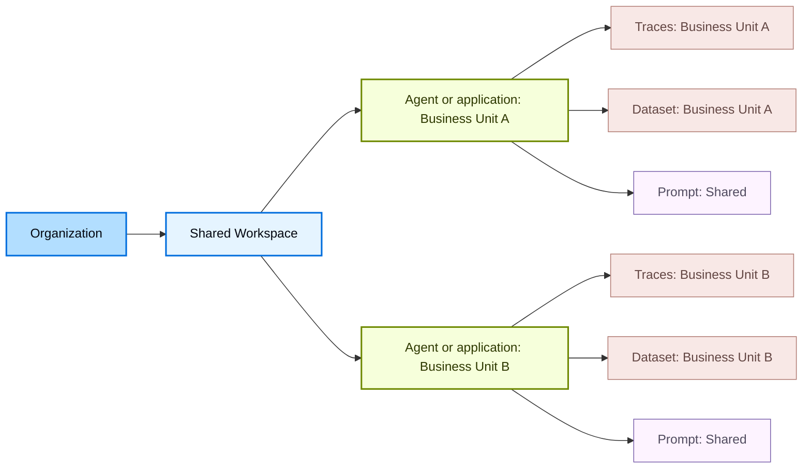

LangSmith 使用分层结构来组织你的工作：组织、工作区、agent 或应用，以及资源。这套结构让你可以在协作与访问控制之间取得平衡，从而根据组织需求选择合适的隔离级别。

这个归组层级叫什么，取决于你的工作区使用哪种信息架构。左上角的控件会告诉你当前处于哪一种：

- Agent-based workspace 按 [agent](/langsmith/agent-registry#agent) 归组资源，每个 agent 的 traces 会划分到从固定的一组四个中抽取的[环境](/langsmith/agent-environments)中。
- Project-based workspace 则按应用归组资源，没有环境层级，因此环境用单独的 tracing projects 来近似。

下面介绍的模型对两者都适用，并在有差异的地方做了标注。

本页介绍了两种常见的工作区组织方式，分别适用于不同的组织隔离需求：

- [按工作区隔离](#按工作区隔离)：每个业务单元一个工作区（大多数客户推荐）
- [按 agent 或应用隔离](#按-agent-或应用隔离)：多个业务单元共用一个工作区

<Tip>
关于如何设置组织和工作区，请参阅 [Set up hierarchy](/langsmith/set-up-hierarchy)。
</Tip>

## 使用 RBAC 和 ABAC 控制访问

LangSmith 的权限系统建立在[资源层级](/langsmith/administration-overview#resource-hierarchy)之上：

- 通过[基于角色的访问控制（RBAC）](/langsmith/rbac)，用户权限会被限定在一个或多个工作区，从而在工作区之间实施隔离。
- 通过更细粒度的[基于属性的访问控制](/langsmith/organization-workspace-operations#access-policies)（ABAC），还可以根据工作区内的标签、agent 或应用等属性进一步限制或授予访问权限。例如，ABAC 可以只允许访问开发资源，或只允许访问与某个特定 agent 或应用相关的资源。

## 按工作区隔离

<Warning>
这是默认模型，也是大多数客户的推荐选择。
</Warning>

在这种模型中，组织中的每个业务单元都有自己的工作区。工作区就是隔离边界：它决定该业务单元可以访问哪些数据和资源。在工作区内部，业务单元按 agent 或按应用（取决于 workspace）归组支撑同一应用的资源。

在下图中，production 和 staging 在 agent-based workspace 中是一个 agent 的环境，在 project-based workspace 中则是单独的 tracing projects。

- **优点：** 单个工作区允许属于同一业务单元的所有资源在该业务单元内共享，使单元内部的协作和迭代更直接。同时也简化了从开发到生产的推广流程。例如，同一个 [prompt](/langsmith/prompt-context-hub#prompts) 可以通过版本和标签推进到生产环境，而不需要复制。
- **缺点：** 开发、测试和生产工作共存在同一个工作区中，因此仅靠作用域为工作区的[RBAC](/langsmith/rbac)无法将它们分开。在 agent-based workspace 中，环境会划分 agent 的 traces，无需维护任何约定。在 project-based workspace 中，分离依赖命名约定，例如成对的 `checkout-production` 和 `checkout-staging` projects。[ABAC](/langsmith/organization-workspace-operations#access-policies)则可在工作区内提供更细粒度的权限控制，例如只允许用户访问开发资源。

## 按 agent 或应用隔离

在这种模型中，多个业务单元在同一组织内共用一个工作区。它们使用 agent 或应用，配合 [ABAC](/langsmith/organization-workspace-operations#access-policies) 来分隔资源和管理访问。因此，[prompts](/langsmith/prompt-context-hub#prompts) 和 [deployments](/langsmith/deployment) 等共享资源可以跨业务单元复用。对 [traces](/langsmith/observability-concepts#traces) 和 [datasets](/langsmith/evaluation-concepts#datasets) 等敏感资源的访问，则仅限于拥有它们的业务单元。

- **优点：** prompts 和 deployments 等公共资源可以跨业务单元共享与复用，从而提升协作效率并减少重复工作。与按工作区隔离不同，协作可以扩展到工作区内的多个业务单元。
- **缺点：** 业务单元之间的隔离弱于多工作区模型，并且依赖于正确使用 ABAC。标签或策略配置错误可能会让敏感 [traces](/langsmith/observability-concepts#traces) 或 [datasets](/langsmith/evaluation-concepts#datasets) 暴露给其他业务单元。跨多个业务单元管理权限会增加运维复杂度。
