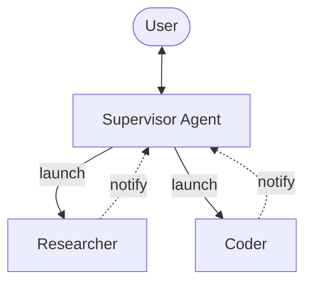
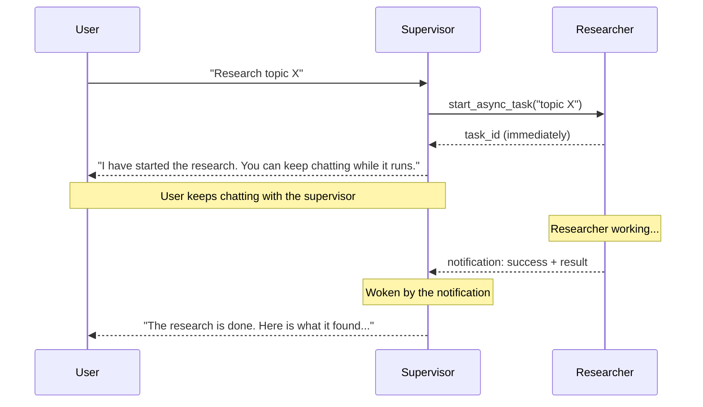

import AsyncSubagentsConfigurePy from '/snippets/code-samples/async-subagents-configure-py.mdx';
import AsyncSubagentsConfigureJs from '/snippets/code-samples/async-subagents-configure-js.mdx';
import AsyncSubagentsHttpTransportPy from '/snippets/code-samples/async-subagents-http-transport-py.mdx';
import AsyncSubagentsHybridPy from '/snippets/code-samples/async-subagents-hybrid-py.mdx';
import AsyncSubagentsHybridJs from '/snippets/code-samples/async-subagents-hybrid-js.mdx';
import AsyncSubagentsDescriptionsGoodPy from '/snippets/code-samples/async-subagents-descriptions-good-py.mdx';
import AsyncSubagentsDescriptionsBadPy from '/snippets/code-samples/async-subagents-descriptions-bad-py.mdx';
import AsyncSubagentsDescriptionsJs from '/snippets/code-samples/async-subagents-descriptions-js.mdx';
import AsyncSubagentsTroubleshootingPollingPy from '/snippets/code-samples/async-subagents-troubleshooting-polling-py.mdx';
import AsyncSubagentsTroubleshootingPollingJs from '/snippets/code-samples/async-subagents-troubleshooting-polling-js.mdx';
import AsyncSubagentsNotificationsPy from '/snippets/code-samples/async-subagents-notifications-py.mdx';
import AsyncSubagentsAnswerWaitingPy from '/snippets/code-samples/async-subagents-answer-waiting-py.mdx';
import AsyncSubagentsParentThreadPy from '/snippets/code-samples/async-subagents-parent-thread-py.mdx';
import AsyncSubagentsNotificationsJs from '/snippets/code-samples/async-subagents-notifications-js.mdx';
import AsyncSubagentsAnswerWaitingJs from '/snippets/code-samples/async-subagents-answer-waiting-js.mdx';
import AsyncSubagentsParentThreadJs from '/snippets/code-samples/async-subagents-parent-thread-js.mdx';
import AsyncSubagentsDeliverResultsPy from '/snippets/code-samples/async-subagents-deliver-results-py.mdx';
import AsyncSubagentsDeliverResultsJs from '/snippets/code-samples/async-subagents-deliver-results-js.mdx';

异步子代理允许 supervisor agent 启动会立即返回的后台任务。supervisor 可以在子代理并发工作的同时继续与用户交互。supervisor 可以在任何时点检查任务状态、发送后续指令，或取消任务。在 Agent Server 上，子代理还会在完成、失败或需要输入时回报。supervisor 无需主动检查。

这建立在 [子代理](/oss/deepagents/subagents) 之上；后者是同步运行的，会阻塞 supervisor，直到完成。对于耗时较长、可并行化，或者需要在执行过程中动态调整的任务，请使用异步子代理。

要在托管 agent 中运行异步子代理，请用 `async: true` 启用它们。参见 [Managed Deep Agents 中的异步子代理](/langsmith/managed-deep-agents-subagents#async-subagents)。



<Note>
异步子代理可在任何实现 [Agent Protocol](https://github.com/langchain-ai/agent-protocol) 的 server 上运行，例如 [LangSmith Deployment](/langsmith/deployment) 或自托管的 Agent Protocol server。每个子代理都独立于 supervisor 运行。supervisor 通过 SDK 启动、检查、更新和取消它。通知和 webhook 需要 [Agent Server](/langsmith/agent-server)。
</Note>

## 比较同步和异步子代理

| 维度 | 同步子代理 | 异步子代理 |
|------|-----------|-----------|
| **执行模型** | supervisor 会阻塞，直到子代理完成 | 立即返回 task ID；supervisor 继续执行 |
| **运行位置** | 在 supervisor 的 run 内部 | 在 server 上自己的线程中（Agent Server 或其他 Agent Protocol server） |
| **并发性** | 并行但阻塞 | 并行且非阻塞 |
| **结果** | 作为工具结果返回 | 在 Agent Server 上，子代理会通知 supervisor；否则由 supervisor 调用 `check_async_task` |
| **任务中更新** | 不支持 | 可通过 `update_async_task` 发送后续指令 |
| **取消** | 不支持（除非停止 supervisor） | 可通过 `cancel_async_task` 取消任务 |
| **状态性** | 无状态 - 多次调用之间没有持久状态 | 有状态 - 在自己的线程上跨交互保持状态 |
| **适用场景** | 需要先等结果再继续的任务 | 在聊天中交互式管理的长耗时复杂任务 |

## 配置异步子代理

将异步子代理定义为 @[`AsyncSubAgent`] 规格列表，每个都指向一个 Agent Protocol server：

:::python
<AsyncSubagentsConfigurePy />

| 字段 | 类型 | 说明 |
|------|------|------|
| `name` | `str` | 必需。唯一标识符。supervisor 用它来启动任务。 |
| `description` | `str` | 必需。这个子代理的职责。supervisor 用它来决定把任务委派给谁。 |
| `graph_id` | `str` | 必需。Agent Protocol server 上的 graph ID（或 assistant ID）。对于基于 LangGraph 的部署，它必须与 `langgraph.json` 中注册的 graph 匹配。 |
| `url` | `str` | 可选。省略时使用 ASGI transport（进程内）。设置后使用 HTTP transport 连接远程 Agent Protocol server。 |
| `headers` | `dict[str, str]` | 可选。发送给远程 server 的附加 header。用于自托管 Agent Protocol server 的自定义认证。 |
| `mode` | `"isolated" \| "fork"` | 可选。控制子代理启动时收到的对话上下文。默认为 `"isolated"`。参见[选择启动模式](#choose-a-launch-mode)。 |
| `update_strategy` | `"interrupt" \| "enqueue"` | 可选。run 处于活动状态时 `update_async_task` 如何发送后续指令。默认为 `"interrupt"`。参见[了解生命周期](#understand-the-lifecycle)。 |
| `webhook` | `str` | 可选。该子代理的任一 run 结束时 Agent Server 调用的 URL。参见[通过你的应用投递结果](#deliver-results-through-your-app)。 |
| `notify_parent` | `bool` | 可选。子代理在 supervisor 空闲时完成或失败，是否可以唤醒 supervisor。默认为 `True`。 |
:::

:::js
<AsyncSubagentsConfigureJs />

| 字段 | 类型 | 说明 |
|------|------|------|
| `name` | `string` | 必需。唯一标识符。supervisor 用它来启动任务。 |
| `description` | `string` | 必需。这个子代理的职责。supervisor 用它来决定把任务委派给谁。 |
| `graphId` | `string` | 必需。Agent Protocol server 上的 graph ID（或 assistant ID）。对于基于 LangGraph 的部署，它必须与 `langgraph.json` 中注册的 graph 匹配。 |
| `url` | `string` | 可选。省略时与运行此 graph 的同一个 Agent Server 部署通信（server 提供给运行中 graph 的地址）。对于远程 server，或者当你的 Agent Server 尚未提供该地址时，请设置 `url`。参见[选择传输方式](#choose-a-transport)。 |
| `headers` | `Record<string, string>` | 可选。发送给远程 server 的附加 header。用于自托管 Agent Protocol server 的自定义认证。 |
| `mode` | `"isolated" \| "fork"` | 可选。控制子代理启动时收到的对话上下文。默认为 `"isolated"`。参见[选择启动模式](#choose-a-launch-mode)。 |
| `updateStrategy` | `"interrupt" \| "enqueue"` | 可选。run 处于活动状态时 `update_async_task` 如何发送后续指令。默认为 `"interrupt"`。参见[了解生命周期](#understand-the-lifecycle)。 |
| `webhook` | `string` | 可选。该子代理的任一 run 结束时 Agent Server 调用的 URL。参见[通过你的应用投递结果](#deliver-results-through-your-app)。 |
| `notifyParent` | `boolean` | 可选。子代理在 supervisor 空闲时完成或失败，是否可以唤醒 supervisor。默认为 `true`。 |
:::

对于基于 LangGraph 的部署，请将所有 graph 注册到同一个 `langgraph.json` 中，以支持共置部署：

```json
{
  "graphs": {
    "supervisor": "./src/supervisor.py:graph",
    "researcher": "./src/researcher.py:graph",
    "coder": "./src/coder.py:graph"
  }
}
```

## 使用异步子代理工具

当配置了异步子代理时，包含在 [Deep Agents 栈](/oss/deepagents/customization#deep-agents-stack) 中的 @[`AsyncSubAgentMiddleware`] 会为 supervisor 提供五个工具：

| 工具 | 作用 | 返回值 |
|------|------|------|
| `start_async_task` | 启动新的后台任务 | Task ID（立即返回） |
| `check_async_task` | 获取任务的当前状态，以及其结果、错误或它正在向用户询问的内容 | 状态，以及结果、错误或待处理的请求 |
| `update_async_task` | 向任务发送新指令 | 后续指令已启动或已排队的确认 |
| `cancel_async_task` | 停止任务 | 确认 |
| `list_async_tasks` | 列出已跟踪的任务及其实时状态，可选按状态筛选 | 每个任务的状态（不含结果） |

supervisor 的 LLM 会像调用其他工具一样调用这些工具。middleware 会自动处理线程创建、run 管理和状态持久化。

### 了解生命周期

典型交互如下：

<Note>
在 Agent Server 上，supervisor 无需检查任务：子代理完成时，任务会通知 supervisor。
</Note>



- **Launch** 会在 server 上创建新的线程，并按[启动模式](#choose-a-launch-mode)确定的输入启动一个 run。isolated 模式只发送任务描述；fork 模式还会发送父代理的有效对话历史。`start_async_task` 会把线程 ID 作为 task ID 返回。
- **Check** 会获取任务的当前状态，以及其结果、错误或它正在向用户询问的内容。
- **Update** 会在同一线程上创建一个新的 run。默认情况下它会中断前一个 run，子代理会带着完整对话历史和新的指令重新启动。task ID 保持不变。
- **Cancel** 会调用 server 上的 `runs.cancel()`，并把任务标记为 `"cancelled"`。
- **List** 会遍历所有已跟踪任务。对于非终态任务，它会并行从 server 获取实时状态。对于终态状态（`success`、`error`、`timeout`、`cancelled`、`interrupted`），它使用缓存的状态。

:::python
要让后续指令排队等待，请设置 `update_strategy="enqueue"`。此时 **Update** 会把新的 run 排在当前 run 之后，任务在开始前处于 `pending` 状态。取消该任务也会取消仍然活跃的更早 run。
如果当前 run 在后续指令开始前因等待输入或审批而暂停，后续指令仍会启动，而该请求会被丢弃。

<Note>
`update_strategy` 需要 `deepagents>=0.7.30`。它处于 [**beta**](/oss/versioning) 阶段；API 和行为可能在版本之间发生变化。
</Note>
:::

:::js
要让后续指令排队等待，请设置 `updateStrategy: "enqueue"`。此时 **Update** 会把新的 run 排在当前 run 之后，任务在开始前处于 `pending` 状态。取消该任务也会取消仍然活跃的更早 run。
如果当前 run 在后续指令开始前因等待输入或审批而暂停，后续指令仍会启动，而该请求会被丢弃。

<Note>
`updateStrategy` 需要 `deepagents>=1.16.0`。它处于 [**beta**](/oss/versioning) 阶段；API 和行为可能在版本之间发生变化。
</Note>
:::

如果子代理因等待输入或审批而暂停，**check** 和 **list** 会把它报告为 `waiting`。更新一个 `waiting` 任务会丢弃其待处理的请求；取消它只会标记为 `"cancelled"`，因为它没有活跃的 run。参见[处理等待输入的子代理](#handle-subagents-waiting-for-input)。

在 [Agent Server](/langsmith/agent-server) 上，子代理会在完成、失败或需要输入时通知 supervisor。当 supervisor 忙碌时，它会在下一次模型调用前收到这些通知。如果子代理和 supervisor 位于[同一部署](#single-deployment)，那么完成或失败的子代理会通过一次新的 run 唤醒空闲的 supervisor。只有作为 deep agent 的子代理才会唤醒空闲的 supervisor。等待输入的子代理不会唤醒 supervisor。supervisor 会在下一次 run 时收到该通知。


<Note>
:::python
任务通知需要 `deepagents>=0.7.26`，通知 metadata 需要 `deepagents>=0.7.33`。它们处于 [**beta**](/oss/versioning) 阶段；API 和行为可能在版本之间发生变化。
:::
:::js
任务通知需要 `deepagents>=1.16.0`，通知 metadata 需要 `deepagents>=1.16.2`。它们处于 [**beta**](/oss/versioning) 阶段；API 和行为可能在版本之间发生变化。
:::
</Note>

:::python
supervisor 会以 `HumanMessage` 的形式接收每条通知。通知可以包含图像和其他多模态媒体。每条通知都携带 metadata：其 `source` 为 `"async_subagent"`，其 `data` 为一个 @[`TaskEvent`]（`task_id`、`agent_name`、`status`、`run_id`）。用 `get_notification_metadata` 读取它，以便用不同于用户消息的方式展示通知：

<AsyncSubagentsNotificationsPy />
:::

:::js
supervisor 会以 `HumanMessage` 的形式接收每条通知。通知可以包含图像和其他多模态媒体。每条通知都携带 metadata：其 `source` 为 `"async_subagent"`，其 `data` 为一个 `TaskEvent`（`task_id`、`agent_name`、`status`、`run_id`）。用 `getNotificationMetadata` 读取它，以便用不同于用户消息的方式展示通知：

<AsyncSubagentsNotificationsJs />
:::

:::python
<Note>
异步子代理的拒绝结果需要 `deepagents>=0.7.33`。
</Note>
:::

:::js
<Note>
异步子代理的拒绝结果需要 `deepagents>=1.16.4`。
</Note>
:::

如果子代理的 run 以模型拒绝结束，supervisor 会收到一条说明该情况的简短结果，而不是拒绝内容本身。参见[模型拒绝](/oss/deepagents/subagents#model-refusals)。

### 通过你的应用投递结果

<Note>
:::python
`webhook` 和 `notify_parent` 需要 `deepagents>=0.7.30`。`notify_parent` 处于 [**beta**](/oss/versioning) 阶段；API 和行为可能在版本之间发生变化。
:::
:::js
`webhook` 和 `notifyParent` 需要 `deepagents>=1.16.0`。`notifyParent` 处于 [**beta**](/oss/versioning) 阶段；API 和行为可能在版本之间发生变化。
:::
</Note>

设置 `webhook` 后，每当该子代理的某个 run 结束，Agent Server 都会调用你的应用。该调用包含 run 的 thread ID、run ID、状态和 metadata，其中包括 `parent_thread_id` 和 `subagent_name`。如果希望通过你的应用投递结果而不是唤醒 supervisor，请同时关闭向父代理发送通知。supervisor 在子代理运行期间仍会收到通知。

:::python
<AsyncSubagentsDeliverResultsPy />
:::

:::js
<AsyncSubagentsDeliverResultsJs />
:::

## 处理等待输入的子代理

<Note>
:::python
`waiting` 状态需要 `deepagents>=0.7.26`。它处于 [**beta**](/oss/versioning) 阶段；API 和行为可能在版本之间发生变化。
:::
:::js
`waiting` 状态需要 `deepagents>=1.16.0`。它处于 [**beta**](/oss/versioning) 阶段；API 和行为可能在版本之间发生变化。
:::
</Note>

当子代理通过 `interrupt()` 或 [human-in-the-loop](/oss/deepagents/human-in-the-loop) 暂停以等待输入或审批时，`check_async_task` 和 `list_async_tasks` 会把它报告为 `waiting`。只有 `check_async_task` 还会返回其待处理的 interrupt。supervisor 不能代替用户回答或批准。这个请求是给用户的。

你的应用在子代理自己的线程上作答。task ID 就是子代理的 thread ID：

:::python
<AsyncSubagentsAnswerWaitingPy />
:::

:::js
<AsyncSubagentsAnswerWaitingJs />
:::

子代理在得到回答后完成时，supervisor 会照常收到通知。如果子代理需要的信息来自 supervisor 而不是用户，可以让它在结果中提出。supervisor 会用 `update_async_task` 回复。

## 了解状态管理

:::python
任务元数据存储在 supervisor graph 上一个专用的 state channel（`async_tasks`）中，与消息历史分离。这一点很关键，因为 deep agents 在上下文窗口装满时会 [压缩消息历史](/oss/deepagents/context-engineering#summarization)。如果 task ID 只存在于工具消息里，压缩时就会丢失。这个专用 channel 能确保 supervisor 即使经过多轮总结，仍然可以通过 `list_async_tasks` 找回任务。

每个被跟踪的任务都会记录 task ID、agent 名称、thread ID、run ID、状态以及时间戳（`created_at`、`last_checked_at`、`last_updated_at`）。

### 查找 supervisor 的子代理线程

<Note>
    线程标记需要 `deepagents>=0.7.26`。它处于 [**beta**](/oss/versioning) 阶段；API 和行为可能在版本之间发生变化。
</Note>

`start_async_task` 创建每个子代理线程时会附带 `metadata={"parent_thread_id": ...}`，即 supervisor 的 thread ID。可以用它来查找某个 supervisor 的子代理线程，或者在子代理的 graph factory 中读取 supervisor 的线程：

<AsyncSubagentsParentThreadPy />

例如，子代理可以通过 `parent_thread_id` 查找并复用 supervisor 的 [线程级 sandbox](/oss/deepagents/sandboxes#thread-scoped-default)。请先确认调用方有权访问该线程，因为任何有权访问该线程的人都可以编辑其 metadata。
:::

:::js
任务元数据存储在 supervisor graph 上一个专用的 state channel（`asyncTasks`）中，与消息历史分离。这一点很关键，因为 deep agents 在上下文窗口装满时会 [压缩消息历史](/oss/deepagents/context-engineering#summarization)。如果 task ID 只存在于 tool messages 中，压缩时就会丢失。这个专用 channel 能确保 supervisor 即使经过多轮总结，仍然可以通过 `list_async_tasks` 找回任务。

每个被跟踪的任务都会记录 task ID、agent 名称、thread ID、run ID、状态以及时间戳（`createdAt`、`checkedAt`、`updatedAt`）。

### 查找 supervisor 的子代理线程

<Note>
    线程标记需要 `deepagents>=1.16.0`。
</Note>

`start_async_task` 创建每个子代理线程时会附带 `metadata: { parent_thread_id }`，即 supervisor 的 thread ID。可以用它来查找某个 supervisor 的子代理线程，或者在子代理的 graph factory 中读取 supervisor 的线程：

<AsyncSubagentsParentThreadJs />
:::

## 选择传输方式

:::python
### ASGI transport（共置部署）

当子代理规格省略 `url` 字段时，LangGraph SDK 会使用 ASGI transport，SDK 调用会通过进程内函数调用而不是 HTTP 路由。对于基于 LangGraph 的部署，这要求两个 graph 都注册在同一个 `langgraph.json` 里。

ASGI transport 消除了网络延迟，也不需要额外的认证配置。子代理仍然会作为一个拥有自己状态的独立线程运行。这是推荐的默认方式。
:::

:::js
### 同部署（省略 `url`）

当子代理规格省略 `url` 字段时，LangGraph SDK 会使用该 server 提供的地址，与运行此 graph 的 Agent Server 通信。在其他情况下，SDK 默认使用 `http://localhost:8123`。对于基于 LangGraph 的部署，请将两个 graph 注册在同一个 `langgraph.json` 中。

已部署的 Agent Server 从 0.18.0 版本起会提供此地址（`langgraph dev` 已经如此）。在更早的版本中，请将 `url` 设置为部署 URL。
:::

### HTTP transport（远程）

添加 `url` 字段即可切换到 HTTP transport，此时 SDK 调用会通过网络发送到远程 Agent Protocol server：

:::python
<AsyncSubagentsHttpTransportPy />
:::

:::js
```typescript
{
  name: "researcher",
  description: "Research agent",
  graphId: "researcher",
  url: "https://my-research-deployment.langsmith.dev",
}
```
:::

对于 LangGraph 部署，认证由 LangGraph SDK 通过环境变量中的 `LANGSMITH_API_KEY`（或 `LANGGRAPH_API_KEY`）处理。自托管的 Agent Protocol server 可能会使用不同的认证机制。

当子代理需要独立扩展、不同的资源配置，或者由不同团队维护时，请使用 HTTP transport。

## 选择启动模式

每个 @[`AsyncSubAgent`] 规格上的 `mode` 字段控制子代理在任务启动时收到的对话上下文。

| 模式 | 行为 |
|------|------|
| `"isolated"`（默认） | 只发送被委派的任务描述。子代理全新启动，对父代理的对话历史一无所知。 |
| `"fork"` | 启动时先发送父代理对话的快照，然后发送任务描述。子代理可以在后台工作期间使用这些上下文。 |

对于大多数任务，`"isolated"` 是正确的选择。当子代理需要已有的上下文时，请使用 `"fork"`。例如，对于应当按照对话中已经确定的风格和语气来写作的后台起草 agent，请使用 `"fork"`。

### Fork 模式

<Warning>
:::python
Fork 模式是实验性功能，可能会在未来的版本中更改。
:::
:::js
Fork 模式需要 `deepagents>=1.16.0`。它是实验性功能，可能会在未来的版本中更改。
:::
</Warning>

:::python

在任何 `AsyncSubAgent` 规格上设置 `mode="fork"`：

```python
async_subagents=[
    {
        "name": "drafter",
        "description": "Drafts documents based on the conversation context",
        "graph_id": "drafter",
        "mode": "fork",
    }
]
```

:::

:::js

在任何 `AsyncSubAgent` 规格上设置 `mode: "fork"`：

```typescript
const asyncSubagents: AsyncSubAgent[] = [
  {
    name: "drafter",
    description: "Drafts documents based on the conversation context",
    graphId: "drafter",
    mode: "fork",
  },
];
```

:::

启动时，`start_async_task` 会发送父代理有效对话历史的快照，随后发送任务描述。如果父代理已压缩其历史，快照包含的是压缩后的上下文，而不是每条原始消息。父代理之后的消息不会转发给子代理。

子代理在一个新的 server 线程上启动。fork 模式把对话消息作为 run 输入发送，不会复制父代理的 checkpoint 历史或全部父状态。元数据可以把新线程与其 supervisor 关联起来，但这种关联本身并不会传递对话上下文。

**提示缓存复用。** 要在分叉后的对话前缀上获得缓存命中，请为远程 agent 配置与父代理相同的模型、system prompt、工具和提示处理 middleware。Fork 模式只复制对话历史，不会同步这些设置。配置一致是必要但不充分条件：渲染出的前缀必须一致，且缓存命中取决于 provider。

:::js
**卸载媒体。** 如果父代理通过 `offloadBinaryContent` 卸载媒体，fork 模式会发送对这些媒体的引用，而不是媒体本身。子代理必须是共享父代理 backend 的 deep agent 才能看到该媒体；其他 deep agents 会收到一条说明其不可用的提示，其他 graphs 无法使用这些消息。
:::

## 选择部署拓扑

### 单一部署

:::python
单一部署意味着所有 agent 都通过 ASGI transport 共置在同一台 server 上。对于基于 LangGraph 的部署，请把所有 graph 注册到一个 `langgraph.json` 中。这是推荐的起点 - 只需要管理一个 server，agent 之间也没有网络延迟。
:::

:::js
单一部署意味着所有 agent 都共置在同一个 Agent Server 上。省略 `url`，让每个 graph 通过该 server 访问其他 graph。对于基于 LangGraph 的部署，请把所有 graph 注册到一个 `langgraph.json` 中。这是推荐的起点 - 只需要管理一个 server。
:::

### 分离部署

supervisor 运行在一台 server 上，子代理通过 HTTP transport 运行在另一台 server 上。当子代理需要不同的计算配置或独立扩展时使用这种方式。

### 混合部署

:::python
在混合部署中，一些子代理通过 ASGI 共置，另一些通过 HTTP 远程运行：

<AsyncSubagentsHybridPy />
:::

:::js
在混合部署中，一些子代理省略 `url`（同一个 Agent Server），另一些为远程 server 设置 `url`：

<AsyncSubagentsHybridJs />
:::

## 最佳实践

### 为本地开发配置合适的 worker pool

在本地使用 `langgraph dev` 运行时，增大 worker pool 以容纳并发的子代理运行。每个活跃 run 会占用一个 worker slot。一个有 3 个并发子代理任务的 supervisor 需要 4 个 slot（1 个 supervisor + 3 个子代理）。如果配置不足，launch 会进入队列。

```bash
langgraph dev --n-jobs-per-worker 10
```

### 写清楚子代理描述

supervisor 会根据描述决定启动哪个子代理。描述要具体、动作导向：

:::python
<CodeGroup>
    <AsyncSubagentsDescriptionsGoodPy />
    <AsyncSubagentsDescriptionsBadPy />
</CodeGroup>
:::

:::js
<AsyncSubagentsDescriptionsJs />
:::

### 跟踪子代理运行

在基于 LangGraph 的部署中，每一次异步子代理运行都是一次标准的 LangGraph run，会完整显示在 LangSmith 中。supervisor 的 trace 会展示它的 `start_async_task`、`check_async_task`、`update_async_task`、`cancel_async_task` 和 `list_async_tasks` 调用。默认情况下，每个子代理 run 都会作为单独的 trace 出现。使用 thread ID（task ID）可以把子代理的 trace 与 supervisor 的 trace 匹配起来。

同一部署上的子代理还会收到 supervisor 的 trace header。要把子代理的 run 显示为嵌套在 supervisor 的 trace 下，请让子代理的 graph 采用这些 trace header。参见 [Agent Server 上的分布式 tracing](/langsmith/agent-server-distributed-tracing)。

## 故障排查

### supervisor 在 launch 后立即轮询

**问题**：supervisor 在启动后立刻循环调用 `check_async_task`，把异步执行变成了阻塞执行。

**解决方案**：supervisor 无需检查。在 Agent Server 上，子代理会在任务完成、失败或需要输入时通知 supervisor。`start_async_task` 的工具描述已经告诉模型不要在启动后立即检查状态。如果仍然轮询，请在 supervisor 的 system prompt 中强化这一点：

:::python
<AsyncSubagentsTroubleshootingPollingPy />
:::

:::js
<AsyncSubagentsTroubleshootingPollingJs />
:::

### supervisor 报告了过期状态

**问题**：supervisor 报告的是对话中更早的任务状态，而不是再次检查任务。

**解决方案**：`check_async_task` 和 `list_async_tasks` 的工具描述会告诉模型对话历史中的状态是过期的。如果仍然出现这种情况，请增加指令，要求在报告任务状态前调用 `check_async_task` 或 `list_async_tasks`。开启通知后，supervisor 无需检查就能了解每次状态变化。

### task ID 查找失败

**问题**：supervisor 截断或重新格式化了 task ID，导致 `check_async_task` 或 `cancel_async_task` 失败。

**解决方案**：每个工具的 task ID 参数会告诉模型传入完整的 task ID。如果仍然截断，原因通常是模型特定的。请尝试不同的模型，或者在 system prompt 中加入“always show the full task_id, never truncate or abbreviate it”。

### 子代理启动后排队而不是运行

**问题**：启动子代理时卡住或启动很慢。

**解决方案**：worker pool 可能已耗尽。使用 `--n-jobs-per-worker` 增大池大小。另见 [为本地开发配置合适的 worker pool](#size-the-worker-pool-for-local-development)。

## 参考实现

[async-deep-agents](https://github.com/langchain-ai/async-deep-agents) 仓库包含可运行的 Python 和 TypeScript 示例，它们可以部署到 LangSmith Deployments。它演示了一个带有 researcher 和 coder 子代理、作为后台任务运行的 supervisor。
